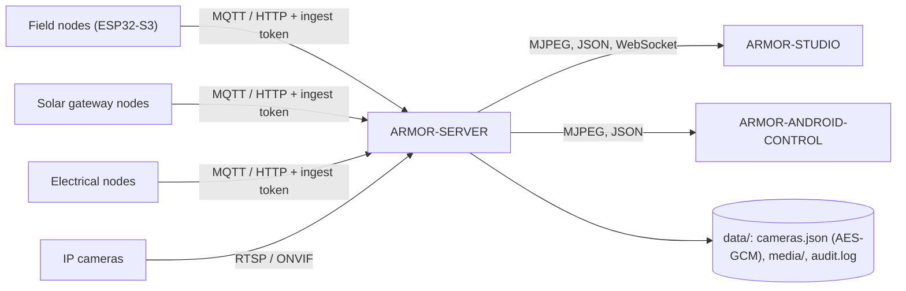

<p align="center">
  
</p>

# 🛡️ ARMOR-SERVER

<p align="center">
  🇺🇸 <b>English</b> |
  <a href="README_spa.md">🇪🇸 Español</a> |
  <a href="README_fra.md">🇫🇷 Français</a> |
  <a href="README_ita.md">🇮🇹 Italiano</a> |
  <a href="README_deu.md">🇩🇪 Deutsch</a> |
  <a href="README_zho.md">🇨🇳 简体中文</a> |
  <a href="README_jpn.md">🇯🇵 日本語</a> |
  <a href="README_por.md">🇵🇹 Português</a>
</p>

### Central security coordinator: nodes, alarms, devices, energy, cameras, the local network and the upkeep of the installation

<p align="center">
  
  
  
  
  
  
</p>

---

**Honesty check - what runs today:** Every route, session, encryption and evidence rule below is real and covered by tests (`npm test`: 510 tests, including a full HTTP integration suite against an isolated server and a check that every route is documented in the OpenAPI file). It runs in daily use on the CM5 test bench with a real MQTT broker, the firmware of a real radar node on an ESP32-S3 board, real IP cameras (live video, snapshots, recordings, PTZ on the Hi3510 units), the Studio console, the Android app and the voice and observation services. What is **not** proven yet: ONVIF against a real ONVIF camera, any Jetson hardware, the solar, electrical, alarm-panel and touch-panel routes against real nodes (they are tested with generated messages: only the radar board exists) and push through Firebase against a real Firebase project.

---

## 📋 At a glance

| | |
|---|---|
| Version | `0.7.7` |
| Maturity | Established |
| Tests | 510 (`npm test`) |
| Stack | Node.js 22+ / TypeScript / Docker Compose |
| On real hardware | The CM5 test bench, in daily use: a real MQTT broker, real IP cameras, a real radar node on an ESP32-S3 board, Studio, the Android app and the voice and observation services against it |

## 🎯 Overview

**ARMOR-SERVER** is the trusted centre of A.R.M.O.R. Field nodes publish radar, light and health observations; this service validates them, keeps the last known state of every node, and serves that state to the Studio console and the Android client. It also owns everything that touches a camera, so that **no browser and no phone ever holds a camera password or an RTSP address**.

* **Validated ingest:** HTTP and MQTT messages of every kind of node (radar, solar, electrical, alarm panel, network) are checked at the boundary by the shared contract before they reach the state; a node may have its own token (derived from the shared one) and a strict mode accepts nothing else.
* **Honest node state:** a node that stops talking is shown as *stale* and *offline* after a configurable window, never as online on old data; one that reconnects is counted from its return, not from its old messages. Disarming clears a high alert at once.
* **Camera gateway:** encrypted camera vault, ONVIF / Hi3510 / PSIA PTZ, RTSP path discovery, one shared FFmpeg relay per camera, snapshots and MP4 recording, a watchdog that turns a silent camera into an event and, while armed, an alarm, **zones of the picture to ignore** and **photos and video taken by themselves** when a camera sees something while armed.
* **Evidence library:** oldest-first retention by age and size, **protected evidence** that is never pruned, a SHA-256 for chain of custody and a **proof of custody** file signed by the server. One audit line per security-relevant action, with credentials scrubbed.
* **State that survives:** the security mode and every node's last observation are restored after a restart (a restart never silently disarms the perimeter); files are written atomically and a damaged one is recovered. Every alert, node and mode change is kept in an event history.
* **Alarms:** one alarm centre with a raised / acknowledged / cleared lifecycle, escalation of a critical alarm that waits unseen, a **check before arming** (what is open, silent or down), a PIN to disarm (and a duress PIN) and alarms from nodes, cameras, devices, solar, electrical, network and alarm panels. They reach Studio, the phones (ntfy, Telegram, Home Assistant, a signed webhook, Firebase push when you configure it) and the MQTT topic `armor/server/alert`.
* **Users and roles:** names and passwords (scrypt hashes), an `admin` role that manages users, an `operator` role that operates and a `viewer` role that only looks; a changed password or role ends that user's other sessions.
* **Devices and automations:** smoke, gas, flood, door, window, motion, climate, plug, light, siren, lock, shutter, gate and garage-door, and water-heater devices over MQTT or an authenticated push, with normalised state, availability and commands; rules that switch devices when anything happens (including threshold triggers).
* **Energy:** inverters and battery stacks (with each cell and the capacities) and electrical nodes arrive by HTTP or MQTT, are validated by the shared contract, kept with a history and a per-day energy, marked stale when silent, and raise alarms (inverter fault, battery low, grid lost, voltage, switch fault…). The electrical design and the rules for switching a circuit are kept on the server.
* **Alarm panels:** the state of the ARMOR-ALARM nodes, the **design of the alarm** kept with its versions, the **Zigbee devices tied to the zones** (the server tells a panel how a zone is while it holds the radio) and arm / disarm commands to a panel (off unless `ARMOR_ALARM_COMMANDS=1`).
* **Local network:** what the ARMOR-NETWORK node reports (devices, internet, the public address and who gives it), orders for the node (sweep, ping, ports, inspect a device with a login you give), names, hidden and watched devices, and logins that travel **sealed for the node alone**.
* **Voice, observation and the nodes' upkeep:** written and spoken commands (a closed list, in eight languages, with a confirmation bound to the person), the context for the observation service (which radars cover which camera), the firmware of the nodes updated from Studio one by one with progress, and the installation's own updates from GitHub, the system's updates and an optional root console, all through the maintenance helper.
* **Using it from outside the house:** the server tells the house from the outside (a VPN counts as the house), keeps shorter sessions from outside, asks for a second factor (an authenticator app, with recovery codes) and for the password again before critical actions, lets you choose what a session from outside may do (everything, operate the alarm only, only look), tells the places the alarms go to when someone signs in from a new place, and opens the web panel of a node through the server - pinned to the certificate of the node, with its cookie kept on the server - so that no node is ever published.
* **Optional encrypted link to the broker (mqtts):** `ARMOR_MQTT_CA_FILE` names the certificate of the installation's own authority; with an `mqtts://` address the server trusts that authority only and checks the broker's name, and it refuses to start if the file is not one valid certificate or the address is not `mqtts://`. Studio shows whether the link is encrypted and the authority's fingerprint. Tested against a TLS broker stand-in and against a real Mosquitto 2.0.
* **Node health and arming modes:** keeps the latest report and the restart log of every node and raises four warnings (low memory, restarting too often, a broker that keeps dropping, a weak Wi-Fi signal); keeps the arming profiles (Away, Home, Night and your own) and puts the chosen one inside the arm command, only for a node that says it understands them. A loud or a quiet alarm follows the profile; an arm without one is the command it always was.
* **History of connections and of the system:** besides the alerts, nodes, cameras, devices and alarms, the history records which devices and apps connect (Studio sessions, the Android app, the panels of the nodes, the voice service: sign-ins, refusals, sign-outs, expired sessions, use of the second factor, first and last seen) and the events of the system (nodes that appear or disappear with their firmware, the broker link, settings changed and by whom, services, updates, arming with its profile). It can be filtered by kind, category, client and user; the address and the user agent are shown to administrators only, and no password, token, cookie or PIN is ever recorded.

## 🧩 Role in A.R.M.O.R.

ARMOR-SERVER is the one trusted centre of the family. The field nodes ([ARMOR-RADAR](https://github.com/JuanenRac/ARMOR-RADAR), [ARMOR-SOLAR](https://github.com/JuanenRac/ARMOR-SOLAR), [ARMOR-ELECTRICAL](https://github.com/JuanenRac/ARMOR-ELECTRICAL), [ARMOR-ALARM](https://github.com/JuanenRac/ARMOR-ALARM), [ARMOR-HMI](https://github.com/JuanenRac/ARMOR-HMI)) and [ARMOR-NETWORK](https://github.com/JuanenRac/ARMOR-NETWORK) speak to it over MQTT or HTTP; [ARMOR-STUDIO](https://github.com/JuanenRac/ARMOR-STUDIO) and [ARMOR-ANDROID-CONTROL](https://github.com/JuanenRac/ARMOR-ANDROID-CONTROL) read it and give it orders; [ARMOR-SERVER-AI](https://github.com/JuanenRac/ARMOR-SERVER-AI) weighs what the cameras see against the radars and only recommends; [ARMOR-VOICE-AI](https://github.com/JuanenRac/ARMOR-VOICE-AI) turns speech into a closed list of commands; [ARMOR-DEVOPS](https://github.com/JuanenRac/ARMOR-DEVOPS) installs and updates all of it on the CM5. The server decides: nothing else arms, disarms or switches anything.

## 🔄 Architecture



## 🔒 Security model

* Separate secrets: **ingest** (the nodes post their messages; each node may also have its own token, derived from the shared one, and a strict mode accepts only those), **control** (arm / disarm, events), **operator** (automation) and the **Studio login**; each is compared in constant time and none stands in for another. A login given to a network node travels sealed for that node alone.
* Three roles: **admin**, **operator** and **viewer** (reads, never changes). Every route that configures, moves, captures, records, protects, deletes or arms needs an operator; live video needs an operator or a short-lived stream ticket tied to one camera. Dangerous commands (disarming, switching a circuit, the root console) ask for an administrator and, for disarming, the PIN.
* Camera passwords live only in `data/cameras.json`, AES-256-GCM encrypted, and no API returns them; ONVIF addresses must stay on the camera's host and redirects are refused.
* Studio sessions are HttpOnly and SameSite=Strict, login is rate limited and errors never carry a stack trace.
* The server listens on 127.0.0.1 unless `ARMOR_HOST` is set on purpose, and then a Studio password shorter than 12 characters is refused.
* From outside the house: the second factor (TOTP, RFC 6238), a new proof of identity for users, firmware and the node panels, a policy that keeps administering in the house or on the VPN, only signed firmware releases, and a proxy for node panels that never takes an address from the request, only passes what is needed and refuses a node whose certificate is not the trusted one.

## 🌐 API

* Public: `GET /healthz`. For a signed-in user: status, information, cameras, media, history, rules, devices, alarms, automations, the designs (site, alarm, electrical, network), solar and electrical readings, the local network, notifications and preferences, and for an administrator users, services, firmware, updates and the console.
* For the nodes: `POST /api/v1/telemetry`, `/health`, `/solar`, `/electrical/readings`, `/alarm/state`, `/network/state` and `/devices/state` with the ingest token, and the MQTT topics `armor/node/#`, `armor/solar/#`, `armor/electrical/#`, `armor/alarm/#` and `armor/network/#`. Events reach the consoles by the WebSocket `/api/v1/events`.
* Every route (135 paths today), its access rule and its schema is in the OpenAPI file of [ARMOR-COMMON](https://github.com/JuanenRac/ARMOR-COMMON), and a test checks that no route is missing from it.

## ⚙️ Configuration

* Copy `.env.example` to `.env` (ignored by Git), or let `run.bat` / `run.sh` generate random secrets on the first run.
* Required: `ARMOR_INGEST_TOKEN` and `ARMOR_CONTROL_TOKEN` (24 characters or more, all different) and `ARMOR_STUDIO_USERNAME` / `ARMOR_STUDIO_PASSWORD` (the first administrator).
* Common: `ARMOR_HOST` / `ARMOR_PORT`, `ARMOR_DATA_DIR`, `ARMOR_FFMPEG_PATH` (live video and capture), `ARMOR_MQTT_URL`, `ARMOR_MQTT_CA_FILE`, `ARMOR_STUDIO_ORIGIN`, `ARMOR_NODE_STALE_AFTER_S`, `ARMOR_CAMERA_CHECK_S`, `ARMOR_ALERT_DWELL_MS`, `ARMOR_ALERT_WEBHOOK_URL` and `ARMOR_COOKIE_SECURE` (set it to `1` behind TLS).
* Optional, all off by default: `ARMOR_NTFY_URL`, `ARMOR_TELEGRAM_BOT_TOKEN`, `ARMOR_HOMEASSISTANT_URL`, `ARMOR_FCM_SERVICE_ACCOUNT` (push through the installation's own Firebase project), `ARMOR_ALARM_COMMANDS=1` (let the server arm and disarm alarm panels), `ARMOR_ELECTRICAL_SWITCHING` and `ARMOR_INGEST_STRICT=1`.

## 📂 Repository Structure

```text
ARMOR-SERVER/
├── src/            server, app, config, context, store, persistence, events, contracts, rules, mqtt, mqtt_tls, audit, notify, channels,
│   │               alarms, alarm, alarm_design, alarm_commands, alarm_zone_feed, escalation, preflight, automations, users,
│   │               site, solar, solar_registry, electrical, electrical_energy, electrical_switching, network, network_commands,
│   │               firmware, installation, admin, voice, voice_actions, ai, capture_on_detect, ignore_zones, push_fcm, ...
│   ├── http/       auth, per-node tokens, sealed credentials
│   ├── routes/     sessions, users, cameras, media, ingest, history, devices, alarms, alarm, alarm_design, solar, electrical,
│   │               network, firmware, maintenance, admin, notifications, voice, ai, push, preferences, system
│   ├── devices/    catalog, registry, commands, mapping (the device model and its MQTT bridge)
│   ├── cameras/    model, vault, digest, ptz, rtsp, discovery, health, errors
│   └── media/      relay, evidence
├── tests/          510 tests: unit + full HTTP integration
├── docs/           state machine, camera gateway, integration, node firmware
├── tools/          project tooling and the CI checks
├── data/           runtime state (ignored by Git)
└── images/         brand assets
```

## 🛠️ Development Environment

**Requirements:** Node.js 22+, FFmpeg (live video and capture), an MQTT broker (Mosquitto)

```powershell
npm install
npm run typecheck   # tsc --noEmit
npm test            # 510 tests: unit + full HTTP integration (every route must be in the OpenAPI file)
npm run build       # dist/server.mjs
.\run.bat           # development server with hot reload
```

To install on the CM5 test bench (isolated from every other project, own user, own ports) see [ARMOR-DEVOPS](https://github.com/JuanenRac/ARMOR-DEVOPS).

## 🔗 Related Projects

**A.R.M.O.R.** (Autonomous Radar & Multimodal Observation Range) is a perimeter-security system made of independent repositories. Each one has its own version, its own tests and its own README; this is the family:

* **[ARMOR-COMMON](https://github.com/JuanenRac/ARMOR-COMMON)** - Message contracts, validators, conformance vectors and generated types
* **[ARMOR-RADAR](https://github.com/JuanenRac/ARMOR-RADAR)** - Field-node firmware for ESP32-S3 with three radars and its own web panel
* **[ARMOR-SOLAR](https://github.com/JuanenRac/ARMOR-SOLAR)** - Solar inverter and battery protocols and the messages of a gateway node
* **[ARMOR-ELECTRICAL](https://github.com/JuanenRac/ARMOR-ELECTRICAL)** - Electrical node: meters, the message of the network's readings and the rules for switching
* **[ARMOR-ALARM](https://github.com/JuanenRac/ARMOR-ALARM)** - Alarm node and panel: zones, arming, delays, siren and PIN, with the server or without it
* **[ARMOR-HMI](https://github.com/JuanenRac/ARMOR-HMI)** - Touch panel: the state of the system on a wall screen, arming and acknowledging, and the home of the voice assistant
* **[ARMOR-NETWORK](https://github.com/JuanenRac/ARMOR-NETWORK)** - The local network: its devices, the internet and what changes
* **ARMOR-SERVER** (this repository) - Central coordinator: telemetry, alarms, devices, solar readings and cameras
* **[ARMOR-STUDIO](https://github.com/JuanenRac/ARMOR-STUDIO)** - Web console: cameras, radar, alarms, solar energy and the 2D/3D site designer
* **[ARMOR-ANDROID-CONTROL](https://github.com/JuanenRac/ARMOR-ANDROID-CONTROL)** - Android operator client with a live 2D/3D radar
* **[ARMOR-SERVER-AI](https://github.com/JuanenRac/ARMOR-SERVER-AI)** - Visual inference policy that explains its decisions and never actuates
* **[ARMOR-VISION](https://github.com/JuanenRac/ARMOR-VISION)** - Camera zones, masks and detection rules for the Jetson Orin NX
* **[ARMOR-VOICE-AI](https://github.com/JuanenRac/ARMOR-VOICE-AI)** - Offline voice intents with a confirmation that cannot be forged
* **[ARMOR-HARDWARE](https://github.com/JuanenRac/ARMOR-HARDWARE)** - Enclosures, electronics and the bench acceptance matrix
* **[ARMOR-DEVOPS](https://github.com/JuanenRac/ARMOR-DEVOPS)** - Deployment, the CM5 test bench, backup and TLS
* **[ARMOR-SIMULATOR](https://github.com/JuanenRac/ARMOR-SIMULATOR)** - Offline telemetry simulator with repeatable faults
* **[ARMOR-UPDATER](https://github.com/JuanenRac/ARMOR-UPDATER)** - Detects, installs and updates the ecosystem's own repositories
* **[ARMOR-DOCS](https://github.com/JuanenRac/ARMOR-DOCS)** - Architecture, security baseline and the capability matrix

## 📚 Documentation & Community

Where to read more:

* [Capability matrix: what is proven and what is not](https://github.com/JuanenRac/ARMOR-DOCS/blob/main/docs/CAPABILITY_MATRIX.md)
* [Project catalogue: versions and how the repositories depend on each other](https://github.com/JuanenRac/ARMOR-DOCS/blob/main/docs/PROJECT_CATALOG.md)
* [Changelog of this repository](CHANGELOG.md)
* [License (GPL-3.0-or-later)](LICENSE)
* Questions, ideas and reports: electrohobby3d@gmail.com

## 👤 AUTHOR

**JuanenRac (Electro Hobby 3D)** · electrohobby3d@gmail.com

## 📜 LICENSE

GPL-3.0-or-later - see [LICENSE](LICENSE).
