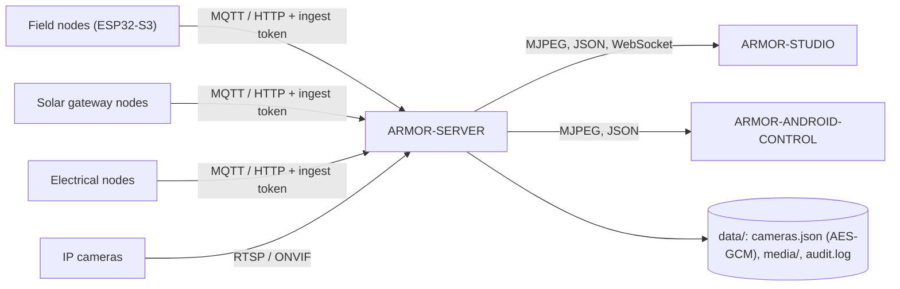

<p align="center">
  
</p>

# 🛡️ ARMOR-SERVER

<p align="center">
  🇺🇸 <b>English</b> |
  <a href="README_spa.md">🇪🇸 Español</a> |
  <a href="README_fra.md">🇫🇷 Français</a> |
  <a href="README_ita.md">🇮🇹 Italiano</a> |
  <a href="README_deu.md">🇩🇪 Deutsch</a> |
  <a href="README_zho.md">🇨🇳 简体中文</a> |
  <a href="README_jpn.md">🇯🇵 日本語</a> |
  <a href="README_por.md">🇵🇹 Português</a>
</p>

### Central security coordinator: nodes, alarms, devices, energy, cameras, the local network and the upkeep of the installation

<p align="center">
  
  
  
  
  
  
</p>

---

**Honesty check - what runs today:** Every route, session, encryption and evidence rule below is real and covered by tests (`npm test`: 700 tests, including a full HTTP integration suite against an isolated server and a check that every route is documented in the OpenAPI file). It runs in daily use on the CM5 test bench with a real MQTT broker, the firmware of a real radar node on an ESP32-S3 board, real IP cameras (live video, snapshots, recordings, PTZ on the Hi3510 units), the Studio console, the Android app and the voice and observation services. What is **not** proven yet: ONVIF against a real ONVIF camera, any Jetson hardware, the solar, electrical, alarm-panel and touch-panel routes against real nodes (they are tested with generated messages: only the radar board exists) and push through Firebase against a real Firebase project.

---

## 📋 At a glance

| | |
|---|---|
| Version | `0.8.0.6` |
| Maturity | Established |
| Role | Central security coordinator of the family: nodes, alarms, devices, energy, cameras, network |
| Stack | Node.js 22+, TypeScript, Express 5, MQTT, WebSocket, FFmpeg |
| Tests | 700 (`npm test`: unit and full HTTP integration) |
| Contract | 191 HTTP paths, 247 operations (OpenAPI in ARMOR-COMMON), route table in `docs/ROUTES.md` |
| Listens on | `127.0.0.1:8080` (`ARMOR_HOST`, `ARMOR_PORT`) |
| Runs on | The CM5 test bench (as a service, see ARMOR-DEVOPS) or any computer with Node.js |
| On real hardware | The CM5 test bench, in daily use: a real MQTT broker, real IP cameras, a real radar node on an ESP32-S3 board, Studio, the Android app and the voice and observation services against it |
| License | GPL-3.0-or-later |

**Jump to:** [Overview](#-overview) · [Architecture](#-architecture) · [Security](#-security--safety) · [Interfaces](#-interfaces) · [Configuration](#-configuration) · [Quick start](#-quick-start) · [Testing](#-testing) · [Troubleshooting](#-troubleshooting) · [Structure](#-repository-structure) · [Related](#-related-projects)

## 🚦 Project status

Each line is one part of this repository and the light says how far it is today. It is written from what the repository can show (tests, builds, runs), not from what is planned.

🟢 Done and verified · 🟡 Works, with known limits · 🟠 Partly done or not verified yet · 🔴 Not done or not working

| Area | State | What it means here |
|---|---|---|
| Software | 🟢 | The routes, sessions, encryption and evidence rules run in daily use on the CM5 test bench. |
| Tests | 🟢 | 700 tests pass (`npm test`), including a full HTTP integration suite against an isolated server and a check that every route is documented in the OpenAPI file. |
| Protocols and data | 🟡 | The radar messages come from a real board; the solar, electrical, alarm-panel and touch-panel routes are tested with generated messages, and ONVIF has not met a real ONVIF camera. |
| Hardware | 🟡 | It runs on the CM5 test bench with a real MQTT broker, real IP cameras (live video, snapshots, recordings, PTZ on the Hi3510 units) and a real radar node; nothing has run on a Jetson. |
| Security | 🟡 | The sessions, encryption, evidence and login rules are covered by tests; there has been no independent review. |
| Integration | 🟡 | Studio, the Android app and the voice and observation services use it every day on the bench; push through Firebase has never run against a real Firebase project. |
| Documentation | 🟢 | Eight languages, the route reference (OpenAPI and ROUTES), the environment and remote-access guides and the changelog are up to date. |

## 🎯 Overview

**ARMOR-SERVER** is the trusted centre of A.R.M.O.R. Field nodes publish radar, light and health observations; this service validates them, keeps the last known state of every node, and serves that state to the Studio console and the Android client. It also owns everything that touches a camera, so that **no browser and no phone ever holds a camera password or an RTSP address**.

* **Validated ingest:** HTTP and MQTT messages of every kind of node (radar, solar, electrical, alarm panel, network) are checked at the boundary by the shared contract before they reach the state; a node may have its own token (derived from the shared one) and a strict mode accepts nothing else.
* **Honest node state:** a node that stops talking is shown as *stale* and *offline* after a configurable window, never as online on old data; one that reconnects is counted from its return, not from its old messages. Disarming clears a high alert at once.
* **Camera gateway:** encrypted camera vault, ONVIF / Hi3510 / PSIA PTZ, RTSP path discovery, one shared FFmpeg relay per camera, snapshots and MP4 recording, a watchdog that turns a silent camera into an event and, while armed, an alarm, **zones of the picture to ignore** and **photos and video taken by themselves** when a camera sees something while armed.
* **Evidence library:** oldest-first retention by age and size, **protected evidence** that is never pruned, a SHA-256 for chain of custody and a **proof of custody** file signed by the server. One audit line per security-relevant action, with credentials scrubbed.
* **State that survives:** the security mode and every node's last observation are restored after a restart (a restart never silently disarms the perimeter); files are written atomically and a damaged one is recovered. Every alert, node and mode change is kept in an event history.
* **Alarms:** one alarm centre with a raised / acknowledged / cleared lifecycle, escalation of a critical alarm that waits unseen, a **check before arming** (what is open, silent or down), a PIN to disarm (and a duress PIN) and alarms from nodes, cameras, devices, solar, electrical, network and alarm panels. They reach Studio, the phones (ntfy, Telegram, Home Assistant, a signed webhook, Firebase push when you configure it) and the MQTT topic `armor/server/alert`.
* **Users and roles:** names and passwords (scrypt hashes), an `admin` role that manages users, an `operator` role that operates and a `viewer` role that only looks; a changed password or role ends that user's other sessions.
* **Devices and automations:** smoke, gas, flood, door, window, motion, climate, plug, light, siren, lock, shutter, gate and garage-door, and water-heater devices over MQTT or an authenticated push, with normalised state, availability and commands; rules that switch devices when anything happens (including threshold triggers).
* **Energy:** inverters and battery stacks (with each cell and the capacities) and electrical nodes arrive by HTTP or MQTT, are validated by the shared contract, kept with a history and a per-day energy, marked stale when silent, and raise alarms (inverter fault, battery low, grid lost, voltage, switch fault…). The electrical design and the rules for switching a circuit are kept on the server.
* **Alarm panels:** the state of the ARMOR-NODE-ALARM nodes, the **design of the alarm** kept with its versions, the **Zigbee devices tied to the zones** (the server tells a panel how a zone is while it holds the radio) and arm / disarm commands to a panel (off unless `ARMOR_ALARM_COMMANDS=1`).
* **Local network:** what the ARMOR-NETWORK node reports (devices, internet, the public address and who gives it), orders for the node (sweep, ping, ports, inspect a device with a login you give), names, hidden and watched devices, and logins that travel **sealed for the node alone**.
* **Voice, observation and the nodes' upkeep:** written and spoken commands (a closed list, in eight languages, with a confirmation bound to the person), the context for the observation service (which radars cover which camera), the firmware of the nodes updated from Studio one by one with progress, and the installation's own updates from GitHub, the system's updates and an optional root console, all through the maintenance helper.
* **Using it from outside the house:** the server tells the house from the outside (a VPN counts as the house), keeps shorter sessions from outside, asks for a second factor (an authenticator app, with recovery codes) and for the password again before critical actions, lets you choose what a session from outside may do (everything, operate the alarm only, only look), tells the places the alarms go to when someone signs in from a new place, and opens the web panel of a node through the server - pinned to the certificate of the node, with its cookie kept on the server - so that no node is ever published.
* **Optional encrypted link to the broker (mqtts):** `ARMOR_MQTT_CA_FILE` names the certificate of the installation's own authority; with an `mqtts://` address the server trusts that authority only and checks the broker's name, and it refuses to start if the file is not one valid certificate or the address is not `mqtts://`. Studio shows whether the link is encrypted and the authority's fingerprint. Tested against a TLS broker stand-in and against a real Mosquitto 2.0.
* **Node health and arming modes:** keeps the latest report and the restart log of every node and raises four warnings (low memory, restarting too often, a broker that keeps dropping, a weak Wi-Fi signal); keeps the arming profiles (Away, Home, Night and your own) and puts the chosen one inside the arm command, only for a node that says it understands them. A loud or a quiet alarm follows the profile; an arm without one is the command it always was.
* **History of connections and of the system:** besides the alerts, nodes, cameras, devices and alarms, the history records which devices and apps connect (Studio sessions, the Android app, the panels of the nodes, the voice service: sign-ins, refusals, sign-outs, expired sessions, use of the second factor, first and last seen) and the events of the system (nodes that appear or disappear with their firmware, the broker link, settings changed and by whom, services, updates, arming with its profile). It can be filtered by kind, category, client and user; the address and the user agent are shown to administrators only, and no password, token, cookie or PIN is ever recorded.
* **Orders to write to a Pylontech battery (off unless `ARMOR_BATTERY_WRITE=1`):** for administrators who have just proved who they are again - arm, execute with the battery's serial number typed again, cancel, put an output back, keep a firmware image for an hour - checked against the shared table of operations and ranges, sent to the gateway node as `solar_battery_command`, with every operation kept (who, which battery, what was read before and after, the difference and the transcript, never the service password) and told to the history under *Batteries*.
* **Control of the nodes:** `POST /api/v1/nodes/{id}/control` and `POST /api/v1/nodes/control` give one order (restart, pause, resume, standby, identify, diagnostics, maintenance on or off) to one node or to every node that reports, only for an administrator who proved themselves again a moment ago, with the node's name (or the word RESTART, PAUSE or STANDBY for all) typed again where the house would be left less guarded. The server arms the order, executes it with the one-time token the node gives for that operation, follows each node (sent, acknowledged, applied, back) in `GET /api/v1/nodes/control/operations`, restarts the alarm panels last in a rolling restart, records who ordered what in the history and the audit trail, and shows paused, standby (work off, still connected) and maintenance in the node health. There is no factory reset, no erase and no deep sleep. It is tested with a fake broker; it has not been tried on a real node.
* **Live state and a route table:** the server pushes the whole state to Studio down a WebSocket at `/api/v1/events` whenever something changes (a burst of changes is one message, and a client that falls behind is dropped), and every route it registers, with who may call it, is listed in a table generated from the code. The wall panel has its own, smaller channel at `/api/v1/panel/events` (the same few hundred bytes of summary as `GET /api/v1/panel/summary`, sent when it changes and every five seconds, for the panel, operator and administrator accounts; an administrator turns it off with `panel.live_events`).

## 🧩 Role in A.R.M.O.R.

ARMOR-SERVER is the one trusted centre of the family. The field nodes ([ARMOR-NODE-RADAR](https://github.com/JuanenRac/ARMOR-NODE-RADAR), [ARMOR-NODE-SOLAR](https://github.com/JuanenRac/ARMOR-NODE-SOLAR), [ARMOR-NODE-ELECTRICAL](https://github.com/JuanenRac/ARMOR-NODE-ELECTRICAL), [ARMOR-NODE-ALARM](https://github.com/JuanenRac/ARMOR-NODE-ALARM), [ARMOR-NODE-HMI](https://github.com/JuanenRac/ARMOR-NODE-HMI)) and [ARMOR-NETWORK](https://github.com/JuanenRac/ARMOR-NETWORK) speak to it over MQTT or HTTP; [ARMOR-STUDIO](https://github.com/JuanenRac/ARMOR-STUDIO) and [ARMOR-ANDROID-CONTROL](https://github.com/JuanenRac/ARMOR-ANDROID-CONTROL) read it and give it orders; [ARMOR-SERVER-AI](https://github.com/JuanenRac/ARMOR-SERVER-AI) weighs what the cameras see against the radars and only recommends; [ARMOR-VOICE-AI](https://github.com/JuanenRac/ARMOR-VOICE-AI) turns speech into a closed list of commands; [ARMOR-DEVOPS](https://github.com/JuanenRac/ARMOR-DEVOPS) installs and updates all of it on the CM5. The server decides: nothing else arms, disarms or switches anything.

| It talks to | How | What for |
|---|---|---|
| ARMOR-NODE-RADAR, SOLAR, ELECTRICAL, ALARM, HMI | MQTT `armor/*/#` or HTTP `POST` with the ingest token | their messages in, orders out |
| ARMOR-NETWORK | state in, orders and sealed logins out | the local network |
| ARMOR-STUDIO, ARMOR-ANDROID-CONTROL | HTTP, MJPEG and the WebSocket `/api/v1/events` | the consoles |
| ARMOR-VOICE-AI | `/v1/command`, `/v1/turn` with its own token | decides a phrase; the server acts |
| ARMOR-SERVER-AI | `ARMOR_AI_TOKEN`, `/api/v1/ai/...` | observation of the cameras |
| IP cameras | RTSP, ONVIF, Hi3510, PSIA (the server calls them) | live video, snapshots, recording, PTZ |

## 🏛️ Architecture

<p align="center">
  
</p>

<details>
<summary>Text version of the diagram (Mermaid)</summary>



</details>

## 🔒 Security & Safety

* Separate secrets: **ingest** (the nodes post their messages; each node may also have its own token, derived from the shared one, and a strict mode accepts only those), **control** (arm / disarm, events), **operator** (automation) and the **Studio login**; each is compared in constant time and none stands in for another. A login given to a network node travels sealed for that node alone.
* Three roles: **admin**, **operator** and **viewer** (reads, never changes). Every route that configures, moves, captures, records, protects, deletes or arms needs an operator; live video needs an operator or a short-lived stream ticket tied to one camera. Dangerous commands (disarming, switching a circuit, the root console) ask for an administrator and, for disarming, the PIN.
* Camera passwords live only in `data/cameras.json`, AES-256-GCM encrypted, and no API returns them; ONVIF addresses must stay on the camera's host and redirects are refused.
* Studio sessions are HttpOnly and SameSite=Strict, login is rate limited and errors never carry a stack trace.
* The server listens on 127.0.0.1 unless `ARMOR_HOST` is set on purpose, and then a Studio password shorter than 12 characters is refused.
* From outside the house: the second factor (TOTP, RFC 6238), a new proof of identity for users, firmware and the node panels, a policy that keeps administering in the house or on the VPN, only signed firmware releases, and a proxy for node panels that never takes an address from the request, only passes what is needed and refuses a node whose certificate is not the trusted one.

| Threat | Defence |
|---|---|
| Guessing the Studio password | scrypt (N=16384, r=8, p=1), the same work whether the user exists or not; 12 tries per 15 minutes per person and address, 60 per address, 40 a minute overall; under 8 characters is refused (12 when the server is reachable from the network) |
| A stolen cookie, a request from another site | HttpOnly, SameSite=Strict and Secure behind HTTPS; sessions last 7 days (Studio), 8 hours (operator) and 12 hours with 30 minutes idle from outside |
| Timing attacks and weak secrets | Secrets are compared in constant time, must have 24 characters or more and all differ (ingest, control, operator, camera key, AI, evidence key) |
| Disarming without proof | A PIN of 4 to 10 digits by `alarm.disarm_pin` (never, if_set, always); 3 wrong tries lock for 60 s, 5 min, 15 min and then 1 h, kept on disk across restarts; a duress PIN is told apart silently; the control token disarms only with `ARMOR_CONTROL_DISARM=1` |
| Camera passwords leaking | AES-256-GCM in `data/cameras.json`; no API returns them; FFmpeg goes through a local RTSP tunnel (`media.rtsp_proxy`) so the password is never on a command line; ONVIF redirects are refused |
| Live video without signing in | A stream ticket tied to one camera, issued only to an operator |
| Flooding the API | 240 requests a minute in general (node posts have their own budget of 6000 a minute); JSON bodies of 64 kB (9 MB for an installation file) |
| A false or malformed node message | Checked at the boundary by the parsers of `src/contracts.ts`, tested with the shared vectors of ARMOR-COMMON: at most 15 tracks, lux up to 200 000, a node id of letters, digits, `_` and `-`; a token per node derived from the shared one and a strict mode (`ARMOR_INGEST_STRICT=1`) |
| A session from outside the house | A second factor (`ARMOR_TOTP_REQUIRED`: off, remote, always), a policy for what it may do (`ARMOR_REMOTE_POLICY`: full, operate, view), proof of identity again for critical actions (5 minutes by default) and an alert on a sign-in from a new place |
| A node panel used as an open proxy | The address never comes from the request; HTTPS is pinned to the SHA-256 fingerprint of the node's certificate |
| Voice: silencing without checking, long text, huge audio | The policy `voice.silence_confirmation` (off, pin, double_turn) travels with every turn; confirmation tied to the person; 200 characters, 8 languages, 30 requests a minute; audio of 480 000 bytes and a reply of 200 000 bytes at most |
| Dangerous writes by mistake | Off unless `ARMOR_BATTERY_WRITE=1`, `ARMOR_ELECTRICAL_SWITCHING=1` or `ARMOR_ALARM_COMMANDS=1`, with a warning at start-up |

**Switches in Studio.** The protections that can be tuned are 13 settings kept in `security-settings.json` (mode 0600, atomic writes), each with a conservative default, and lowering one is written in the audit: `alarm.disarm_pin`, `voice.silence_confirmation`, `alarm.config_hash`, `server.zone_feed`, `server.zone_feed_signature`, `media.rtsp_proxy`, `network.login_secure_only`, `voice.multipart_turn`, `panel.live_events`, `client.device_lock`, `nodes.nvs_encryption`, `voice.turn_max_bytes` and `voice.reply_audio_max_bytes`.

**What it never does:** return a camera password, keep the words that were spoken (only the command and its result), or write a PIN, a token or a cookie in a log. There has been no independent security review.

## 🔌 Interfaces

The route table (`docs/ROUTES.md`, generated from the code) lists every route with who may call it; the OpenAPI file of ARMOR-COMMON describes 191 paths and 247 operations, and a test fails if a route is missing from it. The ones that matter most:

| Route | Auth | What it does |
|---|---|---|
| `GET /healthz` | none | alive and ready |
| `POST /api/v1/telemetry`  `/health`  `/solar`  `/electrical/readings`  `/alarm/state`  `/network/state`  `/devices/state` | ingest token | what the nodes post |
| `WS /api/v1/events` | session | the whole state, whenever something changes (a burst is one message; a client that falls behind is dropped; 1 KB at most from the client) |
| `WS /api/v1/panel/events` | panel | a smaller channel for the wall panel (128 bytes at most from the client) |
| `POST /api/v1/voice/command` | operator, 30 a minute | a written or spoken command: `{text, language, confirmation?, pin?}`; answers `{accepted, executed, intent, outcome, speech, confirmation_token?, reason?, result?}` |
| `POST /api/v1/voice/turn`  `/api/v1/voice/v1/turn` | header `X-Armor-Voice-Token` | the audio of one turn (multipart); errors `unauthorized`, `multipart_turn_disabled` (415), `audio_too_large` (413), `bad_multipart` (400), `voice_bad_reply` (502) |
| `POST /api/v1/nodes/{id}/control`  `POST /api/v1/nodes/control` | administrator who proved themselves a moment ago | one order (restart, pause, resume, standby, identify, diagnostics, maintenance) to one node or to all |
| `POST /api/v1/cameras/{id}/stream-ticket` | operator | a short-lived ticket for the live video of one camera |

* Public: `GET /healthz`. For a signed-in user: status, information, cameras, media, history, rules, devices, alarms, automations, the designs (site, alarm, electrical, network), solar and electrical readings, the local network, notifications and preferences, and for an administrator users, services, firmware, updates and the console.
* For the nodes: `POST /api/v1/telemetry`, `/health`, `/solar`, `/electrical/readings`, `/alarm/state`, `/network/state` and `/devices/state` with the ingest token, and the MQTT topics `armor/node/#`, `armor/solar/#`, `armor/electrical/#`, `armor/alarm/#` and `armor/network/#`. Events reach the consoles by the WebSocket `/api/v1/events`.

## ⚙️ Configuration

Copy `.env.example` to `.env` (ignored by Git), or let `run.bat` / `run.sh` generate random secrets on the first run. The complete list of the variables, with their ranges, is in [docs/ENVIRONMENT.md](docs/ENVIRONMENT.md) (generated from the code) and the remote-access ones in [docs/REMOTE_ACCESS.md](docs/REMOTE_ACCESS.md). The values that protect the installation are not here but in Studio (see Security).

| Setting | Default | What it does |
|---|---|---|
| `ARMOR_INGEST_TOKEN`  `ARMOR_CONTROL_TOKEN` | yes (24+ characters, all different) | what the nodes post with; what arms, disarms and reads events |
| `ARMOR_STUDIO_USERNAME`  `ARMOR_STUDIO_PASSWORD` | yes | the first administrator |
| `ARMOR_HOST`  `ARMOR_PORT` | 127.0.0.1  8080 | where it listens; a Studio password under 12 characters is refused when it is not loopback |
| `ARMOR_DATA_DIR`  `ARMOR_FFMPEG_PATH` | data/ | state folder; FFmpeg for live video and capture |
| `ARMOR_MQTT_URL`  `ARMOR_MQTT_CA_FILE` | optional | the broker; the installation's own authority for `mqtts://` (the server then trusts only it, checks the broker's name and refuses to start with a bad file) |
| `ARMOR_NODE_STALE_AFTER_S` | 30 (5-3600) | seconds of silence before a node is stale |
| `ARMOR_ALERT_DWELL_MS`  `ARMOR_ALERT_MIN_TARGETS` | 2000 (0-60000)  1 (1-20) | how long and how many targets before a radar alert |
| `ARMOR_ESCALATE_AFTER_MIN` | 0 = off (0-1440) | minutes before a critical alarm nobody sees is escalated |
| `ARMOR_MEDIA_RETENTION_DAYS`  `ARMOR_MEDIA_MAX_BYTES` | 30 (0-3650)  20 GiB | evidence kept by age and size, oldest first; protected evidence is never pruned |
| `ARMOR_STUDIO_SESSION_TTL_MS`  `ARMOR_OPERATOR_SESSION_TTL_MS`  `ARMOR_REMOTE_SESSION_TTL_MS`  `ARMOR_REMOTE_IDLE_MS`  `ARMOR_ELEVATION_MS` | 7 d  8 h  12 h  30 min  5 min | session lengths and how long a new proof of identity lasts |
| `ARMOR_TOTP_REQUIRED`  `ARMOR_REMOTE_POLICY` | off  full | second factor and what a session from outside may do |
| `ARMOR_ALERT_LANGUAGE` | es | language of the alerts (one of the eight) |
| `ARMOR_NTFY_URL`  `ARMOR_TELEGRAM_BOT_TOKEN`  `ARMOR_HOMEASSISTANT_URL`  `ARMOR_ALERT_WEBHOOK_URL`  `ARMOR_FCM_SERVICE_ACCOUNT` | off | where the alarms are sent (all off by default) |
| `ARMOR_ALARM_COMMANDS`  `ARMOR_BATTERY_WRITE`  `ARMOR_ELECTRICAL_SWITCHING`  `ARMOR_INGEST_STRICT`  `ARMOR_CONTROL_DISARM` | 0 | dangerous writes and strict modes, all off |
| `ARMOR_COOKIE_SECURE`  `ARMOR_STUDIO_ORIGIN` | - | set `1` behind TLS; the origin of Studio |

* Required: `ARMOR_INGEST_TOKEN` and `ARMOR_CONTROL_TOKEN` (24 characters or more, all different) and `ARMOR_STUDIO_USERNAME` / `ARMOR_STUDIO_PASSWORD` (the first administrator).
* Common: `ARMOR_HOST` / `ARMOR_PORT`, `ARMOR_DATA_DIR`, `ARMOR_FFMPEG_PATH` (live video and capture), `ARMOR_MQTT_URL`, `ARMOR_MQTT_CA_FILE`, `ARMOR_STUDIO_ORIGIN`, `ARMOR_NODE_STALE_AFTER_S`, `ARMOR_CAMERA_CHECK_S`, `ARMOR_ALERT_DWELL_MS`, `ARMOR_ALERT_WEBHOOK_URL` and `ARMOR_COOKIE_SECURE` (set it to `1` behind TLS).

## 🚀 Quick start

**Requirements:** Node.js 22+, FFmpeg (live video and capture), an MQTT broker (Mosquitto).

```powershell
npm install           # dependencies
npm run typecheck     # tsc --noEmit
npm test              # 700 tests: unit and full HTTP integration
npm run build         # dist/server.mjs
.\run.bat   (run.sh)  # development server with hot reload
```

To install it on the CM5 test bench (isolated from every other project, own user, own ports) see [ARMOR-DEVOPS](https://github.com/JuanenRac/ARMOR-DEVOPS).

## 🧪 Testing

```powershell
npm run typecheck  # tsc --noEmit
npm test           # tsx --test tests/*.test.ts
python -I tools/armor_ci_validate.py
```

`npm test` runs every file of `tests/` (95 files): unit tests of each module and a full HTTP integration suite against an isolated server (`tests/vertical-slice.test.ts`). `tests/conformance.test.ts` runs the shared vectors of ARMOR-COMMON and checks that **the routes the server registers are exactly the operations the OpenAPI file describes**, by method and path, and that every answer says which body it has; it is skipped when ARMOR-COMMON is not next to this repository. The TLS tests need `openssl` installed. GitHub Actions runs the A.R.M.O.R. baseline on every push and pull request: the validation of the manifest, version, changelog and README parity, then the project's own build and tests.

## 🏗️ Build & Release

`npm run build` bundles the server into `dist/server.mjs` (the `Dockerfile` builds the container image from it). The version lives in `package.json`, in `armor.project.json` and in the README badge (read from the manifest); each version has its entry in [CHANGELOG.md](CHANGELOG.md). Releases are published on GitHub.

## 🩺 Troubleshooting

| You see | Because | Do |
|---|---|---|
| `ARMOR_INGEST_TOKEN must be at least 24 characters` | a secret is missing or short | set it (24+ characters); `run.sh` can generate them |
| `... and ... must be different values` | two secrets are equal | give each its own value |
| `ARMOR_STUDIO_PASSWORD must be at least 12 characters when the server is reachable from the network` | `ARMOR_HOST` is not loopback | use a longer password, or keep `127.0.0.1` |
| `ARMOR_MQTT_CA_FILE needs an mqtts:// address in ARMOR_MQTT_URL` | the authority file is set but the broker address is not `mqtts://` | use an `mqtts://` address, or remove the file |
| `TLS_CERT_PATH and TLS_KEY_PATH must both be set` | only one of the two is set | set both for HTTPS, or neither for plain HTTP |
| `voice_unavailable`  `voice_not_answering` (503) | the voice service is not reachable | start ARMOR-VOICE-AI and check `ARMOR_VOICE_URL` and its token |

## 📂 Repository Structure

<p align="center">
  
</p>

<details>
<summary>Text version of the tree</summary>

```text
ARMOR-SERVER/
├── src/
│   ├── server.ts app.ts              start-up, Express app, rate limits
│   ├── config.ts                     every setting, checked at start-up
│   ├── contracts.ts mqtt_router.ts   validation at the boundary
│   ├── store.ts persistence.ts       node state and what survives a restart
│   ├── alarms.ts escalation.ts       alarm centre and escalation
│   ├── users.ts totp.ts              users, roles, PIN and second factor
│   ├── security_settings.ts          the 13 switches Studio changes
│   ├── voice.ts voice_turn.ts        written and spoken commands
│   ├── firmware.ts installation.ts   node firmware and own updates
│   ├── http/                         sessions, per-node tokens, sealed logins
│   ├── routes/                       one file per group of routes
│   ├── cameras/                      vault, PTZ, RTSP, discovery, health
│   ├── media/                        FFmpeg relay and evidence library
│   └── devices/                      device model and its MQTT bridge
├── tests/                            700 tests, unit and HTTP integration
├── docs/                             7 guides, route table, environment
├── tools/                            generators of docs/ROUTES.md and docs/ENVIRONMENT.md, shared CI checks, launcher
├── images/                           banner, icon and the pictures of the README
├── .github/                          CI workflow, dashboard notice, issue and pull-request templates
├── Dockerfile                        container image of the server
├── armor.project.json                manifest: version, role, maturity
├── CHANGELOG.md                      what changed in each version
├── package.json package-lock.json    dependencies and scripts
├── tsconfig.json                     TypeScript settings
├── run.sh run.bat                    start, shared workflow
├── build.sh build.bat                build and test, shared workflow
├── build-test.sh build-test.bat      build, test and package
├── test.sh test.bat                  only the tests, never the version
└── SECURITY.md SUPPORT.md CONTRIBUTING.md CODE_OF_CONDUCT.md LICENSE
```

</details>

## 🗺️ Roadmap & Known limits

**Known limits today**

* ONVIF has not met a real ONVIF camera, and nothing has run on a Jetson.
* The solar, electrical, alarm-panel and touch-panel routes are tested with generated messages: only the radar board exists.
* Push through Firebase has never run against a real Firebase project.
* The node control orders and native TLS with a public certificate have not run on a real node.
* No independent security review.

**Next**

* Try ONVIF with a real camera and the routes of the other nodes with their boards.
* Try the push through a real Firebase project.

## 🌍 Languages

README and texts exist in English, Spanish, French, Italian, German, Chinese, Japanese and European Portuguese.

## 🔗 Related Projects

**A.R.M.O.R.** (Autonomous Radar & Multimodal Observation Range) is a perimeter-security system made of independent repositories. Each one has its own version, its own tests and its own README; this is the family:

* **[ARMOR-COMMON](https://github.com/JuanenRac/ARMOR-COMMON)** - Message contracts, validators, conformance vectors and generated types
* **[ARMOR-NODE-RADAR](https://github.com/JuanenRac/ARMOR-NODE-RADAR)** - Field-node firmware for ESP32-S3 with three radars and its own web panel
* **[ARMOR-NODE-SOLAR](https://github.com/JuanenRac/ARMOR-NODE-SOLAR)** - Solar inverter and battery protocols and the messages of a gateway node
* **[ARMOR-NODE-ELECTRICAL](https://github.com/JuanenRac/ARMOR-NODE-ELECTRICAL)** - Electrical node: meters, the message of the network's readings and the rules for switching
* **[ARMOR-NODE-ALARM](https://github.com/JuanenRac/ARMOR-NODE-ALARM)** - Alarm node and panel: zones, arming, delays, siren and PIN, with the server or without it
* **[ARMOR-NODE-HMI](https://github.com/JuanenRac/ARMOR-NODE-HMI)** - Touch panel: the state of the system on a wall screen, arming and acknowledging, and the home of the voice assistant
* **[ARMOR-NETWORK](https://github.com/JuanenRac/ARMOR-NETWORK)** - The local network: its devices, the internet and what changes
* **ARMOR-SERVER** (this repository) - Central coordinator: telemetry, alarms, devices, solar readings and cameras
* **[ARMOR-STUDIO](https://github.com/JuanenRac/ARMOR-STUDIO)** - Web console: cameras, radar, alarms, solar energy and the 2D/3D site designer
* **[ARMOR-ANDROID-CONTROL](https://github.com/JuanenRac/ARMOR-ANDROID-CONTROL)** - Android operator client with a live 2D/3D radar
* **[ARMOR-IOS-CONTROL](https://github.com/JuanenRac/ARMOR-IOS-CONTROL)** - iPhone operator client
* **[ARMOR-SERVER-AI](https://github.com/JuanenRac/ARMOR-SERVER-AI)** - Visual inference policy that explains its decisions and never actuates
* **[ARMOR-VISION](https://github.com/JuanenRac/ARMOR-VISION)** - Camera zones, masks and detection rules for the Jetson Orin NX
* **[ARMOR-VOICE-AI](https://github.com/JuanenRac/ARMOR-VOICE-AI)** - Offline voice intents with a confirmation that cannot be forged
* **[ARMOR-HARDWARE](https://github.com/JuanenRac/ARMOR-HARDWARE)** - Enclosures, electronics and the bench acceptance matrix
* **[ARMOR-DEVOPS](https://github.com/JuanenRac/ARMOR-DEVOPS)** - Deployment, the CM5 test bench, backup and TLS
* **[ARMOR-SIMULATOR](https://github.com/JuanenRac/ARMOR-SIMULATOR)** - Offline telemetry simulator with repeatable faults
* **[ARMOR-UPDATER](https://github.com/JuanenRac/ARMOR-UPDATER)** - Detects, installs and updates the ecosystem's own repositories
* **[ARMOR-DOCS](https://github.com/JuanenRac/ARMOR-DOCS)** - Architecture, security baseline and the capability matrix

## 📚 Documentation

* [Route table](docs/ROUTES.md): every route and who may call it (generated)
* [Environment](docs/ENVIRONMENT.md): every variable with its range (generated)
* [Integration](docs/INTEGRATION.md): how nodes, apps and services talk to the server
* [Remote access](docs/REMOTE_ACCESS.md): second factor, policy and the house from outside
* [Camera and media gateway](docs/CAMERA_MEDIA_GATEWAY.md): the vault, PTZ, relay and evidence
* [Node firmware](docs/NODE_FIRMWARE.md): updating the nodes from Studio
* [State machine](docs/STATE_MACHINE.md): the life of a node and of an alarm
* [Capability matrix: what is proven and what is not](https://github.com/JuanenRac/ARMOR-DOCS/blob/main/docs/CAPABILITY_MATRIX.md)
* [Project catalogue: versions and how the repositories depend on each other](https://github.com/JuanenRac/ARMOR-DOCS/blob/main/docs/PROJECT_CATALOG.md)
* [Changelog of this repository](CHANGELOG.md)

## 🤝 Contributing & Community

* Before a pull request run `python -I tools/armor_ci_validate.py` and the tests: both must pass. See [CONTRIBUTING.md](CONTRIBUTING.md) and the [code of conduct](CODE_OF_CONDUCT.md).
* The README exists in eight languages and is generated from the sources in ARMOR-DOCS: a change to the text is made there.
* A change to a message between components starts in ARMOR-COMMON.
* Do not describe as working on a board what has only been built.
* Report a vulnerability privately: [SECURITY.md](SECURITY.md). Questions, ideas and reports: electrohobby3d@gmail.com ([SUPPORT.md](SUPPORT.md)).

## 👤 AUTHOR

**JuanenRac (Electro Hobby 3D)** · electrohobby3d@gmail.com

## 📜 LICENSE

GPL-3.0-or-later - see [LICENSE](LICENSE).
