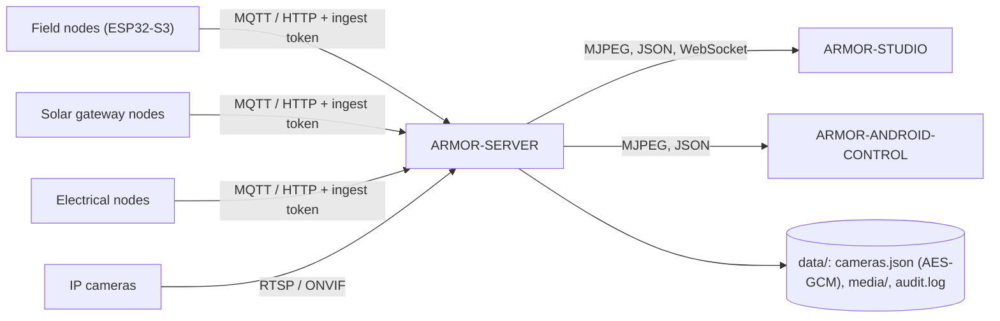

<p align="center">
  
</p>

# 🛡️ ARMOR-SERVER

<p align="center">
  <a href="README.md">🇺🇸 English</a> |
  <a href="README_spa.md">🇪🇸 Español</a> |
  <a href="README_fra.md">🇫🇷 Français</a> |
  <a href="README_ita.md">🇮🇹 Italiano</a> |
  🇩🇪 <b>Deutsch</b> |
  <a href="README_zho.md">🇨🇳 简体中文</a> |
  <a href="README_jpn.md">🇯🇵 日本語</a> |
  <a href="README_por.md">🇵🇹 Português</a>
</p>

### Zentraler Sicherheitskoordinator: Knoten, Alarme, Geräte, Energie, Kameras, das lokale Netz und die Wartung der Anlage

<p align="center">
  
  
  
  
  
  
</p>

---

**Ehrlichkeitsprüfung - was heute läuft:** Jede Route, Sitzung, Verschlüsselung und Beweisregel unten ist real und durch Tests abgedeckt (`npm test`: 724 Tests, darunter eine vollständige HTTP-Integrationssuite gegen einen isolierten Server und eine Prüfung, dass jede Route in der OpenAPI-Datei dokumentiert ist). Er läuft im täglichen Einsatz auf dem CM5-Testaufbau mit einem echten MQTT-Broker, der Firmware eines echten Radarknotens auf einer ESP32-S3-Platine, echten IP-Kameras (Livevideo, Schnappschüsse, Aufnahmen, PTZ an den Hi3510-Geräten), der Studio-Konsole, der Android-App sowie den Sprach- und Beobachtungsdiensten. Was **noch nicht** bewiesen ist: ONVIF mit einer echten ONVIF-Kamera, jegliche Jetson-Hardware, die Solar-, Elektro-, Alarmzentralen- und Touchpanel-Routen mit echten Knoten (sie werden mit erzeugten Nachrichten getestet: nur die Radarplatine existiert) und Push über Firebase mit einem echten Firebase-Projekt.

---

## 📋 Auf einen Blick

| | |
|---|---|
| Version | `0.8.0.8` |
| Reifegrad | Etabliert |
| Rolle | Zentraler Sicherheitskoordinator der Familie: Knoten, Alarme, Geräte, Energie, Kameras, Netzwerk |
| Technik | Node.js 22+, TypeScript, Express 5, MQTT, WebSocket, FFmpeg |
| Tests | 724 (`npm test`: Unit und volle HTTP-Integration) |
| Vertrag | 191 HTTP-Pfade, 247 Operationen (OpenAPI in ARMOR-COMMON), Routentabelle in `docs/ROUTES.md` |
| Lauscht auf | `127.0.0.1:8080` (`ARMOR_HOST`, `ARMOR_PORT`) |
| Läuft auf | Der CM5-Prüfstand (als Dienst, siehe ARMOR-DEVOPS) oder jeder Computer mit Node.js |
| Auf echter Hardware | Der CM5-Testaufbau im täglichen Einsatz: ein echter MQTT-Broker, echte IP-Kameras, ein echter Radarknoten auf einer ESP32-S3-Platine, Studio, die Android-App und die Sprach- und Beobachtungsdienste daran |
| Lizenz | GPL-3.0-or-later |

**Springe zu:** [Überblick](#-überblick) · [Architektur](#-architektur) · [Sicherheit](#-sicherheit-und-schutz) · [Schnittstellen](#-schnittstellen) · [Konfiguration](#-konfiguration) · [Schnellstart](#-schnellstart) · [Tests](#-tests) · [Probleme](#-fehlerbehebung) · [Struktur](#-struktur-des-repositorys) · [Verwandte](#-verwandte-projekte)

## 🚦 Projektstatus

Jede Zeile ist ein Teil dieses Repositorys, und die Ampel sagt, wie weit er heute ist. Sie beruht auf dem, was das Repository zeigen kann (Tests, Builds, Läufe), nicht auf dem, was geplant ist.

🟢 Fertig und überprüft · 🟡 Funktioniert, mit bekannten Grenzen · 🟠 Teilweise fertig oder noch nicht überprüft · 🔴 Nicht gemacht oder funktioniert nicht

| Bereich | Stand | Was das hier bedeutet |
|---|---|---|
| Software | 🟢 | Die Routen, Sitzungen, Verschlüsselung und Beweisregeln laufen täglich auf dem CM5-Prüfstand. |
| Tests | 🟢 | 724 Tests bestehen (`npm test`), darunter eine vollständige HTTP-Integrationssuite gegen einen isolierten Server und eine Prüfung, dass jede Route in der OpenAPI-Datei dokumentiert ist. |
| Protokolle und Daten | 🟡 | Die Radar-Nachrichten stammen von einer echten Platine; die Routen für Solar, Elektrik, Alarmzentrale und Touch-Panel sind mit erzeugten Nachrichten getestet, und ONVIF ist keiner echten ONVIF-Kamera begegnet. |
| Hardware | 🟡 | Er läuft auf dem CM5-Prüfstand mit einem echten MQTT-Broker, echten IP-Kameras (Live-Video, Standbilder, Aufnahmen, PTZ an den Hi3510-Geräten) und einem echten Radar-Knoten; auf einem Jetson lief nichts. |
| Sicherheit | 🟡 | Die Regeln für Sitzungen, Verschlüsselung, Beweise und Anmeldung sind durch Tests abgedeckt; es gab keine unabhängige Prüfung. |
| Integration | 🟡 | Studio, die Android-App und die Sprach- und Beobachtungsdienste nutzen ihn täglich auf dem Prüfstand; Push über Firebase lief nie gegen ein echtes Firebase-Projekt. |
| Dokumentation | 🟢 | Acht Sprachen, die Routenreferenz (OpenAPI und ROUTES), die Anleitungen zu Umgebung und Fernzugriff und das Änderungsprotokoll sind aktuell. |

## 🎯 Überblick

**ARMOR-SERVER** ist das vertrauenswürdige Zentrum von A.R.M.O.R. Feldknoten veröffentlichen Radar-, Licht- und Zustandsbeobachtungen; dieser Dienst validiert sie, hält den letzten bekannten Zustand jedes Knotens und stellt ihn der Studio-Konsole und dem Android-Client bereit. Er besitzt auch alles, was eine Kamera berührt, sodass **kein Browser und kein Telefon je ein Kamerapasswort oder eine RTSP-Adresse hält**.

* **Geprüfter Eingang:** HTTP- und MQTT-Nachrichten jeder Knotenart (Radar, Solar, Elektro, Alarmzentrale, Netzwerk) werden an der Grenze vom gemeinsamen Vertrag geprüft, bevor sie den Zustand erreichen; ein Knoten kann ein eigenes Token haben (vom gemeinsamen abgeleitet), und ein strenger Modus akzeptiert nichts anderes.
* **Ehrlicher Knotenzustand:** ein Knoten, der verstummt, wird nach einem einstellbaren Fenster als *veraltet* und *offline* angezeigt, nie als online mit alten Daten; ein sich wieder verbindender wird ab seiner Rückkehr gezählt, nicht ab seinen alten Nachrichten. Unscharfschalten löscht einen hohen Alarm sofort.
* **Kamera-Gateway:** verschlüsselter Kamera-Tresor, PTZ per ONVIF / Hi3510 / PSIA, RTSP-Pfadsuche, ein gemeinsames FFmpeg-Relay pro Kamera, Schnappschüsse und MP4-Aufnahme, ein Wächter, der eine stumme Kamera zu einem Ereignis und, wenn scharf, zu einem Alarm macht, **zu ignorierende Bildzonen** und **von selbst gemachte Fotos und Videos**, wenn eine Kamera im scharfen Zustand etwas sieht.
* **Beweisbibliothek:** Aufbewahrung nach Alter und Größe, **geschützte Beweise**, die nie gelöscht werden, ein SHA-256 für die Beweiskette und eine vom Server signierte **Verwahrungsnachweis**-Datei. Eine Audit-Zeile pro sicherheitsrelevanter Aktion, mit entfernten Zugangsdaten.
* **Zustand, der überlebt:** der Sicherheitsmodus und die letzte Beobachtung jedes Knotens werden nach einem Neustart wiederhergestellt (ein Neustart schaltet den Perimeter nie stillschweigend unscharf); Dateien werden atomar geschrieben und eine beschädigte wird wiederhergestellt. Jede Alarm-, Knoten- und Moduswechsel steht in einem Ereignisverlauf.
* **Alarme:** eine Alarmzentrale mit Lebenslauf ausgelöst / quittiert / beendet, Eskalation eines kritischen Alarms, der ungesehen wartet, eine **Prüfung vor dem Scharfschalten** (was offen, stumm oder ausgefallen ist), eine PIN zum Unscharfschalten (und eine Nötigungs-PIN) sowie Alarme von Knoten, Kameras, Geräten, Solar, Elektro, Netzwerk und Alarmzentralen. Sie erreichen Studio, die Telefone (ntfy, Telegram, Home Assistant, einen signierten Webhook, Firebase-Push bei Konfiguration) und das MQTT-Thema `armor/server/alert`.
* **Benutzer und Rollen:** Namen und Passwörter (scrypt-Hashes), eine Rolle `admin`, die Benutzer verwaltet, eine Rolle `operator`, die bedient, und eine Rolle `viewer`, die nur ansieht; ein geändertes Passwort oder eine geänderte Rolle beendet die anderen Sitzungen dieses Benutzers.
* **Geräte und Automationen:** Rauch, Gas, Wasser, Tür, Fenster, Bewegung, Klima, Steckdose, Licht, Sirene, Schloss, Rollladen, Tor oder Garagentor und Warmwasserbereiter über MQTT oder authentifizierten Push, mit normalisiertem Zustand, Verfügbarkeit und Befehlen; Regeln, die Geräte schalten, wenn etwas geschieht (auch per Schwellwert).
* **Energie:** Wechselrichter und Batteriestapel (mit jeder Zelle und den Kapazitäten) sowie Elektroknoten kommen per HTTP oder MQTT, werden vom gemeinsamen Vertrag geprüft, mit Verlauf und Energie pro Tag gespeichert, bei Schweigen als veraltet markiert und lösen Alarme aus (Wechselrichterfehler, Batterie schwach, Netz verloren, Spannung, Schaltfehler…). Der Elektroplan und die Regeln zum Schalten eines Stromkreises liegen auf dem Server.
* **Alarmzentralen:** der Zustand der ARMOR-NODE-ALARM-Knoten, der **Alarmplan** mit seinen Versionen, die **den Zonen zugeordneten Zigbee-Geräte** (der Server sagt einer Zentrale, wie eine Zone ist, solange er das Funkmodul hält) und Scharf-/Unscharf-Befehle an eine Zentrale (aus, außer mit `ARMOR_ALARM_COMMANDS=1`).
* **Lokales Netz:** was der ARMOR-NETWORK-Knoten meldet (Geräte, Internet, die öffentliche Adresse und wer sie liefert), Aufträge für den Knoten (Scan, Ping, Ports, ein Gerät mit einem von Ihnen gegebenen Login prüfen), Namen, versteckte und beobachtete Geräte sowie Zugangsdaten, die **nur für den Knoten versiegelt** reisen.
* **Sprache, Beobachtung und Wartung:** geschriebene und gesprochene Befehle (geschlossene Liste, in acht Sprachen, mit einer an die Person gebundenen Bestätigung), der Kontext für den Beobachtungsdienst (welche Radare welche Kamera abdecken), die Firmware der Knoten, von Studio aus nacheinander mit Fortschritt aktualisiert, sowie die Updates der Anlage selbst von GitHub, die des Systems und eine optionale Root-Konsole, alles über den Wartungshelfer.
* **Nutzung von außerhalb des Hauses:** Der Server unterscheidet das Haus vom Außen (ein VPN zählt als Haus), hält Sitzungen von außen kürzer, verlangt einen zweiten Faktor (Authenticator-App, mit Wiederherstellungscodes) und vor kritischen Aktionen erneut das Passwort, lässt wählen, was eine Sitzung von außen darf (alles, nur den Alarm bedienen, nur ansehen), meldet den Alarmzielen, wenn sich jemand von einem neuen Ort anmeldet, und öffnet das Web-Panel eines Knotens über den Server - an das Zertifikat des Knotens gebunden, mit seinem Cookie auf dem Server -, sodass nie ein Knoten veröffentlicht wird.
* **Optionale verschlüsselte Verbindung zum Broker (mqtts):** `ARMOR_MQTT_CA_FILE` nennt das Zertifikat der eigenen Zertifizierungsstelle der Anlage; bei einer `mqtts://`-Adresse vertraut der Server nur dieser Stelle und prüft den Namen des Brokers, und er startet nicht, wenn die Datei kein gültiges Zertifikat ist oder die Adresse nicht `mqtts://` lautet. Studio zeigt, ob die Verbindung verschlüsselt ist, und den Fingerabdruck der Stelle. Getestet gegen einen TLS-Broker-Ersatz und gegen einen echten Mosquitto 2.0.
* **Zustand der Knoten und Scharfschaltmodi:** speichert den letzten Bericht und das Neustartprotokoll jedes Knotens und löst vier Warnungen aus (wenig Speicher, zu häufige Neustarts, ein Broker, der immer wieder abreißt, schwaches WLAN-Signal); verwaltet die Scharfschaltprofile (Abwesend, Zuhause, Nacht und eigene) und legt das gewählte in den Scharfschaltbefehl, nur für einen Knoten, der sie versteht. Ein lauter oder leiser Alarm folgt dem Profil; ein Scharfschalten ohne Profil ist der Befehl wie immer.
* **Verlauf der Verbindungen und des Systems:** Neben Warnungen, Knoten, Kameras, Geräten und Alarmen zeichnet der Verlauf auf, welche Geräte und Apps sich verbinden (Studio-Sitzungen, die Android-App, die Panels der Knoten, der Sprachdienst: Anmeldungen, Ablehnungen, Abmeldungen, abgelaufene Sitzungen, Nutzung des zweiten Faktors, erste und letzte Sichtung) und die Ereignisse des Systems (Knoten, die mit ihrer Firmware auftauchen oder verschwinden, die Broker-Verbindung, geänderte Einstellungen und von wem, Dienste, Updates, Scharfschalten mit Profil). Filter nach Art, Kategorie, Client und Benutzer; Adresse und User-Agent sehen nur Administratoren, und nie wird ein Passwort, Token, Cookie oder PIN aufgezeichnet.
* **Befehle zum Schreiben auf eine Pylontech-Batterie (aus, außer mit `ARMOR_BATTERY_WRITE=1`):** für Administratoren, die sich eben erneut ausgewiesen haben - vorbereiten, mit nochmals eingetippter Seriennummer der Batterie ausführen, abbrechen, einen Ausgang zurücksetzen, ein Firmware-Image eine Stunde lang aufbewahren - geprüft an der gemeinsamen Tabelle der Operationen und Bereiche, als `solar_battery_command` an den Gateway-Knoten gesendet; jede Operation wird festgehalten (wer, welche Batterie, was davor und danach gelesen wurde, der Unterschied und das Protokoll, nie das Service-Passwort) und im Verlauf unter *Batterien* gemeldet.
* **Steuerung der Knoten:** `POST /api/v1/nodes/{id}/control` und `POST /api/v1/nodes/control` erteilen einen Befehl (Neustart, Pause, Fortsetzen, Standby, Identifizieren, Diagnose, Wartung ein oder aus) an einen Knoten oder an alle, die sich melden, nur für einen Administrator, der sich gerade erneut ausgewiesen hat, wobei der Name des Knotens (oder das Wort RESTART, PAUSE oder STANDBY für alle) dort erneut getippt wird, wo das Haus weniger bewacht wäre. Der Server bereitet den Befehl vor, führt ihn mit dem Einmal-Token aus, das der Knoten für diese Operation gibt, verfolgt jeden Knoten (gesendet, bestätigt, angewendet, zurück) in `GET /api/v1/nodes/control/operations`, startet bei einem gestaffelten Neustart die Alarmzentralen zuletzt neu, hält im Verlauf und im Audit-Protokoll fest, wer was befohlen hat, und zeigt Pause, Standby (Arbeit aus, bleibt verbunden) und Wartung im Knotenzustand. Es gibt kein Zurücksetzen auf Werkseinstellungen, kein Löschen und keinen Tiefschlaf. Getestet mit einem Schein-Broker; auf einem echten Knoten wurde es nicht ausprobiert.
* **Live-Zustand und Routentabelle:** Der Server schickt den gesamten Zustand über einen WebSocket unter `/api/v1/events` an Studio, sobald sich etwas ändert (eine Folge von Änderungen ist eine einzige Nachricht, ein zurückfallender Client wird fallen gelassen), und jede registrierte Route mit der Angabe, wer sie aufrufen darf, steht in einer aus dem Code erzeugten Tabelle. Das Wandpanel hat einen eigenen, kleineren Kanal unter `/api/v1/panel/events` (dieselbe Zusammenfassung von wenigen hundert Bytes wie `GET /api/v1/panel/summary`, gesendet bei Änderung und alle fünf Sekunden, für die Konten Panel, Operator und Administrator; ein Administrator schaltet ihn mit `panel.live_events` ab).

## 🧩 Rolle in A.R.M.O.R.

ARMOR-SERVER ist das eine vertrauenswürdige Zentrum der Familie. Die Feldknoten ([ARMOR-NODE-RADAR](https://github.com/JuanenRac/ARMOR-NODE-RADAR), [ARMOR-NODE-SOLAR](https://github.com/JuanenRac/ARMOR-NODE-SOLAR), [ARMOR-NODE-ELECTRICAL](https://github.com/JuanenRac/ARMOR-NODE-ELECTRICAL), [ARMOR-NODE-ALARM](https://github.com/JuanenRac/ARMOR-NODE-ALARM), [ARMOR-NODE-HMI](https://github.com/JuanenRac/ARMOR-NODE-HMI)) und [ARMOR-NETWORK](https://github.com/JuanenRac/ARMOR-NETWORK) sprechen per MQTT oder HTTP mit ihm; [ARMOR-STUDIO](https://github.com/JuanenRac/ARMOR-STUDIO) und [ARMOR-ANDROID-CONTROL](https://github.com/JuanenRac/ARMOR-ANDROID-CONTROL) lesen es und geben ihm Befehle; [ARMOR-SERVER-AI](https://github.com/JuanenRac/ARMOR-SERVER-AI) wägt ab, was die Kameras sehen, gegen die Radare und empfiehlt nur; [ARMOR-VOICE-AI](https://github.com/JuanenRac/ARMOR-VOICE-AI) macht aus Sprache eine geschlossene Liste von Befehlen; [ARMOR-DEVOPS](https://github.com/JuanenRac/ARMOR-DEVOPS) installiert und aktualisiert alles auf dem CM5. Der Server entscheidet: nichts sonst schaltet scharf, unscharf oder irgendetwas.

| Er spricht mit | Wie | Wozu |
|---|---|---|
| ARMOR-NODE-RADAR, SOLAR, ELECTRICAL, ALARM, HMI | MQTT `armor/*/#` oder HTTP `POST` mit dem Ingest-Token | ihre Nachrichten hinein, Befehle hinaus |
| ARMOR-NETWORK | Zustand hinein, Aufträge und versiegelte Logins hinaus | das lokale Netz |
| ARMOR-STUDIO, ARMOR-ANDROID-CONTROL | HTTP, MJPEG und der WebSocket `/api/v1/events` | die Konsolen |
| ARMOR-VOICE-AI | `/v1/command`, `/v1/turn` mit eigenem Token | entscheidet über einen Satz; der Server handelt |
| ARMOR-SERVER-AI | `ARMOR_AI_TOKEN`, `/api/v1/ai/...` | Beobachtung der Kameras |
| IP-Kameras | RTSP, ONVIF, Hi3510, PSIA (der Server ruft sie auf) | Live-Video, Standbilder, Aufnahme, PTZ |

## 🏛️ Architektur

<p align="center">
  
</p>

<details>
<summary>Textversion des Diagramms (Mermaid)</summary>



</details>

## 🔒 Sicherheit und Schutz

* Getrennte Geheimnisse: **ingest** (die Knoten senden ihre Nachrichten; jeder Knoten kann außerdem ein eigenes, vom gemeinsamen abgeleitetes Token haben, und ein strenger Modus akzeptiert nur diese), **control** (scharf / unscharf, Ereignisse), **operator** (Automation) und das **Studio-Login**; jedes wird in konstanter Zeit verglichen, und keines ersetzt ein anderes. Ein einem Netzwerkknoten gegebener Login reist nur für diesen Knoten versiegelt.
* Drei Rollen: **admin**, **operator** und **viewer** (liest, ändert nie). Jede Route, die konfiguriert, bewegt, aufnimmt, aufzeichnet, schützt, löscht oder scharf schaltet, braucht einen Operator; Livevideo braucht einen Operator oder ein kurzlebiges Stream-Ticket für eine Kamera. Gefährliche Befehle (Unscharfschalten, einen Stromkreis schalten, die Root-Konsole) verlangen einen Administrator und zum Unscharfschalten die PIN.
* Kamerapasswörter liegen nur in `data/cameras.json`, mit AES-256-GCM verschlüsselt, und keine API gibt sie zurück; ONVIF-Adressen müssen auf dem Host der Kamera bleiben, und Weiterleitungen werden abgelehnt.
* Studio-Sitzungen sind HttpOnly und SameSite=Strict, das Login ist ratenbegrenzt, und Fehler tragen nie einen Stacktrace.
* Der Server lauscht auf 127.0.0.1, außer `ARMOR_HOST` wird absichtlich gesetzt; dann wird ein Studio-Passwort unter 12 Zeichen abgelehnt.
* Von außerhalb des Hauses: zweiter Faktor (TOTP, RFC 6238), ein neuer Identitätsnachweis für Benutzer, Firmware und Knoten-Panels, eine Richtlinie, die Verwaltung nur im Haus oder über das VPN erlaubt, nur signierte Firmware-Releases und ein Proxy für Knoten-Panels, der nie eine Adresse aus der Anfrage übernimmt, nur das Nötige weiterreicht und einen Knoten ablehnt, dessen Zertifikat nicht das vertrauenswürdige ist.

| Bedrohung | Abwehr |
|---|---|
| Erraten des Studio-Passworts | scrypt (N=16384, r=8, p=1), gleicher Aufwand, ob der Benutzer existiert oder nicht; 12 Versuche je 15 Minuten je Person und Adresse, 60 je Adresse, 40 pro Minute insgesamt; unter 8 Zeichen wird abgelehnt (12, wenn der Server aus dem Netz erreichbar ist) |
| Ein gestohlenes Cookie, eine Anfrage von einer anderen Seite | HttpOnly, SameSite=Strict und Secure hinter HTTPS; Sitzungen dauern 7 Tage (Studio), 8 Stunden (Bediener) und 12 Stunden mit 30 Minuten Leerlauf von außen |
| Zeitangriffe und schwache Geheimnisse | Geheimnisse werden zeitkonstant verglichen, brauchen mindestens 24 Zeichen und müssen alle verschieden sein (Ingest, Steuerung, Bediener, Kameraschlüssel, KI, Beweisschlüssel) |
| Entschärfen ohne Nachweis | Eine PIN mit 4 bis 10 Ziffern gemäß `alarm.disarm_pin` (never, if_set, always); 3 Fehlversuche sperren 60 s, 5 min, 15 min, dann 1 h, auf Platte über Neustarts gespeichert; eine Zwangs-PIN wird still erkannt; das Steuer-Token entschärft nur mit `ARMOR_CONTROL_DISARM=1` |
| Kennwörter der Kameras gelangen nach außen | AES-256-GCM in `data/cameras.json`; keine API gibt sie zurück; FFmpeg läuft über einen lokalen RTSP-Tunnel (`media.rtsp_proxy`), damit das Kennwort nie in der Kommandozeile steht; ONVIF-Weiterleitungen werden abgelehnt |
| Live-Video ohne Anmeldung | Ein Stream-Ticket für genau eine Kamera, nur an Bediener ausgestellt |
| Überfluten der API | allgemein 240 Anfragen pro Minute (Knoten-POSTs haben ein eigenes Budget von 6000 pro Minute); JSON-Inhalte bis 64 kB (9 MB für eine Installationsdatei) |
| Eine falsche oder fehlerhafte Knotennachricht | An der Grenze von den Parsern in `src/contracts.ts` geprüft, getestet mit den gemeinsamen Vektoren von ARMOR-COMMON: höchstens 15 Spuren, Lux bis 200 000, eine Knoten-ID aus Buchstaben, Ziffern, `_` und `-`; ein Token je Knoten, vom gemeinsamen abgeleitet, und ein strenger Modus (`ARMOR_INGEST_STRICT=1`) |
| Eine Sitzung von außerhalb des Hauses | Zweiter Faktor (`ARMOR_TOTP_REQUIRED`: off, remote, always), eine Richtlinie, was sie darf (`ARMOR_REMOTE_POLICY`: full, operate, view), erneuter Identitätsnachweis bei kritischen Aktionen (standardmäßig 5 Minuten) und ein Hinweis bei Anmeldung von einem neuen Ort |
| Ein Knoten-Panel als offener Proxy | Die Adresse stammt nie aus der Anfrage; HTTPS ist an den SHA-256-Fingerabdruck des Knotenzertifikats gebunden |
| Sprache: Stummschalten ohne Prüfung, langer Text, riesiges Audio | Die Richtlinie `voice.silence_confirmation` (off, pin, double_turn) reist mit jedem Turn; Bestätigung an die Person gebunden; 200 Zeichen, 8 Sprachen, 30 Anfragen pro Minute; Audio höchstens 480 000 Bytes, Antwort höchstens 200 000 Bytes |
| Gefährliche Schreibzugriffe aus Versehen | Aus, außer mit `ARMOR_BATTERY_WRITE=1`, `ARMOR_ELECTRICAL_SWITCHING=1` oder `ARMOR_ALARM_COMMANDS=1`, mit Warnung beim Start |

**Schalter in Studio.** Die einstellbaren Schutzmaßnahmen sind 15 Werte in `security-settings.json` (Modus 0600, atomares Schreiben), jeweils mit konservativem Standard; das Absenken eines Werts landet im Audit: `alarm.disarm_pin`, `voice.silence_confirmation`, `alarm.config_hash`, `server.zone_feed`, `server.zone_feed_signature`, `media.rtsp_proxy`, `network.login_secure_only`, `voice.multipart_turn`, `panel.live_events`, `client.device_lock`, `nodes.nvs_encryption`, `alarm_audio.spoken`, `alarm_audio.custom_sounds`, `voice.turn_max_bytes` und `voice.reply_audio_max_bytes`.

**Was es nie tut:** ein Kamerakennwort zurückgeben, das Gesprochene speichern (nur Befehl und Ergebnis) oder eine PIN, ein Token oder ein Cookie in ein Protokoll schreiben. Eine unabhängige Sicherheitsprüfung gab es nicht.

## 🔌 Schnittstellen

Die Routentabelle (`docs/ROUTES.md`, aus dem Code erzeugt) listet jede Route mit den Berechtigten; die OpenAPI-Datei von ARMOR-COMMON beschreibt 191 Pfade und 247 Operationen, und ein Test schlägt fehl, wenn eine Route fehlt. Die wichtigsten:

| Route | Authentifizierung | Was sie tut |
|---|---|---|
| `GET /healthz` | keine | lebt und ist bereit |
| `POST /api/v1/telemetry`  `/health`  `/solar`  `/electrical/readings`  `/alarm/state`  `/network/state`  `/devices/state` | Ingest-Token | was die Knoten senden |
| `WS /api/v1/events` | Sitzung | der ganze Zustand bei jeder Änderung (ein Schwung ist eine Nachricht; ein zurückfallender Client wird getrennt; höchstens 1 KB vom Client) |
| `WS /api/v1/panel/events` | Panel | ein kleinerer Kanal für das Wandpanel (höchstens 128 Bytes vom Client) |
| `POST /api/v1/voice/command` | Bediener, 30 pro Minute | ein geschriebener oder gesprochener Befehl: `{text, language, confirmation?, pin?}`; Antwort `{accepted, executed, intent, outcome, speech, confirmation_token?, reason?, result?}` |
| `POST /api/v1/voice/turn`  `/api/v1/voice/v1/turn` | Header `X-Armor-Voice-Token` | das Audio eines Turns (Multipart); Fehler `unauthorized`, `multipart_turn_disabled` (415), `audio_too_large` (413), `bad_multipart` (400), `voice_bad_reply` (502) |
| `GET /api/v1/alarm-audio` | Operator | was der Ton der Alarme bietet: die zwei Optionen (standardmäßig aus), ob ein Sprach-Gateway eingerichtet ist, die Grenzen und die gespeicherten Töne |
| `GET /api/v1/alarm-audio/spoken` | Operator oder das Konto eines Wandpanels | ein laut gesprochener Alarm (Herkunft, Schweregrad, Alarmcode; rohes 16-kHz-16-Bit-Mono-PCM mit SHA-256), vom Sprach-Gateway erzeugt und in einem Cache gehalten; 404 `spoken_alarms_disabled`, solange die Option aus ist |
| `GET` `PUT` `DELETE /api/v1/alarm-audio/sounds/{source}` | GET: Operator oder das Konto eines Wandpanels; PUT und DELETE: Administrator (von außerhalb des Hauses mit erneutem Identitätsnachweis) | der Ton einer Alarmherkunft: eine WAVE-Datei mit 16-kHz-16-Bit-Mono-PCM, Byte für Byte gelesen (eine Zehntelsekunde bis `ARMOR_ALARM_SOUND_MAX_BYTES`, keine Stille), nur die Samples werden gespeichert, ausgeliefert mit SHA-256; 409 `custom_sounds_disabled`, solange die Option aus ist |
| `POST /api/v1/nodes/{id}/control`  `POST /api/v1/nodes/control` | Administrator, der sich eben erneut ausgewiesen hat | ein Befehl (Neustart, Pause, Fortsetzen, Standby, Identifizieren, Diagnose, Wartung) an einen Knoten oder alle |
| `POST /api/v1/cameras/{id}/stream-ticket` | Bediener | ein kurzlebiges Ticket für das Live-Video einer Kamera |

* Öffentlich: `GET /healthz`. Für einen angemeldeten Benutzer: Status, Informationen, Kameras, Medien, Verlauf, Regeln, Geräte, Alarme, Automationen, die Pläne (Standort, Alarm, Elektro, Netzwerk), Solar- und Elektrowerte, das lokale Netz, Benachrichtigungen und Einstellungen und für einen Administrator Benutzer, Dienste, Firmware, Updates und die Konsole.
* Für die Knoten: `POST /api/v1/telemetry`, `/health`, `/solar`, `/electrical/readings`, `/alarm/state`, `/network/state` und `/devices/state` mit dem Ingest-Token sowie die MQTT-Themen `armor/node/#`, `armor/solar/#`, `armor/electrical/#`, `armor/alarm/#` und `armor/network/#`. Ereignisse erreichen die Konsolen über den WebSocket `/api/v1/events`.

## ⚙️ Konfiguration

`.env.example` nach `.env` kopieren (von Git ignoriert) oder `run.bat` / `run.sh` beim ersten Start zufällige Geheimnisse erzeugen lassen. Die vollständige Liste der Variablen mit Bereichen steht in [docs/ENVIRONMENT.md](docs/ENVIRONMENT.md) (aus dem Code erzeugt), die des Fernzugriffs in [docs/REMOTE_ACCESS.md](docs/REMOTE_ACCESS.md). Die Werte, die die Installation schützen, stehen nicht hier, sondern in Studio (siehe Sicherheit).

| Einstellung | Standard | Was sie tut |
|---|---|---|
| `ARMOR_INGEST_TOKEN`  `ARMOR_CONTROL_TOKEN` | ja (24+ Zeichen, alle verschieden) | womit die Knoten senden; was schärft, entschärft und Ereignisse liest |
| `ARMOR_STUDIO_USERNAME`  `ARMOR_STUDIO_PASSWORD` | ja | der erste Administrator |
| `ARMOR_HOST`  `ARMOR_PORT` | 127.0.0.1  8080 | wo er lauscht; ein Studio-Passwort unter 12 Zeichen wird abgelehnt, wenn es nicht Loopback ist |
| `ARMOR_DATA_DIR`  `ARMOR_FFMPEG_PATH` | data/ | Zustandsordner; FFmpeg für Live-Video und Aufnahme |
| `ARMOR_MQTT_URL`  `ARMOR_MQTT_CA_FILE` | optional | der Broker; die eigene Stelle der Installation für `mqtts://` (der Server vertraut nur ihr, prüft den Brokernamen und startet bei falscher Datei nicht) |
| `ARMOR_NODE_STALE_AFTER_S` | 30 (5-3600) | Sekunden Stille, bis ein Knoten veraltet ist |
| `ARMOR_ALERT_DWELL_MS`  `ARMOR_ALERT_MIN_TARGETS` | 2000 (0-60000)  1 (1-20) | wie lange und wie viele Ziele bis zu einem Radar-Alarm |
| `ARMOR_ESCALATE_AFTER_MIN` | 0 = off (0-1440) | Minuten, bis ein unbeachteter kritischer Alarm eskaliert |
| `ARMOR_MEDIA_RETENTION_DAYS`  `ARMOR_MEDIA_MAX_BYTES` | 30 (0-3650)  20 GiB | Beweise nach Alter und Größe, älteste zuerst; geschützte Beweise werden nie gelöscht |
| `ARMOR_STUDIO_SESSION_TTL_MS`  `ARMOR_OPERATOR_SESSION_TTL_MS`  `ARMOR_REMOTE_SESSION_TTL_MS`  `ARMOR_REMOTE_IDLE_MS`  `ARMOR_ELEVATION_MS` | 7 d  8 h  12 h  30 min  5 min | Sitzungsdauer und Gültigkeit eines erneuten Nachweises |
| `ARMOR_TOTP_REQUIRED`  `ARMOR_REMOTE_POLICY` | off  full | zweiter Faktor und was eine Sitzung von außen darf |
| `ARMOR_ALERT_LANGUAGE` | es | Sprache der Alarme (eine der acht) |
| `ARMOR_NTFY_URL`  `ARMOR_TELEGRAM_BOT_TOKEN`  `ARMOR_HOMEASSISTANT_URL`  `ARMOR_ALERT_WEBHOOK_URL`  `ARMOR_FCM_SERVICE_ACCOUNT` | aus | wohin die Alarme gehen (alles standardmäßig aus) |
| `ARMOR_ALARM_COMMANDS`  `ARMOR_BATTERY_WRITE`  `ARMOR_ELECTRICAL_SWITCHING`  `ARMOR_INGEST_STRICT`  `ARMOR_CONTROL_DISARM` | 0 | gefährliche Schreibzugriffe und strenge Modi, alles aus |
| `ARMOR_COOKIE_SECURE`  `ARMOR_STUDIO_ORIGIN` | - | `1` hinter TLS setzen; der Ursprung von Studio |

* Erforderlich: `ARMOR_INGEST_TOKEN` und `ARMOR_CONTROL_TOKEN` (24 Zeichen oder mehr, alle verschieden) sowie `ARMOR_STUDIO_USERNAME` / `ARMOR_STUDIO_PASSWORD` (der erste Administrator).
* Üblich: `ARMOR_HOST` / `ARMOR_PORT`, `ARMOR_DATA_DIR`, `ARMOR_FFMPEG_PATH` (Livevideo und Aufnahme), `ARMOR_MQTT_URL`, `ARMOR_MQTT_CA_FILE`, `ARMOR_STUDIO_ORIGIN`, `ARMOR_NODE_STALE_AFTER_S`, `ARMOR_CAMERA_CHECK_S`, `ARMOR_ALERT_DWELL_MS`, `ARMOR_ALERT_WEBHOOK_URL` und `ARMOR_COOKIE_SECURE` (auf `1` hinter TLS).

## 🚀 Schnellstart

**Voraussetzungen:** Node.js 22+, FFmpeg (Live-Video und Aufnahme), ein MQTT-Broker (Mosquitto).

```powershell
npm install           # Abhängigkeiten
npm run typecheck     # tsc --noEmit
npm test              # 724 Tests: Unit und volle HTTP-Integration
npm run build         # dist/server.mjs
.\run.bat   (run.sh)  # Entwicklungsserver mit Hot-Reload
```

Zur Installation auf dem CM5-Prüfstand (isoliert von jedem anderen Projekt, eigener Benutzer, eigene Ports) siehe [ARMOR-DEVOPS](https://github.com/JuanenRac/ARMOR-DEVOPS).

## 🧪 Tests

```powershell
npm run typecheck  # tsc --noEmit
npm test           # tsx --test tests/*.test.ts
python -I tools/armor_ci_validate.py
```

`npm test` führt jede Datei in `tests/` aus (95 Dateien): Unit-Tests jedes Moduls und eine volle HTTP-Integrationssuite gegen einen isolierten Server (`tests/vertical-slice.test.ts`). `tests/conformance.test.ts` führt die gemeinsamen Vektoren von ARMOR-COMMON aus und prüft, dass **die vom Server registrierten Routen genau die Operationen sind, die die OpenAPI-Datei beschreibt**, nach Methode und Pfad, und dass jede Antwort sagt, welchen Inhalt sie hat; er wird übersprungen, wenn ARMOR-COMMON nicht neben diesem Repository liegt. Die TLS-Tests brauchen installiertes `openssl`. GitHub Actions führt bei jedem Push und Pull Request die A.R.M.O.R.-Basis aus: die Prüfung von Manifest, Version, Änderungsprotokoll und README-Parität, dann den eigenen Build und die eigenen Tests des Projekts.

## 🏗️ Build und Veröffentlichung

`npm run build` bündelt den Server in `dist/server.mjs` (das `Dockerfile` baut daraus das Container-Image). Die Version steht in `package.json`, in `armor.project.json` und im README-Badge (aus dem Manifest gelesen); jede Version hat ihren Eintrag in [CHANGELOG.md](CHANGELOG.md). Releases werden auf GitHub veröffentlicht.

## 🩺 Fehlerbehebung

| Du siehst | Weil | Tu |
|---|---|---|
| `ARMOR_INGEST_TOKEN must be at least 24 characters` | ein Geheimnis fehlt oder ist kurz | setzen (24+ Zeichen); `run.sh` kann sie erzeugen |
| `... and ... must be different values` | zwei Geheimnisse sind gleich | jedem einen eigenen Wert geben |
| `ARMOR_STUDIO_PASSWORD must be at least 12 characters when the server is reachable from the network` | `ARMOR_HOST` ist nicht Loopback | ein längeres Passwort nehmen oder `127.0.0.1` lassen |
| `ARMOR_MQTT_CA_FILE needs an mqtts:// address in ARMOR_MQTT_URL` | die Datei der Stelle ist gesetzt, die Broker-Adresse aber nicht `mqtts://` | eine `mqtts://`-Adresse verwenden oder die Datei entfernen |
| `TLS_CERT_PATH and TLS_KEY_PATH must both be set` | nur eines von beiden ist gesetzt | beide für HTTPS setzen oder keines für einfaches HTTP |
| `voice_unavailable`  `voice_not_answering` (503) | der Sprachdienst ist nicht erreichbar | ARMOR-VOICE-AI starten und `ARMOR_VOICE_URL` samt Token prüfen |

## 📂 Struktur des Repositorys

<p align="center">
  
</p>

<details>
<summary>Textversion des Baums</summary>

```text
ARMOR-SERVER/
├── src/
│   ├── server.ts app.ts              Start, Express-App, Ratenbegrenzung
│   ├── config.ts                     jede Einstellung, beim Start geprüft
│   ├── contracts.ts mqtt_router.ts   Prüfung an der Grenze
│   ├── store.ts persistence.ts       Knotenzustand und was einen Neustart übersteht
│   ├── alarms.ts escalation.ts       Alarmzentrale und Eskalation
│   ├── users.ts totp.ts              Benutzer, Rollen, PIN und zweiter Faktor
│   ├── security_settings.ts          die 15 Schalter aus Studio
│   ├── voice.ts voice_turn.ts        geschriebene und gesprochene Befehle
│   ├── firmware.ts installation.ts   Knoten-Firmware und eigene Updates
│   ├── http/                         Sitzungen, Knoten-Tokens, versiegelte Logins
│   ├── routes/                       eine Datei je Routengruppe
│   ├── cameras/                      Tresor, PTZ, RTSP, Suche, Zustand
│   ├── media/                        FFmpeg-Relais und Beweisbibliothek
│   └── devices/                      Gerätemodell und MQTT-Brücke
├── tests/                            700 Tests, Unit und HTTP-Integration
├── docs/                             7 Leitfäden, Routentabelle, Umgebung
├── tools/                            Generatoren für docs/ROUTES.md und docs/ENVIRONMENT.md, gemeinsame CI-Prüfungen, Starter
├── images/                           Banner, Symbol und die Bilder des READMEs
├── .github/                          CI-Workflow, Dashboard-Hinweis, Vorlagen für Issues und Pull Requests
├── Dockerfile                        Container-Image des Servers
├── armor.project.json                Manifest: Version, Rolle, Reife
├── CHANGELOG.md                      was sich in jeder Version geändert hat
├── package.json package-lock.json    Abhängigkeiten und Skripte
├── tsconfig.json                     TypeScript-Einstellungen
├── run.sh run.bat                    Start, gemeinsamer Ablauf
├── build.sh build.bat                Bauen und Testen, gemeinsamer Ablauf
├── build-test.sh build-test.bat      Bauen, Testen und Verpacken
├── test.sh test.bat                  nur die Tests, nie die Version
└── SECURITY.md SUPPORT.md CONTRIBUTING.md CODE_OF_CONDUCT.md LICENSE
```

</details>

## 🗺️ Roadmap und bekannte Grenzen

**Bekannte Grenzen heute**

* ONVIF ist keiner echten ONVIF-Kamera begegnet, und nichts lief auf einem Jetson.
* Die Routen für Solar, Elektro, Alarmpanel und Touchpanel werden mit erzeugten Nachrichten getestet: Es gibt nur die Radar-Platine.
* Push über Firebase lief nie gegen ein echtes Firebase-Projekt.
* Die Steuerbefehle für Knoten und natives TLS mit öffentlichem Zertifikat liefen nicht auf einem echten Knoten.
* Keine unabhängige Sicherheitsprüfung.

**Als Nächstes**

* ONVIF mit einer echten Kamera und die Routen der anderen Knoten mit ihren Platinen ausprobieren.
* Push über ein echtes Firebase-Projekt ausprobieren.

## 🌍 Sprachen

README und Texte gibt es auf Englisch, Spanisch, Französisch, Italienisch, Deutsch, Chinesisch, Japanisch und europäischem Portugiesisch.

## 🔗 Verwandte Projekte

**A.R.M.O.R.** (Autonomous Radar & Multimodal Observation Range) ist ein Perimeter-Sicherheitssystem aus unabhängigen Repositorys. Jedes hat eine eigene Version, eigene Tests und ein eigenes README; hier ist die Familie:

* **[ARMOR-COMMON](https://github.com/JuanenRac/ARMOR-COMMON)** - Nachrichtenverträge, Validierer, Konformitätsvektoren und generierte Typen
* **[ARMOR-NODE-RADAR](https://github.com/JuanenRac/ARMOR-NODE-RADAR)** - Feldknoten-Firmware für ESP32-S3 mit drei Radaren und eigenem Web-Panel
* **[ARMOR-NODE-SOLAR](https://github.com/JuanenRac/ARMOR-NODE-SOLAR)** - Protokolle für Solar-Wechselrichter und -Batterien und die Nachrichten eines Gateway-Knotens
* **[ARMOR-NODE-ELECTRICAL](https://github.com/JuanenRac/ARMOR-NODE-ELECTRICAL)** - Elektroknoten: Zähler, die Nachricht der Netzmesswerte und die Regeln fürs Schalten
* **[ARMOR-NODE-ALARM](https://github.com/JuanenRac/ARMOR-NODE-ALARM)** - Alarmknoten und Alarmzentrale: Zonen, Scharfschalten, Verzögerungen, Sirene und PIN, mit dem Server oder ohne ihn
* **[ARMOR-NODE-HMI](https://github.com/JuanenRac/ARMOR-NODE-HMI)** - Touch-Panel: der Systemzustand auf einem Wandbildschirm, Scharf- und Quittieren sowie das Zuhause des Sprachassistenten
* **[ARMOR-NETWORK](https://github.com/JuanenRac/ARMOR-NETWORK)** - Das lokale Netzwerk: seine Geräte, das Internet und was sich ändert
* **ARMOR-SERVER** (dieses Repository) - Zentraler Koordinator: Telemetrie, Alarme, Geräte, Solarmesswerte und Kameras
* **[ARMOR-STUDIO](https://github.com/JuanenRac/ARMOR-STUDIO)** - Web-Konsole: Kameras, Radar, Alarme, Solarenergie und 2D/3D-Standortdesigner
* **[ARMOR-ANDROID-CONTROL](https://github.com/JuanenRac/ARMOR-ANDROID-CONTROL)** - Android-Bedienclient mit Live-Radar in 2D/3D
* **[ARMOR-IOS-CONTROL](https://github.com/JuanenRac/ARMOR-IOS-CONTROL)** - iPhone-Bedienclient
* **[ARMOR-SERVER-AI](https://github.com/JuanenRac/ARMOR-SERVER-AI)** - Visuelle Inferenzrichtlinie, die ihre Entscheidungen erklärt und nie handelt
* **[ARMOR-VISION](https://github.com/JuanenRac/ARMOR-VISION)** - Kamerazonen, Masken und Erkennungsregeln für den Jetson Orin NX
* **[ARMOR-VOICE-AI](https://github.com/JuanenRac/ARMOR-VOICE-AI)** - Offline-Sprachabsichten mit einer nicht fälschbaren Bestätigung
* **[ARMOR-HARDWARE](https://github.com/JuanenRac/ARMOR-HARDWARE)** - Gehäuse, Elektronik und die Abnahmematrix am Prüfstand
* **[ARMOR-DEVOPS](https://github.com/JuanenRac/ARMOR-DEVOPS)** - Bereitstellung, CM5-Prüfstand, Backup und TLS
* **[ARMOR-SIMULATOR](https://github.com/JuanenRac/ARMOR-SIMULATOR)** - Offline-Telemetriesimulator mit wiederholbaren Fehlern
* **[ARMOR-UPDATER](https://github.com/JuanenRac/ARMOR-UPDATER)** - Erkennt, installiert und aktualisiert die eigenen Repositorys des Ökosystems
* **[ARMOR-DOCS](https://github.com/JuanenRac/ARMOR-DOCS)** - Architektur, Sicherheitsgrundlage und die Fähigkeitsmatrix

## 📚 Dokumentation

* [Routentabelle](docs/ROUTES.md): jede Route und wer sie aufrufen darf (erzeugt)
* [Umgebung](docs/ENVIRONMENT.md): jede Variable mit Bereich (erzeugt)
* [Integration](docs/INTEGRATION.md): wie Knoten, Apps und Dienste mit dem Server sprechen
* [Fernzugriff](docs/REMOTE_ACCESS.md): zweiter Faktor, Richtlinie und das Haus von außen
* [Kamera- und Medien-Gateway](docs/CAMERA_MEDIA_GATEWAY.md): Tresor, PTZ, Relais und Beweise
* [Knoten-Firmware](docs/NODE_FIRMWARE.md): die Knoten aus Studio aktualisieren
* [Zustandsautomat](docs/STATE_MACHINE.md): das Leben eines Knotens und eines Alarms
* [Fähigkeitsmatrix: was belegt ist und was nicht](https://github.com/JuanenRac/ARMOR-DOCS/blob/main/docs/CAPABILITY_MATRIX.md)
* [Projektkatalog: Versionen und wie die Repositorys voneinander abhängen](https://github.com/JuanenRac/ARMOR-DOCS/blob/main/docs/PROJECT_CATALOG.md)
* [Änderungsverlauf dieses Repositorys](CHANGELOG.md)

## 🤝 Mitwirken und Community

* Führe vor einem Pull Request `python -I tools/armor_ci_validate.py` und die Tests aus: Beide müssen bestehen. Siehe [CONTRIBUTING.md](CONTRIBUTING.md) und den [Verhaltenskodex](CODE_OF_CONDUCT.md).
* Das README gibt es in acht Sprachen, und es wird aus den Quellen in ARMOR-DOCS erzeugt: Eine Textänderung erfolgt dort.
* Eine Änderung an einer Nachricht zwischen Komponenten beginnt in ARMOR-COMMON.
* Beschreibe nichts als auf einer Platine funktionierend, was nur gebaut wurde.
* Melde eine Schwachstelle privat: [SECURITY.md](SECURITY.md). Fragen, Ideen und Meldungen: electrohobby3d@gmail.com ([SUPPORT.md](SUPPORT.md)).

## 👤 AUTOR

**JuanenRac (Electro Hobby 3D)** · electrohobby3d@gmail.com

## 📜 LIZENZ

GPL-3.0-or-later - siehe [LICENSE](LICENSE).
