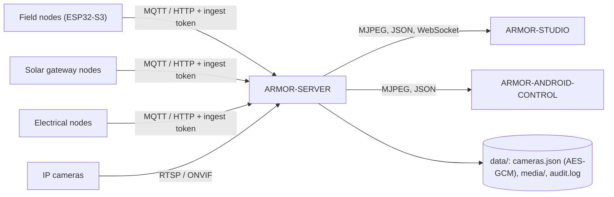

<p align="center">
  
</p>

# 🛡️ ARMOR-SERVER

<p align="center">
  <a href="README.md">🇺🇸 English</a> |
  <a href="README_spa.md">🇪🇸 Español</a> |
  <a href="README_fra.md">🇫🇷 Français</a> |
  <a href="README_ita.md">🇮🇹 Italiano</a> |
  🇩🇪 <b>Deutsch</b> |
  <a href="README_zho.md">🇨🇳 简体中文</a> |
  <a href="README_jpn.md">🇯🇵 日本語</a> |
  <a href="README_por.md">🇵🇹 Português</a>
</p>

### Zentraler Sicherheitskoordinator: Knoten, Alarme, Geräte, Energie, Kameras, das lokale Netz und die Wartung der Anlage

<p align="center">
  
  
  
  
  
  
</p>

---

**Ehrlichkeitsprüfung - was heute läuft:** Jede Route, Sitzung, Verschlüsselung und Beweisregel unten ist real und durch Tests abgedeckt (`npm test`: 513 Tests, darunter eine vollständige HTTP-Integrationssuite gegen einen isolierten Server und eine Prüfung, dass jede Route in der OpenAPI-Datei dokumentiert ist). Er läuft im täglichen Einsatz auf dem CM5-Testaufbau mit einem echten MQTT-Broker, der Firmware eines echten Radarknotens auf einer ESP32-S3-Platine, echten IP-Kameras (Livevideo, Schnappschüsse, Aufnahmen, PTZ an den Hi3510-Geräten), der Studio-Konsole, der Android-App sowie den Sprach- und Beobachtungsdiensten. Was **noch nicht** bewiesen ist: ONVIF mit einer echten ONVIF-Kamera, jegliche Jetson-Hardware, die Solar-, Elektro-, Alarmzentralen- und Touchpanel-Routen mit echten Knoten (sie werden mit erzeugten Nachrichten getestet: nur die Radarplatine existiert) und Push über Firebase mit einem echten Firebase-Projekt.

---

## 📋 Auf einen Blick

| | |
|---|---|
| Version | `0.8.0.0` |
| Reifegrad | Etabliert |
| Tests | 513 (`npm test`) |
| Technik | Node.js 22+ / TypeScript / Docker Compose |
| Auf echter Hardware | Der CM5-Testaufbau im täglichen Einsatz: ein echter MQTT-Broker, echte IP-Kameras, ein echter Radarknoten auf einer ESP32-S3-Platine, Studio, die Android-App und die Sprach- und Beobachtungsdienste daran |

## 🎯 Überblick

**ARMOR-SERVER** ist das vertrauenswürdige Zentrum von A.R.M.O.R. Feldknoten veröffentlichen Radar-, Licht- und Zustandsbeobachtungen; dieser Dienst validiert sie, hält den letzten bekannten Zustand jedes Knotens und stellt ihn der Studio-Konsole und dem Android-Client bereit. Er besitzt auch alles, was eine Kamera berührt, sodass **kein Browser und kein Telefon je ein Kamerapasswort oder eine RTSP-Adresse hält**.

* **Geprüfter Eingang:** HTTP- und MQTT-Nachrichten jeder Knotenart (Radar, Solar, Elektro, Alarmzentrale, Netzwerk) werden an der Grenze vom gemeinsamen Vertrag geprüft, bevor sie den Zustand erreichen; ein Knoten kann ein eigenes Token haben (vom gemeinsamen abgeleitet), und ein strenger Modus akzeptiert nichts anderes.
* **Ehrlicher Knotenzustand:** ein Knoten, der verstummt, wird nach einem einstellbaren Fenster als *veraltet* und *offline* angezeigt, nie als online mit alten Daten; ein sich wieder verbindender wird ab seiner Rückkehr gezählt, nicht ab seinen alten Nachrichten. Unscharfschalten löscht einen hohen Alarm sofort.
* **Kamera-Gateway:** verschlüsselter Kamera-Tresor, PTZ per ONVIF / Hi3510 / PSIA, RTSP-Pfadsuche, ein gemeinsames FFmpeg-Relay pro Kamera, Schnappschüsse und MP4-Aufnahme, ein Wächter, der eine stumme Kamera zu einem Ereignis und, wenn scharf, zu einem Alarm macht, **zu ignorierende Bildzonen** und **von selbst gemachte Fotos und Videos**, wenn eine Kamera im scharfen Zustand etwas sieht.
* **Beweisbibliothek:** Aufbewahrung nach Alter und Größe, **geschützte Beweise**, die nie gelöscht werden, ein SHA-256 für die Beweiskette und eine vom Server signierte **Verwahrungsnachweis**-Datei. Eine Audit-Zeile pro sicherheitsrelevanter Aktion, mit entfernten Zugangsdaten.
* **Zustand, der überlebt:** der Sicherheitsmodus und die letzte Beobachtung jedes Knotens werden nach einem Neustart wiederhergestellt (ein Neustart schaltet den Perimeter nie stillschweigend unscharf); Dateien werden atomar geschrieben und eine beschädigte wird wiederhergestellt. Jede Alarm-, Knoten- und Moduswechsel steht in einem Ereignisverlauf.
* **Alarme:** eine Alarmzentrale mit Lebenslauf ausgelöst / quittiert / beendet, Eskalation eines kritischen Alarms, der ungesehen wartet, eine **Prüfung vor dem Scharfschalten** (was offen, stumm oder ausgefallen ist), eine PIN zum Unscharfschalten (und eine Nötigungs-PIN) sowie Alarme von Knoten, Kameras, Geräten, Solar, Elektro, Netzwerk und Alarmzentralen. Sie erreichen Studio, die Telefone (ntfy, Telegram, Home Assistant, einen signierten Webhook, Firebase-Push bei Konfiguration) und das MQTT-Thema `armor/server/alert`.
* **Benutzer und Rollen:** Namen und Passwörter (scrypt-Hashes), eine Rolle `admin`, die Benutzer verwaltet, eine Rolle `operator`, die bedient, und eine Rolle `viewer`, die nur ansieht; ein geändertes Passwort oder eine geänderte Rolle beendet die anderen Sitzungen dieses Benutzers.
* **Geräte und Automationen:** Rauch, Gas, Wasser, Tür, Fenster, Bewegung, Klima, Steckdose, Licht, Sirene, Schloss, Rollladen, Tor oder Garagentor und Warmwasserbereiter über MQTT oder authentifizierten Push, mit normalisiertem Zustand, Verfügbarkeit und Befehlen; Regeln, die Geräte schalten, wenn etwas geschieht (auch per Schwellwert).
* **Energie:** Wechselrichter und Batteriestapel (mit jeder Zelle und den Kapazitäten) sowie Elektroknoten kommen per HTTP oder MQTT, werden vom gemeinsamen Vertrag geprüft, mit Verlauf und Energie pro Tag gespeichert, bei Schweigen als veraltet markiert und lösen Alarme aus (Wechselrichterfehler, Batterie schwach, Netz verloren, Spannung, Schaltfehler…). Der Elektroplan und die Regeln zum Schalten eines Stromkreises liegen auf dem Server.
* **Alarmzentralen:** der Zustand der ARMOR-ALARM-Knoten, der **Alarmplan** mit seinen Versionen, die **den Zonen zugeordneten Zigbee-Geräte** (der Server sagt einer Zentrale, wie eine Zone ist, solange er das Funkmodul hält) und Scharf-/Unscharf-Befehle an eine Zentrale (aus, außer mit `ARMOR_ALARM_COMMANDS=1`).
* **Lokales Netz:** was der ARMOR-NETWORK-Knoten meldet (Geräte, Internet, die öffentliche Adresse und wer sie liefert), Aufträge für den Knoten (Scan, Ping, Ports, ein Gerät mit einem von Ihnen gegebenen Login prüfen), Namen, versteckte und beobachtete Geräte sowie Zugangsdaten, die **nur für den Knoten versiegelt** reisen.
* **Sprache, Beobachtung und Wartung:** geschriebene und gesprochene Befehle (geschlossene Liste, in acht Sprachen, mit einer an die Person gebundenen Bestätigung), der Kontext für den Beobachtungsdienst (welche Radare welche Kamera abdecken), die Firmware der Knoten, von Studio aus nacheinander mit Fortschritt aktualisiert, sowie die Updates der Anlage selbst von GitHub, die des Systems und eine optionale Root-Konsole, alles über den Wartungshelfer.
* **Nutzung von außerhalb des Hauses:** Der Server unterscheidet das Haus vom Außen (ein VPN zählt als Haus), hält Sitzungen von außen kürzer, verlangt einen zweiten Faktor (Authenticator-App, mit Wiederherstellungscodes) und vor kritischen Aktionen erneut das Passwort, lässt wählen, was eine Sitzung von außen darf (alles, nur den Alarm bedienen, nur ansehen), meldet den Alarmzielen, wenn sich jemand von einem neuen Ort anmeldet, und öffnet das Web-Panel eines Knotens über den Server - an das Zertifikat des Knotens gebunden, mit seinem Cookie auf dem Server -, sodass nie ein Knoten veröffentlicht wird.
* **Optionale verschlüsselte Verbindung zum Broker (mqtts):** `ARMOR_MQTT_CA_FILE` nennt das Zertifikat der eigenen Zertifizierungsstelle der Anlage; bei einer `mqtts://`-Adresse vertraut der Server nur dieser Stelle und prüft den Namen des Brokers, und er startet nicht, wenn die Datei kein gültiges Zertifikat ist oder die Adresse nicht `mqtts://` lautet. Studio zeigt, ob die Verbindung verschlüsselt ist, und den Fingerabdruck der Stelle. Getestet gegen einen TLS-Broker-Ersatz und gegen einen echten Mosquitto 2.0.
* **Zustand der Knoten und Scharfschaltmodi:** speichert den letzten Bericht und das Neustartprotokoll jedes Knotens und löst vier Warnungen aus (wenig Speicher, zu häufige Neustarts, ein Broker, der immer wieder abreißt, schwaches WLAN-Signal); verwaltet die Scharfschaltprofile (Abwesend, Zuhause, Nacht und eigene) und legt das gewählte in den Scharfschaltbefehl, nur für einen Knoten, der sie versteht. Ein lauter oder leiser Alarm folgt dem Profil; ein Scharfschalten ohne Profil ist der Befehl wie immer.
* **Verlauf der Verbindungen und des Systems:** Neben Warnungen, Knoten, Kameras, Geräten und Alarmen zeichnet der Verlauf auf, welche Geräte und Apps sich verbinden (Studio-Sitzungen, die Android-App, die Panels der Knoten, der Sprachdienst: Anmeldungen, Ablehnungen, Abmeldungen, abgelaufene Sitzungen, Nutzung des zweiten Faktors, erste und letzte Sichtung) und die Ereignisse des Systems (Knoten, die mit ihrer Firmware auftauchen oder verschwinden, die Broker-Verbindung, geänderte Einstellungen und von wem, Dienste, Updates, Scharfschalten mit Profil). Filter nach Art, Kategorie, Client und Benutzer; Adresse und User-Agent sehen nur Administratoren, und nie wird ein Passwort, Token, Cookie oder PIN aufgezeichnet.

## 🧩 Rolle in A.R.M.O.R.

ARMOR-SERVER ist das eine vertrauenswürdige Zentrum der Familie. Die Feldknoten ([ARMOR-RADAR](https://github.com/JuanenRac/ARMOR-RADAR), [ARMOR-SOLAR](https://github.com/JuanenRac/ARMOR-SOLAR), [ARMOR-ELECTRICAL](https://github.com/JuanenRac/ARMOR-ELECTRICAL), [ARMOR-ALARM](https://github.com/JuanenRac/ARMOR-ALARM), [ARMOR-HMI](https://github.com/JuanenRac/ARMOR-HMI)) und [ARMOR-NETWORK](https://github.com/JuanenRac/ARMOR-NETWORK) sprechen per MQTT oder HTTP mit ihm; [ARMOR-STUDIO](https://github.com/JuanenRac/ARMOR-STUDIO) und [ARMOR-ANDROID-CONTROL](https://github.com/JuanenRac/ARMOR-ANDROID-CONTROL) lesen es und geben ihm Befehle; [ARMOR-SERVER-AI](https://github.com/JuanenRac/ARMOR-SERVER-AI) wägt ab, was die Kameras sehen, gegen die Radare und empfiehlt nur; [ARMOR-VOICE-AI](https://github.com/JuanenRac/ARMOR-VOICE-AI) macht aus Sprache eine geschlossene Liste von Befehlen; [ARMOR-DEVOPS](https://github.com/JuanenRac/ARMOR-DEVOPS) installiert und aktualisiert alles auf dem CM5. Der Server entscheidet: nichts sonst schaltet scharf, unscharf oder irgendetwas.

## 🔄 Architektur



## 🔒 Sicherheitsmodell

* Getrennte Geheimnisse: **ingest** (die Knoten senden ihre Nachrichten; jeder Knoten kann außerdem ein eigenes, vom gemeinsamen abgeleitetes Token haben, und ein strenger Modus akzeptiert nur diese), **control** (scharf / unscharf, Ereignisse), **operator** (Automation) und das **Studio-Login**; jedes wird in konstanter Zeit verglichen, und keines ersetzt ein anderes. Ein einem Netzwerkknoten gegebener Login reist nur für diesen Knoten versiegelt.
* Drei Rollen: **admin**, **operator** und **viewer** (liest, ändert nie). Jede Route, die konfiguriert, bewegt, aufnimmt, aufzeichnet, schützt, löscht oder scharf schaltet, braucht einen Operator; Livevideo braucht einen Operator oder ein kurzlebiges Stream-Ticket für eine Kamera. Gefährliche Befehle (Unscharfschalten, einen Stromkreis schalten, die Root-Konsole) verlangen einen Administrator und zum Unscharfschalten die PIN.
* Kamerapasswörter liegen nur in `data/cameras.json`, mit AES-256-GCM verschlüsselt, und keine API gibt sie zurück; ONVIF-Adressen müssen auf dem Host der Kamera bleiben, und Weiterleitungen werden abgelehnt.
* Studio-Sitzungen sind HttpOnly und SameSite=Strict, das Login ist ratenbegrenzt, und Fehler tragen nie einen Stacktrace.
* Der Server lauscht auf 127.0.0.1, außer `ARMOR_HOST` wird absichtlich gesetzt; dann wird ein Studio-Passwort unter 12 Zeichen abgelehnt.
* Von außerhalb des Hauses: zweiter Faktor (TOTP, RFC 6238), ein neuer Identitätsnachweis für Benutzer, Firmware und Knoten-Panels, eine Richtlinie, die Verwaltung nur im Haus oder über das VPN erlaubt, nur signierte Firmware-Releases und ein Proxy für Knoten-Panels, der nie eine Adresse aus der Anfrage übernimmt, nur das Nötige weiterreicht und einen Knoten ablehnt, dessen Zertifikat nicht das vertrauenswürdige ist.

## 🌐 API

* Öffentlich: `GET /healthz`. Für einen angemeldeten Benutzer: Status, Informationen, Kameras, Medien, Verlauf, Regeln, Geräte, Alarme, Automationen, die Pläne (Standort, Alarm, Elektro, Netzwerk), Solar- und Elektrowerte, das lokale Netz, Benachrichtigungen und Einstellungen und für einen Administrator Benutzer, Dienste, Firmware, Updates und die Konsole.
* Für die Knoten: `POST /api/v1/telemetry`, `/health`, `/solar`, `/electrical/readings`, `/alarm/state`, `/network/state` und `/devices/state` mit dem Ingest-Token sowie die MQTT-Themen `armor/node/#`, `armor/solar/#`, `armor/electrical/#`, `armor/alarm/#` und `armor/network/#`. Ereignisse erreichen die Konsolen über den WebSocket `/api/v1/events`.
* Jede Route (heute 135 Pfade), ihre Zugriffsregel und ihr Schema stehen in der OpenAPI-Datei von [ARMOR-COMMON](https://github.com/JuanenRac/ARMOR-COMMON), und ein Test prüft, dass keine fehlt.

## ⚙️ Konfiguration

* Kopieren Sie `.env.example` nach `.env` (von Git ignoriert), oder lassen Sie `run.bat` / `run.sh` beim ersten Start zufällige Geheimnisse erzeugen.
* Erforderlich: `ARMOR_INGEST_TOKEN` und `ARMOR_CONTROL_TOKEN` (24 Zeichen oder mehr, alle verschieden) sowie `ARMOR_STUDIO_USERNAME` / `ARMOR_STUDIO_PASSWORD` (der erste Administrator).
* Üblich: `ARMOR_HOST` / `ARMOR_PORT`, `ARMOR_DATA_DIR`, `ARMOR_FFMPEG_PATH` (Livevideo und Aufnahme), `ARMOR_MQTT_URL`, `ARMOR_MQTT_CA_FILE`, `ARMOR_STUDIO_ORIGIN`, `ARMOR_NODE_STALE_AFTER_S`, `ARMOR_CAMERA_CHECK_S`, `ARMOR_ALERT_DWELL_MS`, `ARMOR_ALERT_WEBHOOK_URL` und `ARMOR_COOKIE_SECURE` (auf `1` hinter TLS).
* Optional, alle standardmäßig aus: `ARMOR_NTFY_URL`, `ARMOR_TELEGRAM_BOT_TOKEN`, `ARMOR_HOMEASSISTANT_URL`, `ARMOR_FCM_SERVICE_ACCOUNT` (Push über das eigene Firebase-Projekt der Anlage), `ARMOR_ALARM_COMMANDS=1` (lässt den Server Alarmzentralen scharf und unscharf schalten), `ARMOR_ELECTRICAL_SWITCHING` und `ARMOR_INGEST_STRICT=1`.

## 📂 Struktur des Repositorys

```text
ARMOR-SERVER/
├── src/            server, app, config, context, store, persistence, events, contracts, rules, mqtt, mqtt_tls, audit, notify, channels,
│   │               alarms, alarm, alarm_design, alarm_commands, alarm_zone_feed, escalation, preflight, automations, users,
│   │               site, solar, solar_registry, electrical, electrical_energy, electrical_switching, network, network_commands,
│   │               firmware, installation, admin, voice, voice_actions, ai, capture_on_detect, ignore_zones, push_fcm, ...
│   ├── http/       auth, per-node tokens, sealed credentials
│   ├── routes/     sessions, users, cameras, media, ingest, history, devices, alarms, alarm, alarm_design, solar, electrical,
│   │               network, firmware, maintenance, admin, notifications, voice, ai, push, preferences, system
│   ├── devices/    catalog, registry, commands, mapping (the device model and its MQTT bridge)
│   ├── cameras/    model, vault, digest, ptz, rtsp, discovery, health, errors
│   └── media/      relay, evidence
├── tests/          540 tests: unit + full HTTP integration
├── docs/           state machine, camera gateway, integration, node firmware
├── tools/          project tooling and the CI checks
├── data/           runtime state (ignored by Git)
└── images/         brand assets
```

## 🛠️ Entwicklungsumgebung

**Voraussetzungen:** Node.js 22+, FFmpeg (live video and capture), an MQTT broker (Mosquitto)

```powershell
npm install
npm run typecheck   # tsc --noEmit
npm test            # 540 tests: unit + full HTTP integration (every route must be in the OpenAPI file)
npm run build       # dist/server.mjs
.\run.bat           # development server with hot reload
```

Zur Installation auf dem CM5-Prüfstand (isoliert von jedem anderen Projekt, eigener Benutzer, eigene Ports) siehe [ARMOR-DEVOPS](https://github.com/JuanenRac/ARMOR-DEVOPS).

## 🔗 Verwandte Projekte

**A.R.M.O.R.** (Autonomous Radar & Multimodal Observation Range) ist ein Perimeter-Sicherheitssystem aus unabhängigen Repositorys. Jedes hat eine eigene Version, eigene Tests und ein eigenes README; hier ist die Familie:

* **[ARMOR-COMMON](https://github.com/JuanenRac/ARMOR-COMMON)** - Nachrichtenverträge, Validierer, Konformitätsvektoren und generierte Typen
* **[ARMOR-RADAR](https://github.com/JuanenRac/ARMOR-RADAR)** - Feldknoten-Firmware für ESP32-S3 mit drei Radaren und eigenem Web-Panel
* **[ARMOR-SOLAR](https://github.com/JuanenRac/ARMOR-SOLAR)** - Protokolle für Solar-Wechselrichter und -Batterien und die Nachrichten eines Gateway-Knotens
* **[ARMOR-ELECTRICAL](https://github.com/JuanenRac/ARMOR-ELECTRICAL)** - Elektroknoten: Zähler, die Nachricht der Netzmesswerte und die Regeln fürs Schalten
* **[ARMOR-ALARM](https://github.com/JuanenRac/ARMOR-ALARM)** - Alarmknoten und Alarmzentrale: Zonen, Scharfschalten, Verzögerungen, Sirene und PIN, mit dem Server oder ohne ihn
* **[ARMOR-HMI](https://github.com/JuanenRac/ARMOR-HMI)** - Touch-Panel: der Systemzustand auf einem Wandbildschirm, Scharf- und Quittieren sowie das Zuhause des Sprachassistenten
* **[ARMOR-NETWORK](https://github.com/JuanenRac/ARMOR-NETWORK)** - Das lokale Netzwerk: seine Geräte, das Internet und was sich ändert
* **ARMOR-SERVER** (dieses Repository) - Zentraler Koordinator: Telemetrie, Alarme, Geräte, Solarmesswerte und Kameras
* **[ARMOR-STUDIO](https://github.com/JuanenRac/ARMOR-STUDIO)** - Web-Konsole: Kameras, Radar, Alarme, Solarenergie und 2D/3D-Standortdesigner
* **[ARMOR-ANDROID-CONTROL](https://github.com/JuanenRac/ARMOR-ANDROID-CONTROL)** - Android-Bedienclient mit Live-Radar in 2D/3D
* **[ARMOR-SERVER-AI](https://github.com/JuanenRac/ARMOR-SERVER-AI)** - Visuelle Inferenzrichtlinie, die ihre Entscheidungen erklärt und nie handelt
* **[ARMOR-VISION](https://github.com/JuanenRac/ARMOR-VISION)** - Kamerazonen, Masken und Erkennungsregeln für den Jetson Orin NX
* **[ARMOR-VOICE-AI](https://github.com/JuanenRac/ARMOR-VOICE-AI)** - Offline-Sprachabsichten mit einer nicht fälschbaren Bestätigung
* **[ARMOR-HARDWARE](https://github.com/JuanenRac/ARMOR-HARDWARE)** - Gehäuse, Elektronik und die Abnahmematrix am Prüfstand
* **[ARMOR-DEVOPS](https://github.com/JuanenRac/ARMOR-DEVOPS)** - Bereitstellung, CM5-Prüfstand, Backup und TLS
* **[ARMOR-SIMULATOR](https://github.com/JuanenRac/ARMOR-SIMULATOR)** - Offline-Telemetriesimulator mit wiederholbaren Fehlern
* **[ARMOR-UPDATER](https://github.com/JuanenRac/ARMOR-UPDATER)** - Erkennt, installiert und aktualisiert die eigenen Repositories des Ökosystems
* **[ARMOR-DOCS](https://github.com/JuanenRac/ARMOR-DOCS)** - Architektur, Sicherheitsgrundlage und die Fähigkeitsmatrix

## 📚 Dokumentation und Community

Hier gibt es mehr zu lesen:

* [Fähigkeitsmatrix: was belegt ist und was nicht](https://github.com/JuanenRac/ARMOR-DOCS/blob/main/docs/CAPABILITY_MATRIX.md)
* [Projektkatalog: Versionen und wie die Repositorys voneinander abhängen](https://github.com/JuanenRac/ARMOR-DOCS/blob/main/docs/PROJECT_CATALOG.md)
* [Änderungsverlauf dieses Repositorys](CHANGELOG.md)
* [Lizenz (GPL-3.0-or-later)](LICENSE)
* Fragen, Ideen und Meldungen: electrohobby3d@gmail.com

## 👤 AUTOR

**JuanenRac (Electro Hobby 3D)** · electrohobby3d@gmail.com

## 📜 LIZENZ

GPL-3.0-or-later - siehe [LICENSE](LICENSE).
