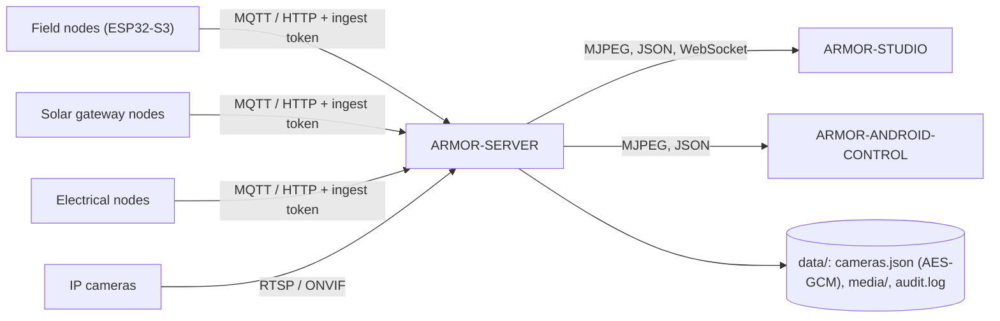

<p align="center">
  
</p>

# 🛡️ ARMOR-SERVER

<p align="center">
  <a href="README.md">🇺🇸 English</a> |
  <a href="README_spa.md">🇪🇸 Español</a> |
  🇫🇷 <b>Français</b> |
  <a href="README_ita.md">🇮🇹 Italiano</a> |
  <a href="README_deu.md">🇩🇪 Deutsch</a> |
  <a href="README_zho.md">🇨🇳 简体中文</a> |
  <a href="README_jpn.md">🇯🇵 日本語</a> |
  <a href="README_por.md">🇵🇹 Português</a>
</p>

### Coordinateur central de sécurité : nœuds, alarmes, appareils, énergie, caméras, réseau local et entretien de l'installation

<p align="center">
  
  
  
  
  
  
</p>

---

**Vérification d'honnêteté - ce qui fonctionne aujourd'hui:** Chaque route, session, chiffrement et règle de preuves ci-dessous est réel et couvert par des tests (`npm test` : 540 tests, dont une suite complète d'intégration HTTP contre un serveur isolé et une vérification que chaque route est documentée dans le fichier OpenAPI). Il fonctionne en usage quotidien sur le banc de test CM5 avec un vrai broker MQTT, le firmware d'un vrai nœud radar sur une carte ESP32-S3, de vraies caméras IP (vidéo en direct, captures, enregistrements, PTZ sur les unités Hi3510), la console Studio, l'application Android et les services de voix et d'observation. Ce qui n'est **pas** encore prouvé : ONVIF avec une vraie caméra ONVIF, tout matériel Jetson, les routes solaires, électriques, de centrales d'alarme et de panneau tactile avec de vrais nœuds (testées avec des messages générés : seule la carte radar existe) et le push via Firebase avec un vrai projet Firebase.

---

## 📋 En un coup d'œil

| | |
|---|---|
| Version | `0.8.0.3` |
| Maturité | Établi |
| Tests | 561 (`npm test`) |
| Technologie | Node.js 22+ / TypeScript / Docker Compose |
| Sur matériel réel | Le banc de test CM5, en usage quotidien : un vrai broker MQTT, de vraies caméras IP, un vrai nœud radar sur une carte ESP32-S3, Studio, l'application Android et les services de voix et d'observation contre lui |

## 🎯 Présentation

**ARMOR-SERVER** est le centre de confiance d'A.R.M.O.R. Les nœuds de terrain publient des observations de radar, de lumière et de santé ; ce service les valide, garde le dernier état connu de chaque nœud et le sert à la console Studio et au client Android. Il possède aussi tout ce qui touche une caméra, de sorte qu'**aucun navigateur ni téléphone ne détient jamais un mot de passe de caméra ni une adresse RTSP**.

* **Entrée validée :** les messages HTTP et MQTT de chaque type de nœud (radar, solaire, électrique, centrale d'alarme, réseau) sont vérifiés à la frontière par le contrat partagé avant d'atteindre l'état ; un nœud peut avoir son propre jeton (dérivé du jeton partagé) et un mode strict n'accepte rien d'autre.
* **État honnête des nœuds :** un nœud qui se tait est affiché *périmé* et *hors ligne* après une fenêtre configurable, jamais en ligne sur de vieilles données ; un nœud qui se reconnecte est compté depuis son retour, pas depuis ses anciens messages. Désarmer efface une alerte haute aussitôt.
* **Passerelle de caméras :** coffre chiffré des caméras, PTZ ONVIF / Hi3510 / PSIA, découverte des chemins RTSP, un relais FFmpeg partagé par caméra, captures et enregistrement MP4, un chien de garde qui transforme une caméra muette en événement et, armé, en alarme, **zones de l'image à ignorer** et **photos et vidéo prises seules** quand une caméra voit quelque chose pendant l'armement.
* **Bibliothèque de preuves :** rétention par ancienneté et taille, **preuves protégées** jamais effacées, un SHA-256 pour la chaîne de conservation et un fichier de **preuve de conservation** signé par le serveur. Une ligne d'audit par action sensible, avec les identifiants effacés.
* **État qui survit :** le mode de sécurité et la dernière observation de chaque nœud sont restaurés après un redémarrage (un redémarrage ne désarme jamais le périmètre en silence) ; les fichiers sont écrits de façon atomique et un fichier abîmé est récupéré. Chaque changement d'alerte, de nœud et de mode est conservé dans un historique d'événements.
* **Alarmes :** un centre d'alarmes avec cycle déclenchée / acquittée / terminée, escalade d'une alarme critique qui attend sans être vue, une **vérification avant armement** (ce qui est ouvert, muet ou en panne), un PIN pour désarmer (et un PIN de contrainte) et des alarmes de nœuds, caméras, appareils, solaire, électrique, réseau et centrales d'alarme. Elles arrivent à Studio, aux téléphones (ntfy, Telegram, Home Assistant, un webhook signé, push Firebase si vous le configurez) et au sujet MQTT `armor/server/alert`.
* **Utilisateurs et rôles :** noms et mots de passe (hachages scrypt), un rôle `admin` qui gère les utilisateurs, un rôle `operator` qui opère et un rôle `viewer` qui ne fait que regarder ; changer le mot de passe ou le rôle ferme les autres sessions de cet utilisateur.
* **Appareils et automatisations :** fumée, gaz, inondation, porte, fenêtre, mouvement, climat, prise, lumière, sirène, serrure, volet, portail ou porte de garage et chauffe-eau, par MQTT ou push authentifié, avec état normalisé, disponibilité et commandes ; des règles qui actionnent des appareils quand quelque chose arrive (aussi par seuils).
* **Énergie :** onduleurs et blocs de batteries (avec chaque cellule et les capacités) et nœuds électriques arrivent par HTTP ou MQTT, sont validés par le contrat partagé, conservés avec un historique et l'énergie par jour, marqués périmés s'ils se taisent, et déclenchent des alarmes (panne d'onduleur, batterie faible, réseau perdu, tension, défaut de commutation…). Le schéma électrique et les règles pour commuter un circuit sont conservés sur le serveur.
* **Centrales d'alarme :** l'état des nœuds ARMOR-ALARM, la **conception de l'alarme** avec ses versions, les **appareils Zigbee liés aux zones** (le serveur dit à une centrale l'état d'une zone tant qu'il tient la radio) et des commandes d'armement / désarmement vers une centrale (désactivé sauf `ARMOR_ALARM_COMMANDS=1`).
* **Réseau local :** ce que rapporte le nœud ARMOR-NETWORK (appareils, internet, l'adresse publique et qui la donne), des ordres pour le nœud (balayage, ping, ports, inspecter un appareil avec un identifiant que vous donnez), noms, appareils masqués et surveillés, et identifiants qui voyagent **scellés pour le seul nœud**.
* **Voix, observation et entretien :** commandes écrites et parlées (liste fermée, en huit langues, avec une confirmation liée à la personne), le contexte pour le service d'observation (quels radars couvrent quelle caméra), le firmware des nœuds mis à jour depuis Studio un par un avec progression, et les mises à jour de l'installation depuis GitHub, celles du système et une console root optionnelle, le tout par l'assistant de maintenance.
* **Usage depuis l'extérieur :** le serveur distingue la maison de l'extérieur (un VPN compte comme la maison), garde des sessions plus courtes depuis l'extérieur, demande un second facteur (une application d'authentification, avec des codes de récupération) et le mot de passe à nouveau avant les actions critiques, permet de choisir ce qu'une session extérieure peut faire (tout, seulement manœuvrer l'alarme, seulement regarder), prévient les destinations des alarmes quand quelqu'un se connecte depuis un nouvel endroit et ouvre le panneau web d'un nœud via le serveur - épinglé au certificat du nœud, avec son cookie gardé sur le serveur - pour qu'aucun nœud ne soit jamais publié.
* **Liaison chiffrée facultative avec le broker (mqtts) :** `ARMOR_MQTT_CA_FILE` désigne le certificat de l'autorité propre à l'installation ; avec une adresse `mqtts://` le serveur ne fait confiance qu'à cette autorité et vérifie le nom du broker, et il refuse de démarrer si le fichier n'est pas un certificat valide ou si l'adresse n'est pas `mqtts://`. Studio montre si la liaison est chiffrée et l'empreinte de l'autorité. Testé contre un faux broker TLS et contre un vrai Mosquitto 2.0.
* **Santé des nœuds et modes d'armement :** conserve le dernier rapport et le journal des redémarrages de chaque nœud et lève quatre avertissements (peu de mémoire, redémarrages trop fréquents, un broker qui décroche à répétition, signal Wi-Fi faible) ; conserve les profils d'armement (Absent, Présent, Nuit et les vôtres) et met celui choisi dans la commande d'armer, seulement pour un nœud qui dit les comprendre. Une alarme forte ou discrète suit le profil ; un armement sans profil est la commande de toujours.
* **Historique des connexions et du système :** en plus des alertes, nœuds, caméras, appareils et alarmes, l'historique enregistre quels appareils et applications se connectent (sessions Studio, appli Android, panneaux des nœuds, service vocal : connexions, refus, déconnexions, sessions expirées, usage du second facteur, première et dernière fois vus) et les événements du système (nœuds qui apparaissent ou disparaissent avec leur firmware, lien avec le broker, réglages changés et par qui, services, mises à jour, armement avec son profil). Filtrable par type, catégorie, client et utilisateur ; l'adresse et l'agent utilisateur ne sont visibles que des administrateurs, et aucun mot de passe, jeton, cookie ni PIN n'est jamais enregistré.
* **Ordres d'écriture sur une batterie Pylontech (désactivés sauf `ARMOR_BATTERY_WRITE=1`) :** pour des administrateurs qui viennent de prouver à nouveau qui ils sont - préparer, exécuter avec le numéro de série de la batterie saisi de nouveau, annuler, remettre une sortie comme avant, garder une image de firmware pendant une heure - vérifiés avec la table partagée des opérations et plages, envoyés au nœud passerelle en `solar_battery_command`, chaque opération étant conservée (qui, quelle batterie, ce qui a été lu avant et après, la différence et la transcription, jamais le mot de passe de service) et consignée dans l'historique sous *Batteries*.
* **Commande des nœuds :** `POST /api/v1/nodes/{id}/control` et `POST /api/v1/nodes/control` donnent un ordre (redémarrer, mettre en pause, reprendre, mettre en veille, identifier, diagnostic, maintenance activée ou désactivée) à un nœud ou à tous ceux qui rapportent, uniquement à un administrateur qui vient de se prouver de nouveau, avec le nom du nœud (ou le mot RESTART, PAUSE ou STANDBY pour tous) saisi de nouveau là où la maison serait moins bien gardée. Le serveur prépare l'ordre, l'exécute avec le jeton à usage unique que le nœud donne pour cette opération, suit chaque nœud (envoyé, reçu, appliqué, de retour) dans `GET /api/v1/nodes/control/operations`, redémarre les centrales d'alarme en dernier lors d'un redémarrage échelonné, consigne qui a ordonné quoi dans l'historique et le journal d'audit, et montre dans la santé du nœud s'il est en pause, en veille (travail arrêté, reste connecté) ou en maintenance. Il n'existe ni réinitialisation d'usine, ni effacement, ni sommeil profond. Il est testé avec un faux broker ; il n'a pas été essayé sur un vrai nœud.

## 🧩 Rôle dans A.R.M.O.R.

ARMOR-SERVER est l'unique centre de confiance de la famille. Les nœuds de terrain ([ARMOR-RADAR](https://github.com/JuanenRac/ARMOR-RADAR), [ARMOR-SOLAR](https://github.com/JuanenRac/ARMOR-SOLAR), [ARMOR-ELECTRICAL](https://github.com/JuanenRac/ARMOR-ELECTRICAL), [ARMOR-ALARM](https://github.com/JuanenRac/ARMOR-ALARM), [ARMOR-HMI](https://github.com/JuanenRac/ARMOR-HMI)) et [ARMOR-NETWORK](https://github.com/JuanenRac/ARMOR-NETWORK) lui parlent en MQTT ou HTTP ; [ARMOR-STUDIO](https://github.com/JuanenRac/ARMOR-STUDIO) et [ARMOR-ANDROID-CONTROL](https://github.com/JuanenRac/ARMOR-ANDROID-CONTROL) le lisent et lui donnent des ordres ; [ARMOR-SERVER-AI](https://github.com/JuanenRac/ARMOR-SERVER-AI) pèse ce que voient les caméras face aux radars et ne fait que recommander ; [ARMOR-VOICE-AI](https://github.com/JuanenRac/ARMOR-VOICE-AI) transforme la parole en une liste fermée de commandes ; [ARMOR-DEVOPS](https://github.com/JuanenRac/ARMOR-DEVOPS) installe et met à jour tout cela sur la CM5. Le serveur décide : rien d'autre n'arme, ne désarme ni ne commute quoi que ce soit.

## 🔄 Architecture



## 🔒 Modèle de sécurité

* Secrets séparés : **ingest** (les nœuds publient leurs messages ; chaque nœud peut aussi avoir son propre jeton, dérivé du jeton partagé, et un mode strict n'accepte que ceux-là), **control** (armer / désarmer, événements), **operator** (automatisation) et la **connexion Studio** ; chacun est comparé en temps constant et aucun n'en remplace un autre. Un identifiant donné à un nœud réseau voyage scellé pour ce seul nœud.
* Trois rôles : **admin**, **operator** et **viewer** (lit, ne change jamais). Toute route qui configure, déplace, capture, enregistre, protège, supprime ou arme exige un opérateur ; la vidéo en direct exige un opérateur ou un ticket de flux de courte durée lié à une caméra. Les commandes dangereuses (désarmer, commuter un circuit, la console root) demandent un administrateur et, pour désarmer, le PIN.
* Les mots de passe des caméras ne vivent que dans `data/cameras.json`, chiffrés en AES-256-GCM, et aucune API ne les renvoie ; les adresses ONVIF doivent rester sur l'hôte de la caméra et les redirections sont refusées.
* Les sessions Studio sont HttpOnly et SameSite=Strict, la connexion est limitée en débit et les erreurs ne portent jamais de trace de pile.
* Le serveur écoute sur 127.0.0.1 sauf si `ARMOR_HOST` est défini volontairement, et alors un mot de passe Studio de moins de 12 caractères est refusé.
* Depuis l'extérieur : second facteur (TOTP, RFC 6238), une nouvelle preuve d'identité pour les utilisateurs, le firmware et les panneaux des nœuds, une politique qui réserve l'administration à la maison ou au VPN, uniquement des versions de firmware signées et un proxy de panneaux de nœuds qui ne prend jamais une adresse dans la requête, ne transmet que le nécessaire et refuse un nœud dont le certificat n'est pas celui de confiance.

## 🌐 API

* Publique : `GET /healthz`. Pour un utilisateur connecté : état, informations, caméras, médias, historique, règles, appareils, alarmes, automatisations, les conceptions (site, alarme, électrique, réseau), mesures solaires et électriques, le réseau local, notifications et préférences, et pour un administrateur utilisateurs, services, firmware, mises à jour et la console.
* Pour les nœuds : `POST /api/v1/telemetry`, `/health`, `/solar`, `/electrical/readings`, `/alarm/state`, `/network/state` et `/devices/state` avec le jeton d'ingestion, et les sujets MQTT `armor/node/#`, `armor/solar/#`, `armor/electrical/#`, `armor/alarm/#` et `armor/network/#`. Les événements atteignent les consoles par le WebSocket `/api/v1/events`.
* Chaque route (135 chemins aujourd'hui), sa règle d'accès et son schéma figurent dans le fichier OpenAPI d'[ARMOR-COMMON](https://github.com/JuanenRac/ARMOR-COMMON), et un test vérifie qu'aucune route n'y manque.

## ⚙️ Configuration

* Copiez `.env.example` vers `.env` (ignoré par Git), ou laissez `run.bat` / `run.sh` générer des secrets aléatoires au premier lancement.
* Obligatoires : `ARMOR_INGEST_TOKEN` et `ARMOR_CONTROL_TOKEN` (24 caractères ou plus, tous différents) et `ARMOR_STUDIO_USERNAME` / `ARMOR_STUDIO_PASSWORD` (le premier administrateur).
* Courantes : `ARMOR_HOST` / `ARMOR_PORT`, `ARMOR_DATA_DIR`, `ARMOR_FFMPEG_PATH` (vidéo en direct et capture), `ARMOR_MQTT_URL`, `ARMOR_MQTT_CA_FILE`, `ARMOR_STUDIO_ORIGIN`, `ARMOR_NODE_STALE_AFTER_S`, `ARMOR_CAMERA_CHECK_S`, `ARMOR_ALERT_DWELL_MS`, `ARMOR_ALERT_WEBHOOK_URL` et `ARMOR_COOKIE_SECURE` (à `1` derrière TLS).
* Optionnelles, toutes désactivées par défaut : `ARMOR_NTFY_URL`, `ARMOR_TELEGRAM_BOT_TOKEN`, `ARMOR_HOMEASSISTANT_URL`, `ARMOR_FCM_SERVICE_ACCOUNT` (push via le projet Firebase propre à l'installation), `ARMOR_ALARM_COMMANDS=1` (laisse le serveur armer et désarmer les centrales), `ARMOR_ELECTRICAL_SWITCHING` et `ARMOR_INGEST_STRICT=1`.

## 📂 Structure du dépôt

```text
ARMOR-SERVER/
├── src/            server, app, config, context, store, persistence, events, contracts, rules, mqtt, mqtt_tls, audit, notify, channels,
│   │               alarms, alarm, alarm_design, alarm_commands, alarm_zone_feed, escalation, preflight, automations, users,
│   │               site, solar, solar_registry, electrical, electrical_energy, electrical_switching, network, network_commands,
│   │               firmware, installation, admin, voice, voice_actions, ai, capture_on_detect, ignore_zones, push_fcm, ...
│   ├── http/       auth, per-node tokens, sealed credentials
│   ├── routes/     sessions, users, cameras, media, ingest, history, devices, alarms, alarm, alarm_design, solar, electrical,
│   │               network, firmware, maintenance, admin, notifications, voice, ai, push, preferences, system
│   ├── devices/    catalog, registry, commands, mapping (the device model and its MQTT bridge)
│   ├── cameras/    model, vault, digest, ptz, rtsp, discovery, health, errors
│   └── media/      relay, evidence
├── tests/          540 tests: unit + full HTTP integration
├── docs/           state machine, camera gateway, integration, node firmware
├── tools/          project tooling and the CI checks
├── data/           runtime state (ignored by Git)
└── images/         brand assets
```

## 🛠️ Environnement de développement

**Prérequis:** Node.js 22+, FFmpeg (live video and capture), an MQTT broker (Mosquitto)

```powershell
npm install
npm run typecheck   # tsc --noEmit
npm test            # 540 tests: unit + full HTTP integration (every route must be in the OpenAPI file)
npm run build       # dist/server.mjs
.\run.bat           # development server with hot reload
```

Pour installer sur le banc d'essai CM5 (isolé de tout autre projet, avec utilisateur et ports propres), voir [ARMOR-DEVOPS](https://github.com/JuanenRac/ARMOR-DEVOPS).

## 🔗 Projets liés

**A.R.M.O.R.** (Autonomous Radar & Multimodal Observation Range) est un système de sécurité périmétrique composé de dépôts indépendants. Chacun a sa propre version, ses propres tests et son propre README ; voici la famille :

* **[ARMOR-COMMON](https://github.com/JuanenRac/ARMOR-COMMON)** - Contrats de messages, validateurs, vecteurs de conformité et types générés
* **[ARMOR-RADAR](https://github.com/JuanenRac/ARMOR-RADAR)** - Firmware du nœud de terrain pour ESP32-S3 avec trois radars et son propre panneau web
* **[ARMOR-SOLAR](https://github.com/JuanenRac/ARMOR-SOLAR)** - Protocoles des onduleurs et batteries solaires et messages d'un nœud passerelle
* **[ARMOR-ELECTRICAL](https://github.com/JuanenRac/ARMOR-ELECTRICAL)** - Nœud électrique : compteurs, le message des mesures du réseau et les règles de commutation
* **[ARMOR-ALARM](https://github.com/JuanenRac/ARMOR-ALARM)** - Nœud et centrale d'alarme : zones, armement, temporisations, sirène et PIN, avec ou sans le serveur
* **[ARMOR-HMI](https://github.com/JuanenRac/ARMOR-HMI)** - Panneau tactile : l'état du système sur un écran mural, armer et acquitter, et la maison de l'assistant vocal
* **[ARMOR-NETWORK](https://github.com/JuanenRac/ARMOR-NETWORK)** - Le réseau local : ses appareils, internet et ce qui change
* **ARMOR-SERVER** (ce dépôt) - Coordinateur central : télémétrie, alarmes, appareils, relevés solaires et caméras
* **[ARMOR-STUDIO](https://github.com/JuanenRac/ARMOR-STUDIO)** - Console web : caméras, radar, alarmes, énergie solaire et concepteur de site 2D/3D
* **[ARMOR-ANDROID-CONTROL](https://github.com/JuanenRac/ARMOR-ANDROID-CONTROL)** - Client Android de l'opérateur avec radar 2D/3D en direct
* **[ARMOR-SERVER-AI](https://github.com/JuanenRac/ARMOR-SERVER-AI)** - Politique d'inférence visuelle qui explique ses décisions et n'agit jamais
* **[ARMOR-VISION](https://github.com/JuanenRac/ARMOR-VISION)** - Zones de caméra, masques et règles de détection pour la Jetson Orin NX
* **[ARMOR-VOICE-AI](https://github.com/JuanenRac/ARMOR-VOICE-AI)** - Intentions vocales hors ligne avec une confirmation impossible à falsifier
* **[ARMOR-HARDWARE](https://github.com/JuanenRac/ARMOR-HARDWARE)** - Boîtiers, électronique et matrice d'acceptation sur banc
* **[ARMOR-DEVOPS](https://github.com/JuanenRac/ARMOR-DEVOPS)** - Déploiement, banc d'essai CM5, sauvegarde et TLS
* **[ARMOR-SIMULATOR](https://github.com/JuanenRac/ARMOR-SIMULATOR)** - Simulateur de télémétrie hors ligne avec des pannes reproductibles
* **[ARMOR-UPDATER](https://github.com/JuanenRac/ARMOR-UPDATER)** - Détecte, installe et met à jour les propres dépôts de l'écosystème
* **[ARMOR-DOCS](https://github.com/JuanenRac/ARMOR-DOCS)** - Architecture, base de sécurité et matrice des capacités

## 📚 Documentation et communauté

Pour en savoir plus :

* [Matrice des capacités : ce qui est prouvé et ce qui ne l'est pas](https://github.com/JuanenRac/ARMOR-DOCS/blob/main/docs/CAPABILITY_MATRIX.md)
* [Catalogue des projets : versions et dépendances entre les dépôts](https://github.com/JuanenRac/ARMOR-DOCS/blob/main/docs/PROJECT_CATALOG.md)
* [Historique des modifications de ce dépôt](CHANGELOG.md)
* [Licence (GPL-3.0-or-later)](LICENSE)
* Questions, idées et rapports : electrohobby3d@gmail.com

## 👤 AUTEUR

**JuanenRac (Electro Hobby 3D)** · electrohobby3d@gmail.com

## 📜 LICENCE

GPL-3.0-or-later - voir [LICENSE](LICENSE).
