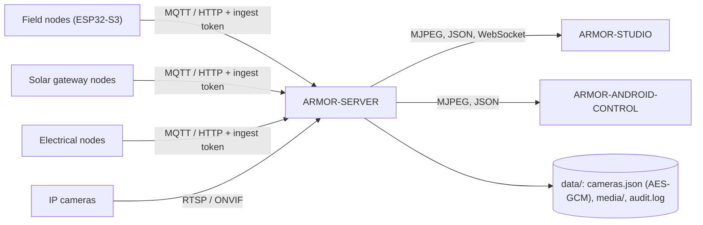

<p align="center">
  
</p>

# 🛡️ ARMOR-SERVER

<p align="center">
  <a href="README.md">🇺🇸 English</a> |
  <a href="README_spa.md">🇪🇸 Español</a> |
  🇫🇷 <b>Français</b> |
  <a href="README_ita.md">🇮🇹 Italiano</a> |
  <a href="README_deu.md">🇩🇪 Deutsch</a> |
  <a href="README_zho.md">🇨🇳 简体中文</a> |
  <a href="README_jpn.md">🇯🇵 日本語</a> |
  <a href="README_por.md">🇵🇹 Português</a>
</p>

### Coordinateur central de sécurité : nœuds, alarmes, appareils, énergie, caméras, réseau local et entretien de l'installation

<p align="center">
  
  
  
  
  
  
</p>

---

**Vérification d'honnêteté - ce qui fonctionne aujourd'hui :** Chaque route, session, chiffrement et règle de preuves ci-dessous est réel et couvert par des tests (`npm test` : 838 tests, dont une suite complète d'intégration HTTP contre un serveur isolé et une vérification que chaque route est documentée dans le fichier OpenAPI). Il fonctionne en usage quotidien sur le banc de test CM5 avec un vrai broker MQTT, le firmware d'un vrai nœud radar sur une carte ESP32-S3, de vraies caméras IP (vidéo en direct, captures, enregistrements, PTZ sur les unités Hi3510), la console Studio, l'application Android et les services de voix et d'observation. Ce qui n'est **pas** encore prouvé : ONVIF avec une vraie caméra ONVIF, tout matériel Jetson, les routes solaires, électriques, de centrales d'alarme et de panneau tactile avec de vrais nœuds (testées avec des messages générés : seule la carte radar existe) et le push via Firebase avec un vrai projet Firebase.

---

## 📋 En un coup d'œil

| | |
|---|---|
| Version | `0.8.0.9` |
| Maturité | Établi |
| Rôle | Coordinateur central de sécurité de la famille : nœuds, alarmes, appareils, énergie, caméras, réseau |
| Technologie | Node.js 22+, TypeScript, Express 5, MQTT, WebSocket, FFmpeg |
| Tests | 838 (`npm test` : unitaires et intégration HTTP complète) |
| Contrat | 196 chemins HTTP, 255 opérations (OpenAPI dans ARMOR-COMMON), table des routes dans `docs/ROUTES.md` |
| Écoute sur | `127.0.0.1:8080` (`ARMOR_HOST`, `ARMOR_PORT`) |
| Fonctionne sur | Le banc d'essai CM5 (en service, voir ARMOR-DEVOPS) ou tout ordinateur avec Node.js |
| Sur matériel réel | Le banc de test CM5, en usage quotidien : un vrai broker MQTT, de vraies caméras IP, un vrai nœud radar sur une carte ESP32-S3, Studio, l'application Android et les services de voix et d'observation contre lui |
| Licence | GPL-3.0-or-later |

**Aller à :** [Présentation](#-présentation) · [Architecture](#-architecture) · [Sécurité](#-sécurité-et-protection) · [Interfaces](#-interfaces) · [Configuration](#-configuration) · [Démarrage rapide](#-démarrage-rapide) · [Tests](#-tests) · [Dépannage](#-dépannage) · [Structure](#-structure-du-dépôt) · [Liés](#-projets-liés)

## 🚦 État du projet

Chaque ligne est une partie de ce dépôt et le feu dit où elle en est aujourd'hui. Elle est écrite d'après ce que le dépôt peut montrer (tests, compilations, exécutions), pas d'après ce qui est prévu.

🟢 Fait et vérifié · 🟡 Fonctionne, avec des limites connues · 🟠 À moitié fait ou pas encore vérifié · 🔴 Pas fait ou ne fonctionne pas

| Domaine | État | Ce que cela veut dire ici |
|---|---|---|
| Logiciel | 🟢 | Les routes, les sessions, le chiffrement et les règles de preuves tournent au quotidien sur le banc d'essai CM5. |
| Tests | 🟢 | 838 tests réussissent (`npm test`), dont une suite d'intégration HTTP complète contre un serveur isolé et un contrôle que chaque route est documentée dans le fichier OpenAPI. |
| Protocoles et données | 🟡 | Les messages du radar viennent d'une vraie carte ; les routes solaire, électrique, de centrale d'alarme et de panneau tactile sont testées avec des messages générés, et ONVIF n'a pas rencontré de vraie caméra ONVIF. |
| Matériel | 🟡 | Il tourne sur le banc d'essai CM5 avec un vrai courtier MQTT, de vraies caméras IP (vidéo en direct, captures, enregistrements, PTZ sur les unités Hi3510) et un vrai nœud radar ; rien n'a tourné sur un Jetson. |
| Sécurité | 🟡 | Les règles de sessions, de chiffrement, de preuves et de connexion sont couvertes par des tests ; il n'y a pas eu de revue indépendante. |
| Intégration | 🟡 | Studio, l'application Android et les services de voix et d'observation l'utilisent chaque jour sur le banc ; le push via Firebase n'a jamais tourné contre un vrai projet Firebase. |
| Documentation | 🟢 | Huit langues, la référence des routes (OpenAPI et ROUTES), les guides d'environnement et d'accès à distance et le journal des modifications sont à jour. |

## 🎯 Présentation

**ARMOR-SERVER** est le centre de confiance d'A.R.M.O.R. Les nœuds de terrain publient des observations de radar, de lumière et de santé ; ce service les valide, garde le dernier état connu de chaque nœud et le sert à la console Studio et au client Android. Il possède aussi tout ce qui touche une caméra, de sorte qu'**aucun navigateur ni téléphone ne détient jamais un mot de passe de caméra ni une adresse RTSP**.

* **Entrée validée :** les messages HTTP et MQTT de chaque type de nœud (radar, solaire, électrique, centrale d'alarme, réseau) sont vérifiés à la frontière par le contrat partagé avant d'atteindre l'état ; un nœud peut avoir son propre jeton (dérivé du jeton partagé) et un mode strict n'accepte rien d'autre.
* **État honnête des nœuds :** un nœud qui se tait est affiché *périmé* et *hors ligne* après une fenêtre configurable, jamais en ligne sur de vieilles données ; un nœud qui se reconnecte est compté depuis son retour, pas depuis ses anciens messages. Désarmer efface une alerte haute aussitôt.
* **Passerelle de caméras :** coffre chiffré des caméras, PTZ ONVIF / Hi3510 / PSIA, découverte des chemins RTSP, un relais FFmpeg partagé par caméra, captures et enregistrement MP4, un chien de garde qui transforme une caméra muette en événement et, armé, en alarme, **zones de l'image à ignorer** et **photos et vidéo prises seules** quand une caméra voit quelque chose pendant l'armement.
* **Bibliothèque de preuves :** rétention par ancienneté et taille, **preuves protégées** jamais effacées, un SHA-256 pour la chaîne de conservation et un fichier de **preuve de conservation** signé par le serveur. Une ligne d'audit par action sensible, avec les identifiants effacés.
* **État qui survit :** le mode de sécurité et la dernière observation de chaque nœud sont restaurés après un redémarrage (un redémarrage ne désarme jamais le périmètre en silence) ; les fichiers sont écrits de façon atomique et un fichier abîmé est récupéré. Chaque changement d'alerte, de nœud et de mode est conservé dans un historique d'événements.
* **Alarmes :** un centre d'alarmes avec cycle déclenchée / acquittée / terminée, escalade d'une alarme critique qui attend sans être vue, une **vérification avant armement** (ce qui est ouvert, muet ou en panne), un PIN pour désarmer (et un PIN de contrainte) et des alarmes de nœuds, caméras, appareils, solaire, électrique, réseau et centrales d'alarme. Elles arrivent à Studio, aux téléphones (ntfy, Telegram, Home Assistant, un webhook signé, push Firebase si vous le configurez) et au sujet MQTT `armor/server/alert`.
* **Utilisateurs et rôles :** noms et mots de passe (hachages scrypt), un rôle `admin` qui gère les utilisateurs, un rôle `operator` qui opère et un rôle `viewer` qui ne fait que regarder ; changer le mot de passe ou le rôle ferme les autres sessions de cet utilisateur.
* **Appareils et automatisations :** fumée, gaz, inondation, porte, fenêtre, mouvement, climat, prise, lumière, sirène, serrure, volet, portail ou porte de garage et chauffe-eau, par MQTT ou push authentifié, avec état normalisé, disponibilité et commandes ; des règles qui actionnent des appareils quand quelque chose arrive (aussi par seuils).
* **Énergie :** onduleurs et blocs de batteries (avec chaque cellule et les capacités) et nœuds électriques arrivent par HTTP ou MQTT, sont validés par le contrat partagé, conservés avec un historique et l'énergie par jour, marqués périmés s'ils se taisent, et déclenchent des alarmes (panne d'onduleur, batterie faible, réseau perdu, tension, défaut de commutation…). Le schéma électrique et les règles pour commuter un circuit sont conservés sur le serveur.
* **Modes d'armement** (désactivés tant qu'un administrateur n'active pas `alarm.arming_modes`) : absent (tout est défendu, l'armement de toujours), à la maison et nuit (seulement les zones et capteurs marqués pour chacun, aucun au départ), une temporisation de sortie et une d'entrée par mode, un calendrier facultatif, `GET` et `PUT /api/v1/alarm/modes` et les modes de `POST /api/v1/mode`. Un mode sans zone assignée est refusé sauf confirmation ; passer à un mode qui défend moins demande le PIN comme un désarmement ; désarmer fonctionne toujours. Aucun firmware ni écran de nœud n'est modifié. Avec `alarm.mode_panel_sync` activé, choisir un mode demande aussi aux centrales d'alarme d'armer avec le profil correspondant (absent, à la maison, nuit) ; l'état indique si elles l'ont confirmé, et une centrale qui ne le fait pas est une alarme du centre d'alarmes (`mode_panel_sync_failed`). Armer avec le jeton de contrôle et par la voix revient à armer en mode absent, avec la même synchronisation.
* **Centrales d'alarme :** l'état des nœuds ARMOR-NODE-ALARM, la **conception de l'alarme** avec ses versions, les **appareils Zigbee liés aux zones** (le serveur dit à une centrale l'état d'une zone tant qu'il tient la radio) et des commandes d'armement / désarmement vers une centrale (désactivé sauf `ARMOR_ALARM_COMMANDS=1`).
* **Réseau local :** ce que rapporte le nœud ARMOR-NETWORK (appareils, internet, l'adresse publique et qui la donne), des ordres pour le nœud (balayage, ping, ports, inspecter un appareil avec un identifiant que vous donnez), noms, appareils masqués et surveillés, et identifiants qui voyagent **scellés pour le seul nœud**.
* **Voix, observation et entretien :** commandes écrites et parlées (liste fermée, en huit langues, avec une confirmation liée à la personne), le contexte pour le service d'observation (quels radars couvrent quelle caméra), le firmware des nœuds mis à jour depuis Studio un par un avec progression, et les mises à jour de l'installation depuis GitHub, celles du système et une console root optionnelle, le tout par l'assistant de maintenance.
* **Usage depuis l'extérieur :** le serveur distingue la maison de l'extérieur (un VPN compte comme la maison), garde des sessions plus courtes depuis l'extérieur, demande un second facteur (une application d'authentification, avec des codes de récupération) et le mot de passe à nouveau avant les actions critiques, permet de choisir ce qu'une session extérieure peut faire (tout, seulement manœuvrer l'alarme, seulement regarder), prévient les destinations des alarmes quand quelqu'un se connecte depuis un nouvel endroit et ouvre le panneau web d'un nœud via le serveur - épinglé au certificat du nœud, avec son cookie gardé sur le serveur - pour qu'aucun nœud ne soit jamais publié.
* **Liaison chiffrée facultative avec le broker (mqtts) :** `ARMOR_MQTT_CA_FILE` désigne le certificat de l'autorité propre à l'installation ; avec une adresse `mqtts://` le serveur ne fait confiance qu'à cette autorité et vérifie le nom du broker, et il refuse de démarrer si le fichier n'est pas un certificat valide ou si l'adresse n'est pas `mqtts://`. Studio montre si la liaison est chiffrée et l'empreinte de l'autorité. Testé contre un faux broker TLS et contre un vrai Mosquitto 2.0.
* **Santé des nœuds et modes d'armement :** conserve le dernier rapport et le journal des redémarrages de chaque nœud et lève quatre avertissements (peu de mémoire, redémarrages trop fréquents, un broker qui décroche à répétition, signal Wi-Fi faible) ; conserve les profils d'armement (Absent, Présent, Nuit et les vôtres) et met celui choisi dans la commande d'armer, seulement pour un nœud qui dit les comprendre. Une alarme forte ou discrète suit le profil ; un armement sans profil est la commande de toujours.
* **Historique des connexions et du système :** en plus des alertes, nœuds, caméras, appareils et alarmes, l'historique enregistre quels appareils et applications se connectent (sessions Studio, appli Android, panneaux des nœuds, service vocal : connexions, refus, déconnexions, sessions expirées, usage du second facteur, première et dernière fois vus) et les événements du système (nœuds qui apparaissent ou disparaissent avec leur firmware, lien avec le broker, réglages changés et par qui, services, mises à jour, armement avec son profil). Filtrable par type, catégorie, client et utilisateur ; l'adresse et l'agent utilisateur ne sont visibles que des administrateurs, et aucun mot de passe, jeton, cookie ni PIN n'est jamais enregistré.
* **Ordres d'écriture sur une batterie Pylontech (désactivés sauf `ARMOR_BATTERY_WRITE=1`) :** pour des administrateurs qui viennent de prouver à nouveau qui ils sont - préparer, exécuter avec le numéro de série de la batterie saisi de nouveau, annuler, remettre une sortie comme avant, garder une image de firmware pendant une heure - vérifiés avec la table partagée des opérations et plages, envoyés au nœud passerelle en `solar_battery_command`, chaque opération étant conservée (qui, quelle batterie, ce qui a été lu avant et après, la différence et la transcription, jamais le mot de passe de service) et consignée dans l'historique sous *Batteries*.
* **Commande des nœuds :** `POST /api/v1/nodes/{id}/control` et `POST /api/v1/nodes/control` donnent un ordre (redémarrer, mettre en pause, reprendre, mettre en veille, identifier, diagnostic, maintenance activée ou désactivée) à un nœud ou à tous ceux qui rapportent, uniquement à un administrateur qui vient de se prouver de nouveau, avec le nom du nœud (ou le mot RESTART, PAUSE ou STANDBY pour tous) saisi de nouveau là où la maison serait moins bien gardée. Le serveur prépare l'ordre, l'exécute avec le jeton à usage unique que le nœud donne pour cette opération, suit chaque nœud (envoyé, reçu, appliqué, de retour) dans `GET /api/v1/nodes/control/operations`, redémarre les centrales d'alarme en dernier lors d'un redémarrage échelonné, consigne qui a ordonné quoi dans l'historique et le journal d'audit, et montre dans la santé du nœud s'il est en pause, en veille (travail arrêté, reste connecté) ou en maintenance. Il n'existe ni réinitialisation d'usine, ni effacement, ni sommeil profond. Il est testé avec un faux broker ; il n'a pas été essayé sur un vrai nœud.
* **État en direct et table des routes :** le serveur pousse l'état complet vers Studio par un WebSocket sur `/api/v1/events` dès que quelque chose change (une rafale de changements est un seul message, et un client qui prend du retard est abandonné), et chaque route enregistrée, avec qui peut l'appeler, figure dans une table générée à partir du code. Le panneau mural a son propre canal, plus petit, sur `/api/v1/panel/events` (le même résumé de quelques centaines d'octets que `GET /api/v1/panel/summary`, envoyé quand il change et toutes les cinq secondes, pour les comptes panneau, opérateur et administrateur ; un administrateur le coupe avec `panel.live_events`).
* **Lectures anciennes mises de côté :** un canal d'un nœud électrique dont la propre lecture a plus d'une minute (son compteur ne répond plus et le nœud répète les derniers bons chiffres) reste hors du chiffre du réseau et des graphiques, est listé dans `stale_channels` du nœud et compté dans `totals.stale_readings` ; l'option `electrical.set_aside_old_readings` (activée par défaut) le désactive.
* **La limite de connexion d'un nœud et la bonne image pour la bonne carte :** un administrateur lit et change les mots de passe erronés par minute qu'un nœud laisse passer (`POST /api/v1/admin/nodes/settings`, l'identifiant du panneau utilisé une fois et jamais conservé), et une image de firmware dont le nom de fichier indique une autre carte que celle du nœud est refusée avec `wrong_board` avant que rien ne soit envoyé.

## 🧩 Rôle dans A.R.M.O.R.

ARMOR-SERVER est l'unique centre de confiance de la famille. Les nœuds de terrain ([ARMOR-NODE-RADAR](https://github.com/JuanenRac/ARMOR-NODE-RADAR), [ARMOR-NODE-SOLAR](https://github.com/JuanenRac/ARMOR-NODE-SOLAR), [ARMOR-NODE-ELECTRICAL](https://github.com/JuanenRac/ARMOR-NODE-ELECTRICAL), [ARMOR-NODE-ALARM](https://github.com/JuanenRac/ARMOR-NODE-ALARM), [ARMOR-NODE-HMI](https://github.com/JuanenRac/ARMOR-NODE-HMI)) et [ARMOR-NETWORK](https://github.com/JuanenRac/ARMOR-NETWORK) lui parlent en MQTT ou HTTP ; [ARMOR-STUDIO](https://github.com/JuanenRac/ARMOR-STUDIO) et [ARMOR-ANDROID-CONTROL](https://github.com/JuanenRac/ARMOR-ANDROID-CONTROL) le lisent et lui donnent des ordres ; [ARMOR-SERVER-AI](https://github.com/JuanenRac/ARMOR-SERVER-AI) pèse ce que voient les caméras face aux radars et ne fait que recommander ; [ARMOR-VOICE-AI](https://github.com/JuanenRac/ARMOR-VOICE-AI) transforme la parole en une liste fermée de commandes ; [ARMOR-DEVOPS](https://github.com/JuanenRac/ARMOR-DEVOPS) installe et met à jour tout cela sur la CM5. Le serveur décide : rien d'autre n'arme, ne désarme ni ne commute quoi que ce soit.

| Il parle à | Comment | Pour quoi faire |
|---|---|---|
| ARMOR-NODE-RADAR, SOLAR, ELECTRICAL, ALARM, HMI | MQTT `armor/*/#` ou HTTP `POST` avec le jeton d'ingestion | leurs messages entrent, les ordres sortent |
| ARMOR-NETWORK | l'état entre, ordres et identifiants scellés sortent | le réseau local |
| ARMOR-STUDIO, ARMOR-ANDROID-CONTROL | HTTP, MJPEG et le WebSocket `/api/v1/events` | les consoles |
| ARMOR-VOICE-AI | `/v1/command`, `/v1/turn` avec son propre jeton | décide d'une phrase ; le serveur agit |
| ARMOR-SERVER-AI | `ARMOR_AI_TOKEN`, `/api/v1/ai/...` | observation des caméras |
| Caméras IP | RTSP, ONVIF, Hi3510, PSIA (le serveur les appelle) | vidéo en direct, instantanés, enregistrement, PTZ |

## 🏛️ Architecture

<p align="center">
  
</p>

<details>
<summary>Version texte du diagramme (Mermaid)</summary>



</details>

## 🔒 Sécurité et protection

* Secrets séparés : **ingest** (les nœuds publient leurs messages ; chaque nœud peut aussi avoir son propre jeton, dérivé du jeton partagé, et un mode strict n'accepte que ceux-là), **control** (armer / désarmer, événements), **operator** (automatisation) et la **connexion Studio** ; chacun est comparé en temps constant et aucun n'en remplace un autre. Un identifiant donné à un nœud réseau voyage scellé pour ce seul nœud.
* Trois rôles : **admin**, **operator** et **viewer** (lit, ne change jamais). Toute route qui configure, déplace, capture, enregistre, protège, supprime ou arme exige un opérateur ; la vidéo en direct exige un opérateur ou un ticket de flux de courte durée lié à une caméra. Les commandes dangereuses (désarmer, commuter un circuit, la console root) demandent un administrateur et, pour désarmer, le PIN.
* Les mots de passe des caméras ne vivent que dans `data/cameras.json`, chiffrés en AES-256-GCM, et aucune API ne les renvoie ; les adresses ONVIF doivent rester sur l'hôte de la caméra et les redirections sont refusées.
* Les sessions Studio sont HttpOnly et SameSite=Strict, la connexion est limitée en débit et les erreurs ne portent jamais de trace de pile.
* Le serveur écoute sur 127.0.0.1 sauf si `ARMOR_HOST` est défini volontairement, et alors un mot de passe Studio de moins de 12 caractères est refusé.
* Depuis l'extérieur : second facteur (TOTP, RFC 6238), une nouvelle preuve d'identité pour les utilisateurs, le firmware et les panneaux des nœuds, une politique qui réserve l'administration à la maison ou au VPN, uniquement des versions de firmware signées et un proxy de panneaux de nœuds qui ne prend jamais une adresse dans la requête, ne transmet que le nécessaire et refuse un nœud dont le certificat n'est pas celui de confiance.

| Menace | Défense |
|---|---|
| Deviner le mot de passe de Studio | scrypt (N=16384, r=8, p=1), même travail que l'utilisateur existe ou non ; 12 essais par 15 minutes par personne et adresse, 60 par adresse, 40 par minute au total ; moins de 8 caractères refusé (12 si le serveur est joignable depuis le réseau) |
| Un cookie volé, une requête d'un autre site | HttpOnly, SameSite=Strict et Secure derrière HTTPS ; les sessions durent 7 jours (Studio), 8 heures (opérateur) et 12 heures avec 30 minutes d'inactivité depuis l'extérieur |
| Attaques par le temps et secrets faibles | Les secrets sont comparés en temps constant, ont 24 caractères ou plus et sont tous différents (ingestion, contrôle, opérateur, clé des caméras, IA, clé des preuves) |
| Désarmer sans preuve | Un PIN de 4 à 10 chiffres selon `alarm.disarm_pin` (never, if_set, always) ; 3 échecs bloquent 60 s, 5 min, 15 min puis 1 h, conservé sur disque après redémarrage ; un PIN de contrainte est reconnu sans avertir ; le jeton de contrôle ne désarme qu'avec `ARMOR_CONTROL_DISARM=1` |
| Fuite des mots de passe des caméras | AES-256-GCM dans `data/cameras.json` ; aucune API ne les renvoie ; FFmpeg passe par un tunnel RTSP local (`media.rtsp_proxy`) pour que le mot de passe ne soit jamais sur une ligne de commande ; les redirections ONVIF sont refusées |
| Vidéo en direct sans connexion | Un ticket de flux lié à une seule caméra, délivré seulement à un opérateur |
| Inondation de l'API | 240 requêtes par minute en général (les POST des nœuds ont leur propre budget de 6000 par minute) ; corps JSON de 64 ko (9 Mo pour un fichier d'installation) |
| Un message de nœud faux ou mal formé | Vérifié à la frontière par les analyseurs de `src/contracts.ts`, testés avec les vecteurs partagés d'ARMOR-COMMON : 15 pistes au plus, lux jusqu'à 200 000, un identifiant de nœud en lettres, chiffres, `_` et `-` ; un jeton par nœud dérivé du partagé et un mode strict (`ARMOR_INGEST_STRICT=1`) |
| Une session depuis l'extérieur | Second facteur (`ARMOR_TOTP_REQUIRED` : off, remote, always), une politique de ce qu'elle peut faire (`ARMOR_REMOTE_POLICY` : full, operate, view), nouvelle preuve d'identité pour les actions critiques (5 minutes par défaut) et alerte lors d'une connexion depuis un nouveau lieu |
| Un panneau de nœud utilisé comme proxy ouvert | L'adresse ne vient jamais de la requête ; HTTPS est épinglé à l'empreinte SHA-256 du certificat du nœud |
| Voix : couper sans vérifier, texte long, audio énorme | La politique `voice.silence_confirmation` (off, pin, double_turn) accompagne chaque tour ; confirmation liée à la personne ; 200 caractères, 8 langues, 30 requêtes par minute ; audio de 480 000 octets et réponse de 200 000 octets au plus |
| Écritures dangereuses par erreur | Désactivées sauf `ARMOR_BATTERY_WRITE=1`, `ARMOR_ELECTRICAL_SWITCHING=1` ou `ARMOR_ALARM_COMMANDS=1`, avec avertissement au démarrage |

**Interrupteurs dans Studio.** Les protections réglables sont 22 valeurs conservées dans `security-settings.json` (mode 0600, écriture atomique), chacune avec un défaut prudent ; en abaisser une est inscrit dans l'audit : `alarm.disarm_pin`, `alarm.arming_modes`, `alarm.mode_downgrade_pin`, `alarm.mode_schedule`, `alarm.mode_schedule_lowers`, `alarm.mode_panel_sync`, `voice.silence_confirmation`, `alarm.config_hash`, `server.zone_feed`, `server.zone_feed_signature`, `media.rtsp_proxy`, `network.login_secure_only`, `login.country_alert`, `electrical.set_aside_old_readings`, `voice.multipart_turn`, `panel.live_events`, `client.device_lock`, `nodes.nvs_encryption`, `alarm_audio.spoken`, `alarm_audio.custom_sounds`, `voice.turn_max_bytes` et `voice.reply_audio_max_bytes`.

**Ce qu'il ne fait jamais :** renvoyer un mot de passe de caméra, garder les paroles prononcées (seulement la commande et son résultat), ni écrire un PIN, un jeton ou un cookie dans un journal. Il n'y a pas eu de revue de sécurité indépendante.

## 🔌 Interfaces

La table des routes (`docs/ROUTES.md`, générée depuis le code) liste chaque route avec qui peut l'appeler ; le fichier OpenAPI d'ARMOR-COMMON décrit 196 chemins et 255 opérations, et un test échoue s'il en manque une. Les plus importantes :

| Route | Authentification | Ce qu'elle fait |
|---|---|---|
| `GET /healthz` | aucune | vivant et prêt |
| `POST /api/v1/telemetry`  `/health`  `/solar`  `/electrical/readings`  `/alarm/state`  `/network/state`  `/devices/state` | jeton d'ingestion | ce que les nœuds envoient |
| `WS /api/v1/events` | session | tout l'état à chaque changement (une rafale est un message ; un client en retard est coupé ; 1 Ko au plus du client) |
| `WS /api/v1/panel/events` | panneau | un canal plus petit pour le panneau mural (128 octets au plus du client) |
| `POST /api/v1/voice/command` | opérateur, 30 par minute | une commande écrite ou vocale : `{text, language, confirmation?, pin?}` ; répond `{accepted, executed, intent, outcome, speech, confirmation_token?, reason?, result?}` |
| `POST /api/v1/voice/turn`  `/api/v1/voice/v1/turn` | en-tête `X-Armor-Voice-Token` | l'audio d'un tour (multipart) ; erreurs `unauthorized`, `multipart_turn_disabled` (415), `audio_too_large` (413), `bad_multipart` (400), `voice_bad_reply` (502) |
| `GET /api/v1/alarm-audio` | opérateur | ce qu'offre le son des alarmes : les deux options (désactivées par défaut), la présence d'une passerelle vocale, les limites et les sons enregistrés |
| `GET /api/v1/alarm-audio/spoken` | opérateur ou le compte d'un panneau mural | une alarme dite à voix haute (origine, gravité, code d'alarme ; PCM mono 16 bits à 16 kHz avec son SHA-256), produite par la passerelle vocale et gardée dans un cache ; 404 `spoken_alarms_disabled` tant que l'option est désactivée |
| `GET` `PUT` `DELETE /api/v1/alarm-audio/sounds/{source}` | GET : opérateur ou le compte d'un panneau mural ; PUT et DELETE : administrateur (nouvelle preuve d'identité depuis l'extérieur) | le son d'une origine d'alarme : un fichier WAVE en PCM mono 16 bits à 16 kHz, lu octet par octet (d'un dixième de seconde jusqu'à `ARMOR_ALARM_SOUND_MAX_BYTES`, pas de silence), seuls ses échantillons sont conservés, servi avec son SHA-256 ; 409 `custom_sounds_disabled` tant que l'option est désactivée |
| `POST /api/v1/nodes/{id}/control`  `POST /api/v1/nodes/control` | administrateur qui vient de se ré-identifier | un ordre (redémarrer, pause, reprise, veille, identifier, diagnostic, maintenance) à un nœud ou à tous |
| `POST /api/v1/admin/nodes/settings` | administrateur | lit et, si `login_limit_per_minute` est donné (0 à 120 mots de passe erronés par minute), change la limite de connexion d'un nœud par le panneau du nœud lui-même ; l'identifiant du panneau est utilisé une fois et jamais conservé, et la ligne d'audit ne le contient pas |
| `POST /api/v1/admin/firmware/jobs` | administrateur, preuve d'identité récente | installe une image de firmware sur les nœuds un par un ; une image dont le nom de fichier indique une autre carte que celle du nœud (`armor_<type>-<carte>.bin`) fait échouer ce nœud avec `wrong_board` avant de lui envoyer quoi que ce soit |
| `POST /api/v1/cameras/{id}/stream-ticket` | opérateur | un ticket de courte durée pour la vidéo en direct d'une caméra |

* Publique : `GET /healthz`. Pour un utilisateur connecté : état, informations, caméras, médias, historique, règles, appareils, alarmes, automatisations, les conceptions (site, alarme, électrique, réseau), mesures solaires et électriques, le réseau local, notifications et préférences, et pour un administrateur utilisateurs, services, firmware, mises à jour et la console.
* Pour les nœuds : `POST /api/v1/telemetry`, `/health`, `/solar`, `/electrical/readings`, `/alarm/state`, `/network/state` et `/devices/state` avec le jeton d'ingestion, et les sujets MQTT `armor/node/#`, `armor/solar/#`, `armor/electrical/#`, `armor/alarm/#` et `armor/network/#`. Les événements atteignent les consoles par le WebSocket `/api/v1/events`.

## ⚙️ Configuration

Copiez `.env.example` en `.env` (ignoré par Git), ou laissez `run.bat` / `run.sh` générer des secrets aléatoires au premier lancement. La liste complète des variables, avec leurs plages, est dans [docs/ENVIRONMENT.md](docs/ENVIRONMENT.md) (générée depuis le code) et celles de l'accès à distance dans [docs/REMOTE_ACCESS.md](docs/REMOTE_ACCESS.md). Les valeurs qui protègent l'installation ne sont pas ici mais dans Studio (voir Sécurité).

| Réglage | Par défaut | Ce qu'il fait |
|---|---|---|
| `ARMOR_INGEST_TOKEN`  `ARMOR_CONTROL_TOKEN` | oui (24+ caractères, tous différents) | avec quoi les nœuds publient ; ce qui arme, désarme et lit les événements |
| `ARMOR_STUDIO_USERNAME`  `ARMOR_STUDIO_PASSWORD` | oui | le premier administrateur |
| `ARMOR_HOST`  `ARMOR_PORT` | 127.0.0.1  8080 | où il écoute ; un mot de passe Studio de moins de 12 caractères est refusé hors boucle locale |
| `ARMOR_DATA_DIR`  `ARMOR_FFMPEG_PATH` | data/ | dossier d'état ; FFmpeg pour la vidéo en direct et la capture |
| `ARMOR_MQTT_URL`  `ARMOR_MQTT_CA_FILE` | facultatif | le broker ; l'autorité propre à l'installation pour `mqtts://` (le serveur ne se fie qu'à elle, vérifie le nom du broker et refuse de démarrer avec un mauvais fichier) |
| `ARMOR_NODE_STALE_AFTER_S` | 30 (5-3600) | secondes de silence avant qu'un nœud soit périmé |
| `ARMOR_ALERT_DWELL_MS`  `ARMOR_ALERT_MIN_TARGETS` | 2000 (0-60000)  1 (1-20) | combien de temps et de cibles avant une alerte radar |
| `ARMOR_ESCALATE_AFTER_MIN` | 0 = off (0-1440) | minutes avant d'escalader une alarme critique que personne ne voit |
| `ARMOR_MEDIA_RETENTION_DAYS`  `ARMOR_MEDIA_MAX_BYTES` | 30 (0-3650)  20 GiB | preuves conservées par âge et taille, les plus anciennes d'abord ; les preuves protégées ne sont jamais supprimées |
| `ARMOR_STUDIO_SESSION_TTL_MS`  `ARMOR_OPERATOR_SESSION_TTL_MS`  `ARMOR_REMOTE_SESSION_TTL_MS`  `ARMOR_REMOTE_IDLE_MS`  `ARMOR_ELEVATION_MS` | 7 d  8 h  12 h  30 min  5 min | durée des sessions et d'une nouvelle preuve d'identité |
| `ARMOR_TOTP_REQUIRED`  `ARMOR_REMOTE_POLICY` | off  full | second facteur et ce qu'une session extérieure peut faire |
| `ARMOR_ALERT_LANGUAGE` | es | langue des alertes (l'une des huit) |
| `ARMOR_NTFY_URL`  `ARMOR_TELEGRAM_BOT_TOKEN`  `ARMOR_HOMEASSISTANT_URL`  `ARMOR_ALERT_WEBHOOK_URL`  `ARMOR_FCM_SERVICE_ACCOUNT` | désactivé | où vont les alarmes (tout désactivé par défaut) |
| `ARMOR_ALARM_COMMANDS`  `ARMOR_BATTERY_WRITE`  `ARMOR_ELECTRICAL_SWITCHING`  `ARMOR_INGEST_STRICT`  `ARMOR_CONTROL_DISARM` | 0 | écritures dangereuses et modes stricts, tout désactivé |
| `ARMOR_COOKIE_SECURE`  `ARMOR_STUDIO_ORIGIN` | - | mettre `1` derrière TLS ; l'origine de Studio |

* Obligatoires : `ARMOR_INGEST_TOKEN` et `ARMOR_CONTROL_TOKEN` (24 caractères ou plus, tous différents) et `ARMOR_STUDIO_USERNAME` / `ARMOR_STUDIO_PASSWORD` (le premier administrateur).
* Courantes : `ARMOR_HOST` / `ARMOR_PORT`, `ARMOR_DATA_DIR`, `ARMOR_FFMPEG_PATH` (vidéo en direct et capture), `ARMOR_MQTT_URL`, `ARMOR_MQTT_CA_FILE`, `ARMOR_STUDIO_ORIGIN`, `ARMOR_NODE_STALE_AFTER_S`, `ARMOR_CAMERA_CHECK_S`, `ARMOR_ALERT_DWELL_MS`, `ARMOR_ALERT_WEBHOOK_URL` et `ARMOR_COOKIE_SECURE` (à `1` derrière TLS).

## 🚀 Démarrage rapide

**Prérequis :** Node.js 22+, FFmpeg (vidéo en direct et capture), un broker MQTT (Mosquitto).

```powershell
npm install           # dépendances
npm run typecheck     # tsc --noEmit
npm test              # 838 tests : unitaires et intégration HTTP complète
npm run build         # dist/server.mjs
.\run.bat   (run.sh)  # serveur de développement avec rechargement à chaud
```

Pour l'installer sur le banc d'essai CM5 (isolé de tout autre projet, utilisateur et ports propres), voir [ARMOR-DEVOPS](https://github.com/JuanenRac/ARMOR-DEVOPS).

## 🧪 Tests

```powershell
npm run typecheck  # tsc --noEmit
npm test           # tsx --test tests/*.test.ts
python -I tools/armor_ci_validate.py
```

`npm test` exécute chaque fichier de `tests/` (99 fichiers) : tests unitaires de chaque module et une suite d'intégration HTTP complète contre un serveur isolé (`tests/vertical-slice.test.ts`). `tests/conformance.test.ts` exécute les vecteurs partagés d'ARMOR-COMMON et vérifie que **les routes enregistrées par le serveur sont exactement les opérations décrites par le fichier OpenAPI**, par méthode et chemin, et que chaque réponse dit quel corps elle porte ; il est ignoré si ARMOR-COMMON n'est pas à côté de ce dépôt. Les tests TLS demandent `openssl` installé. GitHub Actions exécute la base A.R.M.O.R. à chaque push et pull request : la validation du manifeste, de la version, du journal des modifications et de la parité des README, puis le build et les tests propres au projet.

## 🏗️ Compilation et publication

`npm run build` regroupe le serveur dans `dist/server.mjs` (le `Dockerfile` en construit l'image de conteneur). La version se trouve dans `package.json`, dans `armor.project.json` et dans le badge du README (lu depuis le manifeste) ; chaque version a son entrée dans [CHANGELOG.md](CHANGELOG.md). Les versions sont publiées sur GitHub.

## 🩺 Dépannage

| Vous voyez | Parce que | Faites |
|---|---|---|
| `ARMOR_INGEST_TOKEN must be at least 24 characters` | un secret manque ou est court | définissez-le (24+ caractères) ; `run.sh` peut les générer |
| `... and ... must be different values` | deux secrets sont identiques | donnez à chacun sa valeur |
| `ARMOR_STUDIO_PASSWORD must be at least 12 characters when the server is reachable from the network` | `ARMOR_HOST` n'est pas la boucle locale | utilisez un mot de passe plus long, ou gardez `127.0.0.1` |
| `ARMOR_MQTT_CA_FILE needs an mqtts:// address in ARMOR_MQTT_URL` | le fichier d'autorité est donné mais l'adresse du broker n'est pas `mqtts://` | utilisez une adresse `mqtts://`, ou retirez le fichier |
| `TLS_CERT_PATH and TLS_KEY_PATH must both be set` | un seul des deux est donné | donnez les deux pour HTTPS, ou aucun pour HTTP |
| `voice_unavailable`  `voice_not_answering` (503) | le service vocal est injoignable | démarrez ARMOR-VOICE-AI et vérifiez `ARMOR_VOICE_URL` et son jeton |

## 📂 Structure du dépôt

<p align="center">
  
</p>

<details>
<summary>Version texte de l'arborescence</summary>

```text
ARMOR-SERVER/
├── src/
│   ├── server.ts app.ts              démarrage, application Express, limites
│   ├── config.ts                     chaque réglage, vérifié au démarrage
│   ├── contracts.ts mqtt_router.ts   validation à la frontière
│   ├── store.ts persistence.ts       état des nœuds et ce qui survit à un redémarrage
│   ├── alarms.ts escalation.ts       centrale d'alarme et escalade
│   ├── users.ts totp.ts              utilisateurs, rôles, PIN et second facteur
│   ├── security_settings.ts          les 21 interrupteurs de Studio
│   ├── voice.ts voice_turn.ts        commandes écrites et vocales
│   ├── firmware.ts installation.ts   firmware des nœuds et mises à jour propres
│   ├── http/                         sessions, jetons par nœud, identifiants scellés
│   ├── routes/                       un fichier par groupe de routes
│   ├── cameras/                      coffre, PTZ, RTSP, découverte, santé
│   ├── media/                        relais FFmpeg et bibliothèque de preuves
│   └── devices/                      modèle d'appareils et son pont MQTT
├── tests/                            838 tests, unitaires et intégration HTTP
├── docs/                             8 guides, table des routes, environnement
├── tools/                            générateurs de docs/ROUTES.md et docs/ENVIRONMENT.md, vérifications CI, lanceur
├── images/                           bannière, icône et images du README
├── .github/                          workflow CI, avis au tableau de bord, modèles d'issues et de pull requests
├── Dockerfile                        image de conteneur du serveur
├── armor.project.json                manifeste : version, rôle, maturité
├── CHANGELOG.md                      ce qui a changé à chaque version
├── package.json package-lock.json    dépendances et scripts
├── tsconfig.json                     réglages TypeScript
├── run.sh run.bat                    démarrer, flux partagé
├── build.sh build.bat                construire et tester, flux partagé
├── build-test.sh build-test.bat      construire, tester, empaqueter
├── test.sh test.bat                  seulement les tests, jamais la version
└── SECURITY.md SUPPORT.md CONTRIBUTING.md CODE_OF_CONDUCT.md LICENSE
```

</details>

## 🗺️ Feuille de route et limites connues

**Limites connues aujourd'hui**

* ONVIF n'a pas rencontré de vraie caméra ONVIF, et rien n'a tourné sur un Jetson.
* Les routes solaire, électrique, tableau d'alarme et écran tactile sont testées avec des messages générés : seule la carte radar existe.
* Le push via Firebase n'a jamais tourné contre un vrai projet Firebase.
* Les ordres de contrôle des nœuds et le TLS natif avec certificat public n'ont pas tourné sur un vrai nœud.
* Pas de revue de sécurité indépendante.

**Prochainement**

* Essayer ONVIF avec une vraie caméra et les routes des autres nœuds avec leurs cartes.
* Essayer le push avec un vrai projet Firebase.

## 🌍 Langues

Le README et les textes existent en anglais, espagnol, français, italien, allemand, chinois, japonais et portugais européen.

## 🔗 Projets liés

**A.R.M.O.R.** (Autonomous Radar & Multimodal Observation Range) est un système de sécurité périmétrique composé de dépôts indépendants. Chacun a sa propre version, ses propres tests et son propre README ; voici la famille :

* **[ARMOR-COMMON](https://github.com/JuanenRac/ARMOR-COMMON)** - Contrats de messages, validateurs, vecteurs de conformité et types générés
* **[ARMOR-NODE-RADAR](https://github.com/JuanenRac/ARMOR-NODE-RADAR)** - Firmware du nœud de terrain pour ESP32-S3 avec trois radars et son propre panneau web
* **[ARMOR-NODE-SOLAR](https://github.com/JuanenRac/ARMOR-NODE-SOLAR)** - Protocoles des onduleurs et batteries solaires et messages d'un nœud passerelle
* **[ARMOR-NODE-ELECTRICAL](https://github.com/JuanenRac/ARMOR-NODE-ELECTRICAL)** - Nœud électrique : compteurs, le message des mesures du réseau et les règles de commutation
* **[ARMOR-NODE-ALARM](https://github.com/JuanenRac/ARMOR-NODE-ALARM)** - Nœud et centrale d'alarme : zones, armement, temporisations, sirène et PIN, avec ou sans le serveur
* **[ARMOR-NODE-HMI](https://github.com/JuanenRac/ARMOR-NODE-HMI)** - Panneau tactile : l'état du système sur un écran mural, armer et acquitter, et la maison de l'assistant vocal
* **[ARMOR-NETWORK](https://github.com/JuanenRac/ARMOR-NETWORK)** - Le réseau local : ses appareils, internet et ce qui change
* **ARMOR-SERVER** (ce dépôt) - Coordinateur central : télémétrie, alarmes, appareils, relevés solaires et caméras
* **[ARMOR-STUDIO](https://github.com/JuanenRac/ARMOR-STUDIO)** - Console web : caméras, radar, alarmes, énergie solaire et concepteur de site 2D/3D
* **[ARMOR-ANDROID-CONTROL](https://github.com/JuanenRac/ARMOR-ANDROID-CONTROL)** - Client Android de l'opérateur avec radar 2D/3D en direct
* **[ARMOR-IOS-CONTROL](https://github.com/JuanenRac/ARMOR-IOS-CONTROL)** - Client opérateur iPhone
* **[ARMOR-SERVER-AI](https://github.com/JuanenRac/ARMOR-SERVER-AI)** - Politique d'inférence visuelle qui explique ses décisions et n'agit jamais
* **[ARMOR-VISION](https://github.com/JuanenRac/ARMOR-VISION)** - Zones de caméra, masques et règles de détection pour la Jetson Orin NX
* **[ARMOR-VOICE-AI](https://github.com/JuanenRac/ARMOR-VOICE-AI)** - Intentions vocales hors ligne avec une confirmation impossible à falsifier
* **[ARMOR-HARDWARE](https://github.com/JuanenRac/ARMOR-HARDWARE)** - Boîtiers, électronique et matrice d'acceptation sur banc
* **[ARMOR-DEVOPS](https://github.com/JuanenRac/ARMOR-DEVOPS)** - Déploiement, banc d'essai CM5, sauvegarde et TLS
* **[ARMOR-SIMULATOR](https://github.com/JuanenRac/ARMOR-SIMULATOR)** - Simulateur de télémétrie hors ligne avec des pannes reproductibles
* **[ARMOR-UPDATER](https://github.com/JuanenRac/ARMOR-UPDATER)** - Détecte, installe et met à jour les propres dépôts de l'écosystème
* **[ARMOR-DOCS](https://github.com/JuanenRac/ARMOR-DOCS)** - Architecture, base de sécurité et matrice des capacités

## 📚 Documentation

* [Table des routes](docs/ROUTES.md) : chaque route et qui peut l'appeler (générée)
* [Environnement](docs/ENVIRONMENT.md) : chaque variable avec sa plage (généré)
* [Intégration](docs/INTEGRATION.md) : comment nœuds, applications et services parlent au serveur
* [Accès à distance](docs/REMOTE_ACCESS.md) : second facteur, politique et la maison vue de l'extérieur
* [Passerelle caméras et médias](docs/CAMERA_MEDIA_GATEWAY.md) : coffre, PTZ, relais et preuves
* [Firmware des nœuds](docs/NODE_FIRMWARE.md) : mettre à jour les nœuds depuis Studio
* [Modes d'armement](docs/ARMING_MODES.md) : absent, à la maison et nuit, leurs zones, temporisations et ce qu'ils ne font jamais
* [Machine à états](docs/STATE_MACHINE.md) : la vie d'un nœud et d'une alarme
* [Matrice des capacités : ce qui est prouvé et ce qui ne l'est pas](https://github.com/JuanenRac/ARMOR-DOCS/blob/main/docs/CAPABILITY_MATRIX.md)
* [Catalogue des projets : versions et dépendances entre les dépôts](https://github.com/JuanenRac/ARMOR-DOCS/blob/main/docs/PROJECT_CATALOG.md)
* [Historique des modifications de ce dépôt](CHANGELOG.md)

## 🤝 Contribuer et communauté

* Avant une pull request, exécutez `python -I tools/armor_ci_validate.py` et les tests : les deux doivent réussir. Voir [CONTRIBUTING.md](CONTRIBUTING.md) et le [code de conduite](CODE_OF_CONDUCT.md).
* Le README existe en huit langues et est généré à partir des sources d'ARMOR-DOCS : une modification du texte se fait là-bas.
* Une modification d'un message entre composants commence dans ARMOR-COMMON.
* Ne décrivez pas comme fonctionnant sur une carte ce qui a seulement été compilé.
* Signalez une vulnérabilité en privé : [SECURITY.md](SECURITY.md). Questions, idées et rapports : electrohobby3d@gmail.com ([SUPPORT.md](SUPPORT.md)).

## 👤 AUTEUR

**JuanenRac (Electro Hobby 3D)** · electrohobby3d@gmail.com

## 📜 LICENCE

GPL-3.0-or-later - voir [LICENSE](LICENSE).
