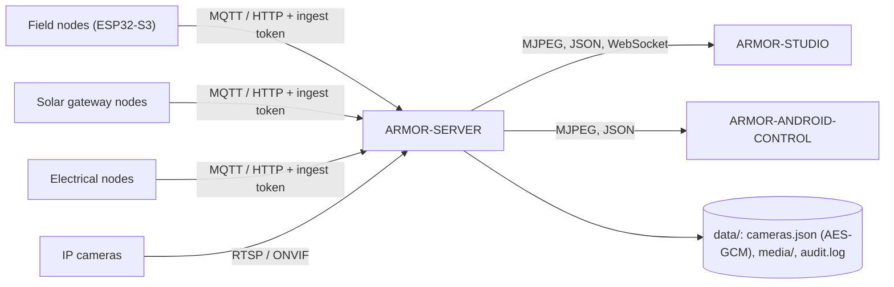

<p align="center">
  
</p>

# 🛡️ ARMOR-SERVER

<p align="center">
  <a href="README.md">🇺🇸 English</a> |
  <a href="README_spa.md">🇪🇸 Español</a> |
  <a href="README_fra.md">🇫🇷 Français</a> |
  🇮🇹 <b>Italiano</b> |
  <a href="README_deu.md">🇩🇪 Deutsch</a> |
  <a href="README_zho.md">🇨🇳 简体中文</a> |
  <a href="README_jpn.md">🇯🇵 日本語</a> |
  <a href="README_por.md">🇵🇹 Português</a>
</p>

### Coordinatore centrale di sicurezza: nodi, allarmi, dispositivi, energia, telecamere, rete locale e manutenzione dell'impianto

<p align="center">
  
  
  
  
  
  
</p>

---

**Controllo di onestà - cosa funziona oggi:** Ogni rotta, sessione, cifratura e regola delle prove qui sotto è reale e coperta da test (`npm test`: 399 test, compresa una suite completa di integrazione HTTP contro un server isolato e un controllo che ogni rotta sia documentata nel file OpenAPI). Funziona in uso quotidiano sul banco di prova CM5 con un vero broker MQTT, il firmware di un vero nodo radar su una scheda ESP32-S3, vere telecamere IP (video dal vivo, istantanee, registrazioni, PTZ sulle unità Hi3510), la console Studio, l'app Android e i servizi di voce e di osservazione. Ciò che **non** è ancora provato: ONVIF con una vera telecamera ONVIF, qualsiasi hardware Jetson, le rotte solari, elettriche, delle centrali d'allarme e del pannello touch con nodi reali (si provano con messaggi generati: esiste solo la scheda radar) e il push tramite Firebase con un vero progetto Firebase.

---

## 📋 In breve

| | |
|---|---|
| Versione | `0.6.5` |
| Maturità | Consolidato |
| Test | 399 (`npm test`) |
| Tecnologia | Node.js 22+ / TypeScript / Docker Compose |
| Su hardware reale | Il banco di prova CM5, in uso quotidiano: un vero broker MQTT, vere telecamere IP, un vero nodo radar su una scheda ESP32-S3, Studio, l'app Android e i servizi di voce e osservazione contro di esso |

## 🎯 Panoramica

**ARMOR-SERVER** è il centro di fiducia di A.R.M.O.R. I nodi di campo pubblicano osservazioni di radar, luce e salute; questo servizio le valida, conserva l'ultimo stato noto di ogni nodo e lo serve alla console Studio e al client Android. Possiede anche tutto ciò che tocca una telecamera, così **nessun browser né telefono detiene mai una password di telecamera o un indirizzo RTSP**.

* **Ingresso validato:** i messaggi HTTP e MQTT di ogni tipo di nodo (radar, solare, elettrico, centrale d'allarme, rete) sono controllati al confine dal contratto condiviso prima di arrivare allo stato; un nodo può avere il proprio token (derivato da quello condiviso) e una modalità rigorosa non accetta altro.
* **Stato onesto dei nodi:** un nodo che smette di parlare appare *obsoleto* e *offline* dopo una finestra configurabile, mai online su dati vecchi; uno che si riconnette è contato dal suo ritorno, non dai vecchi messaggi. Disinserire cancella subito un allarme alto.
* **Gateway delle telecamere:** cassaforte cifrata delle telecamere, PTZ ONVIF / Hi3510 / PSIA, scoperta dei percorsi RTSP, un relay FFmpeg condiviso per telecamera, istantanee e registrazione MP4, un guardiano che trasforma una telecamera muta in un evento e, a impianto inserito, in un allarme, **zone dell'immagine da ignorare** e **foto e video fatti da soli** quando una telecamera vede qualcosa a impianto inserito.
* **Libreria delle prove:** conservazione per età e dimensione, **prove protette** mai cancellate, un SHA-256 per la catena di custodia e un file di **prova di custodia** firmato dal server. Una riga di audit per azione rilevante, con le credenziali rimosse.
* **Stato che sopravvive:** la modalità di sicurezza e l'ultima osservazione di ogni nodo sono ripristinate dopo un riavvio (un riavvio non disinserisce mai il perimetro in silenzio); i file sono scritti in modo atomico e uno danneggiato viene recuperato. Ogni cambio di allarme, nodo e modalità è conservato in uno storico degli eventi.
* **Allarmi:** un centro allarmi con ciclo generato / riconosciuto / chiuso, escalation di un allarme critico che attende senza essere visto, un **controllo prima di inserire** (cosa è aperto, muto o fermo), un PIN per disinserire (e un PIN di coercizione) e allarmi da nodi, telecamere, dispositivi, solare, elettrico, rete e centrali d'allarme. Arrivano a Studio, ai telefoni (ntfy, Telegram, Home Assistant, un webhook firmato, push Firebase se lo configuri) e al topic MQTT `armor/server/alert`.
* **Utenti e ruoli:** nomi e password (hash scrypt), un ruolo `admin` che gestisce gli utenti, un ruolo `operator` che opera e un ruolo `viewer` che guarda soltanto; cambiare la password o il ruolo chiude le altre sessioni di quell'utente.
* **Dispositivi e automazioni:** fumo, gas, allagamento, porta, finestra, movimento, clima, presa, luce, sirena, serratura, tapparella, cancello o porta del garage e scaldabagno, via MQTT o push autenticato, con stato normalizzato, disponibilità e comandi; regole che azionano dispositivi quando succede qualcosa (anche a soglia).
* **Energia:** inverter e pacchi batteria (con ogni cella e le capacità) e nodi elettrici arrivano via HTTP o MQTT, sono validati dal contratto condiviso, conservati con storico ed energia per giorno, segnati obsoleti se tacciono, e generano allarmi (guasto inverter, batteria scarica, rete persa, tensione, guasto di commutazione…). Lo schema elettrico e le regole per commutare un circuito sono conservati sul server.
* **Centrali d'allarme:** lo stato dei nodi ARMOR-ALARM, il **progetto dell'allarme** con le sue versioni, i **dispositivi Zigbee legati alle zone** (il server dice a una centrale com'è una zona mentre tiene la radio) e comandi di inserimento / disinserimento a una centrale (spenti salvo `ARMOR_ALARM_COMMANDS=1`).
* **Rete locale:** ciò che riferisce il nodo ARMOR-NETWORK (dispositivi, internet, l'indirizzo pubblico e chi lo dà), ordini per il nodo (scansione, ping, porte, ispezionare un dispositivo con un accesso che dai tu), nomi, dispositivi nascosti e sorvegliati, e accessi che viaggiano **sigillati per il solo nodo**.
* **Voce, osservazione e manutenzione:** comandi scritti e parlati (elenco chiuso, in otto lingue, con una conferma legata alla persona), il contesto per il servizio di osservazione (quali radar coprono quale telecamera), il firmware dei nodi aggiornato da Studio uno alla volta con avanzamento, e gli aggiornamenti dell'impianto da GitHub, quelli del sistema e una console root opzionale, tutto tramite l'assistente di manutenzione.

## 🧩 Ruolo in A.R.M.O.R.

ARMOR-SERVER è l'unico centro di fiducia della famiglia. I nodi di campo ([ARMOR-RADAR](https://github.com/JuanenRac/ARMOR-RADAR), [ARMOR-SOLAR](https://github.com/JuanenRac/ARMOR-SOLAR), [ARMOR-ELECTRICAL](https://github.com/JuanenRac/ARMOR-ELECTRICAL), [ARMOR-ALARM](https://github.com/JuanenRac/ARMOR-ALARM), [ARMOR-HMI](https://github.com/JuanenRac/ARMOR-HMI)) e [ARMOR-NETWORK](https://github.com/JuanenRac/ARMOR-NETWORK) gli parlano via MQTT o HTTP; [ARMOR-STUDIO](https://github.com/JuanenRac/ARMOR-STUDIO) e [ARMOR-ANDROID-CONTROL](https://github.com/JuanenRac/ARMOR-ANDROID-CONTROL) lo leggono e gli danno ordini; [ARMOR-SERVER-AI](https://github.com/JuanenRac/ARMOR-SERVER-AI) pesa ciò che vedono le telecamere rispetto ai radar e si limita a raccomandare; [ARMOR-VOICE-AI](https://github.com/JuanenRac/ARMOR-VOICE-AI) trasforma la voce in un elenco chiuso di comandi; [ARMOR-DEVOPS](https://github.com/JuanenRac/ARMOR-DEVOPS) installa e aggiorna tutto sulla CM5. Il server decide: nient'altro inserisce, disinserisce o aziona qualcosa.

## 🔄 Architettura



## 🔒 Modello di sicurezza

* Segreti separati: **ingest** (i nodi pubblicano i loro messaggi; ogni nodo può avere anche un proprio token, derivato da quello condiviso, e una modalità rigorosa accetta solo quelli), **control** (inserire / disinserire, eventi), **operator** (automazione) e il **login di Studio**; ciascuno è confrontato in tempo costante e nessuno sostituisce un altro. Un accesso dato a un nodo di rete viaggia sigillato per quel solo nodo.
* Quattro ruoli: **admin**, **operator**, **panel** (il pannello a muro: il riepilogo, la modalità e il riconoscimento) e **viewer** (legge, non cambia mai). Ogni rotta che configura, sposta, cattura, registra, protegge, cancella o inserisce richiede un operatore; il video dal vivo richiede un operatore o un ticket di flusso di breve durata legato a una telecamera. I comandi pericolosi (disinserire, commutare un circuito, la console root) chiedono un amministratore e, per disinserire, il PIN.
* Disinserire con il **PIN di coercizione** è silenzioso: l'allarme che genera viene comunicato solo al webhook, a Telegram e a ntfy - mai al pannello a muro, al broker, a una notifica push, a Home Assistant né alla cronologia - e solo un amministratore lo vede o lo riconosce. Un riconoscimento dal pannello a muro o a voce non prova che ci sia qualcuno, quindi un allarme critico continua a essere scalato finché non lo riconosce una persona autenticata.
* Le password delle telecamere vivono solo in `data/cameras.json`, cifrate con AES-256-GCM, e nessuna API le restituisce; gli indirizzi ONVIF devono restare sull'host della telecamera e i reindirizzamenti sono rifiutati.
* Le sessioni di Studio sono HttpOnly e SameSite=Strict, il login ha un limite di tentativi e gli errori non portano mai una traccia di stack.
* Il server ascolta su 127.0.0.1 a meno che `ARMOR_HOST` sia impostato di proposito, e allora una password di Studio di meno di 12 caratteri è rifiutata.

## 🌐 API

* Pubblica: `GET /healthz`. Per un utente autenticato: stato, informazioni, telecamere, media, storico, regole, dispositivi, allarmi, automazioni, i progetti (sito, allarme, elettrico, rete), letture solari ed elettriche, la rete locale, notifiche e preferenze, e per un amministratore utenti, servizi, firmware, aggiornamenti e la console.
* Per i nodi: `POST /api/v1/telemetry`, `/health`, `/solar`, `/electrical/readings`, `/alarm/state`, `/network/state` e `/devices/state` con il token di ingest, e i topic MQTT `armor/node/#`, `armor/solar/#`, `armor/electrical/#`, `armor/alarm/#` e `armor/network/#`. Gli eventi raggiungono le console via WebSocket `/api/v1/events`.
* Ogni rotta (137 percorsi oggi), la sua regola di accesso e il suo schema sono nel file OpenAPI di [ARMOR-COMMON](https://github.com/JuanenRac/ARMOR-COMMON), e un test controlla che nessuna manchi.

## ⚙️ Configurazione

* Copia `.env.example` in `.env` (ignorato da Git), oppure lascia che `run.bat` / `run.sh` generino segreti casuali al primo avvio.
* Obbligatori: `ARMOR_INGEST_TOKEN` e `ARMOR_CONTROL_TOKEN` (24 caratteri o più, tutti diversi - il server si rifiuta di avviarsi se due coincidono) e `ARMOR_STUDIO_USERNAME` / `ARMOR_STUDIO_PASSWORD` (il primo amministratore).
* Comuni: `ARMOR_HOST` / `ARMOR_PORT`, `ARMOR_DATA_DIR`, `ARMOR_FFMPEG_PATH` (video dal vivo e cattura), `ARMOR_MQTT_URL`, `ARMOR_STUDIO_ORIGIN`, `ARMOR_NODE_STALE_AFTER_S`, `ARMOR_CAMERA_CHECK_S`, `ARMOR_ALERT_DWELL_MS`, `ARMOR_ALERT_WEBHOOK_URL` e `ARMOR_COOKIE_SECURE` (a `1` dietro TLS). Anche: `ARMOR_TRUST_PROXY` (dietro un proxy inverso, perché i limiti di accesso contino ogni client), `ARMOR_CONTROL_DISARM` (lasciare che il token di controllo disinserisca con il PIN obbligatorio), `ARMOR_EVIDENCE_KEY` (una chiave propria per le prove di custodia) e `ARMOR_TZ` (dove finisce un giorno di energia); vedi `.env.example`.
* Opzionali, tutti spenti per impostazione predefinita: `ARMOR_NTFY_URL`, `ARMOR_TELEGRAM_BOT_TOKEN`, `ARMOR_HOMEASSISTANT_URL`, `ARMOR_FCM_SERVICE_ACCOUNT` (push tramite il progetto Firebase dell'impianto stesso), `ARMOR_ALARM_COMMANDS=1` (lascia che il server inserisca e disinserisca le centrali), `ARMOR_ELECTRICAL_SWITCHING` e `ARMOR_INGEST_STRICT=1`.

## 📂 Struttura del repository

```text
ARMOR-SERVER/
├── src/            server, app, config, context, store, persistence, events, contracts, rules, mqtt, audit, notify, channels,
│   │               alarms, alarm, alarm_design, alarm_commands, alarm_zone_feed, escalation, preflight, automations, users,
│   │               site, solar, solar_registry, electrical, electrical_energy, electrical_switching, network, network_commands,
│   │               firmware, installation, admin, voice, voice_actions, ai, capture_on_detect, ignore_zones, push_fcm, ...
│   ├── http/       auth, per-node tokens, sealed credentials
│   ├── routes/     sessions, users, cameras, media, ingest, history, devices, alarms, alarm, alarm_design, solar, electrical,
│   │               network, firmware, maintenance, admin, notifications, voice, ai, push, preferences, system
│   ├── devices/    catalog, registry, commands, mapping (the device model and its MQTT bridge)
│   ├── cameras/    model, vault, digest, ptz, rtsp, discovery, health, errors
│   └── media/      relay, evidence
├── tests/          399 tests: unit + full HTTP integration
├── docs/           state machine, camera gateway, integration, node firmware
├── tools/          project tooling and the CI checks
├── data/           runtime state (ignored by Git)
└── images/         brand assets
```

## 🛠️ Ambiente di sviluppo

**Requisiti:** Node.js 22+, FFmpeg (live video and capture), an MQTT broker (Mosquitto)

```powershell
npm install
npm run typecheck   # tsc --noEmit
npm test            # 399 tests: unit + full HTTP integration (every route must be in the OpenAPI file)
npm run build       # dist/server.mjs
.\run.bat           # development server with hot reload
```

Per installare sul banco di prova CM5 (isolato da ogni altro progetto, con utente e porte proprie) vedi [ARMOR-DEVOPS](https://github.com/JuanenRac/ARMOR-DEVOPS).

## 🔗 Progetti correlati

**A.R.M.O.R.** (Autonomous Radar & Multimodal Observation Range) è un sistema di sicurezza perimetrale fatto di repository indipendenti. Ognuno ha la propria versione, i propri test e il proprio README; ecco la famiglia:

* **[ARMOR-COMMON](https://github.com/JuanenRac/ARMOR-COMMON)** - Contratti dei messaggi, validatori, vettori di conformità e tipi generati
* **[ARMOR-RADAR](https://github.com/JuanenRac/ARMOR-RADAR)** - Firmware del nodo di campo per ESP32-S3 con tre radar e un proprio pannello web
* **[ARMOR-SOLAR](https://github.com/JuanenRac/ARMOR-SOLAR)** - Protocolli di inverter e batterie solari e messaggi di un nodo gateway
* **[ARMOR-ELECTRICAL](https://github.com/JuanenRac/ARMOR-ELECTRICAL)** - Nodo elettrico: contatori, il messaggio delle letture della rete e le regole di manovra
* **[ARMOR-ALARM](https://github.com/JuanenRac/ARMOR-ALARM)** - Nodo e centrale d'allarme: zone, inserimento, ritardi, sirena e PIN, con il server o senza
* **[ARMOR-HMI](https://github.com/JuanenRac/ARMOR-HMI)** - Pannello touch: lo stato del sistema su uno schermo a parete, attivare e riconoscere gli allarmi, e la casa dell'assistente vocale
* **[ARMOR-NETWORK](https://github.com/JuanenRac/ARMOR-NETWORK)** - La rete locale: i suoi dispositivi, internet e ciò che cambia
* **ARMOR-SERVER** (questo repository) - Coordinatore centrale: telemetria, allarmi, dispositivi, letture solari e telecamere
* **[ARMOR-STUDIO](https://github.com/JuanenRac/ARMOR-STUDIO)** - Console web: telecamere, radar, allarmi, energia solare e progettista del sito 2D/3D
* **[ARMOR-ANDROID-CONTROL](https://github.com/JuanenRac/ARMOR-ANDROID-CONTROL)** - Client Android dell'operatore con radar 2D/3D in tempo reale
* **[ARMOR-SERVER-AI](https://github.com/JuanenRac/ARMOR-SERVER-AI)** - Politica di inferenza visiva che spiega le sue decisioni e non agisce mai
* **[ARMOR-VISION](https://github.com/JuanenRac/ARMOR-VISION)** - Zone delle telecamere, maschere e regole di rilevamento per la Jetson Orin NX
* **[ARMOR-VOICE-AI](https://github.com/JuanenRac/ARMOR-VOICE-AI)** - Intenti vocali offline con una conferma impossibile da falsificare
* **[ARMOR-HARDWARE](https://github.com/JuanenRac/ARMOR-HARDWARE)** - Contenitori, elettronica e matrice di accettazione da banco
* **[ARMOR-DEVOPS](https://github.com/JuanenRac/ARMOR-DEVOPS)** - Distribuzione, banco di prova CM5, backup e TLS
* **[ARMOR-SIMULATOR](https://github.com/JuanenRac/ARMOR-SIMULATOR)** - Simulatore di telemetria offline con guasti ripetibili
* **[ARMOR-UPDATER](https://github.com/JuanenRac/ARMOR-UPDATER)** - Rileva, installa e aggiorna i repository stessi dell'ecosistema
* **[ARMOR-DOCS](https://github.com/JuanenRac/ARMOR-DOCS)** - Architettura, base di sicurezza e matrice delle capacità

## 📚 Documentazione e comunità

Dove leggere di più:

* [Matrice delle capacità: cosa è provato e cosa no](https://github.com/JuanenRac/ARMOR-DOCS/blob/main/docs/CAPABILITY_MATRIX.md)
* [Catalogo dei progetti: versioni e dipendenze tra i repository](https://github.com/JuanenRac/ARMOR-DOCS/blob/main/docs/PROJECT_CATALOG.md)
* [Cronologia delle modifiche di questo repository](CHANGELOG.md)
* [Licenza (GPL-3.0-or-later)](LICENSE)
* Domande, idee e segnalazioni: electrohobby3d@gmail.com

## 👤 AUTORE

**JuanenRac (Electro Hobby 3D)** · electrohobby3d@gmail.com

## 📜 LICENZA

GPL-3.0-or-later - vedi [LICENSE](LICENSE).
