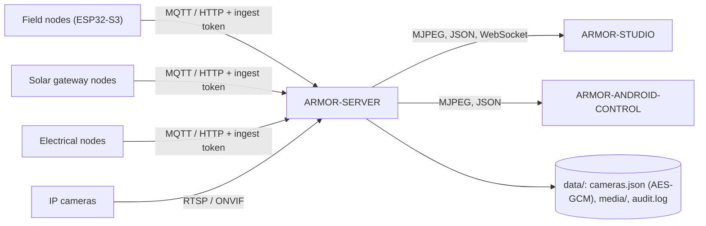

<p align="center">
  
</p>

# 🛡️ ARMOR-SERVER

<p align="center">
  <a href="README.md">🇺🇸 English</a> |
  <a href="README_spa.md">🇪🇸 Español</a> |
  <a href="README_fra.md">🇫🇷 Français</a> |
  🇮🇹 <b>Italiano</b> |
  <a href="README_deu.md">🇩🇪 Deutsch</a> |
  <a href="README_zho.md">🇨🇳 简体中文</a> |
  <a href="README_jpn.md">🇯🇵 日本語</a> |
  <a href="README_por.md">🇵🇹 Português</a>
</p>

### Coordinatore centrale di sicurezza: nodi, allarmi, dispositivi, energia, telecamere, rete locale e manutenzione dell'impianto

<p align="center">
  
  
  
  
  
  
</p>

---

**Controllo di onestà - cosa funziona oggi:** Ogni rotta, sessione, cifratura e regola delle prove qui sotto è reale e coperta da test (`npm test`: 779 test, compresa una suite completa di integrazione HTTP contro un server isolato e un controllo che ogni rotta sia documentata nel file OpenAPI). Funziona in uso quotidiano sul banco di prova CM5 con un vero broker MQTT, il firmware di un vero nodo radar su una scheda ESP32-S3, vere telecamere IP (video dal vivo, istantanee, registrazioni, PTZ sulle unità Hi3510), la console Studio, l'app Android e i servizi di voce e di osservazione. Ciò che **non** è ancora provato: ONVIF con una vera telecamera ONVIF, qualsiasi hardware Jetson, le rotte solari, elettriche, delle centrali d'allarme e del pannello touch con nodi reali (si provano con messaggi generati: esiste solo la scheda radar) e il push tramite Firebase con un vero progetto Firebase.

---

## 📋 In breve

| | |
|---|---|
| Versione | `0.8.0.9` |
| Maturità | Consolidato |
| Ruolo | Coordinatore centrale di sicurezza della famiglia: nodi, allarmi, dispositivi, energia, telecamere, rete |
| Tecnologia | Node.js 22+, TypeScript, Express 5, MQTT, WebSocket, FFmpeg |
| Test | 779 (`npm test`: unitari e integrazione HTTP completa) |
| Contratto | 196 percorsi HTTP, 255 operazioni (OpenAPI in ARMOR-COMMON), tabella delle rotte in `docs/ROUTES.md` |
| In ascolto su | `127.0.0.1:8080` (`ARMOR_HOST`, `ARMOR_PORT`) |
| Gira su | Il banco di prova CM5 (come servizio, vedi ARMOR-DEVOPS) o qualsiasi computer con Node.js |
| Su hardware reale | Il banco di prova CM5, in uso quotidiano: un vero broker MQTT, vere telecamere IP, un vero nodo radar su una scheda ESP32-S3, Studio, l'app Android e i servizi di voce e osservazione contro di esso |
| Licenza | GPL-3.0-or-later |

**Vai a:** [Panoramica](#-panoramica) · [Architettura](#-architettura) · [Sicurezza](#-sicurezza-e-protezione) · [Interfacce](#-interfacce) · [Configurazione](#-configurazione) · [Avvio rapido](#-avvio-rapido) · [Test](#-test) · [Problemi](#-risoluzione-dei-problemi) · [Struttura](#-struttura-del-repository) · [Correlati](#-progetti-correlati)

## 🚦 Stato del progetto

Ogni riga è una parte di questo repository e il semaforo dice a che punto è oggi. È scritta in base a ciò che il repository può mostrare (test, compilazioni, esecuzioni), non a ciò che è previsto.

🟢 Fatto e verificato · 🟡 Funziona, con limiti noti · 🟠 Fatto a metà o non ancora verificato · 🔴 Non fatto o non funzionante

| Area | Stato | Cosa significa qui |
|---|---|---|
| Software | 🟢 | Le route, le sessioni, la cifratura e le regole delle prove girano ogni giorno sul banco di prova CM5. |
| Test | 🟢 | Superano 779 test (`npm test`), compresa una suite di integrazione HTTP completa contro un server isolato e un controllo che ogni rotta sia documentata nel file OpenAPI. |
| Protocolli e dati | 🟡 | I messaggi del radar vengono da una scheda reale; le rotte solare, elettrica, della centralina d'allarme e del pannello touch sono provate con messaggi generati, e ONVIF non ha incontrato una vera telecamera ONVIF. |
| Hardware | 🟡 | Gira sul banco di prova CM5 con un broker MQTT reale, telecamere IP reali (video dal vivo, istantanee, registrazioni, PTZ sulle unità Hi3510) e un nodo radar reale; nulla ha girato su una Jetson. |
| Sicurezza | 🟡 | Le regole di sessioni, cifratura, prove e accesso sono coperte da test; non c'è stata una revisione indipendente. |
| Integrazione | 🟡 | Studio, l'app Android e i servizi di voce e osservazione lo usano ogni giorno sul banco; il push tramite Firebase non è mai stato eseguito contro un vero progetto Firebase. |
| Documentazione | 🟢 | Otto lingue, il riferimento delle rotte (OpenAPI e ROUTES), le guide di ambiente e accesso remoto e il registro delle modifiche sono aggiornati. |

## 🎯 Panoramica

**ARMOR-SERVER** è il centro di fiducia di A.R.M.O.R. I nodi di campo pubblicano osservazioni di radar, luce e salute; questo servizio le valida, conserva l'ultimo stato noto di ogni nodo e lo serve alla console Studio e al client Android. Possiede anche tutto ciò che tocca una telecamera, così **nessun browser né telefono detiene mai una password di telecamera o un indirizzo RTSP**.

* **Ingresso validato:** i messaggi HTTP e MQTT di ogni tipo di nodo (radar, solare, elettrico, centrale d'allarme, rete) sono controllati al confine dal contratto condiviso prima di arrivare allo stato; un nodo può avere il proprio token (derivato da quello condiviso) e una modalità rigorosa non accetta altro.
* **Stato onesto dei nodi:** un nodo che smette di parlare appare *obsoleto* e *offline* dopo una finestra configurabile, mai online su dati vecchi; uno che si riconnette è contato dal suo ritorno, non dai vecchi messaggi. Disinserire cancella subito un allarme alto.
* **Gateway delle telecamere:** cassaforte cifrata delle telecamere, PTZ ONVIF / Hi3510 / PSIA, scoperta dei percorsi RTSP, un relay FFmpeg condiviso per telecamera, istantanee e registrazione MP4, un guardiano che trasforma una telecamera muta in un evento e, a impianto inserito, in un allarme, **zone dell'immagine da ignorare** e **foto e video fatti da soli** quando una telecamera vede qualcosa a impianto inserito.
* **Libreria delle prove:** conservazione per età e dimensione, **prove protette** mai cancellate, un SHA-256 per la catena di custodia e un file di **prova di custodia** firmato dal server. Una riga di audit per azione rilevante, con le credenziali rimosse.
* **Stato che sopravvive:** la modalità di sicurezza e l'ultima osservazione di ogni nodo sono ripristinate dopo un riavvio (un riavvio non disinserisce mai il perimetro in silenzio); i file sono scritti in modo atomico e uno danneggiato viene recuperato. Ogni cambio di allarme, nodo e modalità è conservato in uno storico degli eventi.
* **Allarmi:** un centro allarmi con ciclo generato / riconosciuto / chiuso, escalation di un allarme critico che attende senza essere visto, un **controllo prima di inserire** (cosa è aperto, muto o fermo), un PIN per disinserire (e un PIN di coercizione) e allarmi da nodi, telecamere, dispositivi, solare, elettrico, rete e centrali d'allarme. Arrivano a Studio, ai telefoni (ntfy, Telegram, Home Assistant, un webhook firmato, push Firebase se lo configuri) e al topic MQTT `armor/server/alert`.
* **Utenti e ruoli:** nomi e password (hash scrypt), un ruolo `admin` che gestisce gli utenti, un ruolo `operator` che opera e un ruolo `viewer` che guarda soltanto; cambiare la password o il ruolo chiude le altre sessioni di quell'utente.
* **Dispositivi e automazioni:** fumo, gas, allagamento, porta, finestra, movimento, clima, presa, luce, sirena, serratura, tapparella, cancello o porta del garage e scaldabagno, via MQTT o push autenticato, con stato normalizzato, disponibilità e comandi; regole che azionano dispositivi quando succede qualcosa (anche a soglia).
* **Energia:** inverter e pacchi batteria (con ogni cella e le capacità) e nodi elettrici arrivano via HTTP o MQTT, sono validati dal contratto condiviso, conservati con storico ed energia per giorno, segnati obsoleti se tacciono, e generano allarmi (guasto inverter, batteria scarica, rete persa, tensione, guasto di commutazione…). Lo schema elettrico e le regole per commutare un circuito sono conservati sul server.
* **Modi di inserimento** (spenti finché un amministratore non attiva `alarm.arming_modes`): fuori (tutto difeso, l'inserimento di sempre), in casa e notte (solo le zone e i sensori marcati per ciascuno, nessuno all'inizio), un ritardo di uscita e uno di ingresso per modo, un calendario facoltativo, `GET` e `PUT /api/v1/alarm/modes` e i modi di `POST /api/v1/mode`. Un modo senza zone assegnate viene rifiutato salvo conferma; passare a un modo che difende meno chiede il PIN come un disinserimento; disinserire funziona sempre. Non cambia alcun firmware né display di nodo.
* **Centrali d'allarme:** lo stato dei nodi ARMOR-NODE-ALARM, il **progetto dell'allarme** con le sue versioni, i **dispositivi Zigbee legati alle zone** (il server dice a una centrale com'è una zona mentre tiene la radio) e comandi di inserimento / disinserimento a una centrale (spenti salvo `ARMOR_ALARM_COMMANDS=1`).
* **Rete locale:** ciò che riferisce il nodo ARMOR-NETWORK (dispositivi, internet, l'indirizzo pubblico e chi lo dà), ordini per il nodo (scansione, ping, porte, ispezionare un dispositivo con un accesso che dai tu), nomi, dispositivi nascosti e sorvegliati, e accessi che viaggiano **sigillati per il solo nodo**.
* **Voce, osservazione e manutenzione:** comandi scritti e parlati (elenco chiuso, in otto lingue, con una conferma legata alla persona), il contesto per il servizio di osservazione (quali radar coprono quale telecamera), il firmware dei nodi aggiornato da Studio uno alla volta con avanzamento, e gli aggiornamenti dell'impianto da GitHub, quelli del sistema e una console root opzionale, tutto tramite l'assistente di manutenzione.
* **Uso da fuori casa:** il server distingue la casa dall'esterno (una VPN conta come la casa), mantiene sessioni più brevi da fuori, chiede un secondo fattore (un'app di autenticazione, con codici di recupero) e di nuovo la password prima delle azioni critiche, permette di scegliere cosa può fare una sessione esterna (tutto, solo gestire l'allarme, solo guardare), avvisa le destinazioni degli allarmi quando qualcuno accede da un luogo nuovo e apre il pannello web di un nodo tramite il server - vincolato al certificato del nodo, con il suo cookie tenuto sul server - così nessun nodo viene mai pubblicato.
* **Collegamento cifrato facoltativo con il broker (mqtts):** `ARMOR_MQTT_CA_FILE` indica il certificato dell'autorità propria dell'installazione; con un indirizzo `mqtts://` il server si fida solo di quell'autorità e controlla il nome del broker, e si rifiuta di partire se il file non è un certificato valido o l'indirizzo non è `mqtts://`. Studio mostra se il collegamento è cifrato e l'impronta dell'autorità. Provato contro un broker TLS di prova e contro un vero Mosquitto 2.0.
* **Salute dei nodi e modalità di inserimento:** conserva l'ultimo rapporto e il registro dei riavvii di ogni nodo e solleva quattro avvisi (poca memoria, riavvii troppo frequenti, un broker che cade di continuo, segnale Wi-Fi debole); conserva i profili di inserimento (Fuori casa, In casa, Notte e i tuoi) e mette quello scelto dentro il comando di inserimento, solo per un nodo che dice di capirli. Un allarme forte o discreto segue il profilo; un inserimento senza profilo è il comando di sempre.
* **Cronologia delle connessioni e del sistema:** oltre ad avvisi, nodi, telecamere, dispositivi e allarmi, la cronologia registra quali dispositivi e app si collegano (sessioni di Studio, app Android, pannelli dei nodi, servizio vocale: accessi, rifiuti, uscite, sessioni scadute, uso del secondo fattore, prima e ultima volta visti) e gli eventi del sistema (nodi che appaiono o scompaiono con il loro firmware, il collegamento con il broker, impostazioni cambiate e da chi, servizi, aggiornamenti, inserimento con il suo profilo). Si filtra per tipo, categoria, client e utente; indirizzo e user agent li vedono solo gli amministratori, e non si registra mai una password, un token, un cookie o un PIN.
* **Ordini di scrittura su una batteria Pylontech (disattivati salvo `ARMOR_BATTERY_WRITE=1`):** per amministratori che hanno appena dimostrato di nuovo chi sono - prepara, esegui con il numero di serie della batteria digitato di nuovo, annulla, rimetti un'uscita com'era, conserva un'immagine firmware per un'ora - verificati con la tabella condivisa di operazioni e intervalli, inviati al nodo gateway come `solar_battery_command`, con ogni operazione conservata (chi, quale batteria, cosa è stato letto prima e dopo, la differenza e la trascrizione, mai la password di servizio) e riportata nello storico sotto *Batterie*.
* **Controllo dei nodi:** `POST /api/v1/nodes/{id}/control` e `POST /api/v1/nodes/control` danno un ordine (riavvio, pausa, ripresa, standby, identificazione, diagnostica, manutenzione attivata o disattivata) a un nodo o a tutti quelli che riferiscono, solo a un amministratore che si è appena dimostrato di nuovo, con il nome del nodo (o la parola RESTART, PAUSE o STANDBY per tutti) digitato di nuovo dove la casa resterebbe meno sorvegliata. Il server prepara l'ordine, lo esegue con il token monouso che il nodo dà per quell'operazione, segue ogni nodo (inviato, ricevuto, applicato, tornato) in `GET /api/v1/nodes/control/operations`, riavvia le centrali d'allarme per ultime in un riavvio scaglionato, registra chi ha ordinato cosa nello storico e nel registro di audit, e mostra nella salute del nodo se è in pausa, in standby (lavoro spento, resta connesso) o in manutenzione. Non esistono ripristino di fabbrica, cancellazione né sonno profondo. È provato con un broker finto; non è stato provato su un nodo reale.
* **Stato in diretta e tabella delle rotte:** il server invia lo stato completo a Studio tramite un WebSocket su `/api/v1/events` ogni volta che qualcosa cambia (una raffica di cambiamenti è un solo messaggio e un client che resta indietro viene scartato), e ogni rotta registrata, con chi può chiamarla, è elencata in una tabella generata dal codice. Il pannello a muro ha un canale proprio, più piccolo, su `/api/v1/panel/events` (lo stesso riepilogo di poche centinaia di byte di `GET /api/v1/panel/summary`, inviato quando cambia e ogni cinque secondi, per gli account pannello, operatore e amministratore; un amministratore lo disattiva con `panel.live_events`).
* **Letture vecchie messe da parte:** un canale di un nodo elettrico la cui lettura ha più di un minuto (il suo contatore ha smesso di rispondere e il nodo ripete gli ultimi numeri buoni) resta fuori dalla cifra della rete e dai grafici, è elencato in `stale_channels` del nodo e contato in `totals.stale_readings`; l'opzione `electrical.set_aside_old_readings` (attiva per default) lo disattiva.
* **Il limite di accesso di un nodo e l'immagine giusta per la scheda giusta:** un amministratore legge e cambia le password errate al minuto che un nodo lascia passare (`POST /api/v1/admin/nodes/settings`, con l'accesso al pannello usato una volta e mai conservato), e un'immagine firmware il cui nome di file indica una scheda diversa da quella del nodo viene rifiutata con `wrong_board` prima di inviare qualsiasi cosa.

## 🧩 Ruolo in A.R.M.O.R.

ARMOR-SERVER è l'unico centro di fiducia della famiglia. I nodi di campo ([ARMOR-NODE-RADAR](https://github.com/JuanenRac/ARMOR-NODE-RADAR), [ARMOR-NODE-SOLAR](https://github.com/JuanenRac/ARMOR-NODE-SOLAR), [ARMOR-NODE-ELECTRICAL](https://github.com/JuanenRac/ARMOR-NODE-ELECTRICAL), [ARMOR-NODE-ALARM](https://github.com/JuanenRac/ARMOR-NODE-ALARM), [ARMOR-NODE-HMI](https://github.com/JuanenRac/ARMOR-NODE-HMI)) e [ARMOR-NETWORK](https://github.com/JuanenRac/ARMOR-NETWORK) gli parlano via MQTT o HTTP; [ARMOR-STUDIO](https://github.com/JuanenRac/ARMOR-STUDIO) e [ARMOR-ANDROID-CONTROL](https://github.com/JuanenRac/ARMOR-ANDROID-CONTROL) lo leggono e gli danno ordini; [ARMOR-SERVER-AI](https://github.com/JuanenRac/ARMOR-SERVER-AI) pesa ciò che vedono le telecamere rispetto ai radar e si limita a raccomandare; [ARMOR-VOICE-AI](https://github.com/JuanenRac/ARMOR-VOICE-AI) trasforma la voce in un elenco chiuso di comandi; [ARMOR-DEVOPS](https://github.com/JuanenRac/ARMOR-DEVOPS) installa e aggiorna tutto sulla CM5. Il server decide: nient'altro inserisce, disinserisce o aziona qualcosa.

| Parla con | Come | A che scopo |
|---|---|---|
| ARMOR-NODE-RADAR, SOLAR, ELECTRICAL, ALARM, HMI | MQTT `armor/*/#` o HTTP `POST` con il token di ingestione | i loro messaggi entrano, gli ordini escono |
| ARMOR-NETWORK | lo stato entra, ordini e accessi sigillati escono | la rete locale |
| ARMOR-STUDIO, ARMOR-ANDROID-CONTROL | HTTP, MJPEG e il WebSocket `/api/v1/events` | le console |
| ARMOR-VOICE-AI | `/v1/command`, `/v1/turn` con il proprio token | decide una frase; il server agisce |
| ARMOR-SERVER-AI | `ARMOR_AI_TOKEN`, `/api/v1/ai/...` | osservazione delle telecamere |
| Telecamere IP | RTSP, ONVIF, Hi3510, PSIA (il server le chiama) | video dal vivo, istantanee, registrazione, PTZ |

## 🏛️ Architettura

<p align="center">
  
</p>

<details>
<summary>Versione testuale del diagramma (Mermaid)</summary>



</details>

## 🔒 Sicurezza e protezione

* Segreti separati: **ingest** (i nodi pubblicano i loro messaggi; ogni nodo può avere anche un proprio token, derivato da quello condiviso, e una modalità rigorosa accetta solo quelli), **control** (inserire / disinserire, eventi), **operator** (automazione) e il **login di Studio**; ciascuno è confrontato in tempo costante e nessuno sostituisce un altro. Un accesso dato a un nodo di rete viaggia sigillato per quel solo nodo.
* Tre ruoli: **admin**, **operator** e **viewer** (legge, non cambia mai). Ogni rotta che configura, sposta, cattura, registra, protegge, cancella o inserisce richiede un operatore; il video dal vivo richiede un operatore o un ticket di flusso di breve durata legato a una telecamera. I comandi pericolosi (disinserire, commutare un circuito, la console root) chiedono un amministratore e, per disinserire, il PIN.
* Le password delle telecamere vivono solo in `data/cameras.json`, cifrate con AES-256-GCM, e nessuna API le restituisce; gli indirizzi ONVIF devono restare sull'host della telecamera e i reindirizzamenti sono rifiutati.
* Le sessioni di Studio sono HttpOnly e SameSite=Strict, il login ha un limite di tentativi e gli errori non portano mai una traccia di stack.
* Il server ascolta su 127.0.0.1 a meno che `ARMOR_HOST` sia impostato di proposito, e allora una password di Studio di meno di 12 caratteri è rifiutata.
* Da fuori casa: secondo fattore (TOTP, RFC 6238), una nuova prova di identità per utenti, firmware e pannelli dei nodi, una politica che riserva l'amministrazione alla casa o alla VPN, solo release di firmware firmate e un proxy dei pannelli dei nodi che non prende mai un indirizzo dalla richiesta, passa solo il necessario e rifiuta un nodo il cui certificato non è quello attendibile.

| Minaccia | Difesa |
|---|---|
| Indovinare la password di Studio | scrypt (N=16384, r=8, p=1), stesso lavoro che l'utente esista o no; 12 tentativi ogni 15 minuti per persona e indirizzo, 60 per indirizzo, 40 al minuto in totale; sotto 8 caratteri è rifiutata (12 se il server è raggiungibile dalla rete) |
| Un cookie rubato, una richiesta da un altro sito | HttpOnly, SameSite=Strict e Secure dietro HTTPS; le sessioni durano 7 giorni (Studio), 8 ore (operatore) e 12 ore con 30 minuti di inattività dall'esterno |
| Attacchi temporali e segreti deboli | I segreti si confrontano in tempo costante, hanno almeno 24 caratteri e sono tutti diversi (ingestione, controllo, operatore, chiave delle telecamere, IA, chiave delle prove) |
| Disarmare senza prova | Un PIN di 4-10 cifre secondo `alarm.disarm_pin` (never, if_set, always); 3 errori bloccano 60 s, 5 min, 15 min e poi 1 h, salvato su disco tra i riavvii; un PIN di coercizione si distingue in silenzio; il token di controllo disarma solo con `ARMOR_CONTROL_DISARM=1` |
| Fuga delle password delle telecamere | AES-256-GCM in `data/cameras.json`; nessuna API le restituisce; FFmpeg passa da un tunnel RTSP locale (`media.rtsp_proxy`) così la password non sta mai su una riga di comando; i reindirizzamenti ONVIF sono rifiutati |
| Video dal vivo senza accesso | Un ticket di flusso legato a una sola telecamera, emesso solo a un operatore |
| Inondazione dell'API | 240 richieste al minuto in generale (i POST dei nodi hanno un budget proprio di 6000 al minuto); corpi JSON da 64 kB (9 MB per un file di installazione) |
| Un messaggio di nodo falso o malformato | Verificato al confine dai parser di `src/contracts.ts`, provati con i vettori condivisi di ARMOR-COMMON: al massimo 15 tracce, lux fino a 200 000, un id di nodo con lettere, cifre, `_` e `-`; un token per nodo derivato da quello condiviso e una modalità rigorosa (`ARMOR_INGEST_STRICT=1`) |
| Una sessione da fuori casa | Secondo fattore (`ARMOR_TOTP_REQUIRED`: off, remote, always), una politica su cosa può fare (`ARMOR_REMOTE_POLICY`: full, operate, view), nuova prova d'identità per le azioni critiche (5 minuti di default) e avviso per un accesso da un luogo nuovo |
| Un pannello di nodo usato come proxy aperto | L'indirizzo non arriva mai dalla richiesta; HTTPS è vincolato all'impronta SHA-256 del certificato del nodo |
| Voce: silenziare senza verifica, testo lungo, audio enorme | La politica `voice.silence_confirmation` (off, pin, double_turn) viaggia con ogni turno; conferma legata alla persona; 200 caratteri, 8 lingue, 30 richieste al minuto; audio al massimo 480 000 byte e risposta 200 000 byte |
| Scritture pericolose per errore | Spente salvo `ARMOR_BATTERY_WRITE=1`, `ARMOR_ELECTRICAL_SWITCHING=1` o `ARMOR_ALARM_COMMANDS=1`, con avviso all'avvio |

**Interruttori in Studio.** Le protezioni regolabili sono 21 valori in `security-settings.json` (modo 0600, scrittura atomica), ciascuno con un default prudente; abbassarne uno viene registrato nell'audit: `alarm.disarm_pin`, `alarm.arming_modes`, `alarm.mode_downgrade_pin`, `alarm.mode_schedule`, `alarm.mode_schedule_lowers`, `voice.silence_confirmation`, `alarm.config_hash`, `server.zone_feed`, `server.zone_feed_signature`, `media.rtsp_proxy`, `network.login_secure_only`, `login.country_alert`, `electrical.set_aside_old_readings`, `voice.multipart_turn`, `panel.live_events`, `client.device_lock`, `nodes.nvs_encryption`, `alarm_audio.spoken`, `alarm_audio.custom_sounds`, `voice.turn_max_bytes` e `voice.reply_audio_max_bytes`.

**Cosa non fa mai:** restituire una password di telecamera, conservare le parole dette (solo il comando e il suo risultato) né scrivere un PIN, un token o un cookie in un registro. Non c'è stata una revisione di sicurezza indipendente.

## 🔌 Interfacce

La tabella delle rotte (`docs/ROUTES.md`, generata dal codice) elenca ogni rotta con chi può chiamarla; il file OpenAPI di ARMOR-COMMON descrive 196 percorsi e 255 operazioni, e un test fallisce se ne manca una. Le più importanti:

| Rotta | Autenticazione | Cosa fa |
|---|---|---|
| `GET /healthz` | nessuna | vivo e pronto |
| `POST /api/v1/telemetry`  `/health`  `/solar`  `/electrical/readings`  `/alarm/state`  `/network/state`  `/devices/state` | token di ingestione | ciò che i nodi pubblicano |
| `WS /api/v1/events` | sessione | tutto lo stato a ogni cambiamento (una raffica è un messaggio; un client in ritardo viene scartato; 1 KB al massimo dal client) |
| `WS /api/v1/panel/events` | pannello | un canale più piccolo per il pannello a muro (128 byte al massimo dal client) |
| `POST /api/v1/voice/command` | operatore, 30 al minuto | un comando scritto o vocale: `{text, language, confirmation?, pin?}`; risponde `{accepted, executed, intent, outcome, speech, confirmation_token?, reason?, result?}` |
| `POST /api/v1/voice/turn`  `/api/v1/voice/v1/turn` | intestazione `X-Armor-Voice-Token` | l'audio di un turno (multipart); errori `unauthorized`, `multipart_turn_disabled` (415), `audio_too_large` (413), `bad_multipart` (400), `voice_bad_reply` (502) |
| `GET /api/v1/alarm-audio` | operatore | ciò che offre il suono degli allarmi: le due opzioni (disattivate per default), se c'è un gateway vocale, i limiti e i suoni salvati |
| `GET /api/v1/alarm-audio/spoken` | operatore o l'account di un pannello a parete | un allarme pronunciato ad alta voce (origine, gravità, codice di allarme; PCM mono a 16 bit e 16 kHz con il suo SHA-256), prodotto dal gateway vocale e tenuto in una cache; 404 `spoken_alarms_disabled` con l'opzione disattivata |
| `GET` `PUT` `DELETE /api/v1/alarm-audio/sounds/{source}` | GET: operatore o l'account di un pannello a parete; PUT e DELETE: amministratore (nuova prova di identità da fuori casa) | il suono di un'origine di allarme: un file WAVE in PCM mono a 16 bit e 16 kHz, letto byte per byte (da un decimo di secondo fino a `ARMOR_ALARM_SOUND_MAX_BYTES`, non silenzio), se ne conservano solo i campioni, servito con il suo SHA-256; 409 `custom_sounds_disabled` con l'opzione disattivata |
| `POST /api/v1/nodes/{id}/control`  `POST /api/v1/nodes/control` | amministratore che si è appena identificato di nuovo | un ordine (riavvio, pausa, ripresa, standby, identificazione, diagnostica, manutenzione) a un nodo o a tutti |
| `POST /api/v1/admin/nodes/settings` | amministratore | legge e, se è dato `login_limit_per_minute` (da 0 a 120 password errate al minuto), cambia il limite di accesso di un nodo tramite il pannello del nodo stesso; l'accesso al pannello è usato una volta e mai conservato, e la riga di audit non lo contiene |
| `POST /api/v1/admin/firmware/jobs` | amministratore, prova di identità recente | installa un'immagine firmware sui nodi uno alla volta; un'immagine il cui nome di file indica una scheda diversa da quella del nodo (`armor_<tipo>-<scheda>.bin`) fa fallire quel nodo con `wrong_board` prima di inviargli qualsiasi cosa |
| `POST /api/v1/cameras/{id}/stream-ticket` | operatore | un ticket di breve durata per il video dal vivo di una telecamera |

* Pubblica: `GET /healthz`. Per un utente autenticato: stato, informazioni, telecamere, media, storico, regole, dispositivi, allarmi, automazioni, i progetti (sito, allarme, elettrico, rete), letture solari ed elettriche, la rete locale, notifiche e preferenze, e per un amministratore utenti, servizi, firmware, aggiornamenti e la console.
* Per i nodi: `POST /api/v1/telemetry`, `/health`, `/solar`, `/electrical/readings`, `/alarm/state`, `/network/state` e `/devices/state` con il token di ingest, e i topic MQTT `armor/node/#`, `armor/solar/#`, `armor/electrical/#`, `armor/alarm/#` e `armor/network/#`. Gli eventi raggiungono le console via WebSocket `/api/v1/events`.

## ⚙️ Configurazione

Copia `.env.example` in `.env` (ignorato da Git), oppure lascia che `run.bat` / `run.sh` generino segreti casuali alla prima esecuzione. L'elenco completo delle variabili, con i loro intervalli, è in [docs/ENVIRONMENT.md](docs/ENVIRONMENT.md) (generato dal codice) e quelle dell'accesso remoto in [docs/REMOTE_ACCESS.md](docs/REMOTE_ACCESS.md). I valori che proteggono l'installazione non sono qui ma in Studio (vedi Sicurezza).

| Impostazione | Predefinito | Cosa fa |
|---|---|---|
| `ARMOR_INGEST_TOKEN`  `ARMOR_CONTROL_TOKEN` | sì (24+ caratteri, tutti diversi) | con cosa pubblicano i nodi; ciò che arma, disarma e legge gli eventi |
| `ARMOR_STUDIO_USERNAME`  `ARMOR_STUDIO_PASSWORD` | sì | il primo amministratore |
| `ARMOR_HOST`  `ARMOR_PORT` | 127.0.0.1  8080 | dove ascolta; una password di Studio sotto 12 caratteri è rifiutata se non è loopback |
| `ARMOR_DATA_DIR`  `ARMOR_FFMPEG_PATH` | data/ | cartella di stato; FFmpeg per video dal vivo e cattura |
| `ARMOR_MQTT_URL`  `ARMOR_MQTT_CA_FILE` | facoltativo | il broker; l'autorità propria dell'installazione per `mqtts://` (il server si fida solo di quella, verifica il nome del broker e non parte con un file errato) |
| `ARMOR_NODE_STALE_AFTER_S` | 30 (5-3600) | secondi di silenzio prima che un nodo sia obsoleto |
| `ARMOR_ALERT_DWELL_MS`  `ARMOR_ALERT_MIN_TARGETS` | 2000 (0-60000)  1 (1-20) | per quanto tempo e quanti bersagli prima di un avviso radar |
| `ARMOR_ESCALATE_AFTER_MIN` | 0 = off (0-1440) | minuti prima di far salire un allarme critico non visto |
| `ARMOR_MEDIA_RETENTION_DAYS`  `ARMOR_MEDIA_MAX_BYTES` | 30 (0-3650)  20 GiB | prove conservate per età e dimensione, le più vecchie prima; quelle protette non vengono mai eliminate |
| `ARMOR_STUDIO_SESSION_TTL_MS`  `ARMOR_OPERATOR_SESSION_TTL_MS`  `ARMOR_REMOTE_SESSION_TTL_MS`  `ARMOR_REMOTE_IDLE_MS`  `ARMOR_ELEVATION_MS` | 7 d  8 h  12 h  30 min  5 min | durata delle sessioni e di una nuova prova d'identità |
| `ARMOR_TOTP_REQUIRED`  `ARMOR_REMOTE_POLICY` | off  full | secondo fattore e cosa può fare una sessione dall'esterno |
| `ARMOR_ALERT_LANGUAGE` | es | lingua degli avvisi (una delle otto) |
| `ARMOR_NTFY_URL`  `ARMOR_TELEGRAM_BOT_TOKEN`  `ARMOR_HOMEASSISTANT_URL`  `ARMOR_ALERT_WEBHOOK_URL`  `ARMOR_FCM_SERVICE_ACCOUNT` | spento | dove vanno gli allarmi (tutto spento di default) |
| `ARMOR_ALARM_COMMANDS`  `ARMOR_BATTERY_WRITE`  `ARMOR_ELECTRICAL_SWITCHING`  `ARMOR_INGEST_STRICT`  `ARMOR_CONTROL_DISARM` | 0 | scritture pericolose e modalità rigorose, tutto spento |
| `ARMOR_COOKIE_SECURE`  `ARMOR_STUDIO_ORIGIN` | - | metti `1` dietro TLS; l'origine di Studio |

* Obbligatori: `ARMOR_INGEST_TOKEN` e `ARMOR_CONTROL_TOKEN` (24 caratteri o più, tutti diversi) e `ARMOR_STUDIO_USERNAME` / `ARMOR_STUDIO_PASSWORD` (il primo amministratore).
* Comuni: `ARMOR_HOST` / `ARMOR_PORT`, `ARMOR_DATA_DIR`, `ARMOR_FFMPEG_PATH` (video dal vivo e cattura), `ARMOR_MQTT_URL`, `ARMOR_MQTT_CA_FILE`, `ARMOR_STUDIO_ORIGIN`, `ARMOR_NODE_STALE_AFTER_S`, `ARMOR_CAMERA_CHECK_S`, `ARMOR_ALERT_DWELL_MS`, `ARMOR_ALERT_WEBHOOK_URL` e `ARMOR_COOKIE_SECURE` (a `1` dietro TLS).

## 🚀 Avvio rapido

**Requisiti:** Node.js 22+, FFmpeg (video dal vivo e cattura), un broker MQTT (Mosquitto).

```powershell
npm install           # dipendenze
npm run typecheck     # tsc --noEmit
npm test              # 779 test: unitari e integrazione HTTP completa
npm run build         # dist/server.mjs
.\run.bat   (run.sh)  # server di sviluppo con ricarica a caldo
```

Per installarlo sul banco di prova CM5 (isolato da ogni altro progetto, utente e porte proprie) vedi [ARMOR-DEVOPS](https://github.com/JuanenRac/ARMOR-DEVOPS).

## 🧪 Test

```powershell
npm run typecheck  # tsc --noEmit
npm test           # tsx --test tests/*.test.ts
python -I tools/armor_ci_validate.py
```

`npm test` esegue ogni file di `tests/` (99 file): test unitari di ogni modulo e una suite di integrazione HTTP completa contro un server isolato (`tests/vertical-slice.test.ts`). `tests/conformance.test.ts` esegue i vettori condivisi di ARMOR-COMMON e verifica che **le rotte registrate dal server siano esattamente le operazioni descritte dal file OpenAPI**, per metodo e percorso, e che ogni risposta dica quale corpo ha; viene saltato se ARMOR-COMMON non è accanto a questo repository. I test TLS richiedono `openssl` installato. GitHub Actions esegue la base A.R.M.O.R. a ogni push e pull request: la validazione di manifesto, versione, registro delle modifiche e parità dei README, poi la compilazione e i test del progetto.

## 🏗️ Compilazione e rilascio

`npm run build` impacchetta il server in `dist/server.mjs` (il `Dockerfile` ne costruisce l'immagine container). La versione risiede in `package.json`, in `armor.project.json` e nel badge del README (letto dal manifesto); ogni versione ha la sua voce in [CHANGELOG.md](CHANGELOG.md). Le versioni sono pubblicate su GitHub.

## 🩺 Risoluzione dei problemi

| Vedi | Perché | Fai |
|---|---|---|
| `ARMOR_INGEST_TOKEN must be at least 24 characters` | manca un segreto o è corto | impostalo (24+ caratteri); `run.sh` può generarli |
| `... and ... must be different values` | due segreti sono uguali | dai a ciascuno il suo valore |
| `ARMOR_STUDIO_PASSWORD must be at least 12 characters when the server is reachable from the network` | `ARMOR_HOST` non è loopback | usa una password più lunga, o lascia `127.0.0.1` |
| `ARMOR_MQTT_CA_FILE needs an mqtts:// address in ARMOR_MQTT_URL` | il file dell'autorità c'è ma l'indirizzo del broker non è `mqtts://` | usa un indirizzo `mqtts://`, o rimuovi il file |
| `TLS_CERT_PATH and TLS_KEY_PATH must both be set` | ne è impostato solo uno | imposta entrambi per HTTPS, o nessuno per HTTP |
| `voice_unavailable`  `voice_not_answering` (503) | il servizio vocale non risponde | avvia ARMOR-VOICE-AI e controlla `ARMOR_VOICE_URL` e il suo token |

## 📂 Struttura del repository

<p align="center">
  
</p>

<details>
<summary>Versione testuale dell'albero</summary>

```text
ARMOR-SERVER/
├── src/
│   ├── server.ts app.ts              avvio, app Express, limiti
│   ├── config.ts                     ogni impostazione, verificata all'avvio
│   ├── contracts.ts mqtt_router.ts   validazione al confine
│   ├── store.ts persistence.ts       stato dei nodi e ciò che sopravvive a un riavvio
│   ├── alarms.ts escalation.ts       centrale allarmi ed escalation
│   ├── users.ts totp.ts              utenti, ruoli, PIN e secondo fattore
│   ├── security_settings.ts          i 21 interruttori di Studio
│   ├── voice.ts voice_turn.ts        comandi scritti e vocali
│   ├── firmware.ts installation.ts   firmware dei nodi e aggiornamenti propri
│   ├── http/                         sessioni, token per nodo, accessi sigillati
│   ├── routes/                       un file per gruppo di rotte
│   ├── cameras/                      cassaforte, PTZ, RTSP, scoperta, salute
│   ├── media/                        relè FFmpeg e libreria di prove
│   └── devices/                      modello dei dispositivi e ponte MQTT
├── tests/                            779 test, unitari e integrazione HTTP
├── docs/                             8 guide, tabella delle rotte, ambiente
├── tools/                            generatori di docs/ROUTES.md e docs/ENVIRONMENT.md, controlli CI, avviatore
├── images/                           banner, icona e immagini del README
├── .github/                          workflow CI, avviso alla dashboard, modelli per issue e pull request
├── Dockerfile                        immagine container del server
├── armor.project.json                manifesto: versione, ruolo, maturità
├── CHANGELOG.md                      cosa è cambiato in ogni versione
├── package.json package-lock.json    dipendenze e script
├── tsconfig.json                     impostazioni TypeScript
├── run.sh run.bat                    avvio, flusso condiviso
├── build.sh build.bat                compila e prova, flusso condiviso
├── build-test.sh build-test.bat      compila, prova e impacchetta
├── test.sh test.bat                  solo i test, mai la versione
└── SECURITY.md SUPPORT.md CONTRIBUTING.md CODE_OF_CONDUCT.md LICENSE
```

</details>

## 🗺️ Roadmap e limiti noti

**Limiti noti oggi**

* ONVIF non ha incontrato una vera telecamera ONVIF e nulla ha girato su un Jetson.
* Le rotte solare, elettrica, pannello allarme e pannello touch sono provate con messaggi generati: esiste solo la scheda radar.
* Il push via Firebase non è mai stato provato con un vero progetto Firebase.
* Gli ordini di controllo dei nodi e il TLS nativo con certificato pubblico non hanno girato su un nodo reale.
* Nessuna revisione di sicurezza indipendente.

**Prossimi passi**

* Provare ONVIF con una telecamera reale e le rotte degli altri nodi con le loro schede.
* Provare il push con un vero progetto Firebase.

## 🌍 Lingue

Il README e i testi esistono in inglese, spagnolo, francese, italiano, tedesco, cinese, giapponese e portoghese europeo.

## 🔗 Progetti correlati

**A.R.M.O.R.** (Autonomous Radar & Multimodal Observation Range) è un sistema di sicurezza perimetrale fatto di repository indipendenti. Ognuno ha la propria versione, i propri test e il proprio README; ecco la famiglia:

* **[ARMOR-COMMON](https://github.com/JuanenRac/ARMOR-COMMON)** - Contratti dei messaggi, validatori, vettori di conformità e tipi generati
* **[ARMOR-NODE-RADAR](https://github.com/JuanenRac/ARMOR-NODE-RADAR)** - Firmware del nodo di campo per ESP32-S3 con tre radar e un proprio pannello web
* **[ARMOR-NODE-SOLAR](https://github.com/JuanenRac/ARMOR-NODE-SOLAR)** - Protocolli di inverter e batterie solari e messaggi di un nodo gateway
* **[ARMOR-NODE-ELECTRICAL](https://github.com/JuanenRac/ARMOR-NODE-ELECTRICAL)** - Nodo elettrico: contatori, il messaggio delle letture della rete e le regole di manovra
* **[ARMOR-NODE-ALARM](https://github.com/JuanenRac/ARMOR-NODE-ALARM)** - Nodo e centrale d'allarme: zone, inserimento, ritardi, sirena e PIN, con il server o senza
* **[ARMOR-NODE-HMI](https://github.com/JuanenRac/ARMOR-NODE-HMI)** - Pannello touch: lo stato del sistema su uno schermo a parete, attivare e riconoscere gli allarmi, e la casa dell'assistente vocale
* **[ARMOR-NETWORK](https://github.com/JuanenRac/ARMOR-NETWORK)** - La rete locale: i suoi dispositivi, internet e ciò che cambia
* **ARMOR-SERVER** (questo repository) - Coordinatore centrale: telemetria, allarmi, dispositivi, letture solari e telecamere
* **[ARMOR-STUDIO](https://github.com/JuanenRac/ARMOR-STUDIO)** - Console web: telecamere, radar, allarmi, energia solare e progettista del sito 2D/3D
* **[ARMOR-ANDROID-CONTROL](https://github.com/JuanenRac/ARMOR-ANDROID-CONTROL)** - Client Android dell'operatore con radar 2D/3D in tempo reale
* **[ARMOR-IOS-CONTROL](https://github.com/JuanenRac/ARMOR-IOS-CONTROL)** - Client operatore per iPhone
* **[ARMOR-SERVER-AI](https://github.com/JuanenRac/ARMOR-SERVER-AI)** - Politica di inferenza visiva che spiega le sue decisioni e non agisce mai
* **[ARMOR-VISION](https://github.com/JuanenRac/ARMOR-VISION)** - Zone delle telecamere, maschere e regole di rilevamento per la Jetson Orin NX
* **[ARMOR-VOICE-AI](https://github.com/JuanenRac/ARMOR-VOICE-AI)** - Intenti vocali offline con una conferma impossibile da falsificare
* **[ARMOR-HARDWARE](https://github.com/JuanenRac/ARMOR-HARDWARE)** - Contenitori, elettronica e matrice di accettazione da banco
* **[ARMOR-DEVOPS](https://github.com/JuanenRac/ARMOR-DEVOPS)** - Distribuzione, banco di prova CM5, backup e TLS
* **[ARMOR-SIMULATOR](https://github.com/JuanenRac/ARMOR-SIMULATOR)** - Simulatore di telemetria offline con guasti ripetibili
* **[ARMOR-UPDATER](https://github.com/JuanenRac/ARMOR-UPDATER)** - Rileva, installa e aggiorna i repository stessi dell'ecosistema
* **[ARMOR-DOCS](https://github.com/JuanenRac/ARMOR-DOCS)** - Architettura, base di sicurezza e matrice delle capacità

## 📚 Documentazione

* [Tabella delle rotte](docs/ROUTES.md): ogni rotta e chi può chiamarla (generata)
* [Ambiente](docs/ENVIRONMENT.md): ogni variabile con il suo intervallo (generato)
* [Integrazione](docs/INTEGRATION.md): come nodi, app e servizi parlano con il server
* [Accesso remoto](docs/REMOTE_ACCESS.md): secondo fattore, politica e la casa da fuori
* [Gateway telecamere e media](docs/CAMERA_MEDIA_GATEWAY.md): cassaforte, PTZ, relè e prove
* [Firmware dei nodi](docs/NODE_FIRMWARE.md): aggiornare i nodi da Studio
* [Modi di inserimento](docs/ARMING_MODES.md): fuori, in casa e notte, le loro zone, i ritardi e ciò che non fanno mai
* [Macchina a stati](docs/STATE_MACHINE.md): la vita di un nodo e di un allarme
* [Matrice delle capacità: cosa è provato e cosa no](https://github.com/JuanenRac/ARMOR-DOCS/blob/main/docs/CAPABILITY_MATRIX.md)
* [Catalogo dei progetti: versioni e dipendenze tra i repository](https://github.com/JuanenRac/ARMOR-DOCS/blob/main/docs/PROJECT_CATALOG.md)
* [Cronologia delle modifiche di questo repository](CHANGELOG.md)

## 🤝 Contribuire e comunità

* Prima di una pull request esegui `python -I tools/armor_ci_validate.py` e i test: devono passare entrambi. Vedi [CONTRIBUTING.md](CONTRIBUTING.md) e il [codice di condotta](CODE_OF_CONDUCT.md).
* Il README esiste in otto lingue ed è generato dalle sorgenti in ARMOR-DOCS: una modifica al testo si fa lì.
* Una modifica a un messaggio tra componenti parte da ARMOR-COMMON.
* Non descrivere come funzionante su una scheda ciò che è stato solo compilato.
* Segnala una vulnerabilità in privato: [SECURITY.md](SECURITY.md). Domande, idee e segnalazioni: electrohobby3d@gmail.com ([SUPPORT.md](SUPPORT.md)).

## 👤 AUTORE

**JuanenRac (Electro Hobby 3D)** · electrohobby3d@gmail.com

## 📜 LICENZA

GPL-3.0-or-later - vedi [LICENSE](LICENSE).
