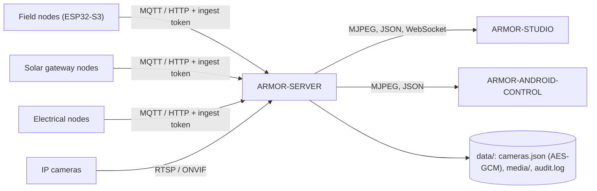

<p align="center">
  
</p>

# 🛡️ ARMOR-SERVER

<p align="center">
  <a href="README.md">🇺🇸 English</a> |
  <a href="README_spa.md">🇪🇸 Español</a> |
  <a href="README_fra.md">🇫🇷 Français</a> |
  <a href="README_ita.md">🇮🇹 Italiano</a> |
  <a href="README_deu.md">🇩🇪 Deutsch</a> |
  <a href="README_zho.md">🇨🇳 简体中文</a> |
  🇯🇵 <b>日本語</b> |
  <a href="README_por.md">🇵🇹 Português</a>
</p>

### 中央セキュリティコーディネーター：ノード、警報、デバイス、エネルギー、カメラ、ローカルネットワーク、設備の保守

<p align="center">
  
  
  
  
  
  
</p>

---

**正直さのチェック - 今日動いているもの:** 以下のすべてのルート、セッション、暗号化、証拠のルールは実在し、テストでカバーされています（`npm test`：724 件。隔離したサーバーに対する完全な HTTP 統合テストと、すべてのルートが OpenAPI ファイルに記載されていることの確認を含む）。CM5 テストベンチで日常的に動作しており、実際の MQTT ブローカー、ESP32-S3 基板上の実際のレーダーノードのファームウェア、実際の IP カメラ（ライブ映像、スナップショット、録画、Hi3510 機での PTZ）、Studio コンソール、Android アプリ、音声・観察サービスと組み合わせています。**まだ**証明されていないもの：実際の ONVIF カメラでの ONVIF、Jetson ハードウェア全般、実ノードでのソーラー・電気・警報盤・タッチパネルのルート（生成したメッセージでテスト：存在するのはレーダー基板のみ）、実際の Firebase プロジェクトでの Firebase プッシュ。

---

## 📋 ひと目で

| | |
|---|---|
| バージョン | `0.8.0.7` |
| 成熟度 | 確立 |
| 役割 | ファミリーの中央セキュリティコーディネーター：ノード、アラーム、デバイス、エネルギー、カメラ、ネットワーク |
| 技術 | Node.js 22+, TypeScript, Express 5, MQTT, WebSocket, FFmpeg |
| テスト | 724 件（`npm test`：単体と完全な HTTP 結合） |
| 契約 | HTTP パス 191 本、247 操作（OpenAPI は ARMOR-COMMON）、ルート表は `docs/ROUTES.md` |
| 待ち受け | `127.0.0.1:8080`（`ARMOR_HOST`、`ARMOR_PORT`） |
| 動作環境 | CM5 テストベンチ（サービスとして。ARMOR-DEVOPS 参照）または Node.js のある任意のコンピューター |
| 実機での確認 | CM5 テストベンチでの日常使用：実際の MQTT ブローカー、実際の IP カメラ、ESP32-S3 基板上の実際のレーダーノード、これに接続する Studio、Android アプリ、音声・観察サービス |
| ライセンス | GPL-3.0-or-later |

**移動先：** [概要](#-概要) · [アーキテクチャ](#-アーキテクチャ) · [セキュリティ](#-セキュリティと安全) · [インターフェース](#-インターフェース) · [設定](#-設定) · [クイックスタート](#-クイックスタート) · [テスト](#-テスト) · [トラブルシューティング](#-トラブルシューティング) · [構成](#-リポジトリの構成) · [関連](#-関連プロジェクト)

## 🚦 プロジェクトの状況

各行はこのリポジトリの一部分で、信号は今日どこまで進んでいるかを示します。計画ではなく、リポジトリが示せるもの（テスト、ビルド、実行）に基づいて書かれています。

🟢 完了・検証済み · 🟡 動作する（既知の制限あり） · 🟠 一部のみ、または未検証 · 🔴 未実装または動作しない

| 領域 | 状態 | ここでの意味 |
|---|---|---|
| ソフトウェア | 🟢 | ルート、セッション、暗号化、証拠の規則は、CM5 テストベンチで毎日使われています。 |
| テスト | 🟢 | 724 件のテストが通ります（`npm test`）。隔離したサーバーに対する HTTP 統合テスト一式と、すべてのルートが OpenAPI ファイルに記載されているかの確認を含みます。 |
| プロトコルとデータ | 🟡 | レーダーのメッセージは実機のボードから来ています。太陽光・電気・警報パネル・タッチパネルのルートは生成したメッセージでテストしており、ONVIF は本物の ONVIF カメラと接続していません。 |
| ハードウェア | 🟡 | CM5 テストベンチで、実際の MQTT ブローカー、実際の IP カメラ（ライブ映像、スナップショット、録画、Hi3510 機の PTZ）、実際のレーダーノードとともに動作しています。Jetson ではまだ何も動かしていません。 |
| セキュリティ | 🟡 | セッション、暗号化、証拠、ログインの規則はテストでカバーされています。独立したレビューはありません。 |
| 連携 | 🟡 | Studio、Android アプリ、音声・観察サービスがテストベンチで毎日使っています。Firebase 経由のプッシュは、本物の Firebase プロジェクトに対して一度も実行していません。 |
| ドキュメント | 🟢 | 8 言語、ルートのリファレンス（OpenAPI と ROUTES）、環境とリモートアクセスのガイド、変更履歴は最新です。 |

## 🎯 概要

**ARMOR-SERVER** は A.R.M.O.R. の信頼の中心です。フィールドノードがレーダー、光、ヘルスの観測を発行し、このサービスがそれを検証し、各ノードの最後に分かっている状態を保持して、Studio コンソールと Android クライアントに提供します。カメラに触れるすべてもここが持つので、**ブラウザーもスマートフォンもカメラのパスワードや RTSP アドレスを持つことはありません**。

* **検証された受信：**あらゆる種類のノード（レーダー、ソーラー、電気、警報盤、ネットワーク）の HTTP・MQTT メッセージは、状態に届く前に共通のコントラクトで境界チェックされます。ノードは独自のトークン（共有トークンから導出）を持て、厳格モードではそれ以外を受け付けません。
* **正直なノード状態：**通信が止まったノードは、設定可能な時間を過ぎると*古い*・*オフライン*と表示され、古いデータでオンラインと見せることはありません。再接続したノードは古いメッセージではなく復帰時点から数えます。警戒解除で高レベルの警報はすぐに消えます。
* **カメラゲートウェイ：**暗号化したカメラの保管庫、ONVIF / Hi3510 / PSIA の PTZ、RTSP パスの探索、カメラごとに共有する FFmpeg リレー、スナップショットと MP4 録画、無応答のカメラをイベント（警戒中は警報）にするウォッチドッグ、**無視する映像ゾーン**、警戒中にカメラが何かを捉えたとき**自動で撮る写真と動画**。
* **証拠ライブラリ：**経過時間とサイズによる保持、決して削除されない**保護された証拠**、証拠保全用の SHA-256、サーバーが署名した**保管証明**ファイル。セキュリティ上重要な操作ごとに 1 行の監査記録（認証情報は除去）。
* **再起動後も残る状態：**セキュリティモードと各ノードの最後の観測は再起動後に復元されます（再起動で黙って警戒解除されることはありません）。ファイルはアトミックに書き込まれ、壊れたファイルは復旧されます。警報、ノード、モードの変化はすべてイベント履歴に残ります。
* **警報：**発生 / 確認 / 解除のライフサイクルを持つ警報センター、誰にも見られずに待つ重大警報のエスカレーション、**警戒前のチェック**（開いている、無応答、停止しているもの）、解除用 PIN（と強要時の PIN）、そしてノード・カメラ・デバイス・ソーラー・電気・ネットワーク・警報盤からの警報。Studio、スマートフォン（ntfy、Telegram、Home Assistant、署名付き Webhook、設定すれば Firebase プッシュ）、MQTT トピック `armor/server/alert` に届きます。
* **ユーザーとロール：**名前とパスワード（scrypt ハッシュ）、ユーザーを管理する `admin`、操作する `operator`、閲覧だけの `viewer`。パスワードやロールを変えると、そのユーザーの他のセッションは終了します。
* **デバイスとオートメーション：**煙、ガス、浸水、ドア、窓、動き、気候、プラグ、照明、サイレン、鍵、シャッター、門扉・ガレージドア、給湯器を MQTT または認証付きプッシュで扱い、正規化した状態、可用性、コマンドを持ちます。何かが起きたときにデバイスを切り替えるルール（しきい値トリガーも）。
* **エネルギー：**インバーターとバッテリースタック（各セルと容量を含む）、電気ノードが HTTP または MQTT で届き、共通コントラクトで検証され、履歴と日ごとのエネルギーとともに保存され、無応答なら古い扱いになり、警報（インバーター故障、バッテリー残量低下、系統喪失、電圧、スイッチ故障など）を出します。電気設計と回路を切り替えるルールはサーバーに保存されます。
* **警報盤：**ARMOR-NODE-ALARM ノードの状態、バージョン付きの**警報設計**、**ゾーンに結び付けた Zigbee デバイス**（サーバーが無線を持つ間、ゾーンの状態を警報盤に伝える）、警報盤への警戒・解除コマンド（`ARMOR_ALARM_COMMANDS=1` でなければオフ）。
* **ローカルネットワーク：**ARMOR-NETWORK ノードの報告（デバイス、インターネット、公開アドレスとその提供元）、ノードへの指示（スキャン、ping、ポート、あなたが渡したログインでデバイスを調べる）、名前、非表示・監視デバイス、そして**そのノードだけに封印されて**届くログイン情報。
* **音声、観察、保守：**文字と音声のコマンド（クローズドなリスト、8 言語、人に結び付いた確認）、観察サービス向けのコンテキスト（どのレーダーがどのカメラをカバーするか）、Studio から 1 台ずつ進捗付きで更新するノードのファームウェア、そして保守ヘルパー経由での GitHub からの設備自身の更新、システムの更新、任意の root コンソール。
* **家の外からの利用：**サーバーは家と外を区別し（VPN は家として扱う）、外からのセッションを短くし、2 段階認証（認証アプリ、復旧コード付き）を求め、重要な操作の前にパスワードを再度求めます。外からのセッションに許す操作（すべて、アラームの操作のみ、閲覧のみ）を選べ、新しい場所からのサインインを警報の通知先に知らせ、ノードのウェブパネルをサーバー経由で開きます（ノードの証明書に固定し、Cookie はサーバー側に保持）。ノードを公開することはありません。
* **ブローカーとの暗号化接続(mqtts、任意):** `ARMOR_MQTT_CA_FILE` で設備独自の認証局の証明書を指定します。`mqtts://` のアドレスではその認証局だけを信頼してブローカーの名前を確認し、ファイルが有効な証明書でない場合やアドレスが `mqtts://` でない場合は起動を拒否します。Studio は接続が暗号化されているかと認証局のフィンガープリントを表示します。TLS ブローカーの代役と実際の Mosquitto 2.0 で検証済みです。
* **ノードの状態と警戒モード:** 各ノードの最新の報告と再起動の記録を保持し、4 つの警告（メモリ不足、再起動の多さ、ブローカーの頻繁な切断、Wi-Fi 信号の弱さ）を出します。警戒プロファイル（外出、在宅、夜間、独自のもの）を保持し、選ばれたものを、対応すると申告したノードにだけ警戒コマンドに入れて送ります。警報の強弱はプロファイルに従い、プロファイルなしの警戒はこれまでどおりのコマンドです。
* **接続とシステムの履歴:** 警告・ノード・カメラ・デバイス・アラームに加えて、履歴は接続するデバイスとアプリ（Studio のセッション、Android アプリ、ノードのパネル、音声サービス。サインイン、拒否、サインアウト、期限切れ、第二要素の使用、初回と最終確認）と、システムのイベント（ファームウェア付きで現れたり消えたりするノード、ブローカー接続、変更された設定とその実行者、サービス、更新、プロファイル付きの警戒操作）を記録します。種類・カテゴリ・クライアント・ユーザーで絞り込め、アドレスとユーザーエージェントは管理者にだけ表示され、パスワード・トークン・クッキー・PIN は一切記録されません。
* **Pylontechバッテリーへの書き込み命令（`ARMOR_BATTERY_WRITE=1` でなければ無効）：** 直前にあらためて本人確認をした管理者のみ——準備、バッテリーのシリアル番号を再入力して実行、取り消し、出力を元に戻す、ファームウェアイメージを1時間保持——を、共有の操作・範囲表で検査し、`solar_battery_command` としてゲートウェイノードへ送ります。各操作（誰が、どのバッテリーに、前後に読み取った内容、差分、記録。サービスパスワードは含まない）は保存され、履歴の「バッテリー」に記録されます。
* **ノードの制御：** `POST /api/v1/nodes/{id}/control` と `POST /api/v1/nodes/control` は、1 台のノード、または報告しているすべてのノードに命令（再起動、一時停止、再開、スタンバイ、識別、診断、メンテナンスのオン／オフ）を出します。対象は、直前にもう一度本人確認をした管理者だけで、家の防護が弱まる操作ではノード名（全ノードの場合は RESTART、PAUSE、STANDBY のいずれかの単語）を再入力します。サーバーは命令を準備し、そのノードがその操作のために渡す使い捨てトークンで実行し、`GET /api/v1/nodes/control/operations` で各ノード（送信済み、受領、適用、復帰）を追跡します。順次再起動では警報パネルを最後にし、誰が何を命じたかを履歴と監査記録に残し、ノードの健全性に一時停止、スタンバイ（動作停止、接続は維持）、メンテナンスを表示します。工場出荷時リセット、消去、ディープスリープはありません。模擬ブローカーでテストしており、実機のノードでは試していません。
* **ライブ状態とルート表：** サーバーは何かが変わるたびに、`/api/v1/events` の WebSocket で状態全体を Studio に送ります（変化の連続は1通にまとめ、遅れたクライアントは切り離します）。登録されている全ルートと呼び出せる主体は、コードから生成した表に載っています。壁掛けパネルには専用の小さなチャンネル `/api/v1/panel/events` があります（`GET /api/v1/panel/summary` と同じ数百バイトの要約を、変化したときと5秒ごとに、パネル・オペレーター・管理者アカウント向けに送ります。管理者は `panel.live_events` で無効にできます）。

## 🧩 A.R.M.O.R. での役割

ARMOR-SERVER はファミリーで唯一の信頼できる中心です。フィールドノード（[ARMOR-NODE-RADAR](https://github.com/JuanenRac/ARMOR-NODE-RADAR)、[ARMOR-NODE-SOLAR](https://github.com/JuanenRac/ARMOR-NODE-SOLAR)、[ARMOR-NODE-ELECTRICAL](https://github.com/JuanenRac/ARMOR-NODE-ELECTRICAL)、[ARMOR-NODE-ALARM](https://github.com/JuanenRac/ARMOR-NODE-ALARM)、[ARMOR-NODE-HMI](https://github.com/JuanenRac/ARMOR-NODE-HMI)）と [ARMOR-NETWORK](https://github.com/JuanenRac/ARMOR-NETWORK) は MQTT または HTTP で話しかけ、[ARMOR-STUDIO](https://github.com/JuanenRac/ARMOR-STUDIO) と [ARMOR-ANDROID-CONTROL](https://github.com/JuanenRac/ARMOR-ANDROID-CONTROL) はこれを読み取って指示を出し、[ARMOR-SERVER-AI](https://github.com/JuanenRac/ARMOR-SERVER-AI) はカメラの映像をレーダーと照らし合わせて推奨するだけ、[ARMOR-VOICE-AI](https://github.com/JuanenRac/ARMOR-VOICE-AI) は音声を閉じたコマンドの一覧に変え、[ARMOR-DEVOPS](https://github.com/JuanenRac/ARMOR-DEVOPS) はそのすべてを CM5 にインストール・更新します。決めるのはサーバーで、他の何も警戒・解除・切り替えを行いません。

| 連携先 | 方法 | 目的 |
|---|---|---|
| ARMOR-NODE-RADAR, SOLAR, ELECTRICAL, ALARM, HMI | MQTT `armor/*/#` または取り込みトークン付きの HTTP `POST` | メッセージの受信とオーダーの送信 |
| ARMOR-NETWORK | 状態の受信、オーダーと封印した認証情報の送信 | ローカルネットワーク |
| ARMOR-STUDIO, ARMOR-ANDROID-CONTROL | HTTP、MJPEG、WebSocket `/api/v1/events` | コンソール |
| ARMOR-VOICE-AI | 専用トークンで `/v1/command`、`/v1/turn` | 発話を判定し、サーバーが実行 |
| ARMOR-SERVER-AI | `ARMOR_AI_TOKEN`、`/api/v1/ai/...` | カメラの観察 |
| IP カメラ | RTSP、ONVIF、Hi3510、PSIA（サーバーが呼び出す） | ライブ映像、スナップショット、録画、PTZ |

## 🏛️ アーキテクチャ

<p align="center">
  
</p>

<details>
<summary>図のテキスト版（Mermaid）</summary>



</details>

## 🔒 セキュリティと安全

* 分離された秘密：**ingest**（ノードがメッセージを送る。各ノードは共有トークンから導出した独自トークンも持て、厳格モードではそれだけを受け付ける）、**control**（警戒 / 解除、イベント）、**operator**（オートメーション）、**Studio ログイン**。それぞれ定数時間で比較され、互いに代用できません。ネットワークノードに渡したログインはそのノードだけに封印されて届きます。
* 3 つのロール：**admin**、**operator**、**viewer**（読むだけで変更しない）。設定、移動、撮影、録画、保護、削除、警戒を行うルートは operator が必要。ライブ映像は operator か、1 台のカメラに結び付いた短命のストリームチケットが必要です。危険なコマンド（解除、回路の切り替え、root コンソール）は管理者を要求し、解除には PIN も必要です。
* カメラのパスワードは `data/cameras.json` にのみ AES-256-GCM で暗号化して保存され、どの API も返しません。ONVIF のアドレスはカメラ自身のホストにとどまる必要があり、リダイレクトは拒否されます。
* Studio のセッションは HttpOnly かつ SameSite=Strict、ログインにはレート制限があり、エラーにスタックトレースは含まれません。
* サーバーは、意図して `ARMOR_HOST` を設定しない限り 127.0.0.1 で待ち受け、設定した場合は 12 文字未満の Studio パスワードが拒否されます。
* 家の外から：2 段階認証（TOTP、RFC 6238）、ユーザー・ファームウェア・ノードパネルでの再認証、管理を家または VPN に限るポリシー、署名済みファームウェアのみ、そしてリクエストからアドレスを受け取らず必要なものだけを通し、信頼した証明書と異なるノードを拒否するノードパネル用プロキシ。

| 脅威 | 防御 |
|---|---|
| Studio のパスワードの推測 | scrypt（N=16384、r=8、p=1）。ユーザーの有無にかかわらず同じ処理量。人とアドレスごとに 15 分で 12 回、アドレスごとに 60 回、全体で毎分 40 回。8 文字未満は拒否（ネットワークから到達可能なら 12 文字未満） |
| Cookie の盗難、別サイトからのリクエスト | HttpOnly、SameSite=Strict、HTTPS では Secure。セッションは Studio 7 日、オペレーター 8 時間、外部からは 12 時間（無操作 30 分） |
| タイミング攻撃と弱い秘密 | 秘密は定数時間で比較し、24 文字以上でそれぞれ別の値にする（取り込み、制御、オペレーター、カメラ鍵、AI、証拠鍵） |
| 証明なしの解除 | `alarm.disarm_pin`（never、if_set、always）による 4〜10 桁の PIN。3 回失敗で 60 秒、5 分、15 分、その後 1 時間ロックし、再起動後もディスクに保持。脅迫用 PIN は気付かれずに区別。制御トークンは `ARMOR_CONTROL_DISARM=1` のときだけ解除可 |
| カメラのパスワード漏えい | `data/cameras.json` に AES-256-GCM で保存し、どの API も返さない。FFmpeg はローカル RTSP トンネル（`media.rtsp_proxy`）経由でパスワードをコマンドラインに出さない。ONVIF のリダイレクトは拒否 |
| ログインなしのライブ映像 | 1 台のカメラに限定したストリームチケット（オペレーターにのみ発行） |
| API の過剰リクエスト | 通常は毎分 240 リクエスト（ノードの POST は別枠で毎分 6000）。JSON 本文は 64 kB（インストールファイルは 9 MB） |
| 偽造または不正なノードメッセージ | `src/contracts.ts` のパーサーが境界で検査し、ARMOR-COMMON の共有ベクターでテスト済み：トラックは最大 15、照度は 200 000 まで、ノード ID は英数字と `_` `-`。共有トークンから導出したノード別トークンと厳格モード（`ARMOR_INGEST_STRICT=1`） |
| 家の外からのセッション | 2 要素（`ARMOR_TOTP_REQUIRED`：off、remote、always）、できることの方針（`ARMOR_REMOTE_POLICY`：full、operate、view）、重要操作での再認証（既定 5 分）、新しい場所からのログイン通知 |
| 開放プロキシとして使われるノードパネル | アドレスはリクエストから取らず、HTTPS はノード証明書の SHA-256 指紋に固定 |
| 音声：確認なしの消音、長文、巨大な音声 | ポリシー `voice.silence_confirmation`（off、pin、double_turn）を毎ターン送信。確認は本人に紐づく。200 文字、8 言語、毎分 30 リクエスト、音声は最大 480 000 バイト、応答は最大 200 000 バイト |
| 誤った危険な書き込み | `ARMOR_BATTERY_WRITE=1`、`ARMOR_ELECTRICAL_SWITCHING=1`、`ARMOR_ALARM_COMMANDS=1` を設定しない限りオフ。起動時に警告 |

**Studio のスイッチ。** 調整できる保護は `security-settings.json`（モード 0600、アトミック書き込み）にある 15 項目で、どれも保守的な既定値です。下げた場合は監査に記録されます：`alarm.disarm_pin`、`voice.silence_confirmation`、`alarm.config_hash`、`server.zone_feed`、`server.zone_feed_signature`、`media.rtsp_proxy`、`network.login_secure_only`、`voice.multipart_turn`、`panel.live_events`、`client.device_lock`、`nodes.nvs_encryption`, `alarm_audio.spoken`, `alarm_audio.custom_sounds`、`voice.turn_max_bytes`、`voice.reply_audio_max_bytes`。

**決してしないこと：** カメラのパスワードを返す、話した内容を保存する（コマンドと結果のみ）、PIN・トークン・Cookie をログに書く。第三者によるセキュリティレビューはありません。

## 🔌 インターフェース

ルート表（`docs/ROUTES.md`、コードから生成）は各ルートと呼び出せる主体を一覧にします。ARMOR-COMMON の OpenAPI は 191 パス・247 操作を記述し、欠けているルートがあるとテストが失敗します。主なもの：

| ルート | 認証 | 内容 |
|---|---|---|
| `GET /healthz` | なし | 稼働中 |
| `POST /api/v1/telemetry`  `/health`  `/solar`  `/electrical/readings`  `/alarm/state`  `/network/state`  `/devices/state` | 取り込みトークン | ノードが送る内容 |
| `WS /api/v1/events` | セッション | 変化のたびに全状態を送信（連続変化は 1 メッセージ、遅れたクライアントは切断、クライアントからは最大 1 KB） |
| `WS /api/v1/panel/events` | パネル | 壁面パネル用の小さなチャネル（クライアントからは最大 128 バイト） |
| `POST /api/v1/voice/command` | オペレーター、毎分 30 | 文字または音声のコマンド `{text, language, confirmation?, pin?}`。応答は `{accepted, executed, intent, outcome, speech, confirmation_token?, reason?, result?}` |
| `POST /api/v1/voice/turn`  `/api/v1/voice/v1/turn` | ヘッダー `X-Armor-Voice-Token` | 1 ターンの音声（multipart）。エラー：`unauthorized`、`multipart_turn_disabled`（415）、`audio_too_large`（413）、`bad_multipart`（400）、`voice_bad_reply`（502） |
| `GET /api/v1/alarm-audio` | オペレーター | アラーム音の状態：2 つのオプション（既定はオフ）、音声ゲートウェイの有無、上限、保存済みの音 |
| `GET /api/v1/alarm-audio/spoken` | オペレーターまたは壁面パネルのアカウント | 音声で読み上げたアラーム（発生元、重大度、アラームコード。SHA-256 付きの 16 kHz 16 ビットモノラル PCM）。音声ゲートウェイが作成しキャッシュに保持。オプションがオフの間は 404 `spoken_alarms_disabled` |
| `GET` `PUT` `DELETE /api/v1/alarm-audio/sounds/{source}` | GET：オペレーターまたは壁面パネルのアカウント。PUT と DELETE：管理者（家の外からは再認証） | アラームの発生元ごとの音：16 kHz 16 ビットモノラル PCM の WAVE ファイルを 1 バイトずつ検査（0.1 秒から `ARMOR_ALARM_SOUND_MAX_BYTES` まで、無音は不可）し、サンプルだけを保存して SHA-256 付きで配信。オプションがオフの間は 409 `custom_sounds_disabled` |
| `POST /api/v1/nodes/{id}/control`  `POST /api/v1/nodes/control` | 直前に再認証した管理者 | 1 ノードまたは全ノードへのオーダー（再起動、一時停止、再開、スタンバイ、識別、診断、メンテナンス） |
| `POST /api/v1/cameras/{id}/stream-ticket` | オペレーター | 1 台のカメラのライブ映像用の短命チケット |

* 公開：`GET /healthz`。ログイン済みユーザー向け：状態、情報、カメラ、メディア、履歴、ルール、デバイス、警報、オートメーション、各種設計（サイト、警報、電気、ネットワーク）、ソーラーと電気の測定値、ローカルネットワーク、通知と設定。管理者向けにはユーザー、サービス、ファームウェア、アップデート、コンソール。
* ノード向け：ingest トークン付きの `POST /api/v1/telemetry`、`/health`、`/solar`、`/electrical/readings`、`/alarm/state`、`/network/state`、`/devices/state`、および MQTT トピック `armor/node/#`、`armor/solar/#`、`armor/electrical/#`、`armor/alarm/#`、`armor/network/#`。イベントは WebSocket `/api/v1/events` でコンソールに届きます。

## ⚙️ 設定

`.env.example` を `.env`（Git は無視）にコピーするか、初回実行時に `run.bat` / `run.sh` がランダムな秘密を生成します。変数の完全な一覧と範囲は [docs/ENVIRONMENT.md](docs/ENVIRONMENT.md)（コードから生成）、リモートアクセス関連は [docs/REMOTE_ACCESS.md](docs/REMOTE_ACCESS.md) にあります。設備を守る値はここではなく Studio で変えます（セキュリティの節を参照）。

| 設定 | 既定値 | 内容 |
|---|---|---|
| `ARMOR_INGEST_TOKEN`  `ARMOR_CONTROL_TOKEN` | 必須（24 文字以上、すべて別） | ノードの送信用と、警戒・解除・イベント読み取り用 |
| `ARMOR_STUDIO_USERNAME`  `ARMOR_STUDIO_PASSWORD` | 必須 | 最初の管理者 |
| `ARMOR_HOST`  `ARMOR_PORT` | 127.0.0.1  8080 | 待ち受け先。ループバック以外では 12 文字未満の Studio パスワードを拒否 |
| `ARMOR_DATA_DIR`  `ARMOR_FFMPEG_PATH` | data/ | 状態フォルダと、ライブ映像・撮影用の FFmpeg |
| `ARMOR_MQTT_URL`  `ARMOR_MQTT_CA_FILE` | 任意 | ブローカー、および `mqtts://` 用の自前の認証局（サーバーはそれだけを信頼し、ブローカー名を確認し、不正なファイルでは起動しない） |
| `ARMOR_NODE_STALE_AFTER_S` | 30 (5-3600) | ノードが古い扱いになるまでの無通信秒数 |
| `ARMOR_ALERT_DWELL_MS`  `ARMOR_ALERT_MIN_TARGETS` | 2000 (0-60000)  1 (1-20) | レーダー警報までの時間と目標数 |
| `ARMOR_ESCALATE_AFTER_MIN` | 0 = off (0-1440) | 誰も見ていない重大アラームをエスカレーションするまでの分数 |
| `ARMOR_MEDIA_RETENTION_DAYS`  `ARMOR_MEDIA_MAX_BYTES` | 30 (0-3650)  20 GiB | 古い順に期間と容量で保持。保護された証拠は削除されない |
| `ARMOR_STUDIO_SESSION_TTL_MS`  `ARMOR_OPERATOR_SESSION_TTL_MS`  `ARMOR_REMOTE_SESSION_TTL_MS`  `ARMOR_REMOTE_IDLE_MS`  `ARMOR_ELEVATION_MS` | 7 d  8 h  12 h  30 min  5 min | セッションの長さと再認証の有効時間 |
| `ARMOR_TOTP_REQUIRED`  `ARMOR_REMOTE_POLICY` | off  full | 2 要素と外部セッションの権限 |
| `ARMOR_ALERT_LANGUAGE` | es | 通知の言語（8 言語のいずれか） |
| `ARMOR_NTFY_URL`  `ARMOR_TELEGRAM_BOT_TOKEN`  `ARMOR_HOMEASSISTANT_URL`  `ARMOR_ALERT_WEBHOOK_URL`  `ARMOR_FCM_SERVICE_ACCOUNT` | オフ | アラームの送信先（すべて既定でオフ） |
| `ARMOR_ALARM_COMMANDS`  `ARMOR_BATTERY_WRITE`  `ARMOR_ELECTRICAL_SWITCHING`  `ARMOR_INGEST_STRICT`  `ARMOR_CONTROL_DISARM` | 0 | 危険な書き込みと厳格モード（すべてオフ） |
| `ARMOR_COOKIE_SECURE`  `ARMOR_STUDIO_ORIGIN` | - | TLS の背後では `1`。Studio のオリジン |

* 必須：`ARMOR_INGEST_TOKEN` と `ARMOR_CONTROL_TOKEN`（24 文字以上、すべて異なる）、および `ARMOR_STUDIO_USERNAME` / `ARMOR_STUDIO_PASSWORD`（最初の管理者）。
* よく使うもの：`ARMOR_HOST` / `ARMOR_PORT`、`ARMOR_DATA_DIR`、`ARMOR_FFMPEG_PATH`（ライブ映像と撮影）、`ARMOR_MQTT_URL`、`ARMOR_MQTT_CA_FILE`、`ARMOR_STUDIO_ORIGIN`、`ARMOR_NODE_STALE_AFTER_S`、`ARMOR_CAMERA_CHECK_S`、`ARMOR_ALERT_DWELL_MS`、`ARMOR_ALERT_WEBHOOK_URL`、`ARMOR_COOKIE_SECURE`（TLS の背後では `1`）。

## 🚀 クイックスタート

**要件：** Node.js 22+、FFmpeg（ライブ映像と撮影）、MQTT ブローカー（Mosquitto）。

```powershell
npm install           # 依存関係
npm run typecheck     # tsc --noEmit
npm test              # 724 件：単体と完全な HTTP 結合
npm run build         # dist/server.mjs
.\run.bat   (run.sh)  # ホットリロード付き開発サーバー
```

CM5 テストベンチへのインストール（他のプロジェクトから分離、専用ユーザーと専用ポート）は [ARMOR-DEVOPS](https://github.com/JuanenRac/ARMOR-DEVOPS) を参照してください。

## 🧪 テスト

```powershell
npm run typecheck  # tsc --noEmit
npm test           # tsx --test tests/*.test.ts
python -I tools/armor_ci_validate.py
```

`npm test` は `tests/` の全ファイル（95 個）を実行します：各モジュールの単体テストと、隔離したサーバーに対する完全な HTTP 結合テスト（`tests/vertical-slice.test.ts`）。`tests/conformance.test.ts` は ARMOR-COMMON の共有ベクターを実行し、**サーバーが登録するルートが OpenAPI の記述する操作と（メソッドとパスで）完全に一致すること**、各応答が本文の種類を示していることを確認します。ARMOR-COMMON がこのリポジトリの隣にないとスキップされます。TLS のテストには `openssl` が必要です。GitHub Actions は push と pull request のたびに A.R.M.O.R. の基本検査（マニフェスト、バージョン、変更履歴、README の一致）と、プロジェクト自身のビルドとテストを実行します。

## 🏗️ ビルドとリリース

`npm run build` はサーバーを `dist/server.mjs` にまとめます（`Dockerfile` がそこからコンテナイメージを作ります）。バージョンは `package.json`、`armor.project.json`、README のバッジ（マニフェストから読み取り）にあり、各バージョンには [CHANGELOG.md](CHANGELOG.md) にエントリーがあります。リリースは GitHub で公開されます。

## 🩺 トラブルシューティング

| 表示 | 原因 | 対処 |
|---|---|---|
| `ARMOR_INGEST_TOKEN must be at least 24 characters` | 秘密がない、または短い | 24 文字以上で設定（`run.sh` が生成可能） |
| `... and ... must be different values` | 2 つの秘密が同じ | それぞれ別の値にする |
| `ARMOR_STUDIO_PASSWORD must be at least 12 characters when the server is reachable from the network` | `ARMOR_HOST` がループバックでない | もっと長いパスワードにするか `127.0.0.1` のままにする |
| `ARMOR_MQTT_CA_FILE needs an mqtts:// address in ARMOR_MQTT_URL` | 認証局ファイルはあるがブローカーのアドレスが `mqtts://` でない | `mqtts://` のアドレスにするか、ファイルを外す |
| `TLS_CERT_PATH and TLS_KEY_PATH must both be set` | 片方しか設定されていない | HTTPS なら両方、HTTP なら両方とも未設定 |
| `voice_unavailable`  `voice_not_answering` (503) | 音声サービスに届かない | ARMOR-VOICE-AI を起動し `ARMOR_VOICE_URL` とトークンを確認 |

## 📂 リポジトリの構成

<p align="center">
  
</p>

<details>
<summary>ツリーのテキスト版</summary>

```text
ARMOR-SERVER/
├── src/
│   ├── server.ts app.ts              起動、Express アプリ、レート制限
│   ├── config.ts                     全設定を起動時に検証
│   ├── contracts.ts mqtt_router.ts   境界での検証
│   ├── store.ts persistence.ts       ノード状態と再起動後も残るもの
│   ├── alarms.ts escalation.ts       アラームセンターとエスカレーション
│   ├── users.ts totp.ts              ユーザー、ロール、PIN、2 要素
│   ├── security_settings.ts          Studio で変える 15 のスイッチ
│   ├── voice.ts voice_turn.ts        文字と音声のコマンド
│   ├── firmware.ts installation.ts   ノードのファームウェアと自己更新
│   ├── http/                         セッション、ノード別トークン、封印した認証情報
│   ├── routes/                       ルート群ごとに 1 ファイル
│   ├── cameras/                      金庫、PTZ、RTSP、探索、健全性
│   ├── media/                        FFmpeg 中継と証拠ライブラリ
│   └── devices/                      デバイスモデルと MQTT ブリッジ
├── tests/                            700 件（単体と HTTP 結合）
├── docs/                             7 つのガイド、ルート表、環境変数
├── tools/                            docs/ROUTES.md と docs/ENVIRONMENT.md の生成、CI 検査、ランチャー
├── images/                           バナー、アイコン、README の画像
├── .github/                          CI ワークフロー、ダッシュボード通知、Issue と Pull Request のテンプレート
├── Dockerfile                        サーバーのコンテナイメージ
├── armor.project.json                マニフェスト：版・役割・成熟度
├── CHANGELOG.md                      各バージョンの変更点
├── package.json package-lock.json    依存関係とスクリプト
├── tsconfig.json                     TypeScript 設定
├── run.sh run.bat                    起動（共通フロー）
├── build.sh build.bat                ビルドとテスト（共通フロー）
├── build-test.sh build-test.bat      ビルド、テスト、パッケージ化
├── test.sh test.bat                  テストのみ（版は変えません）
└── SECURITY.md SUPPORT.md CONTRIBUTING.md CODE_OF_CONDUCT.md LICENSE
```

</details>

## 🗺️ ロードマップと既知の制限

**現時点の既知の制限**

* ONVIF は実際の ONVIF カメラに接続したことがなく、Jetson 上では何も動かしていません。
* ソーラー、電気、アラームパネル、タッチパネルのルートは生成メッセージでテストしています。実機があるのはレーダー基板だけです。
* Firebase 経由のプッシュは実際の Firebase プロジェクトで動かしたことがありません。
* ノード制御オーダーと公開証明書でのネイティブ TLS は実機ノードで動かしていません。
* 第三者によるセキュリティレビューはありません。

**今後**

* 実際のカメラで ONVIF を、他のノードのルートを各基板で試す。
* 実際の Firebase プロジェクトでプッシュを試す。

## 🌍 言語

README とテキストは、英語、スペイン語、フランス語、イタリア語、ドイツ語、中国語、日本語、ヨーロッパポルトガル語で提供されています。

## 🔗 関連プロジェクト

**A.R.M.O.R.**（Autonomous Radar & Multimodal Observation Range）は、独立したリポジトリで構成される境界セキュリティシステムです。各リポジトリは独自のバージョン、テスト、README を持ちます。ファミリーは次のとおりです：

* **[ARMOR-COMMON](https://github.com/JuanenRac/ARMOR-COMMON)** - メッセージのコントラクト、バリデーター、適合ベクトル、生成された型
* **[ARMOR-NODE-RADAR](https://github.com/JuanenRac/ARMOR-NODE-RADAR)** - 3 つのレーダーと独自の Web パネルを備えた ESP32-S3 向けフィールドノードのファームウェア
* **[ARMOR-NODE-SOLAR](https://github.com/JuanenRac/ARMOR-NODE-SOLAR)** - ソーラーインバーターとバッテリーのプロトコル、ゲートウェイノードのメッセージ
* **[ARMOR-NODE-ELECTRICAL](https://github.com/JuanenRac/ARMOR-NODE-ELECTRICAL)** - 電気ノード：メーター、系統の読み取り値のメッセージ、切り替えのルール
* **[ARMOR-NODE-ALARM](https://github.com/JuanenRac/ARMOR-NODE-ALARM)** - 警報ノードとパネル：ゾーン、警戒、遅延、サイレン、PIN。サーバーありでもなしでも動作
* **[ARMOR-NODE-HMI](https://github.com/JuanenRac/ARMOR-NODE-HMI)** - タッチパネル：壁面画面でのシステムの状態、警戒と確認応答、そして音声アシスタントの置き場
* **[ARMOR-NETWORK](https://github.com/JuanenRac/ARMOR-NETWORK)** - ローカルネットワーク：そのデバイス、インターネット、そして変化
* **ARMOR-SERVER**（このリポジトリ） - 中央コーディネーター：テレメトリ、警報、デバイス、ソーラーの読み取り値、カメラ
* **[ARMOR-STUDIO](https://github.com/JuanenRac/ARMOR-STUDIO)** - Web コンソール：カメラ、レーダー、警報、太陽光エネルギー、2D/3D のサイトデザイナー
* **[ARMOR-ANDROID-CONTROL](https://github.com/JuanenRac/ARMOR-ANDROID-CONTROL)** - ライブの 2D/3D レーダーを備えた Android オペレータークライアント
* **[ARMOR-IOS-CONTROL](https://github.com/JuanenRac/ARMOR-IOS-CONTROL)** - iPhone オペレータークライアント
* **[ARMOR-SERVER-AI](https://github.com/JuanenRac/ARMOR-SERVER-AI)** - 判断を説明し、決して作動させない視覚推論ポリシー
* **[ARMOR-VISION](https://github.com/JuanenRac/ARMOR-VISION)** - Jetson Orin NX 向けのカメラゾーン、マスク、検出ルール
* **[ARMOR-VOICE-AI](https://github.com/JuanenRac/ARMOR-VOICE-AI)** - 偽造できない確認つきのオフライン音声インテント
* **[ARMOR-HARDWARE](https://github.com/JuanenRac/ARMOR-HARDWARE)** - 筐体、電子回路、ベンチ受け入れマトリクス
* **[ARMOR-DEVOPS](https://github.com/JuanenRac/ARMOR-DEVOPS)** - デプロイ、CM5 テストベンチ、バックアップ、TLS
* **[ARMOR-SIMULATOR](https://github.com/JuanenRac/ARMOR-SIMULATOR)** - 再現可能な障害を持つオフラインのテレメトリシミュレーター
* **[ARMOR-UPDATER](https://github.com/JuanenRac/ARMOR-UPDATER)** - エコシステム自身のリポジトリを検出、インストール、更新
* **[ARMOR-DOCS](https://github.com/JuanenRac/ARMOR-DOCS)** - アーキテクチャ、セキュリティのベースライン、機能マトリクス

## 📚 ドキュメント

* [ルート表](docs/ROUTES.md)：全ルートと呼び出せる主体（生成）
* [環境変数](docs/ENVIRONMENT.md)：全変数と範囲（生成）
* [連携](docs/INTEGRATION.md)：ノード、アプリ、サービスとサーバーの通信
* [リモートアクセス](docs/REMOTE_ACCESS.md)：2 要素、方針、外部からの利用
* [カメラ・メディアゲートウェイ](docs/CAMERA_MEDIA_GATEWAY.md)：金庫、PTZ、中継、証拠
* [ノードのファームウェア](docs/NODE_FIRMWARE.md)：Studio からのノード更新
* [状態機械](docs/STATE_MACHINE.md)：ノードとアラームのライフサイクル
* [機能マトリクス：何が証明され、何が証明されていないか](https://github.com/JuanenRac/ARMOR-DOCS/blob/main/docs/CAPABILITY_MATRIX.md)
* [プロジェクトカタログ：バージョンと、リポジトリ同士の依存関係](https://github.com/JuanenRac/ARMOR-DOCS/blob/main/docs/PROJECT_CATALOG.md)
* [このリポジトリの変更履歴](CHANGELOG.md)

## 🤝 コントリビュートとコミュニティ

* Pull Request の前に `python -I tools/armor_ci_validate.py` とテストを実行してください。どちらも通る必要があります。[CONTRIBUTING.md](CONTRIBUTING.md) と[行動規範](CODE_OF_CONDUCT.md)を参照してください。
* README は 8 言語で提供され、ARMOR-DOCS のソースから生成されます。文面の変更はそちらで行います。
* コンポーネント間のメッセージの変更は ARMOR-COMMON から始めます。
* ビルドしただけのものを、ボード上で動いているかのように書かないでください。
* 脆弱性は非公開で報告してください：[SECURITY.md](SECURITY.md)。質問、アイデア、報告：electrohobby3d@gmail.com（[SUPPORT.md](SUPPORT.md)）。

## 👤 作者

**JuanenRac (Electro Hobby 3D)** · electrohobby3d@gmail.com

## 📜 ライセンス

GPL-3.0-or-later - [LICENSE](LICENSE) を参照してください。
