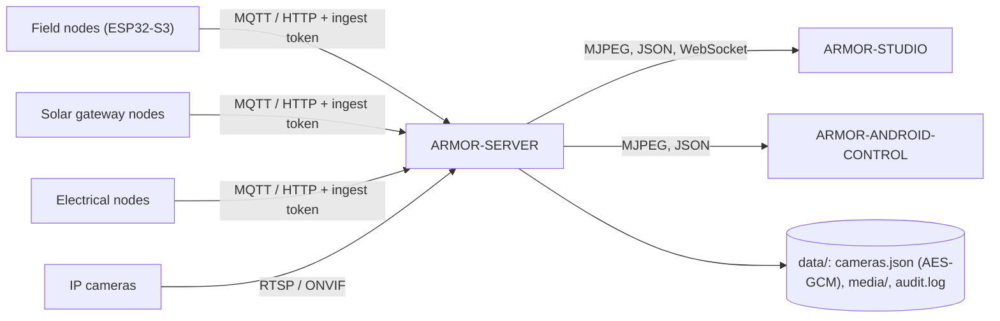

<p align="center">
  
</p>

# 🛡️ ARMOR-SERVER

<p align="center">
  <a href="README.md">🇺🇸 English</a> |
  <a href="README_spa.md">🇪🇸 Español</a> |
  <a href="README_fra.md">🇫🇷 Français</a> |
  <a href="README_ita.md">🇮🇹 Italiano</a> |
  <a href="README_deu.md">🇩🇪 Deutsch</a> |
  <a href="README_zho.md">🇨🇳 简体中文</a> |
  🇯🇵 <b>日本語</b> |
  <a href="README_por.md">🇵🇹 Português</a>
</p>

### 中央セキュリティコーディネーター：ノード、警報、デバイス、エネルギー、カメラ、ローカルネットワーク、設備の保守

<p align="center">
  
  
  
  
  
  
</p>

---

**正直さのチェック - 今日動いているもの:** 以下のすべてのルート、セッション、暗号化、証拠のルールは実在し、テストでカバーされています（`npm test`：561 件。隔離したサーバーに対する完全な HTTP 統合テストと、すべてのルートが OpenAPI ファイルに記載されていることの確認を含む）。CM5 テストベンチで日常的に動作しており、実際の MQTT ブローカー、ESP32-S3 基板上の実際のレーダーノードのファームウェア、実際の IP カメラ（ライブ映像、スナップショット、録画、Hi3510 機での PTZ）、Studio コンソール、Android アプリ、音声・観察サービスと組み合わせています。**まだ**証明されていないもの：実際の ONVIF カメラでの ONVIF、Jetson ハードウェア全般、実ノードでのソーラー・電気・警報盤・タッチパネルのルート（生成したメッセージでテスト：存在するのはレーダー基板のみ）、実際の Firebase プロジェクトでの Firebase プッシュ。

---

## 📋 ひと目で

| | |
|---|---|
| バージョン | `0.8.0.2` |
| 成熟度 | 確立 |
| テスト | 561 (`npm test`) |
| 技術 | Node.js 22+ / TypeScript / Docker Compose |
| 実機での確認 | CM5 テストベンチでの日常使用：実際の MQTT ブローカー、実際の IP カメラ、ESP32-S3 基板上の実際のレーダーノード、これに接続する Studio、Android アプリ、音声・観察サービス |

## 🎯 概要

**ARMOR-SERVER** は A.R.M.O.R. の信頼の中心です。フィールドノードがレーダー、光、ヘルスの観測を発行し、このサービスがそれを検証し、各ノードの最後に分かっている状態を保持して、Studio コンソールと Android クライアントに提供します。カメラに触れるすべてもここが持つので、**ブラウザーもスマートフォンもカメラのパスワードや RTSP アドレスを持つことはありません**。

* **検証された受信：**あらゆる種類のノード（レーダー、ソーラー、電気、警報盤、ネットワーク）の HTTP・MQTT メッセージは、状態に届く前に共通のコントラクトで境界チェックされます。ノードは独自のトークン（共有トークンから導出）を持て、厳格モードではそれ以外を受け付けません。
* **正直なノード状態：**通信が止まったノードは、設定可能な時間を過ぎると*古い*・*オフライン*と表示され、古いデータでオンラインと見せることはありません。再接続したノードは古いメッセージではなく復帰時点から数えます。警戒解除で高レベルの警報はすぐに消えます。
* **カメラゲートウェイ：**暗号化したカメラの保管庫、ONVIF / Hi3510 / PSIA の PTZ、RTSP パスの探索、カメラごとに共有する FFmpeg リレー、スナップショットと MP4 録画、無応答のカメラをイベント（警戒中は警報）にするウォッチドッグ、**無視する映像ゾーン**、警戒中にカメラが何かを捉えたとき**自動で撮る写真と動画**。
* **証拠ライブラリ：**経過時間とサイズによる保持、決して削除されない**保護された証拠**、証拠保全用の SHA-256、サーバーが署名した**保管証明**ファイル。セキュリティ上重要な操作ごとに 1 行の監査記録（認証情報は除去）。
* **再起動後も残る状態：**セキュリティモードと各ノードの最後の観測は再起動後に復元されます（再起動で黙って警戒解除されることはありません）。ファイルはアトミックに書き込まれ、壊れたファイルは復旧されます。警報、ノード、モードの変化はすべてイベント履歴に残ります。
* **警報：**発生 / 確認 / 解除のライフサイクルを持つ警報センター、誰にも見られずに待つ重大警報のエスカレーション、**警戒前のチェック**（開いている、無応答、停止しているもの）、解除用 PIN（と強要時の PIN）、そしてノード・カメラ・デバイス・ソーラー・電気・ネットワーク・警報盤からの警報。Studio、スマートフォン（ntfy、Telegram、Home Assistant、署名付き Webhook、設定すれば Firebase プッシュ）、MQTT トピック `armor/server/alert` に届きます。
* **ユーザーとロール：**名前とパスワード（scrypt ハッシュ）、ユーザーを管理する `admin`、操作する `operator`、閲覧だけの `viewer`。パスワードやロールを変えると、そのユーザーの他のセッションは終了します。
* **デバイスとオートメーション：**煙、ガス、浸水、ドア、窓、動き、気候、プラグ、照明、サイレン、鍵、シャッター、門扉・ガレージドア、給湯器を MQTT または認証付きプッシュで扱い、正規化した状態、可用性、コマンドを持ちます。何かが起きたときにデバイスを切り替えるルール（しきい値トリガーも）。
* **エネルギー：**インバーターとバッテリースタック（各セルと容量を含む）、電気ノードが HTTP または MQTT で届き、共通コントラクトで検証され、履歴と日ごとのエネルギーとともに保存され、無応答なら古い扱いになり、警報（インバーター故障、バッテリー残量低下、系統喪失、電圧、スイッチ故障など）を出します。電気設計と回路を切り替えるルールはサーバーに保存されます。
* **警報盤：**ARMOR-ALARM ノードの状態、バージョン付きの**警報設計**、**ゾーンに結び付けた Zigbee デバイス**（サーバーが無線を持つ間、ゾーンの状態を警報盤に伝える）、警報盤への警戒・解除コマンド（`ARMOR_ALARM_COMMANDS=1` でなければオフ）。
* **ローカルネットワーク：**ARMOR-NETWORK ノードの報告（デバイス、インターネット、公開アドレスとその提供元）、ノードへの指示（スキャン、ping、ポート、あなたが渡したログインでデバイスを調べる）、名前、非表示・監視デバイス、そして**そのノードだけに封印されて**届くログイン情報。
* **音声、観察、保守：**文字と音声のコマンド（クローズドなリスト、8 言語、人に結び付いた確認）、観察サービス向けのコンテキスト（どのレーダーがどのカメラをカバーするか）、Studio から 1 台ずつ進捗付きで更新するノードのファームウェア、そして保守ヘルパー経由での GitHub からの設備自身の更新、システムの更新、任意の root コンソール。
* **家の外からの利用：**サーバーは家と外を区別し（VPN は家として扱う）、外からのセッションを短くし、2 段階認証（認証アプリ、復旧コード付き）を求め、重要な操作の前にパスワードを再度求めます。外からのセッションに許す操作（すべて、アラームの操作のみ、閲覧のみ）を選べ、新しい場所からのサインインを警報の通知先に知らせ、ノードのウェブパネルをサーバー経由で開きます（ノードの証明書に固定し、Cookie はサーバー側に保持）。ノードを公開することはありません。
* **ブローカーとの暗号化接続(mqtts、任意):** `ARMOR_MQTT_CA_FILE` で設備独自の認証局の証明書を指定します。`mqtts://` のアドレスではその認証局だけを信頼してブローカーの名前を確認し、ファイルが有効な証明書でない場合やアドレスが `mqtts://` でない場合は起動を拒否します。Studio は接続が暗号化されているかと認証局のフィンガープリントを表示します。TLS ブローカーの代役と実際の Mosquitto 2.0 で検証済みです。
* **ノードの状態と警戒モード:** 各ノードの最新の報告と再起動の記録を保持し、4 つの警告（メモリ不足、再起動の多さ、ブローカーの頻繁な切断、Wi-Fi 信号の弱さ）を出します。警戒プロファイル（外出、在宅、夜間、独自のもの）を保持し、選ばれたものを、対応すると申告したノードにだけ警戒コマンドに入れて送ります。警報の強弱はプロファイルに従い、プロファイルなしの警戒はこれまでどおりのコマンドです。
* **接続とシステムの履歴:** 警告・ノード・カメラ・デバイス・アラームに加えて、履歴は接続するデバイスとアプリ（Studio のセッション、Android アプリ、ノードのパネル、音声サービス。サインイン、拒否、サインアウト、期限切れ、第二要素の使用、初回と最終確認）と、システムのイベント（ファームウェア付きで現れたり消えたりするノード、ブローカー接続、変更された設定とその実行者、サービス、更新、プロファイル付きの警戒操作）を記録します。種類・カテゴリ・クライアント・ユーザーで絞り込め、アドレスとユーザーエージェントは管理者にだけ表示され、パスワード・トークン・クッキー・PIN は一切記録されません。
* **Pylontechバッテリーへの書き込み命令（`ARMOR_BATTERY_WRITE=1` でなければ無効）：** 直前にあらためて本人確認をした管理者のみ——準備、バッテリーのシリアル番号を再入力して実行、取り消し、出力を元に戻す、ファームウェアイメージを1時間保持——を、共有の操作・範囲表で検査し、`solar_battery_command` としてゲートウェイノードへ送ります。各操作（誰が、どのバッテリーに、前後に読み取った内容、差分、記録。サービスパスワードは含まない）は保存され、履歴の「バッテリー」に記録されます。
* **ノードの制御：** `POST /api/v1/nodes/{id}/control` と `POST /api/v1/nodes/control` は、1 台のノード、または報告しているすべてのノードに命令（再起動、一時停止、再開、スタンバイ、識別、診断、メンテナンスのオン／オフ）を出します。対象は、直前にもう一度本人確認をした管理者だけで、家の防護が弱まる操作ではノード名（全ノードの場合は RESTART、PAUSE、STANDBY のいずれかの単語）を再入力します。サーバーは命令を準備し、そのノードがその操作のために渡す使い捨てトークンで実行し、`GET /api/v1/nodes/control/operations` で各ノード（送信済み、受領、適用、復帰）を追跡します。順次再起動では警報パネルを最後にし、誰が何を命じたかを履歴と監査記録に残し、ノードの健全性に一時停止、スタンバイ（動作停止、接続は維持）、メンテナンスを表示します。工場出荷時リセット、消去、ディープスリープはありません。模擬ブローカーでテストしており、実機のノードでは試していません。意図的に静かになるノードはそれを通知でき（保持メッセージ）、オペレーターのメンテナンスとこの通知は、オフライン警報を保留する単一のウィンドウとして扱われ、サーバーが上限を設けます（ノード自身の通知は標準で10分）。ノードが戻らない場合は警報が再開し、履歴にメンテナンスの期限切れが記録されます。

## 🧩 A.R.M.O.R. での役割

ARMOR-SERVER はファミリーで唯一の信頼できる中心です。フィールドノード（[ARMOR-RADAR](https://github.com/JuanenRac/ARMOR-RADAR)、[ARMOR-SOLAR](https://github.com/JuanenRac/ARMOR-SOLAR)、[ARMOR-ELECTRICAL](https://github.com/JuanenRac/ARMOR-ELECTRICAL)、[ARMOR-ALARM](https://github.com/JuanenRac/ARMOR-ALARM)、[ARMOR-HMI](https://github.com/JuanenRac/ARMOR-HMI)）と [ARMOR-NETWORK](https://github.com/JuanenRac/ARMOR-NETWORK) は MQTT または HTTP で話しかけ、[ARMOR-STUDIO](https://github.com/JuanenRac/ARMOR-STUDIO) と [ARMOR-ANDROID-CONTROL](https://github.com/JuanenRac/ARMOR-ANDROID-CONTROL) はこれを読み取って指示を出し、[ARMOR-SERVER-AI](https://github.com/JuanenRac/ARMOR-SERVER-AI) はカメラの映像をレーダーと照らし合わせて推奨するだけ、[ARMOR-VOICE-AI](https://github.com/JuanenRac/ARMOR-VOICE-AI) は音声を閉じたコマンドの一覧に変え、[ARMOR-DEVOPS](https://github.com/JuanenRac/ARMOR-DEVOPS) はそのすべてを CM5 にインストール・更新します。決めるのはサーバーで、他の何も警戒・解除・切り替えを行いません。

## 🔄 アーキテクチャ



## 🔒 セキュリティモデル

* 分離された秘密：**ingest**（ノードがメッセージを送る。各ノードは共有トークンから導出した独自トークンも持て、厳格モードではそれだけを受け付ける）、**control**（警戒 / 解除、イベント）、**operator**（オートメーション）、**Studio ログイン**。それぞれ定数時間で比較され、互いに代用できません。ネットワークノードに渡したログインはそのノードだけに封印されて届きます。
* 3 つのロール：**admin**、**operator**、**viewer**（読むだけで変更しない）。設定、移動、撮影、録画、保護、削除、警戒を行うルートは operator が必要。ライブ映像は operator か、1 台のカメラに結び付いた短命のストリームチケットが必要です。危険なコマンド（解除、回路の切り替え、root コンソール）は管理者を要求し、解除には PIN も必要です。
* カメラのパスワードは `data/cameras.json` にのみ AES-256-GCM で暗号化して保存され、どの API も返しません。ONVIF のアドレスはカメラ自身のホストにとどまる必要があり、リダイレクトは拒否されます。
* Studio のセッションは HttpOnly かつ SameSite=Strict、ログインにはレート制限があり、エラーにスタックトレースは含まれません。
* サーバーは、意図して `ARMOR_HOST` を設定しない限り 127.0.0.1 で待ち受け、設定した場合は 12 文字未満の Studio パスワードが拒否されます。
* 家の外から：2 段階認証（TOTP、RFC 6238）、ユーザー・ファームウェア・ノードパネルでの再認証、管理を家または VPN に限るポリシー、署名済みファームウェアのみ、そしてリクエストからアドレスを受け取らず必要なものだけを通し、信頼した証明書と異なるノードを拒否するノードパネル用プロキシ。

## 🌐 API

* 公開：`GET /healthz`。ログイン済みユーザー向け：状態、情報、カメラ、メディア、履歴、ルール、デバイス、警報、オートメーション、各種設計（サイト、警報、電気、ネットワーク）、ソーラーと電気の測定値、ローカルネットワーク、通知と設定。管理者向けにはユーザー、サービス、ファームウェア、アップデート、コンソール。
* ノード向け：ingest トークン付きの `POST /api/v1/telemetry`、`/health`、`/solar`、`/electrical/readings`、`/alarm/state`、`/network/state`、`/devices/state`、および MQTT トピック `armor/node/#`、`armor/solar/#`、`armor/electrical/#`、`armor/alarm/#`、`armor/network/#`。イベントは WebSocket `/api/v1/events` でコンソールに届きます。
* すべてのルート（現在 135 パス）、そのアクセスルール、スキーマは [ARMOR-COMMON](https://github.com/JuanenRac/ARMOR-COMMON) の OpenAPI ファイルにあり、抜けがないことをテストが確認します。

## ⚙️ 設定

* `.env.example` を `.env`（Git は無視）にコピーするか、`run.bat` / `run.sh` に初回実行時のランダムな秘密を生成させます。
* 必須：`ARMOR_INGEST_TOKEN` と `ARMOR_CONTROL_TOKEN`（24 文字以上、すべて異なる）、および `ARMOR_STUDIO_USERNAME` / `ARMOR_STUDIO_PASSWORD`（最初の管理者）。
* よく使うもの：`ARMOR_HOST` / `ARMOR_PORT`、`ARMOR_DATA_DIR`、`ARMOR_FFMPEG_PATH`（ライブ映像と撮影）、`ARMOR_MQTT_URL`、`ARMOR_MQTT_CA_FILE`、`ARMOR_STUDIO_ORIGIN`、`ARMOR_NODE_STALE_AFTER_S`、`ARMOR_CAMERA_CHECK_S`、`ARMOR_ALERT_DWELL_MS`、`ARMOR_ALERT_WEBHOOK_URL`、`ARMOR_COOKIE_SECURE`（TLS の背後では `1`）。
* 任意（すべて既定ではオフ）：`ARMOR_NTFY_URL`、`ARMOR_TELEGRAM_BOT_TOKEN`、`ARMOR_HOMEASSISTANT_URL`、`ARMOR_FCM_SERVICE_ACCOUNT`（設備自身の Firebase プロジェクト経由のプッシュ）、`ARMOR_ALARM_COMMANDS=1`（サーバーが警報盤を警戒・解除できるようにする）、`ARMOR_ELECTRICAL_SWITCHING`、`ARMOR_INGEST_STRICT=1`。

## 📂 リポジトリの構成

```text
ARMOR-SERVER/
├── src/            server, app, config, context, store, persistence, events, contracts, rules, mqtt, mqtt_tls, audit, notify, channels,
│   │               alarms, alarm, alarm_design, alarm_commands, alarm_zone_feed, escalation, preflight, automations, users,
│   │               site, solar, solar_registry, electrical, electrical_energy, electrical_switching, network, network_commands,
│   │               firmware, installation, admin, voice, voice_actions, ai, capture_on_detect, ignore_zones, push_fcm, ...
│   ├── http/       auth, per-node tokens, sealed credentials
│   ├── routes/     sessions, users, cameras, media, ingest, history, devices, alarms, alarm, alarm_design, solar, electrical,
│   │               network, firmware, maintenance, admin, notifications, voice, ai, push, preferences, system
│   ├── devices/    catalog, registry, commands, mapping (the device model and its MQTT bridge)
│   ├── cameras/    model, vault, digest, ptz, rtsp, discovery, health, errors
│   └── media/      relay, evidence
├── tests/          540 tests: unit + full HTTP integration
├── docs/           state machine, camera gateway, integration, node firmware
├── tools/          project tooling and the CI checks
├── data/           runtime state (ignored by Git)
└── images/         brand assets
```

## 🛠️ 開発環境

**必要なもの:** Node.js 22+, FFmpeg (live video and capture), an MQTT broker (Mosquitto)

```powershell
npm install
npm run typecheck   # tsc --noEmit
npm test            # 540 tests: unit + full HTTP integration (every route must be in the OpenAPI file)
npm run build       # dist/server.mjs
.\run.bat           # development server with hot reload
```

CM5 テストベンチ（他のすべてのプロジェクトから隔離され、専用のユーザーとポートを持つ）へのインストールは [ARMOR-DEVOPS](https://github.com/JuanenRac/ARMOR-DEVOPS) を参照。

## 🔗 関連プロジェクト

**A.R.M.O.R.**（Autonomous Radar & Multimodal Observation Range）は、独立したリポジトリで構成される周辺警備システムです。それぞれに独自のバージョン、テスト、README があります。ファミリーは次のとおりです：

* **[ARMOR-COMMON](https://github.com/JuanenRac/ARMOR-COMMON)** - メッセージ契約、検証器、適合性ベクトル、生成された型
* **[ARMOR-RADAR](https://github.com/JuanenRac/ARMOR-RADAR)** - ESP32-S3 用フィールドノードのファームウェア。レーダー 3 基と独自の Web パネル付き
* **[ARMOR-SOLAR](https://github.com/JuanenRac/ARMOR-SOLAR)** - 太陽光インバーターとバッテリーのプロトコル、およびゲートウェイノードのメッセージ
* **[ARMOR-ELECTRICAL](https://github.com/JuanenRac/ARMOR-ELECTRICAL)** - 電気ノード：電力量計、電力網の計測メッセージ、開閉のルール
* **[ARMOR-ALARM](https://github.com/JuanenRac/ARMOR-ALARM)** - 警報ノードと警報盤：警戒区域、警戒セット、遅延、サイレン、PIN。サーバーがあってもなくても
* **[ARMOR-HMI](https://github.com/JuanenRac/ARMOR-HMI)** - タッチパネル：壁面ディスプレイでのシステム状態表示、警戒・確認操作、音声アシスタントの拠点
* **[ARMOR-NETWORK](https://github.com/JuanenRac/ARMOR-NETWORK)** - ローカルネットワーク：機器、インターネット、そして変化
* **ARMOR-SERVER** (このリポジトリ) - 中央コーディネーター：テレメトリ、アラーム、デバイス、太陽光の測定値、カメラ
* **[ARMOR-STUDIO](https://github.com/JuanenRac/ARMOR-STUDIO)** - Web コンソール：カメラ、レーダー、アラーム、太陽光発電、2D/3D サイト設計
* **[ARMOR-ANDROID-CONTROL](https://github.com/JuanenRac/ARMOR-ANDROID-CONTROL)** - リアルタイム 2D/3D レーダー付きの Android オペレータークライアント
* **[ARMOR-SERVER-AI](https://github.com/JuanenRac/ARMOR-SERVER-AI)** - 判断を説明し、決して動作しない視覚推論ポリシー
* **[ARMOR-VISION](https://github.com/JuanenRac/ARMOR-VISION)** - Jetson Orin NX 向けのカメラのゾーン、マスク、検知ルール
* **[ARMOR-VOICE-AI](https://github.com/JuanenRac/ARMOR-VOICE-AI)** - 偽造できない確認を備えたオフライン音声インテント
* **[ARMOR-HARDWARE](https://github.com/JuanenRac/ARMOR-HARDWARE)** - 筐体、電子部品、ベンチ受け入れマトリクス
* **[ARMOR-DEVOPS](https://github.com/JuanenRac/ARMOR-DEVOPS)** - デプロイ、CM5 テストベンチ、バックアップ、TLS
* **[ARMOR-SIMULATOR](https://github.com/JuanenRac/ARMOR-SIMULATOR)** - 再現可能な故障を備えたオフラインのテレメトリシミュレーター
* **[ARMOR-UPDATER](https://github.com/JuanenRac/ARMOR-UPDATER)** - エコシステム自身のリポジトリを検出し、インストールし、更新する
* **[ARMOR-DOCS](https://github.com/JuanenRac/ARMOR-DOCS)** - アーキテクチャ、セキュリティ基準、機能マトリクス

## 📚 ドキュメントとコミュニティ

詳しくは：

* [機能マトリクス：実証済みのものとそうでないもの](https://github.com/JuanenRac/ARMOR-DOCS/blob/main/docs/CAPABILITY_MATRIX.md)
* [プロジェクト一覧：バージョンとリポジトリ間の依存関係](https://github.com/JuanenRac/ARMOR-DOCS/blob/main/docs/PROJECT_CATALOG.md)
* [このリポジトリの変更履歴](CHANGELOG.md)
* [ライセンス（GPL-3.0-or-later）](LICENSE)
* 質問・提案・報告：electrohobby3d@gmail.com

## 👤 作者

**JuanenRac (Electro Hobby 3D)** · electrohobby3d@gmail.com

## 📜 ライセンス

GPL-3.0-or-later - [LICENSE](LICENSE) を参照。
