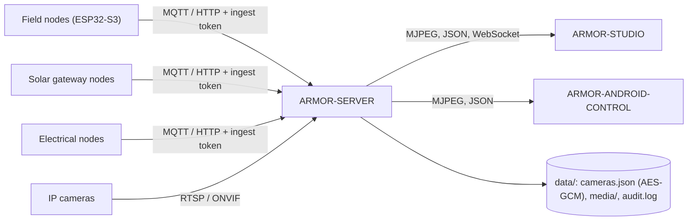

<p align="center">
  
</p>

# 🛡️ ARMOR-SERVER

<p align="center">
  <a href="README.md">🇺🇸 English</a> |
  <a href="README_spa.md">🇪🇸 Español</a> |
  <a href="README_fra.md">🇫🇷 Français</a> |
  <a href="README_ita.md">🇮🇹 Italiano</a> |
  <a href="README_deu.md">🇩🇪 Deutsch</a> |
  <a href="README_zho.md">🇨🇳 简体中文</a> |
  <a href="README_jpn.md">🇯🇵 日本語</a> |
  🇵🇹 <b>Português</b>
</p>


### Coordenador central de segurança: entrada de telemetria, alarmes, dispositivos, leituras solares e a porta de ligação das câmaras

<p align="center">
  
  
  
  
  
</p>

---

**Verificação de honestidade - o que funciona hoje:** Cada rota, sessão, cifragem e regra de provas abaixo é real e está coberta por testes (`npm test`, 168 testes, incluindo um conjunto completo de integração HTTP contra um servidor isolado). Correu contra um broker MQTT real no CM5 (com scripts, não com firmware de nós de campo), e transmitiu vídeo em direto, guardou uma fotografia e gravou a partir de cinco câmaras IP reais através do FFmpeg. O que **não** está provado ainda: ONVIF contra uma câmara ONVIF real, PTZ em todos os firmwares de câmara (funciona na unidade Hi3510), qualquer hardware Jetson, e as rotas solares contra um nó de ligação real (testam-se com leituras geradas).

---

## 🎯 Visão geral

O **ARMOR-SERVER** é o centro de confiança do A.R.M.O.R. Os nós de campo publicam observações de radar, luz e saúde; este serviço valida-as, guarda o último estado conhecido de cada nó e serve esse estado à consola Studio e ao cliente Android. É também dono de tudo o que toca numa câmara, para que **nenhum navegador nem telemóvel tenha alguma vez uma palavra-passe de câmara ou um endereço RTSP**.

* **Entrada validada:** as observações HTTP e MQTT verificam-se na fronteira (identificador, instantes, gama de lux, no máximo 15 rastos) antes de chegarem à projeção de estado.
* **Estado honesto dos nós:** um nó que deixa de falar mostra-se como *desatualizado* e *desligado* após uma janela configurável, nunca como ligado com dados antigos. Desarmar limpa de imediato um alerta alto.
* **Porta de ligação das câmaras:** cofre de câmaras cifrado, PTZ ONVIF / Hi3510 / PSIA, deteção de caminhos RTSP, um retransmissor FFmpeg partilhado por câmara, fotografias e gravação MP4, e um cão de guarda que transforma uma câmara que deixa de responder num evento e, com o sistema armado, num alarme.
* **Biblioteca de provas:** retenção dos mais antigos primeiro por idade e tamanho, **provas protegidas** que nunca se apagam, e um SHA-256 para a cadeia de custódia. Uma linha de auditoria por ação relevante para a segurança, com as credenciais removidas.
* **Estado que sobrevive:** o modo de segurança e a última observação de cada nó restauram-se após um reinício (um reinício nunca desarma o perímetro em silêncio). Cada mudança de nível de alerta, estado de nó e modo guarda-se num histórico de eventos.
* **Saída de alarme:** os alertas altos e, com o sistema armado, os nós silenciosos ou desligados vão para o MQTT `armor/server/alert` e um webhook opcional assinado com HMAC; um tempo de permanência antes de ALTO e as zonas a ignorar afinam-se a partir do Studio.
* **Utilizadores:** nomes e palavras-passe (hashes scrypt), uma função `admin` que gere utilizadores e uma função `operator` que opera; uma palavra-passe ou função alterada termina as outras sessões desse utilizador.
* **Dispositivos, alarmes e automatizações:** dispositivos de fumo, gás, inundação, porta, janela, movimento, clima, ficha, luz, sirene e fechadura por MQTT ou por envio autenticado, com estado normalizado, disponibilidade e comandos; alarmes com um ciclo de vida disparado / reconhecido / terminado; regras que comutam dispositivos quando algo acontece; armar e desarmar a partir de uma sessão iniciada; e o desenho do local guardado no servidor para todos os clientes.
* **Leituras solares:** inversores e conjuntos de baterias (com cada célula e as capacidades) chegam por HTTP ou MQTT, validam-se pelo contrato partilhado, guardam-se com um histórico (uma amostra a cada 30 s durante um dia) e totais, marcam-se como desatualizados após dois minutos, e disparam quatro alarmes (avaria de inversor, bateria fraca, alarme de bateria, dispositivo em silêncio).

## 🔄 Arquitetura



## 🔒 Modelo de segurança

* Quatro segredos separados: **ingestão** (enviar telemetria, saúde e leituras solares), **controlo** (armar / desarmar, eventos), **operador** (automatização) e o **início de sessão do Studio**; cada um compara-se em tempo constante e nenhum substitui outro.
* Cada rota que configura, move, captura, grava, protege ou apaga precisa de um operador. O vídeo em direto precisa de um operador ou de um bilhete de emissão de curta duração ligado a uma câmara.
* As palavras-passe das câmaras vivem apenas em `data/cameras.json`, cifradas com AES-256-GCM, e nenhuma API as devolve; os endereços ONVIF têm de ficar no anfitrião da câmara e os redirecionamentos recusam-se.
* As sessões do Studio são HttpOnly e SameSite=Strict durante 8 horas, o início de sessão tem limite de pedidos e os erros nunca levam um rasto de pilha.
* O servidor escuta em 127.0.0.1 a menos que `ARMOR_HOST` se defina de propósito, e então recusa-se uma palavra-passe do Studio com menos de 12 carateres.

## 🌐 API

* Pública: `GET /healthz`. Para um operador: estado, informação, câmaras, multimédia, histórico, regras, dispositivos, alarmes, automatizações, o desenho do local, e `GET /api/v1/solar` com o seu histórico.
* Para os nós de campo e as ligações: `POST /api/v1/telemetry`, `/health`, `/solar` e `/electrical/readings` com o token de ingestão, e os tópicos MQTT `armor/node/#`, `armor/solar/#` e `armor/electrical/#`. Os eventos chegam às consolas pelo WebSocket `/api/v1/events`.
* Cada rota, a sua regra de acesso e o seu esquema estão no ficheiro OpenAPI do [ARMOR-COMMON](https://github.com/JuanenRac/ARMOR-COMMON), e um teste verifica que nenhuma rota falta nele.

## ⚙️ Configuração

* Copie `.env.example` para `.env` (ignorado pelo Git), ou deixe que `run.bat` / `run.sh` gerem segredos aleatórios na primeira execução.
* Obrigatórios: `ARMOR_INGEST_TOKEN` e `ARMOR_CONTROL_TOKEN` (24 carateres ou mais, todos diferentes) e `ARMOR_STUDIO_USERNAME` / `ARMOR_STUDIO_PASSWORD` (o primeiro administrador).
* Comuns: `ARMOR_HOST` / `ARMOR_PORT`, `ARMOR_DATA_DIR`, `ARMOR_FFMPEG_PATH` (vídeo em direto e captura), `ARMOR_MQTT_URL`, `ARMOR_STUDIO_ORIGIN`, `ARMOR_NODE_STALE_AFTER_S`, `ARMOR_CAMERA_CHECK_S`, `ARMOR_ALERT_DWELL_MS`, `ARMOR_ALERT_WEBHOOK_URL` e `ARMOR_COOKIE_SECURE` (defina-o como `1` atrás de TLS).

## 📂 Estrutura do repositório

```text
ARMOR-SERVER/
├── src/            server, app, config, context, store, persistence, events, rules, notify, contracts, mqtt, audit,
│   │               alarms, automations, users, site, solar, solar_registry, electrical
│   ├── http/       auth primitives
│   ├── routes/     sessions, cameras, media, ingest, history, devices, alarms, users, solar, electrical, system
│   ├── devices/    the device model, kinds and MQTT bridge
│   ├── cameras/    model, vault, digest, ptz, rtsp, discovery, health, errors
│   └── media/      relay, evidence
├── tests/          unit tests + full HTTP integration suite
├── docs/           state machine, camera gateway, integration
├── data/           runtime state (ignored by Git)
└── images/         brand assets
```

## 🛠️ Ambiente de desenvolvimento

```powershell
npm install
npm run typecheck   # tsc --noEmit
npm test            # 168 tests: unit + full HTTP integration
npm run build       # dist/server.mjs
.\run.bat           # development server with hot reload
```

Para instalar na bancada de testes CM5 (isolada de todos os outros projetos, utilizador próprio, portas próprias) veja o [ARMOR-DEVOPS](https://github.com/JuanenRac/ARMOR-DEVOPS).

## 🔗 Projetos relacionados

O **A.R.M.O.R.** (Autonomous Radar & Multimodal Observation Range) é um sistema de segurança perimetral feito de repositórios independentes. Cada um tem a sua própria versão, os seus próprios testes e o seu próprio README; esta é a família:

* **[ARMOR-COMMON](https://github.com/JuanenRac/ARMOR-COMMON)** - Contratos de mensagens, validadores, vetores de conformidade e tipos gerados
* **[ARMOR-RADAR](https://github.com/JuanenRac/ARMOR-RADAR)** - Firmware de nó de campo para ESP32-S3 com três radares e o seu próprio painel web
* **[ARMOR-SOLAR](https://github.com/JuanenRac/ARMOR-SOLAR)** - Protocolos de inversores e baterias solares e as mensagens de um nó de ligação
* **[ARMOR-ELECTRICAL](https://github.com/JuanenRac/ARMOR-ELECTRICAL)** - Nó elétrico: contadores, a mensagem das leituras da rede e as regras de comutação
* **[ARMOR-HMI](https://github.com/JuanenRac/ARMOR-HMI)** - Painel tátil: o estado do sistema num ecrã de parede, armar e reconhecer, e a casa do assistente de voz
* **[ARMOR-NETWORK](https://github.com/JuanenRac/ARMOR-NETWORK)** - A rede local: os seus dispositivos, a internet e o que muda
* **ARMOR-SERVER** (este repositório) - Coordenador central: telemetria, alarmes, dispositivos, leituras solares e câmaras
* **[ARMOR-STUDIO](https://github.com/JuanenRac/ARMOR-STUDIO)** - Consola web: câmaras, radar, alarmes, energia solar e o desenhador de local 2D/3D
* **[ARMOR-ANDROID-CONTROL](https://github.com/JuanenRac/ARMOR-ANDROID-CONTROL)** - Cliente Android de operador com um radar 2D/3D em direto
* **[ARMOR-SERVER-AI](https://github.com/JuanenRac/ARMOR-SERVER-AI)** - Política de inferência visual que explica as suas decisões e nunca atua
* **[ARMOR-VOICE-AI](https://github.com/JuanenRac/ARMOR-VOICE-AI)** - Intenções de voz offline com uma confirmação que não se pode falsificar
* **[ARMOR-HARDWARE](https://github.com/JuanenRac/ARMOR-HARDWARE)** - Caixas, eletrónica e a matriz de aceitação de bancada
* **[ARMOR-DEVOPS](https://github.com/JuanenRac/ARMOR-DEVOPS)** - Implementação, a bancada de testes CM5, cópias de segurança e TLS
* **[ARMOR-SIMULATOR](https://github.com/JuanenRac/ARMOR-SIMULATOR)** - Simulador de telemetria offline com falhas repetíveis
* **[ARMOR-UPDATER](https://github.com/JuanenRac/ARMOR-UPDATER)** - Deteta, instala e atualiza os próprios repositórios do ecossistema
* **[ARMOR-DOCS](https://github.com/JuanenRac/ARMOR-DOCS)** - Arquitetura, linha de base de segurança e a matriz de capacidades

## 📚 Documentação e comunidade

Onde ler mais:

* [Matriz de capacidades: o que está provado e o que não](https://github.com/JuanenRac/ARMOR-DOCS/blob/main/docs/CAPABILITY_MATRIX.md)
* [Catálogo de projetos: versões e como os repositórios dependem uns dos outros](https://github.com/JuanenRac/ARMOR-DOCS/blob/main/docs/PROJECT_CATALOG.md)
* [Registo de alterações deste repositório](CHANGELOG.md)
* [Licença (GPL-3.0-or-later)](LICENSE)
* Perguntas, ideias e relatórios: electrohobby3d@gmail.com

## 👤 AUTOR

**JuanenRac (Electro Hobby 3D)** · electrohobby3d@gmail.com

## 📜 LICENÇA

GPL-3.0-or-later - veja [LICENSE](LICENSE).
