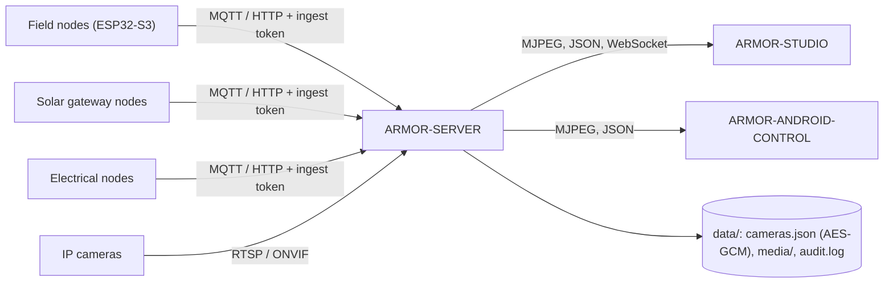

<p align="center">
  
</p>

# 🛡️ ARMOR-SERVER

<p align="center">
  <a href="README.md">🇺🇸 English</a> |
  <a href="README_spa.md">🇪🇸 Español</a> |
  <a href="README_fra.md">🇫🇷 Français</a> |
  <a href="README_ita.md">🇮🇹 Italiano</a> |
  <a href="README_deu.md">🇩🇪 Deutsch</a> |
  <a href="README_zho.md">🇨🇳 简体中文</a> |
  <a href="README_jpn.md">🇯🇵 日本語</a> |
  🇵🇹 <b>Português</b>
</p>

### Coordenador central de segurança: nós, alarmes, dispositivos, energia, câmaras, a rede local e a manutenção da instalação

<p align="center">
  
  
  
  
  
  
</p>

---

**Verificação de honestidade - o que funciona hoje:** Cada rota, sessão, cifra e regra de provas abaixo é real e está coberta por testes (`npm test`: 708 testes, incluindo um conjunto completo de integração HTTP contra um servidor isolado e uma verificação de que cada rota está documentada no ficheiro OpenAPI). Funciona em uso diário na bancada de testes do CM5 com um broker MQTT real, o firmware de um nó radar real numa placa ESP32-S3, câmaras IP reais (vídeo em direto, fotografias, gravações, PTZ nas unidades Hi3510), a consola Studio, a aplicação Android e os serviços de voz e de observação. O que **ainda não** está provado: ONVIF com uma câmara ONVIF real, qualquer hardware Jetson, as rotas solares, elétricas, de centrais de alarme e de painel tátil com nós reais (testam-se com mensagens geradas: só existe a placa radar) e o push por Firebase com um projeto Firebase real.

---

## 📋 Num relance

| | |
|---|---|
| Versão | `0.8.0.7` |
| Maturidade | Estabelecido |
| Função | Coordenador central de segurança da família: nós, alarmes, dispositivos, energia, câmaras, rede |
| Tecnologia | Node.js 22+, TypeScript, Express 5, MQTT, WebSocket, FFmpeg |
| Testes | 708 (`npm test`: unitários e integração HTTP completa) |
| Contrato | 191 caminhos HTTP, 247 operações (OpenAPI no ARMOR-COMMON), tabela de rotas em `docs/ROUTES.md` |
| Escuta em | `127.0.0.1:8080` (`ARMOR_HOST`, `ARMOR_PORT`) |
| Funciona em | A bancada do CM5 (como serviço, ver ARMOR-DEVOPS) ou qualquer computador com Node.js |
| Em hardware real | A bancada de testes do CM5, em uso diário: um broker MQTT real, câmaras IP reais, um nó radar real numa placa ESP32-S3, o Studio, a aplicação Android e os serviços de voz e observação contra ele |
| Licença | GPL-3.0-or-later |

**Ir para:** [Visão geral](#-visão-geral) · [Arquitetura](#-arquitetura) · [Segurança](#-segurança-e-proteção) · [Interfaces](#-interfaces) · [Configuração](#-configuração) · [Início rápido](#-início-rápido) · [Testes](#-testes) · [Problemas](#-resolução-de-problemas) · [Estrutura](#-estrutura-do-repositório) · [Relacionados](#-projetos-relacionados)

## 🚦 Estado do projeto

Cada linha é uma parte deste repositório e a luz diz até onde chega hoje. É escrita com o que o repositório consegue demonstrar (testes, compilações, execuções), não com o que está previsto.

🟢 Feito e verificado · 🟡 Funciona, com limites conhecidos · 🟠 Feito a meio ou ainda por verificar · 🔴 Por fazer ou a não funcionar

| Área | Estado | O que significa aqui |
|---|---|---|
| Software | 🟢 | As rotas, as sessões, a cifragem e as regras de provas funcionam todos os dias na bancada de testes CM5. |
| Testes | 🟢 | Passam 708 testes (`npm test`), incluindo uma bateria de integração HTTP completa contra um servidor isolado e uma verificação de que cada rota está documentada no ficheiro OpenAPI. |
| Protocolos e dados | 🟡 | As mensagens do radar vêm de uma placa real; as rotas solar, elétrica, de painel de alarme e de painel tátil são testadas com mensagens geradas, e o ONVIF não encontrou uma câmara ONVIF real. |
| Hardware | 🟡 | Funciona na bancada de testes CM5 com um broker MQTT real, câmaras IP reais (vídeo em direto, capturas, gravações, PTZ nas unidades Hi3510) e um nó radar real; nada funcionou num Jetson. |
| Segurança | 🟡 | As regras de sessões, cifragem, provas e acesso estão cobertas por testes; não houve revisão independente. |
| Integração | 🟡 | O Studio, a app Android e os serviços de voz e observação usam-no todos os dias na bancada; o push através do Firebase nunca correu contra um projeto Firebase real. |
| Documentação | 🟢 | Oito idiomas, a referência das rotas (OpenAPI e ROUTES), os guias de ambiente e de acesso remoto e o registo de alterações estão atualizados. |

## 🎯 Visão geral

O **ARMOR-SERVER** é o centro de confiança do A.R.M.O.R. Os nós de campo publicam observações de radar, luz e saúde; este serviço valida-as, guarda o último estado conhecido de cada nó e serve esse estado à consola Studio e ao cliente Android. É também dono de tudo o que toca numa câmara, para que **nenhum navegador nem telemóvel tenha alguma vez uma palavra-passe de câmara ou um endereço RTSP**.

* **Entrada validada:** as mensagens HTTP e MQTT de cada tipo de nó (radar, solar, elétrico, central de alarme, rede) são verificadas na fronteira pelo contrato partilhado antes de chegarem ao estado; um nó pode ter o seu próprio token (derivado do partilhado) e um modo estrito não aceita mais nada.
* **Estado honesto dos nós:** um nó que deixa de falar aparece como *desatualizado* e *desligado* após uma janela configurável, nunca como ligado com dados velhos; um que se volta a ligar conta desde o seu regresso, não desde as mensagens antigas. Desarmar limpa um alerta alto de imediato.
* **Porta de ligação das câmaras:** cofre cifrado das câmaras, PTZ ONVIF / Hi3510 / PSIA, descoberta de caminhos RTSP, um relé FFmpeg partilhado por câmara, fotografias e gravação MP4, um vigilante que transforma uma câmara muda num evento e, armado, num alarme, **zonas da imagem a ignorar** e **fotografias e vídeo feitos sozinhos** quando uma câmara vê algo estando armado.
* **Biblioteca de provas:** retenção por idade e tamanho, **provas protegidas** que nunca se apagam, um SHA-256 para a cadeia de custódia e um ficheiro de **prova de custódia** assinado pelo servidor. Uma linha de auditoria por ação relevante, com as credenciais removidas.
* **Estado que sobrevive:** o modo de segurança e a última observação de cada nó são restaurados após um reinício (um reinício nunca desarma o perímetro em silêncio); os ficheiros são escritos de forma atómica e um danificado é recuperado. Cada mudança de alerta, nó e modo fica guardada num histórico de eventos.
* **Alarmes:** um centro de alarmes com ciclo gerado / reconhecido / terminado, escalada de um alarme crítico que espera sem ser visto, uma **verificação antes de armar** (o que está aberto, mudo ou em baixo), um PIN para desarmar (e um PIN de coação) e alarmes de nós, câmaras, dispositivos, solar, elétrico, rede e centrais de alarme. Chegam ao Studio, aos telemóveis (ntfy, Telegram, Home Assistant, um webhook assinado, push por Firebase se o configurar) e ao tópico MQTT `armor/server/alert`.
* **Utilizadores e papéis:** nomes e palavras-passe (hashes scrypt), um papel `admin` que gere utilizadores, um papel `operator` que opera e um papel `viewer` que só observa; mudar a palavra-passe ou o papel termina as outras sessões desse utilizador.
* **Dispositivos e automatizações:** fumo, gás, inundação, porta, janela, movimento, clima, tomada, luz, sirene, fechadura, estore, portão ou porta de garagem e esquentador, por MQTT ou push autenticado, com estado normalizado, disponibilidade e comandos; regras que acionam dispositivos quando algo acontece (também por limiares).
* **Energia:** inversores e pilhas de baterias (com cada célula e as capacidades) e nós elétricos chegam por HTTP ou MQTT, são validados pelo contrato partilhado, guardados com histórico e energia por dia, marcados como desatualizados se calarem, e geram alarmes (avaria do inversor, bateria baixa, rede perdida, tensão, falha de comutação…). O desenho elétrico e as regras para comutar um circuito ficam no servidor.
* **Centrais de alarme:** o estado dos nós ARMOR-NODE-ALARM, o **desenho do alarme** com as suas versões, os **dispositivos Zigbee ligados às zonas** (o servidor diz a uma central como está uma zona enquanto tem o rádio) e comandos de armar / desarmar a uma central (desligados salvo `ARMOR_ALARM_COMMANDS=1`).
* **Rede local:** o que o nó ARMOR-NETWORK comunica (dispositivos, internet, o endereço público e quem o dá), ordens para o nó (varrimento, ping, portas, inspecionar um dispositivo com um acesso que o utilizador dá), nomes, dispositivos ocultos e vigiados, e acessos que viajam **selados só para o nó**.
* **Voz, observação e manutenção:** comandos escritos e falados (lista fechada, em oito idiomas, com uma confirmação ligada à pessoa), o contexto para o serviço de observação (que radares cobrem que câmara), o firmware dos nós atualizado a partir do Studio um a um com progresso, e as atualizações da própria instalação a partir do GitHub, as do sistema e uma consola root opcional, tudo através do assistente de manutenção.
* **Uso a partir de fora de casa:** o servidor distingue a casa do exterior (uma VPN conta como a casa), mantém sessões mais curtas a partir de fora, pede um segundo fator (uma app autenticadora, com códigos de recuperação) e a palavra-passe outra vez antes das ações críticas, deixa escolher o que uma sessão de fora pode fazer (tudo, só operar o alarme, só ver), avisa os destinos dos alarmes quando alguém entra de um sítio novo e abre o painel web de um nó através do servidor - fixado ao certificado do nó e com o seu cookie guardado no servidor - para que nenhum nó seja alguma vez publicado.
* **Ligação cifrada opcional ao broker (mqtts):** `ARMOR_MQTT_CA_FILE` indica o certificado da autoridade própria da instalação; com um endereço `mqtts://` o servidor confia só nessa autoridade e verifica o nome do broker, e recusa-se a arrancar se o ficheiro não for um certificado válido ou o endereço não for `mqtts://`. O Studio mostra se a ligação está cifrada e a impressão digital da autoridade. Testado contra um broker TLS de teste e contra um Mosquitto 2.0 real.
* **Saúde dos nós e modos de armar:** guarda o último relatório e o registo de reinícios de cada nó e levanta quatro avisos (pouca memória, reinícios demasiado frequentes, um broker que cai repetidamente, sinal Wi-Fi fraco); guarda os perfis de armar (Ausente, Em casa, Noite e os seus) e põe o escolhido dentro do comando de armar, só para um nó que diz entendê-los. Um alarme forte ou discreto segue o perfil; um armar sem perfil é o comando de sempre.
* **Histórico das ligações e do sistema:** além dos alertas, nós, câmaras, dispositivos e alarmes, o histórico regista que dispositivos e aplicações se ligam (sessões do Studio, a app Android, os painéis dos nós, o serviço de voz: inícios de sessão, recusas, saídas, sessões expiradas, uso do segundo fator, primeira e última vez vistos) e os eventos do sistema (nós que aparecem ou desaparecem com o seu firmware, a ligação ao broker, definições alteradas e por quem, serviços, atualizações, armar com o seu perfil). Filtra-se por tipo, categoria, cliente e utilizador; o endereço e o agente de utilizador só os veem os administradores, e nunca se regista uma palavra-passe, um token, um cookie nem um PIN.
* **Ordens para escrever numa bateria Pylontech (desligadas salvo `ARMOR_BATTERY_WRITE=1`):** para administradores que acabaram de provar de novo quem são - preparar, executar com o número de série da bateria escrito outra vez, cancelar, repor uma saída como estava, guardar uma imagem de firmware durante uma hora - verificadas com a tabela partilhada de operações e intervalos, enviadas ao nó gateway como `solar_battery_command`, com cada operação guardada (quem, que bateria, o lido antes e depois, a diferença e a transcrição, nunca a palavra-passe de serviço) e registada no histórico em *Baterias*.
* **Controlo dos nós:** `POST /api/v1/nodes/{id}/control` e `POST /api/v1/nodes/control` dão uma ordem (reiniciar, pausar, retomar, pôr em espera, identificar, diagnóstico, manutenção ligada ou desligada) a um nó ou a todos os que reportam, só a um administrador que acabou de provar quem é outra vez, com o nome do nó (ou a palavra RESTART, PAUSE ou STANDBY para todos) escrito de novo onde a casa ficaria menos vigiada. O servidor prepara a ordem, executa-a com o token de uso único que o nó dá para essa operação, segue cada nó (enviada, recebida, aplicada, de volta) em `GET /api/v1/nodes/control/operations`, reinicia as centrais de alarme por último num reinício escalonado, regista quem ordenou o quê no histórico e na auditoria, e mostra na saúde do nó se está em pausa, em espera (trabalho desligado, continua ligado) ou em manutenção. Não existe reposição de fábrica, apagamento nem sono profundo. É testado com um broker simulado; não foi experimentado num nó real.
* **Estado em direto e tabela de rotas:** o servidor envia o estado completo ao Studio por um WebSocket em `/api/v1/events` sempre que algo muda (uma rajada de alterações é uma só mensagem e um cliente que fica para trás é descartado), e cada rota que regista, com quem a pode chamar, consta de uma tabela gerada a partir do código. O painel de parede tem o seu próprio canal, mais pequeno, em `/api/v1/panel/events` (o mesmo resumo de umas centenas de bytes de `GET /api/v1/panel/summary`, enviado quando muda e de cinco em cinco segundos, para as contas de painel, operador e administrador; um administrador desliga-o com `panel.live_events`).

## 🧩 Papel no A.R.M.O.R.

O ARMOR-SERVER é o único centro de confiança da família. Os nós de campo ([ARMOR-NODE-RADAR](https://github.com/JuanenRac/ARMOR-NODE-RADAR), [ARMOR-NODE-SOLAR](https://github.com/JuanenRac/ARMOR-NODE-SOLAR), [ARMOR-NODE-ELECTRICAL](https://github.com/JuanenRac/ARMOR-NODE-ELECTRICAL), [ARMOR-NODE-ALARM](https://github.com/JuanenRac/ARMOR-NODE-ALARM), [ARMOR-NODE-HMI](https://github.com/JuanenRac/ARMOR-NODE-HMI)) e o [ARMOR-NETWORK](https://github.com/JuanenRac/ARMOR-NETWORK) falam com ele por MQTT ou HTTP; o [ARMOR-STUDIO](https://github.com/JuanenRac/ARMOR-STUDIO) e o [ARMOR-ANDROID-CONTROL](https://github.com/JuanenRac/ARMOR-ANDROID-CONTROL) leem-no e dão-lhe ordens; o [ARMOR-SERVER-AI](https://github.com/JuanenRac/ARMOR-SERVER-AI) pesa o que as câmaras veem face aos radares e só recomenda; o [ARMOR-VOICE-AI](https://github.com/JuanenRac/ARMOR-VOICE-AI) transforma a voz numa lista fechada de comandos; o [ARMOR-DEVOPS](https://github.com/JuanenRac/ARMOR-DEVOPS) instala e atualiza tudo isso no CM5. O servidor decide: mais nada arma, desarma ou aciona o que quer que seja.

| Fala com | Como | Para quê |
|---|---|---|
| ARMOR-NODE-RADAR, SOLAR, ELECTRICAL, ALARM, HMI | MQTT `armor/*/#` ou HTTP `POST` com o token de ingestão | as suas mensagens entram, as ordens saem |
| ARMOR-NETWORK | o estado entra, ordens e credenciais seladas saem | a rede local |
| ARMOR-STUDIO, ARMOR-ANDROID-CONTROL | HTTP, MJPEG e o WebSocket `/api/v1/events` | as consolas |
| ARMOR-VOICE-AI | `/v1/command`, `/v1/turn` com o seu próprio token | decide uma frase; o servidor age |
| ARMOR-SERVER-AI | `ARMOR_AI_TOKEN`, `/api/v1/ai/...` | observação das câmaras |
| Câmaras IP | RTSP, ONVIF, Hi3510, PSIA (o servidor chama-as) | vídeo em direto, instantâneos, gravação, PTZ |

## 🏛️ Arquitetura

<p align="center">
  
</p>

<details>
<summary>Versão em texto do diagrama (Mermaid)</summary>



</details>

## 🔒 Segurança e proteção

* Segredos separados: **ingest** (os nós publicam as suas mensagens; cada nó pode ter ainda o seu próprio token, derivado do partilhado, e um modo estrito aceita só esses), **control** (armar / desarmar, eventos), **operator** (automatização) e o **login do Studio**; cada um é comparado em tempo constante e nenhum substitui outro. Um acesso dado a um nó de rede viaja selado só para esse nó.
* Três papéis: **admin**, **operator** e **viewer** (lê, nunca altera). Cada rota que configura, move, captura, grava, protege, apaga ou arma exige um operador; o vídeo em direto exige um operador ou um bilhete de emissão de curta duração ligado a uma câmara. Os comandos perigosos (desarmar, comutar um circuito, a consola root) pedem um administrador e, para desarmar, o PIN.
* As palavras-passe das câmaras vivem só em `data/cameras.json`, cifradas com AES-256-GCM, e nenhuma API as devolve; os endereços ONVIF têm de ficar no anfitrião da câmara e os redirecionamentos são recusados.
* As sessões do Studio são HttpOnly e SameSite=Strict, o login tem limite de tentativas e os erros nunca levam um rasto de pilha.
* O servidor escuta em 127.0.0.1 salvo se `ARMOR_HOST` for definido de propósito, e então uma palavra-passe do Studio com menos de 12 caracteres é recusada.
* A partir de fora de casa: segundo fator (TOTP, RFC 6238), uma nova prova de identidade para utilizadores, firmware e painéis dos nós, uma política que reserva a administração para a casa ou a VPN, só releases de firmware assinadas e um proxy de painéis de nós que nunca toma um endereço do pedido, só passa o necessário e recusa um nó cujo certificado não seja o de confiança.

| Ameaça | Defesa |
|---|---|
| Adivinhar a palavra-passe do Studio | scrypt (N=16384, r=8, p=1), o mesmo trabalho exista ou não o utilizador; 12 tentativas por 15 minutos por pessoa e endereço, 60 por endereço, 40 por minuto no total; menos de 8 caracteres é recusada (12 se o servidor for alcançável pela rede) |
| Um cookie roubado, um pedido de outro site | HttpOnly, SameSite=Strict e Secure atrás de HTTPS; as sessões duram 7 dias (Studio), 8 horas (operador) e 12 horas com 30 minutos de inatividade vindo de fora |
| Ataques de tempo e segredos fracos | Os segredos comparam-se em tempo constante, têm 24 ou mais caracteres e são todos diferentes (ingestão, controlo, operador, chave das câmaras, IA, chave das provas) |
| Desarmar sem prova | Um PIN de 4 a 10 dígitos segundo `alarm.disarm_pin` (never, if_set, always); 3 falhas bloqueiam 60 s, 5 min, 15 min e depois 1 h, guardado em disco entre reinícios; um PIN de coação distingue-se sem avisar; o token de controlo só desarma com `ARMOR_CONTROL_DISARM=1` |
| Fuga das palavras-passe das câmaras | AES-256-GCM em `data/cameras.json`; nenhuma API as devolve; o FFmpeg passa por um túnel RTSP local (`media.rtsp_proxy`) para a palavra-passe nunca ir numa linha de comandos; os redirecionamentos ONVIF são recusados |
| Vídeo em direto sem iniciar sessão | Um bilhete de transmissão ligado a uma só câmara, emitido apenas a um operador |
| Inundar a API | 240 pedidos por minuto em geral (os POST dos nós têm orçamento próprio de 6000 por minuto); corpos JSON de 64 kB (9 MB para um ficheiro de instalação) |
| Uma mensagem de nó falsa ou mal formada | Verificada na fronteira pelos analisadores de `src/contracts.ts`, testados com os vetores partilhados do ARMOR-COMMON: no máximo 15 pistas, lux até 200 000, um id de nó com letras, dígitos, `_` e `-`; um token por nó derivado do partilhado e um modo estrito (`ARMOR_INGEST_STRICT=1`) |
| Uma sessão vinda de fora de casa | Segundo fator (`ARMOR_TOTP_REQUIRED`: off, remote, always), uma política do que pode fazer (`ARMOR_REMOTE_POLICY`: full, operate, view), nova prova de identidade para ações críticas (5 minutos por predefinição) e aviso ao entrar de um sítio novo |
| Um painel de nó usado como proxy aberto | O endereço nunca vem do pedido; o HTTPS fica fixado à impressão digital SHA-256 do certificado do nó |
| Voz: silenciar sem verificar, texto longo, áudio enorme | A política `voice.silence_confirmation` (off, pin, double_turn) viaja em cada turno; confirmação ligada à pessoa; 200 caracteres, 8 idiomas, 30 pedidos por minuto; áudio de 480 000 bytes e resposta de 200 000 bytes no máximo |
| Escritas perigosas por engano | Desligadas salvo `ARMOR_BATTERY_WRITE=1`, `ARMOR_ELECTRICAL_SWITCHING=1` ou `ARMOR_ALARM_COMMANDS=1`, com aviso no arranque |

**Interruptores no Studio.** As proteções ajustáveis são 15 valores guardados em `security-settings.json` (modo 0600, escrita atómica), cada um com um valor predefinido conservador; baixar um fica registado na auditoria: `alarm.disarm_pin`, `voice.silence_confirmation`, `alarm.config_hash`, `server.zone_feed`, `server.zone_feed_signature`, `media.rtsp_proxy`, `network.login_secure_only`, `voice.multipart_turn`, `panel.live_events`, `client.device_lock`, `nodes.nvs_encryption`, `alarm_audio.spoken`, `alarm_audio.custom_sounds`, `voice.turn_max_bytes` e `voice.reply_audio_max_bytes`.

**O que nunca faz:** devolver uma palavra-passe de câmara, guardar as palavras ditas (só o comando e o seu resultado) nem escrever um PIN, um token ou um cookie num registo. Não houve revisão de segurança independente.

## 🔌 Interfaces

A tabela de rotas (`docs/ROUTES.md`, gerada do código) lista cada rota com quem a pode chamar; o ficheiro OpenAPI do ARMOR-COMMON descreve 191 caminhos e 247 operações, e um teste falha se faltar alguma. As mais importantes:

| Rota | Autenticação | O que faz |
|---|---|---|
| `GET /healthz` | nenhuma | vivo e pronto |
| `POST /api/v1/telemetry`  `/health`  `/solar`  `/electrical/readings`  `/alarm/state`  `/network/state`  `/devices/state` | token de ingestão | o que os nós publicam |
| `WS /api/v1/events` | sessão | todo o estado quando algo muda (uma rajada é uma mensagem; um cliente atrasado é descartado; 1 KB no máximo do cliente) |
| `WS /api/v1/panel/events` | painel | um canal mais pequeno para o painel de parede (128 bytes no máximo do cliente) |
| `POST /api/v1/voice/command` | operador, 30 por minuto | uma ordem escrita ou falada: `{text, language, confirmation?, pin?}`; responde `{accepted, executed, intent, outcome, speech, confirmation_token?, reason?, result?}` |
| `POST /api/v1/voice/turn`  `/api/v1/voice/v1/turn` | cabeçalho `X-Armor-Voice-Token` | o áudio de um turno (multipart); erros `unauthorized`, `multipart_turn_disabled` (415), `audio_too_large` (413), `bad_multipart` (400), `voice_bad_reply` (502) |
| `GET /api/v1/alarm-audio` | operador | o que o som dos alarmes oferece: as duas opções (desligadas por defeito), se há porta de ligação de voz, os limites e os sons guardados |
| `GET /api/v1/alarm-audio/spoken` | operador ou a conta de um painel de parede | um alarme dito em voz alta (origem, gravidade, código de alarme; PCM mono de 16 bits a 16 kHz com o seu SHA-256), feito pela porta de ligação de voz e guardado numa cache; 404 `spoken_alarms_disabled` com a opção desligada |
| `GET` `PUT` `DELETE /api/v1/alarm-audio/sounds/{source}` | GET: operador ou a conta de um painel de parede; PUT e DELETE: administrador (nova prova de identidade a partir de fora de casa) | o som de uma origem de alarme: um ficheiro WAVE de PCM mono de 16 bits a 16 kHz, lido byte a byte (de um décimo de segundo até `ARMOR_ALARM_SOUND_MAX_BYTES`, não silêncio), só se guardam as suas amostras e é servido com o seu SHA-256; 409 `custom_sounds_disabled` com a opção desligada |
| `POST /api/v1/nodes/{id}/control`  `POST /api/v1/nodes/control` | administrador que acabou de provar quem é | uma ordem (reiniciar, pausar, retomar, espera, identificar, diagnóstico, manutenção) a um nó ou a todos |
| `POST /api/v1/cameras/{id}/stream-ticket` | operador | um bilhete de curta duração para o vídeo em direto de uma câmara |

* Pública: `GET /healthz`. Para um utilizador com sessão: estado, informação, câmaras, multimédia, histórico, regras, dispositivos, alarmes, automatizações, os desenhos (local, alarme, elétrico, rede), leituras solares e elétricas, a rede local, notificações e preferências, e para um administrador utilizadores, serviços, firmware, atualizações e a consola.
* Para os nós: `POST /api/v1/telemetry`, `/health`, `/solar`, `/electrical/readings`, `/alarm/state`, `/network/state` e `/devices/state` com o token de ingest, e os tópicos MQTT `armor/node/#`, `armor/solar/#`, `armor/electrical/#`, `armor/alarm/#` e `armor/network/#`. Os eventos chegam às consolas pelo WebSocket `/api/v1/events`.

## ⚙️ Configuração

Copie `.env.example` para `.env` (ignorado pelo Git), ou deixe `run.bat` / `run.sh` gerar segredos aleatórios na primeira execução. A lista completa das variáveis, com os seus intervalos, está em [docs/ENVIRONMENT.md](docs/ENVIRONMENT.md) (gerada do código) e as do acesso remoto em [docs/REMOTE_ACCESS.md](docs/REMOTE_ACCESS.md). Os valores que protegem a instalação não estão aqui mas no Studio (ver Segurança).

| Definição | Predefinição | O que faz |
|---|---|---|
| `ARMOR_INGEST_TOKEN`  `ARMOR_CONTROL_TOKEN` | sim (24+ caracteres, todos diferentes) | com o que os nós publicam; o que arma, desarma e lê eventos |
| `ARMOR_STUDIO_USERNAME`  `ARMOR_STUDIO_PASSWORD` | sim | o primeiro administrador |
| `ARMOR_HOST`  `ARMOR_PORT` | 127.0.0.1  8080 | onde escuta; uma palavra-passe do Studio com menos de 12 caracteres é recusada se não for loopback |
| `ARMOR_DATA_DIR`  `ARMOR_FFMPEG_PATH` | data/ | pasta de estado; FFmpeg para vídeo em direto e captura |
| `ARMOR_MQTT_URL`  `ARMOR_MQTT_CA_FILE` | opcional | o broker; a autoridade própria da instalação para `mqtts://` (o servidor só confia nela, verifica o nome do broker e recusa arrancar com um ficheiro errado) |
| `ARMOR_NODE_STALE_AFTER_S` | 30 (5-3600) | segundos de silêncio até um nó ficar obsoleto |
| `ARMOR_ALERT_DWELL_MS`  `ARMOR_ALERT_MIN_TARGETS` | 2000 (0-60000)  1 (1-20) | quanto tempo e quantos alvos antes de um alerta de radar |
| `ARMOR_ESCALATE_AFTER_MIN` | 0 = off (0-1440) | minutos antes de escalar um alarme crítico que ninguém vê |
| `ARMOR_MEDIA_RETENTION_DAYS`  `ARMOR_MEDIA_MAX_BYTES` | 30 (0-3650)  20 GiB | provas guardadas por idade e tamanho, as mais antigas primeiro; as protegidas nunca são apagadas |
| `ARMOR_STUDIO_SESSION_TTL_MS`  `ARMOR_OPERATOR_SESSION_TTL_MS`  `ARMOR_REMOTE_SESSION_TTL_MS`  `ARMOR_REMOTE_IDLE_MS`  `ARMOR_ELEVATION_MS` | 7 d  8 h  12 h  30 min  5 min | duração das sessões e de uma nova prova de identidade |
| `ARMOR_TOTP_REQUIRED`  `ARMOR_REMOTE_POLICY` | off  full | segundo fator e o que uma sessão de fora pode fazer |
| `ARMOR_ALERT_LANGUAGE` | es | idioma dos alertas (um dos oito) |
| `ARMOR_NTFY_URL`  `ARMOR_TELEGRAM_BOT_TOKEN`  `ARMOR_HOMEASSISTANT_URL`  `ARMOR_ALERT_WEBHOOK_URL`  `ARMOR_FCM_SERVICE_ACCOUNT` | desligado | para onde vão os alarmes (tudo desligado por predefinição) |
| `ARMOR_ALARM_COMMANDS`  `ARMOR_BATTERY_WRITE`  `ARMOR_ELECTRICAL_SWITCHING`  `ARMOR_INGEST_STRICT`  `ARMOR_CONTROL_DISARM` | 0 | escritas perigosas e modos estritos, tudo desligado |
| `ARMOR_COOKIE_SECURE`  `ARMOR_STUDIO_ORIGIN` | - | pôr `1` atrás de TLS; a origem do Studio |

* Obrigatórios: `ARMOR_INGEST_TOKEN` e `ARMOR_CONTROL_TOKEN` (24 caracteres ou mais, todos diferentes) e `ARMOR_STUDIO_USERNAME` / `ARMOR_STUDIO_PASSWORD` (o primeiro administrador).
* Habituais: `ARMOR_HOST` / `ARMOR_PORT`, `ARMOR_DATA_DIR`, `ARMOR_FFMPEG_PATH` (vídeo em direto e captura), `ARMOR_MQTT_URL`, `ARMOR_MQTT_CA_FILE`, `ARMOR_STUDIO_ORIGIN`, `ARMOR_NODE_STALE_AFTER_S`, `ARMOR_CAMERA_CHECK_S`, `ARMOR_ALERT_DWELL_MS`, `ARMOR_ALERT_WEBHOOK_URL` e `ARMOR_COOKIE_SECURE` (a `1` atrás de TLS).

## 🚀 Início rápido

**Requisitos:** Node.js 22+, FFmpeg (vídeo em direto e captura), um broker MQTT (Mosquitto).

```powershell
npm install           # dependências
npm run typecheck     # tsc --noEmit
npm test              # 708 testes: unitários e integração HTTP completa
npm run build         # dist/server.mjs
.\run.bat   (run.sh)  # servidor de desenvolvimento com recarga a quente
```

Para o instalar na bancada do CM5 (isolado de qualquer outro projeto, com utilizador e portas próprios) veja [ARMOR-DEVOPS](https://github.com/JuanenRac/ARMOR-DEVOPS).

## 🧪 Testes

```powershell
npm run typecheck  # tsc --noEmit
npm test           # tsx --test tests/*.test.ts
python -I tools/armor_ci_validate.py
```

`npm test` executa cada ficheiro de `tests/` (95 ficheiros): testes unitários de cada módulo e uma bateria de integração HTTP completa contra um servidor isolado (`tests/vertical-slice.test.ts`). `tests/conformance.test.ts` executa os vetores partilhados do ARMOR-COMMON e verifica que **as rotas que o servidor regista são exatamente as operações que o ficheiro OpenAPI descreve**, por método e caminho, e que cada resposta diz que corpo tem; é saltado se o ARMOR-COMMON não estiver ao lado deste repositório. Os testes de TLS precisam de `openssl` instalado. O GitHub Actions executa a base do A.R.M.O.R. em cada push e pull request: a validação do manifesto, da versão, do registo de alterações e da paridade dos README, e depois a compilação e os testes do próprio projeto.

## 🏗️ Compilação e publicação

`npm run build` empacota o servidor em `dist/server.mjs` (o `Dockerfile` constrói a imagem de contentor a partir dele). A versão está em `package.json`, em `armor.project.json` e no emblema do README (lido do manifesto); cada versão tem a sua entrada em [CHANGELOG.md](CHANGELOG.md). As versões são publicadas no GitHub.

## 🩺 Resolução de problemas

| Vê | Porque | Faça |
|---|---|---|
| `ARMOR_INGEST_TOKEN must be at least 24 characters` | falta um segredo ou é curto | defina-o (24+ caracteres); `run.sh` pode gerá-los |
| `... and ... must be different values` | dois segredos são iguais | dê a cada um o seu valor |
| `ARMOR_STUDIO_PASSWORD must be at least 12 characters when the server is reachable from the network` | `ARMOR_HOST` não é loopback | use uma palavra-passe mais longa, ou deixe `127.0.0.1` |
| `ARMOR_MQTT_CA_FILE needs an mqtts:// address in ARMOR_MQTT_URL` | o ficheiro da autoridade está definido mas o endereço do broker não é `mqtts://` | use um endereço `mqtts://`, ou retire o ficheiro |
| `TLS_CERT_PATH and TLS_KEY_PATH must both be set` | só um dos dois está definido | defina ambos para HTTPS, ou nenhum para HTTP simples |
| `voice_unavailable`  `voice_not_answering` (503) | o serviço de voz não responde | inicie o ARMOR-VOICE-AI e verifique `ARMOR_VOICE_URL` e o seu token |

## 📂 Estrutura do repositório

<p align="center">
  
</p>

<details>
<summary>Versão em texto da árvore</summary>

```text
ARMOR-SERVER/
├── src/
│   ├── server.ts app.ts              arranque, aplicação Express, limites
│   ├── config.ts                     cada definição, verificada no arranque
│   ├── contracts.ts mqtt_router.ts   validação na fronteira
│   ├── store.ts persistence.ts       estado dos nós e o que sobrevive a um reinício
│   ├── alarms.ts escalation.ts       central de alarmes e escalada
│   ├── users.ts totp.ts              utilizadores, funções, PIN e segundo fator
│   ├── security_settings.ts          os 15 interruptores do Studio
│   ├── voice.ts voice_turn.ts        ordens escritas e faladas
│   ├── firmware.ts installation.ts   firmware dos nós e atualizações próprias
│   ├── http/                         sessões, tokens por nó, credenciais seladas
│   ├── routes/                       um ficheiro por grupo de rotas
│   ├── cameras/                      cofre, PTZ, RTSP, descoberta, saúde
│   ├── media/                        relé FFmpeg e biblioteca de provas
│   └── devices/                      modelo de dispositivos e a sua ponte MQTT
├── tests/                            700 testes, unitários e integração HTTP
├── docs/                             7 guias, tabela de rotas, ambiente
├── tools/                            geradores de docs/ROUTES.md e docs/ENVIRONMENT.md, verificações de CI, lançador
├── images/                           faixa, ícone e as imagens do README
├── .github/                          fluxo de CI, aviso ao painel, modelos de issues e pull requests
├── Dockerfile                        imagem de contentor do servidor
├── armor.project.json                manifesto: versão, função, maturidade
├── CHANGELOG.md                      o que mudou em cada versão
├── package.json package-lock.json    dependências e scripts
├── tsconfig.json                     definições do TypeScript
├── run.sh run.bat                    arrancar, fluxo partilhado
├── build.sh build.bat                compilar e testar, fluxo partilhado
├── build-test.sh build-test.bat      compilar, testar e empacotar
├── test.sh test.bat                  só os testes, nunca a versão
└── SECURITY.md SUPPORT.md CONTRIBUTING.md CODE_OF_CONDUCT.md LICENSE
```

</details>

## 🗺️ Roteiro e limites conhecidos

**Limites conhecidos hoje**

* O ONVIF nunca encontrou uma câmara ONVIF real, e nada correu num Jetson.
* As rotas solar, elétrica, de painel de alarme e de painel tátil são testadas com mensagens geradas: só existe a placa do radar.
* O push pelo Firebase nunca correu contra um projeto Firebase real.
* As ordens de controlo dos nós e o TLS nativo com certificado público não correram num nó real.
* Sem revisão de segurança independente.

**A seguir**

* Experimentar o ONVIF com uma câmara real e as rotas dos outros nós com as suas placas.
* Experimentar o push com um projeto Firebase real.

## 🌍 Idiomas

O README e os textos existem em inglês, espanhol, francês, italiano, alemão, chinês, japonês e português europeu.

## 🔗 Projetos relacionados

O **A.R.M.O.R.** (Autonomous Radar & Multimodal Observation Range) é um sistema de segurança perimetral feito de repositórios independentes. Cada um tem a sua própria versão, os seus próprios testes e o seu próprio README; esta é a família:

* **[ARMOR-COMMON](https://github.com/JuanenRac/ARMOR-COMMON)** - Contratos de mensagens, validadores, vetores de conformidade e tipos gerados
* **[ARMOR-NODE-RADAR](https://github.com/JuanenRac/ARMOR-NODE-RADAR)** - Firmware de nó de campo para ESP32-S3 com três radares e o seu próprio painel web
* **[ARMOR-NODE-SOLAR](https://github.com/JuanenRac/ARMOR-NODE-SOLAR)** - Protocolos de inversores e baterias solares e as mensagens de um nó porta de ligação
* **[ARMOR-NODE-ELECTRICAL](https://github.com/JuanenRac/ARMOR-NODE-ELECTRICAL)** - Nó elétrico: contadores, a mensagem das leituras da rede e as regras de comutação
* **[ARMOR-NODE-ALARM](https://github.com/JuanenRac/ARMOR-NODE-ALARM)** - Nó e painel de alarme: zonas, armar, atrasos, sirene e PIN, com o servidor ou sem ele
* **[ARMOR-NODE-HMI](https://github.com/JuanenRac/ARMOR-NODE-HMI)** - Painel tátil: o estado do sistema num ecrã de parede, armar e reconhecer, e a casa do assistente de voz
* **[ARMOR-NETWORK](https://github.com/JuanenRac/ARMOR-NETWORK)** - A rede local: os seus dispositivos, a internet e o que muda
* **ARMOR-SERVER** (este repositório) - Coordenador central: telemetria, alarmes, dispositivos, leituras solares e câmaras
* **[ARMOR-STUDIO](https://github.com/JuanenRac/ARMOR-STUDIO)** - Consola web: câmaras, radar, alarmes, energia solar e o desenhador 2D/3D do local
* **[ARMOR-ANDROID-CONTROL](https://github.com/JuanenRac/ARMOR-ANDROID-CONTROL)** - Cliente de operador Android com radar 2D/3D em direto
* **[ARMOR-IOS-CONTROL](https://github.com/JuanenRac/ARMOR-IOS-CONTROL)** - Cliente de operador para iPhone
* **[ARMOR-SERVER-AI](https://github.com/JuanenRac/ARMOR-SERVER-AI)** - Política de inferência visual que explica as suas decisões e nunca atua
* **[ARMOR-VISION](https://github.com/JuanenRac/ARMOR-VISION)** - Zonas de câmara, máscaras e regras de deteção para o Jetson Orin NX
* **[ARMOR-VOICE-AI](https://github.com/JuanenRac/ARMOR-VOICE-AI)** - Intenções de voz offline com uma confirmação que não pode ser falsificada
* **[ARMOR-HARDWARE](https://github.com/JuanenRac/ARMOR-HARDWARE)** - Caixas, eletrónica e a matriz de aceitação em bancada
* **[ARMOR-DEVOPS](https://github.com/JuanenRac/ARMOR-DEVOPS)** - Implantação, a bancada de testes do CM5, cópias de segurança e TLS
* **[ARMOR-SIMULATOR](https://github.com/JuanenRac/ARMOR-SIMULATOR)** - Simulador de telemetria offline com falhas repetíveis
* **[ARMOR-UPDATER](https://github.com/JuanenRac/ARMOR-UPDATER)** - Deteta, instala e atualiza os repositórios do próprio ecossistema
* **[ARMOR-DOCS](https://github.com/JuanenRac/ARMOR-DOCS)** - Arquitetura, base de segurança e a matriz de capacidades

## 📚 Documentação

* [Tabela de rotas](docs/ROUTES.md): cada rota e quem a pode chamar (gerada)
* [Ambiente](docs/ENVIRONMENT.md): cada variável com o seu intervalo (gerado)
* [Integração](docs/INTEGRATION.md): como nós, apps e serviços falam com o servidor
* [Acesso remoto](docs/REMOTE_ACCESS.md): segundo fator, política e a casa vista de fora
* [Gateway de câmaras e media](docs/CAMERA_MEDIA_GATEWAY.md): cofre, PTZ, relé e provas
* [Firmware dos nós](docs/NODE_FIRMWARE.md): atualizar os nós a partir do Studio
* [Máquina de estados](docs/STATE_MACHINE.md): a vida de um nó e de um alarme
* [Matriz de capacidades: o que está demonstrado e o que não está](https://github.com/JuanenRac/ARMOR-DOCS/blob/main/docs/CAPABILITY_MATRIX.md)
* [Catálogo de projetos: versões e como os repositórios dependem uns dos outros](https://github.com/JuanenRac/ARMOR-DOCS/blob/main/docs/PROJECT_CATALOG.md)
* [Registo de alterações deste repositório](CHANGELOG.md)

## 🤝 Contribuir e comunidade

* Antes de um pull request execute `python -I tools/armor_ci_validate.py` e os testes: ambos têm de passar. Consulte [CONTRIBUTING.md](CONTRIBUTING.md) e o [código de conduta](CODE_OF_CONDUCT.md).
* O README existe em oito idiomas e é gerado a partir das fontes do ARMOR-DOCS: uma alteração ao texto faz-se lá.
* Uma alteração a uma mensagem entre componentes começa no ARMOR-COMMON.
* Não descreva como a funcionar numa placa aquilo que só foi compilado.
* Comunique uma vulnerabilidade em privado: [SECURITY.md](SECURITY.md). Perguntas, ideias e relatórios: electrohobby3d@gmail.com ([SUPPORT.md](SUPPORT.md)).

## 👤 AUTOR

**JuanenRac (Electro Hobby 3D)** · electrohobby3d@gmail.com

## 📜 LICENÇA

GPL-3.0-or-later - consulte [LICENSE](LICENSE).
