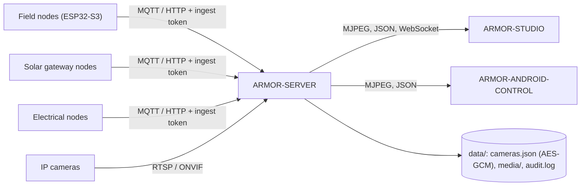

<p align="center">
  
</p>

# 🛡️ ARMOR-SERVER

<p align="center">
  <a href="README.md">🇺🇸 English</a> |
  <a href="README_spa.md">🇪🇸 Español</a> |
  <a href="README_fra.md">🇫🇷 Français</a> |
  <a href="README_ita.md">🇮🇹 Italiano</a> |
  <a href="README_deu.md">🇩🇪 Deutsch</a> |
  <a href="README_zho.md">🇨🇳 简体中文</a> |
  <a href="README_jpn.md">🇯🇵 日本語</a> |
  🇵🇹 <b>Português</b>
</p>

### Coordenador central de segurança: nós, alarmes, dispositivos, energia, câmaras, a rede local e a manutenção da instalação

<p align="center">
  
  
  
  
  
  
</p>

---

**Verificação de honestidade - o que funciona hoje:** Cada rota, sessão, cifra e regra de provas abaixo é real e está coberta por testes (`npm test`: 604 testes, incluindo um conjunto completo de integração HTTP contra um servidor isolado e uma verificação de que cada rota está documentada no ficheiro OpenAPI). Funciona em uso diário na bancada de testes do CM5 com um broker MQTT real, o firmware de um nó radar real numa placa ESP32-S3, câmaras IP reais (vídeo em direto, fotografias, gravações, PTZ nas unidades Hi3510), a consola Studio, a aplicação Android e os serviços de voz e de observação. O que **ainda não** está provado: ONVIF com uma câmara ONVIF real, qualquer hardware Jetson, as rotas solares, elétricas, de centrais de alarme e de painel tátil com nós reais (testam-se com mensagens geradas: só existe a placa radar) e o push por Firebase com um projeto Firebase real.

---

## 📋 Num relance

| | |
|---|---|
| Versão | `0.8.0.3` |
| Maturidade | Estabelecido |
| Testes | 604 (`npm test`) |
| Tecnologia | Node.js 22+ / TypeScript / Docker Compose |
| Em hardware real | A bancada de testes do CM5, em uso diário: um broker MQTT real, câmaras IP reais, um nó radar real numa placa ESP32-S3, o Studio, a aplicação Android e os serviços de voz e observação contra ele |

## 🎯 Visão geral

O **ARMOR-SERVER** é o centro de confiança do A.R.M.O.R. Os nós de campo publicam observações de radar, luz e saúde; este serviço valida-as, guarda o último estado conhecido de cada nó e serve esse estado à consola Studio e ao cliente Android. É também dono de tudo o que toca numa câmara, para que **nenhum navegador nem telemóvel tenha alguma vez uma palavra-passe de câmara ou um endereço RTSP**.

* **Entrada validada:** as mensagens HTTP e MQTT de cada tipo de nó (radar, solar, elétrico, central de alarme, rede) são verificadas na fronteira pelo contrato partilhado antes de chegarem ao estado; um nó pode ter o seu próprio token (derivado do partilhado) e um modo estrito não aceita mais nada.
* **Estado honesto dos nós:** um nó que deixa de falar aparece como *desatualizado* e *desligado* após uma janela configurável, nunca como ligado com dados velhos; um que se volta a ligar conta desde o seu regresso, não desde as mensagens antigas. Desarmar limpa um alerta alto de imediato.
* **Porta de ligação das câmaras:** cofre cifrado das câmaras, PTZ ONVIF / Hi3510 / PSIA, descoberta de caminhos RTSP, um relé FFmpeg partilhado por câmara, fotografias e gravação MP4, um vigilante que transforma uma câmara muda num evento e, armado, num alarme, **zonas da imagem a ignorar** e **fotografias e vídeo feitos sozinhos** quando uma câmara vê algo estando armado.
* **Biblioteca de provas:** retenção por idade e tamanho, **provas protegidas** que nunca se apagam, um SHA-256 para a cadeia de custódia e um ficheiro de **prova de custódia** assinado pelo servidor. Uma linha de auditoria por ação relevante, com as credenciais removidas.
* **Estado que sobrevive:** o modo de segurança e a última observação de cada nó são restaurados após um reinício (um reinício nunca desarma o perímetro em silêncio); os ficheiros são escritos de forma atómica e um danificado é recuperado. Cada mudança de alerta, nó e modo fica guardada num histórico de eventos.
* **Alarmes:** um centro de alarmes com ciclo gerado / reconhecido / terminado, escalada de um alarme crítico que espera sem ser visto, uma **verificação antes de armar** (o que está aberto, mudo ou em baixo), um PIN para desarmar (e um PIN de coação) e alarmes de nós, câmaras, dispositivos, solar, elétrico, rede e centrais de alarme. Chegam ao Studio, aos telemóveis (ntfy, Telegram, Home Assistant, um webhook assinado, push por Firebase se o configurar) e ao tópico MQTT `armor/server/alert`.
* **Utilizadores e papéis:** nomes e palavras-passe (hashes scrypt), um papel `admin` que gere utilizadores, um papel `operator` que opera e um papel `viewer` que só observa; mudar a palavra-passe ou o papel termina as outras sessões desse utilizador.
* **Dispositivos e automatizações:** fumo, gás, inundação, porta, janela, movimento, clima, tomada, luz, sirene, fechadura, estore, portão ou porta de garagem e esquentador, por MQTT ou push autenticado, com estado normalizado, disponibilidade e comandos; regras que acionam dispositivos quando algo acontece (também por limiares).
* **Energia:** inversores e pilhas de baterias (com cada célula e as capacidades) e nós elétricos chegam por HTTP ou MQTT, são validados pelo contrato partilhado, guardados com histórico e energia por dia, marcados como desatualizados se calarem, e geram alarmes (avaria do inversor, bateria baixa, rede perdida, tensão, falha de comutação…). O desenho elétrico e as regras para comutar um circuito ficam no servidor.
* **Centrais de alarme:** o estado dos nós ARMOR-ALARM, o **desenho do alarme** com as suas versões, os **dispositivos Zigbee ligados às zonas** (o servidor diz a uma central como está uma zona enquanto tem o rádio) e comandos de armar / desarmar a uma central (desligados salvo `ARMOR_ALARM_COMMANDS=1`).
* **Rede local:** o que o nó ARMOR-NETWORK comunica (dispositivos, internet, o endereço público e quem o dá), ordens para o nó (varrimento, ping, portas, inspecionar um dispositivo com um acesso que o utilizador dá), nomes, dispositivos ocultos e vigiados, e acessos que viajam **selados só para o nó**.
* **Voz, observação e manutenção:** comandos escritos e falados (lista fechada, em oito idiomas, com uma confirmação ligada à pessoa), o contexto para o serviço de observação (que radares cobrem que câmara), o firmware dos nós atualizado a partir do Studio um a um com progresso, e as atualizações da própria instalação a partir do GitHub, as do sistema e uma consola root opcional, tudo através do assistente de manutenção.
* **Uso a partir de fora de casa:** o servidor distingue a casa do exterior (uma VPN conta como a casa), mantém sessões mais curtas a partir de fora, pede um segundo fator (uma app autenticadora, com códigos de recuperação) e a palavra-passe outra vez antes das ações críticas, deixa escolher o que uma sessão de fora pode fazer (tudo, só operar o alarme, só ver), avisa os destinos dos alarmes quando alguém entra de um sítio novo e abre o painel web de um nó através do servidor - fixado ao certificado do nó e com o seu cookie guardado no servidor - para que nenhum nó seja alguma vez publicado.
* **Ligação cifrada opcional ao broker (mqtts):** `ARMOR_MQTT_CA_FILE` indica o certificado da autoridade própria da instalação; com um endereço `mqtts://` o servidor confia só nessa autoridade e verifica o nome do broker, e recusa-se a arrancar se o ficheiro não for um certificado válido ou o endereço não for `mqtts://`. O Studio mostra se a ligação está cifrada e a impressão digital da autoridade. Testado contra um broker TLS de teste e contra um Mosquitto 2.0 real.
* **Saúde dos nós e modos de armar:** guarda o último relatório e o registo de reinícios de cada nó e levanta quatro avisos (pouca memória, reinícios demasiado frequentes, um broker que cai repetidamente, sinal Wi-Fi fraco); guarda os perfis de armar (Ausente, Em casa, Noite e os seus) e põe o escolhido dentro do comando de armar, só para um nó que diz entendê-los. Um alarme forte ou discreto segue o perfil; um armar sem perfil é o comando de sempre.
* **Histórico das ligações e do sistema:** além dos alertas, nós, câmaras, dispositivos e alarmes, o histórico regista que dispositivos e aplicações se ligam (sessões do Studio, a app Android, os painéis dos nós, o serviço de voz: inícios de sessão, recusas, saídas, sessões expiradas, uso do segundo fator, primeira e última vez vistos) e os eventos do sistema (nós que aparecem ou desaparecem com o seu firmware, a ligação ao broker, definições alteradas e por quem, serviços, atualizações, armar com o seu perfil). Filtra-se por tipo, categoria, cliente e utilizador; o endereço e o agente de utilizador só os veem os administradores, e nunca se regista uma palavra-passe, um token, um cookie nem um PIN.
* **Ordens para escrever numa bateria Pylontech (desligadas salvo `ARMOR_BATTERY_WRITE=1`):** para administradores que acabaram de provar de novo quem são - preparar, executar com o número de série da bateria escrito outra vez, cancelar, repor uma saída como estava, guardar uma imagem de firmware durante uma hora - verificadas com a tabela partilhada de operações e intervalos, enviadas ao nó gateway como `solar_battery_command`, com cada operação guardada (quem, que bateria, o lido antes e depois, a diferença e a transcrição, nunca a palavra-passe de serviço) e registada no histórico em *Baterias*.
* **Controlo dos nós:** `POST /api/v1/nodes/{id}/control` e `POST /api/v1/nodes/control` dão uma ordem (reiniciar, pausar, retomar, pôr em espera, identificar, diagnóstico, manutenção ligada ou desligada) a um nó ou a todos os que reportam, só a um administrador que acabou de provar quem é outra vez, com o nome do nó (ou a palavra RESTART, PAUSE ou STANDBY para todos) escrito de novo onde a casa ficaria menos vigiada. O servidor prepara a ordem, executa-a com o token de uso único que o nó dá para essa operação, segue cada nó (enviada, recebida, aplicada, de volta) em `GET /api/v1/nodes/control/operations`, reinicia as centrais de alarme por último num reinício escalonado, regista quem ordenou o quê no histórico e na auditoria, e mostra na saúde do nó se está em pausa, em espera (trabalho desligado, continua ligado) ou em manutenção. Não existe reposição de fábrica, apagamento nem sono profundo. É testado com um broker simulado; não foi experimentado num nó real.
* **Estado em direto e tabela de rotas:** o servidor envia o estado completo ao Studio por um WebSocket em `/api/v1/events` sempre que algo muda (uma rajada de alterações é uma só mensagem e um cliente que fica para trás é descartado), e cada rota que regista, com quem a pode chamar, consta de uma tabela gerada a partir do código.

## 🧩 Papel no A.R.M.O.R.

O ARMOR-SERVER é o único centro de confiança da família. Os nós de campo ([ARMOR-RADAR](https://github.com/JuanenRac/ARMOR-RADAR), [ARMOR-SOLAR](https://github.com/JuanenRac/ARMOR-SOLAR), [ARMOR-ELECTRICAL](https://github.com/JuanenRac/ARMOR-ELECTRICAL), [ARMOR-ALARM](https://github.com/JuanenRac/ARMOR-ALARM), [ARMOR-HMI](https://github.com/JuanenRac/ARMOR-HMI)) e o [ARMOR-NETWORK](https://github.com/JuanenRac/ARMOR-NETWORK) falam com ele por MQTT ou HTTP; o [ARMOR-STUDIO](https://github.com/JuanenRac/ARMOR-STUDIO) e o [ARMOR-ANDROID-CONTROL](https://github.com/JuanenRac/ARMOR-ANDROID-CONTROL) leem-no e dão-lhe ordens; o [ARMOR-SERVER-AI](https://github.com/JuanenRac/ARMOR-SERVER-AI) pesa o que as câmaras veem face aos radares e só recomenda; o [ARMOR-VOICE-AI](https://github.com/JuanenRac/ARMOR-VOICE-AI) transforma a voz numa lista fechada de comandos; o [ARMOR-DEVOPS](https://github.com/JuanenRac/ARMOR-DEVOPS) instala e atualiza tudo isso no CM5. O servidor decide: mais nada arma, desarma ou aciona o que quer que seja.

## 🔄 Arquitetura



## 🔒 Modelo de segurança

* Segredos separados: **ingest** (os nós publicam as suas mensagens; cada nó pode ter ainda o seu próprio token, derivado do partilhado, e um modo estrito aceita só esses), **control** (armar / desarmar, eventos), **operator** (automatização) e o **login do Studio**; cada um é comparado em tempo constante e nenhum substitui outro. Um acesso dado a um nó de rede viaja selado só para esse nó.
* Três papéis: **admin**, **operator** e **viewer** (lê, nunca altera). Cada rota que configura, move, captura, grava, protege, apaga ou arma exige um operador; o vídeo em direto exige um operador ou um bilhete de emissão de curta duração ligado a uma câmara. Os comandos perigosos (desarmar, comutar um circuito, a consola root) pedem um administrador e, para desarmar, o PIN.
* As palavras-passe das câmaras vivem só em `data/cameras.json`, cifradas com AES-256-GCM, e nenhuma API as devolve; os endereços ONVIF têm de ficar no anfitrião da câmara e os redirecionamentos são recusados.
* As sessões do Studio são HttpOnly e SameSite=Strict, o login tem limite de tentativas e os erros nunca levam um rasto de pilha.
* O servidor escuta em 127.0.0.1 salvo se `ARMOR_HOST` for definido de propósito, e então uma palavra-passe do Studio com menos de 12 caracteres é recusada.
* A partir de fora de casa: segundo fator (TOTP, RFC 6238), uma nova prova de identidade para utilizadores, firmware e painéis dos nós, uma política que reserva a administração para a casa ou a VPN, só releases de firmware assinadas e um proxy de painéis de nós que nunca toma um endereço do pedido, só passa o necessário e recusa um nó cujo certificado não seja o de confiança.

## 🌐 API

* Pública: `GET /healthz`. Para um utilizador com sessão: estado, informação, câmaras, multimédia, histórico, regras, dispositivos, alarmes, automatizações, os desenhos (local, alarme, elétrico, rede), leituras solares e elétricas, a rede local, notificações e preferências, e para um administrador utilizadores, serviços, firmware, atualizações e a consola.
* Para os nós: `POST /api/v1/telemetry`, `/health`, `/solar`, `/electrical/readings`, `/alarm/state`, `/network/state` e `/devices/state` com o token de ingest, e os tópicos MQTT `armor/node/#`, `armor/solar/#`, `armor/electrical/#`, `armor/alarm/#` e `armor/network/#`. Os eventos chegam às consolas pelo WebSocket `/api/v1/events`.
* Cada rota (135 caminhos hoje), a sua regra de acesso e o seu esquema estão no ficheiro OpenAPI do [ARMOR-COMMON](https://github.com/JuanenRac/ARMOR-COMMON), e um teste verifica que nenhuma falta.

## ⚙️ Configuração

* Copie `.env.example` para `.env` (ignorado pelo Git), ou deixe o `run.bat` / `run.sh` gerar segredos aleatórios na primeira execução.
* Obrigatórios: `ARMOR_INGEST_TOKEN` e `ARMOR_CONTROL_TOKEN` (24 caracteres ou mais, todos diferentes) e `ARMOR_STUDIO_USERNAME` / `ARMOR_STUDIO_PASSWORD` (o primeiro administrador).
* Habituais: `ARMOR_HOST` / `ARMOR_PORT`, `ARMOR_DATA_DIR`, `ARMOR_FFMPEG_PATH` (vídeo em direto e captura), `ARMOR_MQTT_URL`, `ARMOR_MQTT_CA_FILE`, `ARMOR_STUDIO_ORIGIN`, `ARMOR_NODE_STALE_AFTER_S`, `ARMOR_CAMERA_CHECK_S`, `ARMOR_ALERT_DWELL_MS`, `ARMOR_ALERT_WEBHOOK_URL` e `ARMOR_COOKIE_SECURE` (a `1` atrás de TLS).
* Opcionais, todos desligados por defeito: `ARMOR_NTFY_URL`, `ARMOR_TELEGRAM_BOT_TOKEN`, `ARMOR_HOMEASSISTANT_URL`, `ARMOR_FCM_SERVICE_ACCOUNT` (push pelo projeto Firebase da própria instalação), `ARMOR_ALARM_COMMANDS=1` (deixa o servidor armar e desarmar as centrais), `ARMOR_ELECTRICAL_SWITCHING` e `ARMOR_INGEST_STRICT=1`.

## 📂 Estrutura do repositório

```text
ARMOR-SERVER/
├── src/            server, app, config, context, store, persistence, events, contracts, rules, mqtt, mqtt_tls, audit, notify, channels,
│   │               alarms, alarm, alarm_design, alarm_commands, alarm_zone_feed, escalation, preflight, automations, users,
│   │               site, solar, solar_registry, electrical, electrical_energy, electrical_switching, network, network_commands,
│   │               firmware, installation, admin, voice, voice_actions, ai, capture_on_detect, ignore_zones, push_fcm, ...
│   ├── http/       auth, per-node tokens, sealed credentials
│   ├── routes/     sessions, users, cameras, media, ingest, history, devices, alarms, alarm, alarm_design, solar, electrical,
│   │               network, firmware, maintenance, admin, notifications, voice, ai, push, preferences, system
│   ├── devices/    catalog, registry, commands, mapping (the device model and its MQTT bridge)
│   ├── cameras/    model, vault, digest, ptz, rtsp, discovery, health, errors
│   └── media/      relay, evidence
├── tests/          604 tests: unit + full HTTP integration
├── docs/           state machine, camera gateway, integration, node firmware
├── tools/          project tooling and the CI checks
├── data/           runtime state (ignored by Git)
└── images/         brand assets
```

## 🛠️ Ambiente de desenvolvimento

**Requisitos:** Node.js 22+, FFmpeg (vídeo em direto e captura), um broker MQTT (Mosquitto)

```powershell
npm install
npm run typecheck   # tsc --noEmit
npm test            # 604 tests: unit + full HTTP integration (every route must be in the OpenAPI file)
npm run build       # dist/server.mjs
.\run.bat           # development server with hot reload
```

Para instalar na bancada de testes CM5 (isolada de todos os outros projetos, utilizador próprio, portas próprias) veja o [ARMOR-DEVOPS](https://github.com/JuanenRac/ARMOR-DEVOPS).

## 🔗 Projetos relacionados

O **A.R.M.O.R.** (Autonomous Radar & Multimodal Observation Range) é um sistema de segurança perimetral feito de repositórios independentes. Cada um tem a sua própria versão, os seus próprios testes e o seu próprio README; esta é a família:

* **[ARMOR-COMMON](https://github.com/JuanenRac/ARMOR-COMMON)** - Contratos de mensagens, validadores, vetores de conformidade e tipos gerados
* **[ARMOR-RADAR](https://github.com/JuanenRac/ARMOR-RADAR)** - Firmware de nó de campo para ESP32-S3 com três radares e o seu próprio painel web
* **[ARMOR-SOLAR](https://github.com/JuanenRac/ARMOR-SOLAR)** - Protocolos de inversores e baterias solares e as mensagens de um nó de ligação
* **[ARMOR-ELECTRICAL](https://github.com/JuanenRac/ARMOR-ELECTRICAL)** - Nó elétrico: contadores, a mensagem das leituras da rede e as regras de comutação
* **[ARMOR-ALARM](https://github.com/JuanenRac/ARMOR-ALARM)** - Nó e central de alarme: zonas, armar, atrasos, sirene e PIN, com o servidor ou sem ele
* **[ARMOR-HMI](https://github.com/JuanenRac/ARMOR-HMI)** - Painel tátil: o estado do sistema num ecrã de parede, armar e reconhecer, e a casa do assistente de voz
* **[ARMOR-NETWORK](https://github.com/JuanenRac/ARMOR-NETWORK)** - A rede local: os seus dispositivos, a internet e o que muda
* **ARMOR-SERVER** (este repositório) - Coordenador central: telemetria, alarmes, dispositivos, leituras solares e câmaras
* **[ARMOR-STUDIO](https://github.com/JuanenRac/ARMOR-STUDIO)** - Consola web: câmaras, radar, alarmes, energia solar e o desenhador de local 2D/3D
* **[ARMOR-ANDROID-CONTROL](https://github.com/JuanenRac/ARMOR-ANDROID-CONTROL)** - Cliente Android de operador com um radar 2D/3D em direto
* **[ARMOR-SERVER-AI](https://github.com/JuanenRac/ARMOR-SERVER-AI)** - Política de inferência visual que explica as suas decisões e nunca atua
* **[ARMOR-VISION](https://github.com/JuanenRac/ARMOR-VISION)** - Zonas de câmara, máscaras e regras de deteção para o Jetson Orin NX
* **[ARMOR-VOICE-AI](https://github.com/JuanenRac/ARMOR-VOICE-AI)** - Intenções de voz offline com uma confirmação que não se pode falsificar
* **[ARMOR-HARDWARE](https://github.com/JuanenRac/ARMOR-HARDWARE)** - Caixas, eletrónica e a matriz de aceitação de bancada
* **[ARMOR-DEVOPS](https://github.com/JuanenRac/ARMOR-DEVOPS)** - Implementação, a bancada de testes CM5, cópias de segurança e TLS
* **[ARMOR-SIMULATOR](https://github.com/JuanenRac/ARMOR-SIMULATOR)** - Simulador de telemetria offline com falhas repetíveis
* **[ARMOR-UPDATER](https://github.com/JuanenRac/ARMOR-UPDATER)** - Deteta, instala e atualiza os próprios repositórios do ecossistema
* **[ARMOR-DOCS](https://github.com/JuanenRac/ARMOR-DOCS)** - Arquitetura, linha de base de segurança e a matriz de capacidades

## 📚 Documentação e comunidade

Onde ler mais:

* [Matriz de capacidades: o que está provado e o que não](https://github.com/JuanenRac/ARMOR-DOCS/blob/main/docs/CAPABILITY_MATRIX.md)
* [Catálogo de projetos: versões e como os repositórios dependem uns dos outros](https://github.com/JuanenRac/ARMOR-DOCS/blob/main/docs/PROJECT_CATALOG.md)
* [Registo de alterações deste repositório](CHANGELOG.md)
* [Licença (GPL-3.0-or-later)](LICENSE)
* Perguntas, ideias e relatórios: electrohobby3d@gmail.com

## 👤 AUTOR

**JuanenRac (Electro Hobby 3D)** · electrohobby3d@gmail.com

## 📜 LICENÇA

GPL-3.0-or-later - veja [LICENSE](LICENSE).
