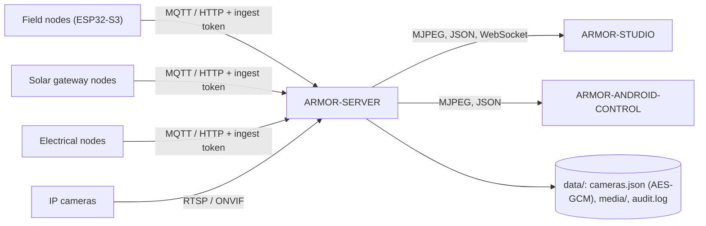

<p align="center">
  
</p>

# 🛡️ ARMOR-SERVER

<p align="center">
  <a href="README.md">🇺🇸 English</a> |
  🇪🇸 <b>Español</b> |
  <a href="README_fra.md">🇫🇷 Français</a> |
  <a href="README_ita.md">🇮🇹 Italiano</a> |
  <a href="README_deu.md">🇩🇪 Deutsch</a> |
  <a href="README_zho.md">🇨🇳 简体中文</a> |
  <a href="README_jpn.md">🇯🇵 日本語</a> |
  <a href="README_por.md">🇵🇹 Português</a>
</p>

### Coordinador central de seguridad: nodos, alarmas, dispositivos, energía, cámaras, la red local y el mantenimiento de la instalación

<p align="center">
  
  
  
  
  
  
</p>

---

**Comprobación de honestidad - qué funciona hoy:** Cada ruta, sesión, cifrado y regla de evidencias de abajo es real y está cubierta por tests (`npm test`: 421 tests, con una suite completa de integración HTTP contra un servidor aislado y una comprobación de que cada ruta está documentada en el fichero OpenAPI). Funciona en uso diario en el banco de pruebas de la CM5 con un broker MQTT real, el firmware de un nodo radar real en una placa ESP32-S3, cámaras IP reales (vídeo en directo, capturas, grabaciones, PTZ en las unidades Hi3510), la consola Studio, la app Android y los servicios de voz y de observación. Lo que **todavía no** está probado: ONVIF con una cámara ONVIF real, cualquier hardware Jetson, las rutas solares, eléctricas, de centrales de alarma y de panel táctil con nodos reales (se prueban con mensajes generados: solo existe la placa radar) y el push por Firebase con un proyecto Firebase real.

---

## 📋 De un vistazo

| | |
|---|---|
| Versión | `0.7.1` |
| Madurez | Establecido |
| Tests | 421 (`npm test`) |
| Tecnología | Node.js 22+ / TypeScript / Docker Compose |
| En hardware real | El banco de pruebas de la CM5, en uso diario: un broker MQTT real, cámaras IP reales, un nodo radar real en una placa ESP32-S3, Studio, la app Android y los servicios de voz y observación contra él |

## 🎯 Descripción general

**ARMOR-SERVER** es el centro de confianza de A.R.M.O.R. Los nodos de campo publican observaciones de radar, luz y salud; este servicio las valida, guarda el último estado conocido de cada nodo y lo sirve a la consola Studio y al cliente Android. También es dueño de todo lo que toca una cámara, de modo que **ningún navegador ni teléfono guarda jamás una contraseña de cámara ni una dirección RTSP**.

* **Entrada validada:** los mensajes HTTP y MQTT de cada tipo de nodo (radar, solar, eléctrico, central de alarma, red) se comprueban en la frontera con el contrato compartido antes de llegar al estado; un nodo puede tener su propio token (derivado del compartido) y un modo estricto no acepta otra cosa.
* **Estado honesto de los nodos:** un nodo que deja de hablar se muestra como *obsoleto* y *desconectado* tras una ventana configurable, nunca como en línea con datos viejos; uno que se reconecta cuenta desde su regreso, no desde sus mensajes antiguos. Desarmar borra una alerta alta al instante.
* **Pasarela de cámaras:** bóveda cifrada de cámaras, PTZ ONVIF / Hi3510 / PSIA, descubrimiento de rutas RTSP, un relé FFmpeg compartido por cámara, capturas y grabación MP4, un vigilante que convierte una cámara muda en un evento y, armado, en una alarma, **zonas de la imagen que se ignoran** y **fotos y vídeo hechos solos** cuando una cámara ve algo estando armado.
* **Biblioteca de evidencias:** retención por antigüedad y tamaño, **evidencias protegidas** que nunca se borran, un SHA-256 para la cadena de custodia y un fichero de **prueba de custodia** firmado por el servidor. Una línea de auditoría por acción relevante, con las credenciales borradas.
* **Estado que sobrevive:** el modo de seguridad y la última observación de cada nodo se restauran tras un reinicio (un reinicio nunca desarma el perímetro en silencio); los ficheros se escriben de forma atómica y uno dañado se recupera. Cada cambio de alerta, nodo y modo se guarda en un historial de eventos.
* **Alarmas:** un centro de alarmas con ciclo generada / reconocida / cerrada, escalado de una alarma crítica que espera sin verse, una **comprobación antes de armar** (qué está abierto, mudo o caído), un PIN para desarmar (y un PIN de coacción) y alarmas de nodos, cámaras, dispositivos, solar, eléctrico, red y centrales de alarma. Llegan a Studio, a los móviles (ntfy, Telegram, Home Assistant, un webhook firmado, push por Firebase si lo configuras) y al tema MQTT `armor/server/alert`.
* **Usuarios y roles:** nombres y contraseñas (hashes scrypt), un rol `admin` que gestiona usuarios, un rol `operator` que opera y un rol `viewer` que solo mira; cambiar la contraseña o el rol cierra las demás sesiones de ese usuario.
* **Dispositivos y automatizaciones:** humo, gas, inundación, puerta, ventana, movimiento, clima, enchufe, luz, sirena, cerradura, persiana, puerta de garaje o cancela y calentador de agua, por MQTT o push autenticado, con estado normalizado, disponibilidad y comandos; reglas que accionan dispositivos cuando algo ocurre (también por umbrales).
* **Energía:** inversores y pilas de baterías (con cada celda y las capacidades) y nodos eléctricos llegan por HTTP o MQTT, se validan con el contrato compartido, se guardan con historial y energía por día, se marcan obsoletos si callan y generan alarmas (avería de inversor, batería baja, red perdida, tensión, fallo de conmutación…). El diseño eléctrico y las reglas para conmutar un circuito se guardan en el servidor.
* **Centrales de alarma:** el estado de los nodos ARMOR-ALARM, el **diseño de la alarma** con sus versiones, los **dispositivos Zigbee atados a las zonas** (el servidor le dice a una central cómo está una zona mientras él tiene la radio) y comandos de armar / desarmar a una central (apagado salvo `ARMOR_ALARM_COMMANDS=1`).
* **Red local:** lo que informa el nodo ARMOR-NETWORK (dispositivos, internet, la dirección pública y quién la da), órdenes para el nodo (barrido, ping, puertos, inspeccionar un dispositivo con un acceso que tú das), nombres, dispositivos ocultos y vigilados, y accesos que viajan **sellados solo para el nodo**.
* **Voz, observación y mantenimiento:** comandos escritos y hablados (lista cerrada, en ocho idiomas, con una confirmación ligada a la persona), el contexto para el servicio de observación (qué radares cubren qué cámara), el firmware de los nodos actualizado desde Studio de uno en uno con progreso, y las actualizaciones de la propia instalación desde GitHub, las del sistema y una consola root opcional, todo por el ayudante de mantenimiento.
* **Uso desde fuera de casa:** el servidor distingue la casa del exterior (una VPN cuenta como la casa), mantiene sesiones más cortas desde fuera, pide un segundo factor (una app autenticadora, con códigos de recuperación) y la contraseña otra vez antes de las acciones críticas, deja elegir qué puede hacer una sesión de fuera (todo, solo operar la alarma, solo mirar), avisa a los sitios de las alarmas cuando alguien entra desde un lugar nuevo y abre el panel web de un nodo a través del servidor -fijado al certificado del nodo y con su cookie guardada en el servidor- para que ningún nodo se publique nunca.

## 🧩 Papel en A.R.M.O.R.

ARMOR-SERVER es el único centro de confianza de la familia. Los nodos de campo ([ARMOR-RADAR](https://github.com/JuanenRac/ARMOR-RADAR), [ARMOR-SOLAR](https://github.com/JuanenRac/ARMOR-SOLAR), [ARMOR-ELECTRICAL](https://github.com/JuanenRac/ARMOR-ELECTRICAL), [ARMOR-ALARM](https://github.com/JuanenRac/ARMOR-ALARM), [ARMOR-HMI](https://github.com/JuanenRac/ARMOR-HMI)) y [ARMOR-NETWORK](https://github.com/JuanenRac/ARMOR-NETWORK) le hablan por MQTT o HTTP; [ARMOR-STUDIO](https://github.com/JuanenRac/ARMOR-STUDIO) y [ARMOR-ANDROID-CONTROL](https://github.com/JuanenRac/ARMOR-ANDROID-CONTROL) lo leen y le dan órdenes; [ARMOR-SERVER-AI](https://github.com/JuanenRac/ARMOR-SERVER-AI) sopesa lo que ven las cámaras frente a los radares y solo recomienda; [ARMOR-VOICE-AI](https://github.com/JuanenRac/ARMOR-VOICE-AI) convierte la voz en una lista cerrada de comandos; [ARMOR-DEVOPS](https://github.com/JuanenRac/ARMOR-DEVOPS) lo instala y actualiza todo en la CM5. El servidor decide: nada más arma, desarma ni acciona nada.

## 🔄 Arquitectura



## 🔒 Modelo de seguridad

* Secretos separados: **ingest** (los nodos publican sus mensajes; cada nodo puede tener además su propio token, derivado del compartido, y un modo estricto acepta solo esos), **control** (armar / desarmar, eventos), **operator** (automatización) y el **login de Studio**; cada uno se compara en tiempo constante y ninguno sustituye a otro. Un acceso dado a un nodo de red viaja sellado solo para ese nodo.
* Tres roles: **admin**, **operator** y **viewer** (lee, nunca cambia). Cada ruta que configura, mueve, captura, graba, protege, borra o arma necesita un operador; el vídeo en directo necesita un operador o un ticket de emisión de corta vida ligado a una cámara. Los comandos peligrosos (desarmar, conmutar un circuito, la consola root) piden un administrador y, para desarmar, el PIN.
* Las contraseñas de las cámaras viven solo en `data/cameras.json`, cifradas con AES-256-GCM, y ninguna API las devuelve; las direcciones ONVIF deben quedarse en el host de la cámara y las redirecciones se rechazan.
* Las sesiones de Studio son HttpOnly y SameSite=Strict, el login tiene límite de intentos y los errores nunca llevan traza de pila.
* El servidor escucha en 127.0.0.1 salvo que `ARMOR_HOST` se ponga a propósito, y entonces se rechaza una contraseña de Studio de menos de 12 caracteres.
* Desde fuera de casa: segundo factor (TOTP, RFC 6238), una prueba de identidad nueva para usuarios, firmware y paneles de nodos, una política que deja administrar solo desde casa o la VPN, solo releases de firmware firmadas y un proxy de paneles de nodos que nunca toma una dirección de la petición, solo pasa lo necesario y rechaza un nodo cuyo certificado no sea el de confianza.

## 🌐 API

* Pública: `GET /healthz`. Para un usuario con sesión: estado, información, cámaras, medios, historial, reglas, dispositivos, alarmas, automatizaciones, los diseños (sitio, alarma, eléctrico, red), lecturas solares y eléctricas, la red local, notificaciones y preferencias, y para un administrador usuarios, servicios, firmware, actualizaciones y la consola.
* Para los nodos: `POST /api/v1/telemetry`, `/health`, `/solar`, `/electrical/readings`, `/alarm/state`, `/network/state` y `/devices/state` con el token de ingest, y los temas MQTT `armor/node/#`, `armor/solar/#`, `armor/electrical/#`, `armor/alarm/#` y `armor/network/#`. Los eventos llegan a las consolas por el WebSocket `/api/v1/events`.
* Cada ruta (135 rutas hoy), su regla de acceso y su esquema están en el fichero OpenAPI de [ARMOR-COMMON](https://github.com/JuanenRac/ARMOR-COMMON), y un test comprueba que no falta ninguna.

## ⚙️ Configuración

* Copia `.env.example` a `.env` (ignorado por Git), o deja que `run.bat` / `run.sh` generen secretos aleatorios la primera vez.
* Obligatorios: `ARMOR_INGEST_TOKEN` y `ARMOR_CONTROL_TOKEN` (24 caracteres o más, todos distintos) y `ARMOR_STUDIO_USERNAME` / `ARMOR_STUDIO_PASSWORD` (el primer administrador).
* Habituales: `ARMOR_HOST` / `ARMOR_PORT`, `ARMOR_DATA_DIR`, `ARMOR_FFMPEG_PATH` (vídeo en directo y captura), `ARMOR_MQTT_URL`, `ARMOR_STUDIO_ORIGIN`, `ARMOR_NODE_STALE_AFTER_S`, `ARMOR_CAMERA_CHECK_S`, `ARMOR_ALERT_DWELL_MS`, `ARMOR_ALERT_WEBHOOK_URL` y `ARMOR_COOKIE_SECURE` (ponlo a `1` tras TLS).
* Opcionales, todos apagados por defecto: `ARMOR_NTFY_URL`, `ARMOR_TELEGRAM_BOT_TOKEN`, `ARMOR_HOMEASSISTANT_URL`, `ARMOR_FCM_SERVICE_ACCOUNT` (push por el proyecto Firebase de la propia instalación), `ARMOR_ALARM_COMMANDS=1` (deja que el servidor arme y desarme las centrales), `ARMOR_ELECTRICAL_SWITCHING` y `ARMOR_INGEST_STRICT=1`.

## 📂 Estructura del repositorio

```text
ARMOR-SERVER/
├── src/            server, app, config, context, store, persistence, events, contracts, rules, mqtt, audit, notify, channels,
│   │               alarms, alarm, alarm_design, alarm_commands, alarm_zone_feed, escalation, preflight, automations, users,
│   │               site, solar, solar_registry, electrical, electrical_energy, electrical_switching, network, network_commands,
│   │               firmware, installation, admin, voice, voice_actions, ai, capture_on_detect, ignore_zones, push_fcm, ...
│   ├── http/       auth, per-node tokens, sealed credentials
│   ├── routes/     sessions, users, cameras, media, ingest, history, devices, alarms, alarm, alarm_design, solar, electrical,
│   │               network, firmware, maintenance, admin, notifications, voice, ai, push, preferences, system
│   ├── devices/    catalog, registry, commands, mapping (the device model and its MQTT bridge)
│   ├── cameras/    model, vault, digest, ptz, rtsp, discovery, health, errors
│   └── media/      relay, evidence
├── tests/          421 tests: unit + full HTTP integration
├── docs/           state machine, camera gateway, integration, node firmware
├── tools/          project tooling and the CI checks
├── data/           runtime state (ignored by Git)
└── images/         brand assets
```

## 🛠️ Entorno de desarrollo

**Requisitos:** Node.js 22+, FFmpeg (live video and capture), an MQTT broker (Mosquitto)

```powershell
npm install
npm run typecheck   # tsc --noEmit
npm test            # 421 tests: unit + full HTTP integration (every route must be in the OpenAPI file)
npm run build       # dist/server.mjs
.\run.bat           # development server with hot reload
```

Para instalar en el banco de pruebas de la CM5 (aislado de todo otro proyecto, con usuario y puertos propios) véase [ARMOR-DEVOPS](https://github.com/JuanenRac/ARMOR-DEVOPS).

## 🔗 Proyectos relacionados

**A.R.M.O.R.** (Autonomous Radar & Multimodal Observation Range) es un sistema de seguridad perimetral hecho de repositorios independientes. Cada uno tiene su propia versión, sus propias pruebas y su propio README; esta es la familia:

* **[ARMOR-COMMON](https://github.com/JuanenRac/ARMOR-COMMON)** - Contratos de mensajes, validadores, vectores de conformidad y tipos generados
* **[ARMOR-RADAR](https://github.com/JuanenRac/ARMOR-RADAR)** - Firmware del nodo de campo para ESP32-S3 con tres radares y su propio panel web
* **[ARMOR-SOLAR](https://github.com/JuanenRac/ARMOR-SOLAR)** - Protocolos de inversores y baterías solares y los mensajes de un nodo pasarela
* **[ARMOR-ELECTRICAL](https://github.com/JuanenRac/ARMOR-ELECTRICAL)** - Nodo eléctrico: contadores, el mensaje de las lecturas de la red y las reglas para maniobrar
* **[ARMOR-ALARM](https://github.com/JuanenRac/ARMOR-ALARM)** - Nodo y central de alarma: zonas, armado, retardos, sirena y PIN, con el servidor o sin él
* **[ARMOR-HMI](https://github.com/JuanenRac/ARMOR-HMI)** - Panel táctil: el estado del sistema en una pantalla de pared, armar y reconocer alarmas, y el hogar del asistente de voz
* **[ARMOR-NETWORK](https://github.com/JuanenRac/ARMOR-NETWORK)** - La red local: sus dispositivos, internet y lo que cambia
* **ARMOR-SERVER** (este repositorio) - Coordinador central: telemetría, alarmas, dispositivos, lecturas solares y cámaras
* **[ARMOR-STUDIO](https://github.com/JuanenRac/ARMOR-STUDIO)** - Consola web: cámaras, radar, alarmas, energía solar y el diseñador de sitio 2D/3D
* **[ARMOR-ANDROID-CONTROL](https://github.com/JuanenRac/ARMOR-ANDROID-CONTROL)** - Cliente Android del operador con radar 2D/3D en vivo
* **[ARMOR-SERVER-AI](https://github.com/JuanenRac/ARMOR-SERVER-AI)** - Política de inferencia visual que explica sus decisiones y nunca actúa
* **[ARMOR-VISION](https://github.com/JuanenRac/ARMOR-VISION)** - Zonas de cámara, máscaras y reglas de detección para la Jetson Orin NX
* **[ARMOR-VOICE-AI](https://github.com/JuanenRac/ARMOR-VOICE-AI)** - Intenciones de voz sin conexión con una confirmación imposible de falsificar
* **[ARMOR-HARDWARE](https://github.com/JuanenRac/ARMOR-HARDWARE)** - Cajas, electrónica y la matriz de aceptación en banco
* **[ARMOR-DEVOPS](https://github.com/JuanenRac/ARMOR-DEVOPS)** - Despliegue, el banco de pruebas de la CM5, copias de seguridad y TLS
* **[ARMOR-SIMULATOR](https://github.com/JuanenRac/ARMOR-SIMULATOR)** - Simulador de telemetría sin conexión con fallos repetibles
* **[ARMOR-UPDATER](https://github.com/JuanenRac/ARMOR-UPDATER)** - Detecta, instala y actualiza los propios repositorios del ecosistema
* **[ARMOR-DOCS](https://github.com/JuanenRac/ARMOR-DOCS)** - Arquitectura, base de seguridad y la matriz de capacidades

## 📚 Documentación y comunidad

Dónde leer más:

* [Matriz de capacidades: qué está probado y qué no](https://github.com/JuanenRac/ARMOR-DOCS/blob/main/docs/CAPABILITY_MATRIX.md)
* [Catálogo de proyectos: versiones y cómo dependen unos de otros](https://github.com/JuanenRac/ARMOR-DOCS/blob/main/docs/PROJECT_CATALOG.md)
* [Historial de cambios de este repositorio](CHANGELOG.md)
* [Licencia (GPL-3.0-or-later)](LICENSE)
* Preguntas, ideas e informes: electrohobby3d@gmail.com

## 👤 AUTOR

**JuanenRac (Electro Hobby 3D)** · electrohobby3d@gmail.com

## 📜 LICENCIA

GPL-3.0-or-later - véase [LICENSE](LICENSE).
