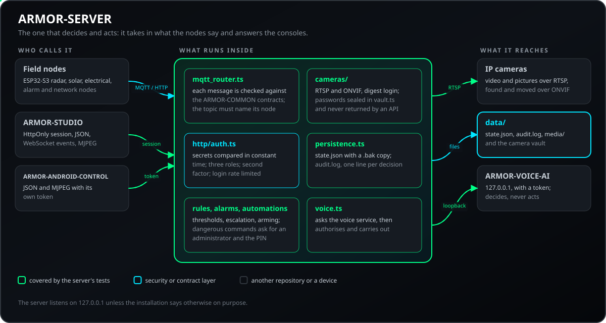
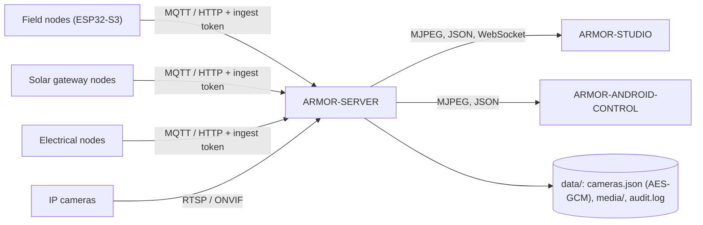
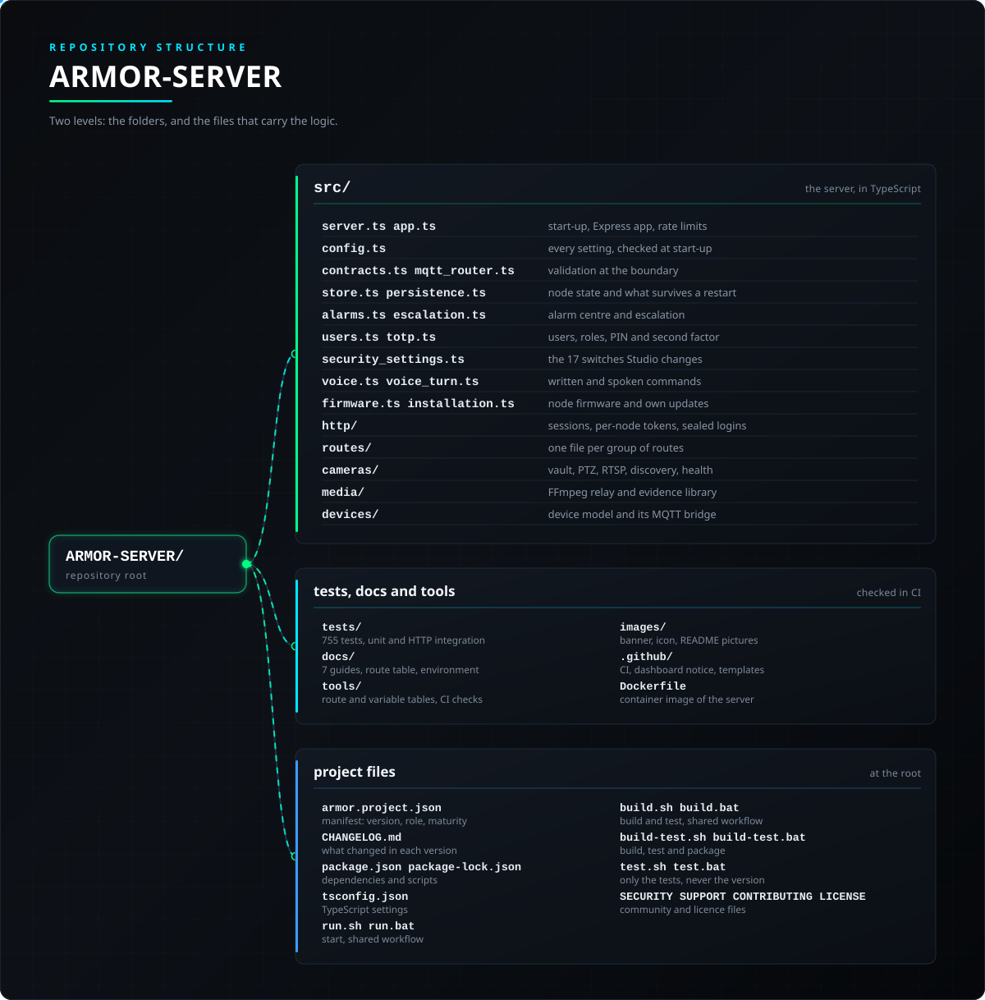

<p align="center">
  
</p>

# 🛡️ ARMOR-SERVER

<p align="center">
  <a href="README.md">🇺🇸 English</a> |
  🇪🇸 <b>Español</b> |
  <a href="README_fra.md">🇫🇷 Français</a> |
  <a href="README_ita.md">🇮🇹 Italiano</a> |
  <a href="README_deu.md">🇩🇪 Deutsch</a> |
  <a href="README_zho.md">🇨🇳 简体中文</a> |
  <a href="README_jpn.md">🇯🇵 日本語</a> |
  <a href="README_por.md">🇵🇹 Português</a>
</p>

### Coordinador central de seguridad: nodos, alarmas, dispositivos, energía, cámaras, la red local y el mantenimiento de la instalación

<p align="center">
  
  
  
  
  
  
</p>

---

**Comprobación de honestidad - qué funciona hoy:** Cada ruta, sesión, cifrado y regla de evidencias de abajo es real y está cubierta por tests (`npm test`: 811 tests, con una suite completa de integración HTTP contra un servidor aislado y una comprobación de que cada ruta está documentada en el fichero OpenAPI). Funciona en uso diario en el banco de pruebas de la CM5 con un broker MQTT real, el firmware de un nodo radar real en una placa ESP32-S3, cámaras IP reales (vídeo en directo, capturas, grabaciones, PTZ en las unidades Hi3510), la consola Studio, la app Android y los servicios de voz y de observación. Lo que **todavía no** está probado: ONVIF con una cámara ONVIF real, cualquier hardware Jetson, las rutas solares, eléctricas, de centrales de alarma y de panel táctil con nodos reales (se prueban con mensajes generados: solo existe la placa radar) y el push por Firebase con un proyecto Firebase real.

---

## 📋 De un vistazo

| | |
|---|---|
| Versión | `0.8.0.9` |
| Madurez | Establecido |
| Función | Coordinador central de seguridad de la familia: nodos, alarmas, dispositivos, energía, cámaras, red |
| Tecnología | Node.js 22+, TypeScript, Express 5, MQTT, WebSocket, FFmpeg |
| Pruebas | 811 (`npm test`: unitarias e integración HTTP completa) |
| Contrato | 196 rutas HTTP, 255 operaciones (OpenAPI en ARMOR-COMMON), tabla de rutas en `docs/ROUTES.md` |
| Escucha en | `127.0.0.1:8080` (`ARMOR_HOST`, `ARMOR_PORT`) |
| Funciona en | El banco de la CM5 (como servicio, ver ARMOR-DEVOPS) o cualquier ordenador con Node.js |
| En hardware real | El banco de pruebas de la CM5, en uso diario: un broker MQTT real, cámaras IP reales, un nodo radar real en una placa ESP32-S3, Studio, la app Android y los servicios de voz y observación contra él |
| Licencia | GPL-3.0-or-later |

**Ir a:** [Resumen](#-resumen) · [Arquitectura](#-arquitectura) · [Seguridad](#-seguridad-y-protección) · [Interfaces](#-interfaces) · [Configuración](#-configuración) · [Inicio rápido](#-inicio-rápido) · [Pruebas](#-pruebas) · [Problemas](#-resolución-de-problemas) · [Estructura](#-estructura-del-repositorio) · [Relacionados](#-proyectos-relacionados)

## 🚦 Estado del proyecto

Cada línea es una parte de este repositorio y la luz dice hasta dónde llega hoy. Está escrito con lo que el repositorio puede demostrar (pruebas, compilaciones, ejecuciones), no con lo que está planeado.

🟢 Hecho y verificado · 🟡 Funciona, con límites conocidos · 🟠 Parcial o sin verificar todavía · 🔴 No hecho o no funciona

| Área | Estado | Qué significa aquí |
|---|---|---|
| Software | 🟢 | Las rutas, sesiones, cifrado y reglas de evidencias funcionan a diario en el banco de pruebas CM5. |
| Pruebas | 🟢 | Pasan 811 pruebas (`npm test`), incluida una suite de integración HTTP completa contra un servidor aislado y una comprobación de que cada ruta está documentada en el archivo OpenAPI. |
| Protocolos y datos | 🟡 | Los mensajes del radar vienen de una placa real; las rutas solar, eléctrica, de panel de alarma y de panel táctil se prueban con mensajes generados, y ONVIF no se ha probado con una cámara ONVIF real. |
| Hardware | 🟡 | Funciona en el banco de pruebas CM5 con un broker MQTT real, cámaras IP reales (vídeo en vivo, capturas, grabaciones, PTZ en las unidades Hi3510) y un nodo radar real; nada ha funcionado en una Jetson. |
| Seguridad | 🟡 | Las reglas de sesiones, cifrado, evidencias y acceso están cubiertas por pruebas; no ha habido una revisión independiente. |
| Integración | 🟡 | Studio, la app de Android y los servicios de voz y observación lo usan a diario en el banco; el push mediante Firebase nunca se ha ejecutado contra un proyecto Firebase real. |
| Documentación | 🟢 | Ocho idiomas, la referencia de rutas (OpenAPI y ROUTES), las guías de entorno y de acceso remoto y el historial de cambios están al día. |

## 🎯 Resumen

**ARMOR-SERVER** es el centro de confianza de A.R.M.O.R. Los nodos de campo publican observaciones de radar, luz y salud; este servicio las valida, guarda el último estado conocido de cada nodo y lo sirve a la consola Studio y al cliente Android. También es dueño de todo lo que toca una cámara, de modo que **ningún navegador ni teléfono guarda jamás una contraseña de cámara ni una dirección RTSP**.

* **Entrada validada:** los mensajes HTTP y MQTT de cada tipo de nodo (radar, solar, eléctrico, central de alarma, red) se comprueban en la frontera con el contrato compartido antes de llegar al estado; un nodo puede tener su propio token (derivado del compartido) y un modo estricto no acepta otra cosa.
* **Estado honesto de los nodos:** un nodo que deja de hablar se muestra como *obsoleto* y *desconectado* tras una ventana configurable, nunca como en línea con datos viejos; uno que se reconecta cuenta desde su regreso, no desde sus mensajes antiguos. Desarmar borra una alerta alta al instante.
* **Pasarela de cámaras:** bóveda cifrada de cámaras, PTZ ONVIF / Hi3510 / PSIA, descubrimiento de rutas RTSP, un relé FFmpeg compartido por cámara, capturas y grabación MP4, un vigilante que convierte una cámara muda en un evento y, armado, en una alarma, **zonas de la imagen que se ignoran** y **fotos y vídeo hechos solos** cuando una cámara ve algo estando armado.
* **Biblioteca de evidencias:** retención por antigüedad y tamaño, **evidencias protegidas** que nunca se borran, un SHA-256 para la cadena de custodia y un fichero de **prueba de custodia** firmado por el servidor. Una línea de auditoría por acción relevante, con las credenciales borradas.
* **Estado que sobrevive:** el modo de seguridad y la última observación de cada nodo se restauran tras un reinicio (un reinicio nunca desarma el perímetro en silencio); los ficheros se escriben de forma atómica y uno dañado se recupera. Cada cambio de alerta, nodo y modo se guarda en un historial de eventos.
* **Alarmas:** un centro de alarmas con ciclo generada / reconocida / cerrada, escalado de una alarma crítica que espera sin verse, una **comprobación antes de armar** (qué está abierto, mudo o caído), un PIN para desarmar (y un PIN de coacción) y alarmas de nodos, cámaras, dispositivos, solar, eléctrico, red y centrales de alarma. Llegan a Studio, a los móviles (ntfy, Telegram, Home Assistant, un webhook firmado, push por Firebase si lo configuras) y al tema MQTT `armor/server/alert`.
* **Usuarios y roles:** nombres y contraseñas (hashes scrypt), un rol `admin` que gestiona usuarios, un rol `operator` que opera y un rol `viewer` que solo mira; cambiar la contraseña o el rol cierra las demás sesiones de ese usuario.
* **Dispositivos y automatizaciones:** humo, gas, inundación, puerta, ventana, movimiento, clima, enchufe, luz, sirena, cerradura, persiana, puerta de garaje o cancela y calentador de agua, por MQTT o push autenticado, con estado normalizado, disponibilidad y comandos; reglas que accionan dispositivos cuando algo ocurre (también por umbrales).
* **Energía:** inversores y pilas de baterías (con cada celda y las capacidades) y nodos eléctricos llegan por HTTP o MQTT, se validan con el contrato compartido, se guardan con historial y energía por día, se marcan obsoletos si callan y generan alarmas (avería de inversor, batería baja, red perdida, tensión, fallo de conmutación…). El diseño eléctrico y las reglas para conmutar un circuito se guardan en el servidor.
* **Modos de armado** (apagados hasta que un administrador active `alarm.arming_modes`): fuera (todo defendido, el armado de siempre), en casa y noche (solo las zonas y sensores marcados para cada uno, ninguno al empezar), un retardo de salida y otro de entrada por modo, un calendario opcional, `GET` y `PUT /api/v1/alarm/modes` y los modos de `POST /api/v1/mode`. Un modo sin zonas asignadas se rechaza salvo que se confirme; pasar a un modo que defiende menos pide el PIN como un desarmado; desarmar siempre funciona. No cambia ningún firmware ni pantalla de nodo. Con `alarm.mode_panel_sync` activado, al elegir un modo también se pide a los paneles de alarma que armen con el perfil correspondiente (fuera, en casa, noche); el estado dice si lo confirmaron.
* **Centrales de alarma:** el estado de los nodos ARMOR-NODE-ALARM, el **diseño de la alarma** con sus versiones, los **dispositivos Zigbee atados a las zonas** (el servidor le dice a una central cómo está una zona mientras él tiene la radio) y comandos de armar / desarmar a una central (apagado salvo `ARMOR_ALARM_COMMANDS=1`).
* **Red local:** lo que informa el nodo ARMOR-NETWORK (dispositivos, internet, la dirección pública y quién la da), órdenes para el nodo (barrido, ping, puertos, inspeccionar un dispositivo con un acceso que tú das), nombres, dispositivos ocultos y vigilados, y accesos que viajan **sellados solo para el nodo**.
* **Voz, observación y mantenimiento:** comandos escritos y hablados (lista cerrada, en ocho idiomas, con una confirmación ligada a la persona), el contexto para el servicio de observación (qué radares cubren qué cámara), el firmware de los nodos actualizado desde Studio de uno en uno con progreso, y las actualizaciones de la propia instalación desde GitHub, las del sistema y una consola root opcional, todo por el ayudante de mantenimiento.
* **Uso desde fuera de casa:** el servidor distingue la casa del exterior (una VPN cuenta como la casa), mantiene sesiones más cortas desde fuera, pide un segundo factor (una app autenticadora, con códigos de recuperación) y la contraseña otra vez antes de las acciones críticas, deja elegir qué puede hacer una sesión de fuera (todo, solo operar la alarma, solo mirar), avisa a los sitios de las alarmas cuando alguien entra desde un lugar nuevo y abre el panel web de un nodo a través del servidor -fijado al certificado del nodo y con su cookie guardada en el servidor- para que ningún nodo se publique nunca.
* **Enlace cifrado opcional con el broker (mqtts):** `ARMOR_MQTT_CA_FILE` indica el certificado de la autoridad propia de la instalación; con una dirección `mqtts://` el servidor confía solo en esa autoridad y comprueba el nombre del broker, y se niega a arrancar si el fichero no es un certificado válido o la dirección no es `mqtts://`. Studio muestra si el enlace está cifrado y la huella de la autoridad. Probado contra un broker TLS de pruebas y contra un Mosquitto 2.0 real.
* **Salud de los nodos y modos de armado:** guarda el último informe y el registro de reinicios de cada nodo y levanta cuatro avisos (poca memoria, reinicios demasiado frecuentes, un broker que se corta una y otra vez, señal Wi-Fi débil); guarda los perfiles de armado (Fuera, En casa, Noche y los tuyos) y pone el elegido dentro del comando de armar, solo para un nodo que dice entenderlos. Una alarma fuerte o discreta sigue el perfil; un armado sin perfil es el comando de siempre.
* **Historial de conexiones y del sistema:** además de las alertas, nodos, cámaras, dispositivos y alarmas, el historial registra qué dispositivos y apps se conectan (sesiones de Studio, la app Android, los paneles de los nodos, el servicio de voz: inicios de sesión, rechazos, cierres, sesiones caducadas, uso del segundo factor, primera y última vez vistos) y los eventos del sistema (nodos que aparecen o desaparecen con su firmware, el enlace con el broker, ajustes cambiados y por quién, servicios, actualizaciones, armado con su perfil). Se filtra por tipo, categoría, cliente y usuario; la dirección y el agente de usuario solo los ven los administradores, y nunca se registra una contraseña, un token, una cookie ni un PIN.
* **Órdenes para escribir en una batería Pylontech (desactivadas salvo `ARMOR_BATTERY_WRITE=1`):** para administradores que acaban de demostrar de nuevo quiénes son - preparar, ejecutar con el número de serie de la batería escrito otra vez, cancelar, dejar una salida como estaba, guardar una imagen de firmware durante una hora - comprobadas con la tabla compartida de operaciones y rangos, enviadas al nodo pasarela como `solar_battery_command`, con cada operación guardada (quién, qué batería, lo leído antes y después, la diferencia y la transcripción, nunca la contraseña de servicio) y contada en el historial en *Baterías*.
* **Control de los nodos:** `POST /api/v1/nodes/{id}/control` y `POST /api/v1/nodes/control` dan una orden (reiniciar, pausar, reanudar, poner en espera, identificar, diagnóstico, mantenimiento activado o desactivado) a un nodo o a todos los que informan, solo a un administrador que acaba de demostrar quién es otra vez, con el nombre del nodo (o la palabra RESTART, PAUSE o STANDBY para todos) escrito de nuevo donde la casa quedaría menos vigilada. El servidor prepara la orden, la ejecuta con el token de un solo uso que el nodo da para esa operación, sigue a cada nodo (enviada, recibida, aplicada, de vuelta) en `GET /api/v1/nodes/control/operations`, reinicia las centrales de alarma las últimas en un reinicio escalonado, anota quién ordenó qué en el historial y en la auditoría, y muestra en la salud del nodo si está en pausa, en espera (trabajo apagado, sigue conectado) o en mantenimiento. No existe restablecimiento de fábrica, borrado ni sueño profundo. Se prueba con un broker simulado; no se ha probado en un nodo real.
* **Estado en vivo y tabla de rutas:** el servidor empuja el estado completo a Studio por un WebSocket en `/api/v1/events` cada vez que algo cambia (una ráfaga de cambios es un solo mensaje y un cliente que se queda atrás se descarta), y cada ruta que registra, con quién puede llamarla, figura en una tabla generada desde el código. El panel de pared tiene su propio canal, más pequeño, en `/api/v1/panel/events` (el mismo resumen de unos cientos de bytes que `GET /api/v1/panel/summary`, enviado cuando cambia y cada cinco segundos, para las cuentas de panel, operador y administrador; un administrador lo desactiva con `panel.live_events`).
* **Lecturas viejas apartadas:** un canal de un nodo eléctrico cuya propia lectura tiene más de un minuto (su contador dejó de responder y el nodo repite los últimos números buenos) queda fuera de la cifra de la red y de las gráficas, se lista en `stale_channels` del nodo y se cuenta en `totals.stale_readings`; la opción `electrical.set_aside_old_readings` (activada por defecto) lo desactiva.
* **El límite de acceso de un nodo y la imagen correcta para cada placa:** un administrador lee y cambia las contraseñas erróneas por minuto que deja pasar un nodo (`POST /api/v1/admin/nodes/settings`, con el acceso al panel usado una vez y nunca guardado), y una imagen de firmware cuyo nombre de fichero dice otra placa distinta de la del nodo se rechaza con `wrong_board` antes de enviar nada.

## 🧩 Papel en A.R.M.O.R.

ARMOR-SERVER es el único centro de confianza de la familia. Los nodos de campo ([ARMOR-NODE-RADAR](https://github.com/JuanenRac/ARMOR-NODE-RADAR), [ARMOR-NODE-SOLAR](https://github.com/JuanenRac/ARMOR-NODE-SOLAR), [ARMOR-NODE-ELECTRICAL](https://github.com/JuanenRac/ARMOR-NODE-ELECTRICAL), [ARMOR-NODE-ALARM](https://github.com/JuanenRac/ARMOR-NODE-ALARM), [ARMOR-NODE-HMI](https://github.com/JuanenRac/ARMOR-NODE-HMI)) y [ARMOR-NETWORK](https://github.com/JuanenRac/ARMOR-NETWORK) le hablan por MQTT o HTTP; [ARMOR-STUDIO](https://github.com/JuanenRac/ARMOR-STUDIO) y [ARMOR-ANDROID-CONTROL](https://github.com/JuanenRac/ARMOR-ANDROID-CONTROL) lo leen y le dan órdenes; [ARMOR-SERVER-AI](https://github.com/JuanenRac/ARMOR-SERVER-AI) sopesa lo que ven las cámaras frente a los radares y solo recomienda; [ARMOR-VOICE-AI](https://github.com/JuanenRac/ARMOR-VOICE-AI) convierte la voz en una lista cerrada de comandos; [ARMOR-DEVOPS](https://github.com/JuanenRac/ARMOR-DEVOPS) lo instala y actualiza todo en la CM5. El servidor decide: nada más arma, desarma ni acciona nada.

| Habla con | Cómo | Para qué |
|---|---|---|
| ARMOR-NODE-RADAR, SOLAR, ELECTRICAL, ALARM, HMI | MQTT `armor/*/#` o HTTP `POST` con el token de ingesta | sus mensajes entran, las órdenes salen |
| ARMOR-NETWORK | estado entra, órdenes y accesos sellados salen | la red local |
| ARMOR-STUDIO, ARMOR-ANDROID-CONTROL | HTTP, MJPEG y el WebSocket `/api/v1/events` | las consolas |
| ARMOR-VOICE-AI | `/v1/command`, `/v1/turn` con su propio token | decide una frase; el servidor actúa |
| ARMOR-SERVER-AI | `ARMOR_AI_TOKEN`, `/api/v1/ai/...` | observación de las cámaras |
| Cámaras IP | RTSP, ONVIF, Hi3510, PSIA (el servidor las llama) | vídeo en vivo, instantáneas, grabación, PTZ |

## 🏛️ Arquitectura

<p align="center">
  
</p>

<details>
<summary>Versión en texto del diagrama (Mermaid)</summary>



</details>

## 🔒 Seguridad y protección

* Secretos separados: **ingest** (los nodos publican sus mensajes; cada nodo puede tener además su propio token, derivado del compartido, y un modo estricto acepta solo esos), **control** (armar / desarmar, eventos), **operator** (automatización) y el **login de Studio**; cada uno se compara en tiempo constante y ninguno sustituye a otro. Un acceso dado a un nodo de red viaja sellado solo para ese nodo.
* Tres roles: **admin**, **operator** y **viewer** (lee, nunca cambia). Cada ruta que configura, mueve, captura, graba, protege, borra o arma necesita un operador; el vídeo en directo necesita un operador o un ticket de emisión de corta vida ligado a una cámara. Los comandos peligrosos (desarmar, conmutar un circuito, la consola root) piden un administrador y, para desarmar, el PIN.
* Las contraseñas de las cámaras viven solo en `data/cameras.json`, cifradas con AES-256-GCM, y ninguna API las devuelve; las direcciones ONVIF deben quedarse en el host de la cámara y las redirecciones se rechazan.
* Las sesiones de Studio son HttpOnly y SameSite=Strict, el login tiene límite de intentos y los errores nunca llevan traza de pila.
* El servidor escucha en 127.0.0.1 salvo que `ARMOR_HOST` se ponga a propósito, y entonces se rechaza una contraseña de Studio de menos de 12 caracteres.
* Desde fuera de casa: segundo factor (TOTP, RFC 6238), una prueba de identidad nueva para usuarios, firmware y paneles de nodos, una política que deja administrar solo desde casa o la VPN, solo releases de firmware firmadas y un proxy de paneles de nodos que nunca toma una dirección de la petición, solo pasa lo necesario y rechaza un nodo cuyo certificado no sea el de confianza.

| Amenaza | Defensa |
|---|---|
| Adivinar la contraseña de Studio | scrypt (N=16384, r=8, p=1), el mismo trabajo exista o no el usuario; 12 intentos por 15 minutos por persona y dirección, 60 por dirección, 40 por minuto en total; menos de 8 caracteres se rechaza (12 si el servidor es alcanzable desde la red) |
| Una cookie robada, una petición de otro sitio | HttpOnly, SameSite=Strict y Secure con HTTPS; las sesiones duran 7 días (Studio), 8 horas (operador) y 12 horas con 30 minutos de inactividad desde fuera |
| Ataques de tiempo y secretos débiles | Los secretos se comparan en tiempo constante, deben tener 24 caracteres o más y ser todos distintos (ingesta, control, operador, clave de cámaras, IA, clave de evidencias) |
| Desarmar sin comprobar quién eres | Un PIN de 4 a 10 dígitos según `alarm.disarm_pin` (never, if_set, always); 3 fallos bloquean 60 s, 5 min, 15 min y luego 1 h, guardado en disco entre reinicios; un PIN de coacción se distingue sin avisar; el token de control desarma solo con `ARMOR_CONTROL_DISARM=1` |
| Filtración de contraseñas de cámaras | AES-256-GCM en `data/cameras.json`; ninguna API las devuelve; FFmpeg pasa por un túnel RTSP local (`media.rtsp_proxy`) para que la clave no vaya en la línea de órdenes; se rechazan las redirecciones ONVIF |
| Vídeo en vivo sin iniciar sesión | Un ticket de transmisión atado a una sola cámara, emitido solo a un operador |
| Inundar la API | 240 peticiones por minuto en general (los POST de nodos tienen su propio presupuesto de 6000 por minuto); cuerpos JSON de 64 kB (9 MB para un fichero de instalación) |
| Un mensaje de nodo falso o mal formado | Se comprueba en el borde con los analizadores de `src/contracts.ts`, probados con los vectores compartidos de ARMOR-COMMON: 15 pistas como máximo, lux hasta 200 000, un id de nodo de letras, dígitos, `_` y `-`; un token por nodo derivado del compartido y un modo estricto (`ARMOR_INGEST_STRICT=1`) |
| Una sesión desde fuera de casa | Segundo factor (`ARMOR_TOTP_REQUIRED`: off, remote, always), una política de lo que puede hacer (`ARMOR_REMOTE_POLICY`: full, operate, view), nueva prueba de identidad para acciones críticas (5 minutos por defecto) y aviso al entrar desde un sitio nuevo |
| Un panel de nodo usado como proxy abierto | La dirección nunca sale de la petición; HTTPS queda fijado a la huella SHA-256 del certificado del nodo |
| Voz: silenciar sin comprobar, texto largo, audio enorme | La política `voice.silence_confirmation` (off, pin, double_turn) viaja en cada turno; confirmación atada a la persona; 200 caracteres, 8 idiomas, 30 peticiones por minuto; audio de 480 000 bytes y respuesta de 200 000 bytes como máximo |
| Escrituras peligrosas por error | Apagadas salvo `ARMOR_BATTERY_WRITE=1`, `ARMOR_ELECTRICAL_SWITCHING=1` o `ARMOR_ALARM_COMMANDS=1`, con aviso al arrancar |

**Interruptores en Studio.** Las protecciones que se pueden ajustar son 22 valores guardados en `security-settings.json` (modo 0600, escritura atómica), cada uno con un valor por defecto conservador, y bajar uno queda en la auditoría: `alarm.disarm_pin`, `alarm.arming_modes`, `alarm.mode_downgrade_pin`, `alarm.mode_schedule`, `alarm.mode_schedule_lowers`, `alarm.mode_panel_sync`, `voice.silence_confirmation`, `alarm.config_hash`, `server.zone_feed`, `server.zone_feed_signature`, `media.rtsp_proxy`, `network.login_secure_only`, `login.country_alert`, `electrical.set_aside_old_readings`, `voice.multipart_turn`, `panel.live_events`, `client.device_lock`, `nodes.nvs_encryption`, `alarm_audio.spoken`, `alarm_audio.custom_sounds`, `voice.turn_max_bytes` y `voice.reply_audio_max_bytes`.

**Lo que nunca hace:** devolver una contraseña de cámara, guardar las palabras que se dijeron (solo el comando y su resultado) ni escribir un PIN, un token o una cookie en un registro. No ha habido revisión de seguridad independiente.

## 🔌 Interfaces

La tabla de rutas (`docs/ROUTES.md`, generada del código) lista cada ruta con quién puede llamarla; el fichero OpenAPI de ARMOR-COMMON describe 196 rutas y 255 operaciones, y una prueba falla si falta alguna. Las que más importan:

| Ruta | Autenticación | Qué hace |
|---|---|---|
| `GET /healthz` | ninguna | vivo y listo |
| `POST /api/v1/telemetry`  `/health`  `/solar`  `/electrical/readings`  `/alarm/state`  `/network/state`  `/devices/state` | token de ingesta | lo que publican los nodos |
| `WS /api/v1/events` | sesión | todo el estado cuando algo cambia (una ráfaga es un mensaje; un cliente que se retrasa se descarta; 1 KB como máximo del cliente) |
| `WS /api/v1/panel/events` | panel | un canal más pequeño para el panel de pared (128 bytes como máximo del cliente) |
| `POST /api/v1/voice/command` | operador, 30 por minuto | una orden escrita o hablada: `{text, language, confirmation?, pin?}`; responde `{accepted, executed, intent, outcome, speech, confirmation_token?, reason?, result?}` |
| `POST /api/v1/voice/turn`  `/api/v1/voice/v1/turn` | cabecera `X-Armor-Voice-Token` | el audio de un turno (multipart); errores `unauthorized`, `multipart_turn_disabled` (415), `audio_too_large` (413), `bad_multipart` (400), `voice_bad_reply` (502) |
| `GET /api/v1/alarm-audio` | operador | lo que ofrece el sonido de las alarmas: las dos opciones (desactivadas por defecto), si hay pasarela de voz, los límites y los sonidos guardados |
| `GET /api/v1/alarm-audio/spoken` | operador o la cuenta de un panel de pared | una alarma dicha en voz alta (origen, gravedad, código de alarma; PCM mono de 16 bits a 16 kHz con su SHA-256), hecha por la pasarela de voz y guardada en una caché; 404 `spoken_alarms_disabled` con la opción desactivada |
| `GET` `PUT` `DELETE /api/v1/alarm-audio/sounds/{source}` | GET: operador o la cuenta de un panel de pared; PUT y DELETE: administrador (con nueva prueba de identidad desde fuera de casa) | el sonido de un origen de alarma: un archivo WAVE de PCM mono de 16 bits a 16 kHz, leído byte a byte (de una décima de segundo hasta `ARMOR_ALARM_SOUND_MAX_BYTES`, no silencio), solo se guardan sus muestras y se sirve con su SHA-256; 409 `custom_sounds_disabled` con la opción desactivada |
| `POST /api/v1/nodes/{id}/control`  `POST /api/v1/nodes/control` | administrador que se acaba de identificar de nuevo | una orden (reiniciar, pausar, reanudar, espera, identificar, diagnóstico, mantenimiento) a un nodo o a todos |
| `POST /api/v1/admin/nodes/settings` | administrador | lee y, si se da `login_limit_per_minute` (de 0 a 120 contraseñas erróneas por minuto), cambia el límite de acceso de un nodo a través del propio panel del nodo; el acceso al panel se usa una vez y no se guarda, y la línea de auditoría no lo lleva |
| `POST /api/v1/admin/firmware/jobs` | administrador, con prueba de identidad reciente | instala una imagen de firmware en los nodos uno a uno; una imagen cuyo nombre de fichero dice otra placa distinta de la del nodo (`armor_<tipo>-<placa>.bin`) hace fallar ese nodo con `wrong_board` antes de enviarle nada |
| `POST /api/v1/cameras/{id}/stream-ticket` | operador | un ticket de vida corta para el vídeo en vivo de una cámara |

* Pública: `GET /healthz`. Para un usuario con sesión: estado, información, cámaras, medios, historial, reglas, dispositivos, alarmas, automatizaciones, los diseños (sitio, alarma, eléctrico, red), lecturas solares y eléctricas, la red local, notificaciones y preferencias, y para un administrador usuarios, servicios, firmware, actualizaciones y la consola.
* Para los nodos: `POST /api/v1/telemetry`, `/health`, `/solar`, `/electrical/readings`, `/alarm/state`, `/network/state` y `/devices/state` con el token de ingest, y los temas MQTT `armor/node/#`, `armor/solar/#`, `armor/electrical/#`, `armor/alarm/#` y `armor/network/#`. Los eventos llegan a las consolas por el WebSocket `/api/v1/events`.

## ⚙️ Configuración

Copia `.env.example` a `.env` (ignorado por Git), o deja que `run.bat` / `run.sh` generen secretos aleatorios en la primera ejecución. La lista completa de variables, con sus rangos, está en [docs/ENVIRONMENT.md](docs/ENVIRONMENT.md) (generada del código) y las de acceso remoto en [docs/REMOTE_ACCESS.md](docs/REMOTE_ACCESS.md). Los valores que protegen la instalación no están aquí sino en Studio (ver Seguridad).

| Ajuste | Por defecto | Qué hace |
|---|---|---|
| `ARMOR_INGEST_TOKEN`  `ARMOR_CONTROL_TOKEN` | sí (24+ caracteres, todos distintos) | con qué publican los nodos; qué arma, desarma y lee eventos |
| `ARMOR_STUDIO_USERNAME`  `ARMOR_STUDIO_PASSWORD` | sí | el primer administrador |
| `ARMOR_HOST`  `ARMOR_PORT` | 127.0.0.1  8080 | dónde escucha; con otra dirección se rechaza una contraseña de Studio de menos de 12 caracteres |
| `ARMOR_DATA_DIR`  `ARMOR_FFMPEG_PATH` | data/ | carpeta de estado; FFmpeg para vídeo en vivo y captura |
| `ARMOR_MQTT_URL`  `ARMOR_MQTT_CA_FILE` | opcional | el broker; la autoridad propia de la instalación para `mqtts://` (el servidor solo confía en ella, comprueba el nombre del broker y se niega a arrancar con un fichero erróneo) |
| `ARMOR_NODE_STALE_AFTER_S` | 30 (5-3600) | segundos de silencio antes de que un nodo esté obsoleto |
| `ARMOR_ALERT_DWELL_MS`  `ARMOR_ALERT_MIN_TARGETS` | 2000 (0-60000)  1 (1-20) | cuánto tiempo y cuántos objetivos antes de una alerta de radar |
| `ARMOR_ESCALATE_AFTER_MIN` | 0 = off (0-1440) | minutos antes de escalar una alarma crítica que nadie ve |
| `ARMOR_MEDIA_RETENTION_DAYS`  `ARMOR_MEDIA_MAX_BYTES` | 30 (0-3650)  20 GiB | evidencias guardadas por edad y tamaño, las más viejas primero; la protegida nunca se borra |
| `ARMOR_STUDIO_SESSION_TTL_MS`  `ARMOR_OPERATOR_SESSION_TTL_MS`  `ARMOR_REMOTE_SESSION_TTL_MS`  `ARMOR_REMOTE_IDLE_MS`  `ARMOR_ELEVATION_MS` | 7 d  8 h  12 h  30 min  5 min | duración de las sesiones y de una nueva prueba de identidad |
| `ARMOR_TOTP_REQUIRED`  `ARMOR_REMOTE_POLICY` | off  full | segundo factor y lo que puede hacer una sesión desde fuera |
| `ARMOR_ALERT_LANGUAGE` | es | idioma de las alertas (uno de los ocho) |
| `ARMOR_NTFY_URL`  `ARMOR_TELEGRAM_BOT_TOKEN`  `ARMOR_HOMEASSISTANT_URL`  `ARMOR_ALERT_WEBHOOK_URL`  `ARMOR_FCM_SERVICE_ACCOUNT` | apagado | adónde van las alarmas (todo apagado por defecto) |
| `ARMOR_ALARM_COMMANDS`  `ARMOR_BATTERY_WRITE`  `ARMOR_ELECTRICAL_SWITCHING`  `ARMOR_INGEST_STRICT`  `ARMOR_CONTROL_DISARM` | 0 | escrituras peligrosas y modos estrictos, todo apagado |
| `ARMOR_COOKIE_SECURE`  `ARMOR_STUDIO_ORIGIN` | - | pon `1` tras TLS; el origen de Studio |

* Obligatorios: `ARMOR_INGEST_TOKEN` y `ARMOR_CONTROL_TOKEN` (24 caracteres o más, todos distintos) y `ARMOR_STUDIO_USERNAME` / `ARMOR_STUDIO_PASSWORD` (el primer administrador).
* Habituales: `ARMOR_HOST` / `ARMOR_PORT`, `ARMOR_DATA_DIR`, `ARMOR_FFMPEG_PATH` (vídeo en directo y captura), `ARMOR_MQTT_URL`, `ARMOR_MQTT_CA_FILE`, `ARMOR_STUDIO_ORIGIN`, `ARMOR_NODE_STALE_AFTER_S`, `ARMOR_CAMERA_CHECK_S`, `ARMOR_ALERT_DWELL_MS`, `ARMOR_ALERT_WEBHOOK_URL` y `ARMOR_COOKIE_SECURE` (ponlo a `1` tras TLS).

## 🚀 Inicio rápido

**Requisitos:** Node.js 22+, FFmpeg (vídeo en vivo y captura), un broker MQTT (Mosquitto).

```powershell
npm install           # dependencias
npm run typecheck     # tsc --noEmit
npm test              # 811 pruebas: unitarias e integración HTTP completa
npm run build         # dist/server.mjs
.\run.bat   (run.sh)  # servidor de desarrollo con recarga en caliente
```

Para instalarlo en el banco de la CM5 (aislado de todo otro proyecto, con usuario y puertos propios) mira [ARMOR-DEVOPS](https://github.com/JuanenRac/ARMOR-DEVOPS).

## 🧪 Pruebas

```powershell
npm run typecheck  # tsc --noEmit
npm test           # tsx --test tests/*.test.ts
python -I tools/armor_ci_validate.py
```

`npm test` ejecuta cada fichero de `tests/` (99 ficheros): pruebas unitarias de cada módulo y una batería de integración HTTP completa contra un servidor aislado (`tests/vertical-slice.test.ts`). `tests/conformance.test.ts` ejecuta los vectores compartidos de ARMOR-COMMON y comprueba que **las rutas que registra el servidor son exactamente las operaciones que describe el fichero OpenAPI**, por método y ruta, y que cada respuesta dice qué cuerpo lleva; se salta si ARMOR-COMMON no está junto a este repositorio. Las pruebas de TLS necesitan `openssl` instalado. GitHub Actions ejecuta la base de A.R.M.O.R. en cada push y pull request: la validación del manifiesto, la versión, el registro de cambios y la paridad de los README, y luego la compilación y las pruebas del propio proyecto.

## 🏗️ Compilación y publicación

`npm run build` empaqueta el servidor en `dist/server.mjs` (el `Dockerfile` construye la imagen de contenedor a partir de él). La versión vive en `package.json`, en `armor.project.json` y en la insignia del README (leída del manifiesto); cada versión tiene su entrada en [CHANGELOG.md](CHANGELOG.md). Las versiones se publican en GitHub.

## 🩺 Resolución de problemas

| Ves | Porque | Haz |
|---|---|---|
| `ARMOR_INGEST_TOKEN must be at least 24 characters` | falta un secreto o es corto | defínelo (24+ caracteres); `run.sh` puede generarlos |
| `... and ... must be different values` | dos secretos son iguales | da a cada uno su valor |
| `ARMOR_STUDIO_PASSWORD must be at least 12 characters when the server is reachable from the network` | `ARMOR_HOST` no es loopback | usa una contraseña más larga, o deja `127.0.0.1` |
| `ARMOR_MQTT_CA_FILE needs an mqtts:// address in ARMOR_MQTT_URL` | se dio el fichero de autoridad pero la dirección del broker no es `mqtts://` | usa una dirección `mqtts://`, o quita el fichero |
| `TLS_CERT_PATH and TLS_KEY_PATH must both be set` | solo se dio uno de los dos | define ambos para HTTPS, o ninguno para HTTP |
| `voice_unavailable`  `voice_not_answering` (503) | el servicio de voz no responde | arranca ARMOR-VOICE-AI y revisa `ARMOR_VOICE_URL` y su token |

## 📂 Estructura del repositorio

<p align="center">
  
</p>

<details>
<summary>Versión en texto del árbol</summary>

```text
ARMOR-SERVER/
├── src/
│   ├── server.ts app.ts              arranque, aplicación Express, límites
│   ├── config.ts                     cada ajuste, comprobado al arrancar
│   ├── contracts.ts mqtt_router.ts   validación en el borde
│   ├── store.ts persistence.ts       estado de nodos y lo que sobrevive a un reinicio
│   ├── alarms.ts escalation.ts       centro de alarmas y escalado
│   ├── users.ts totp.ts              usuarios, roles, PIN y segundo factor
│   ├── security_settings.ts          los 21 interruptores de Studio
│   ├── voice.ts voice_turn.ts        órdenes escritas y habladas
│   ├── firmware.ts installation.ts   firmware de nodos y actualizaciones propias
│   ├── http/                         sesiones, tokens por nodo, accesos sellados
│   ├── routes/                       un fichero por grupo de rutas
│   ├── cameras/                      caja fuerte, PTZ, RTSP, descubrimiento, salud
│   ├── media/                        relé FFmpeg y biblioteca de evidencias
│   └── devices/                      modelo de dispositivos y su puente MQTT
├── tests/                            811 pruebas, unitarias e integración HTTP
├── docs/                             8 guías, tabla de rutas, entorno
├── tools/                            generadores de docs/ROUTES.md y docs/ENVIRONMENT.md, comprobaciones de CI, lanzador
├── images/                           banner, icono y las imágenes del README
├── .github/                          flujo de CI, aviso al panel, plantillas de incidencias y pull requests
├── Dockerfile                        imagen de contenedor del servidor
├── armor.project.json                manifiesto: versión, función, madurez
├── CHANGELOG.md                      qué cambió en cada versión
├── package.json package-lock.json    dependencias y scripts
├── tsconfig.json                     ajustes de TypeScript
├── run.sh run.bat                    arrancar, flujo compartido
├── build.sh build.bat                construir y probar, flujo compartido
├── build-test.sh build-test.bat      construir, probar y empaquetar
├── test.sh test.bat                  solo las pruebas, nunca la versión
└── SECURITY.md SUPPORT.md CONTRIBUTING.md CODE_OF_CONDUCT.md LICENSE
```

</details>

## 🗺️ Hoja de ruta y límites conocidos

**Límites conocidos hoy**

* ONVIF no ha conocido una cámara ONVIF real, y nada ha corrido en una Jetson.
* Las rutas solar, eléctrica, de panel de alarma y de panel táctil se prueban con mensajes generados: solo existe la placa del radar.
* El push por Firebase nunca ha corrido contra un proyecto Firebase real.
* Las órdenes de control de nodos y el TLS nativo con certificado público no han corrido en un nodo real.
* Sin revisión de seguridad independiente.

**Lo siguiente**

* Probar ONVIF con una cámara real y las rutas de los demás nodos con sus placas.
* Probar el push con un proyecto Firebase real.

## 🌍 Idiomas

El README y los textos existen en inglés, español, francés, italiano, alemán, chino, japonés y portugués de Portugal.

## 🔗 Proyectos relacionados

**A.R.M.O.R.** (Autonomous Radar & Multimodal Observation Range) es un sistema de seguridad perimetral hecho de repositorios independientes. Cada uno tiene su propia versión, sus propias pruebas y su propio README; esta es la familia:

* **[ARMOR-COMMON](https://github.com/JuanenRac/ARMOR-COMMON)** - Contratos de mensajes, validadores, vectores de conformidad y tipos generados
* **[ARMOR-NODE-RADAR](https://github.com/JuanenRac/ARMOR-NODE-RADAR)** - Firmware de nodo de campo para ESP32-S3 con tres radares y su propio panel web
* **[ARMOR-NODE-SOLAR](https://github.com/JuanenRac/ARMOR-NODE-SOLAR)** - Protocolos de inversores y baterías solares y los mensajes de un nodo pasarela
* **[ARMOR-NODE-ELECTRICAL](https://github.com/JuanenRac/ARMOR-NODE-ELECTRICAL)** - Nodo eléctrico: medidores, el mensaje de las lecturas de la red y las reglas de maniobra
* **[ARMOR-NODE-ALARM](https://github.com/JuanenRac/ARMOR-NODE-ALARM)** - Nodo y panel de alarma: zonas, armado, retardos, sirena y PIN, con el servidor o sin él
* **[ARMOR-NODE-HMI](https://github.com/JuanenRac/ARMOR-NODE-HMI)** - Panel táctil: el estado del sistema en una pantalla de pared, armar y reconocer, y el hogar del asistente de voz
* **[ARMOR-NETWORK](https://github.com/JuanenRac/ARMOR-NETWORK)** - La red local: sus dispositivos, internet y lo que cambia
* **ARMOR-SERVER** (este repositorio) - Coordinador central: telemetría, alarmas, dispositivos, lecturas solares y cámaras
* **[ARMOR-STUDIO](https://github.com/JuanenRac/ARMOR-STUDIO)** - Consola web: cámaras, radar, alarmas, energía solar y el diseñador 2D/3D del emplazamiento
* **[ARMOR-ANDROID-CONTROL](https://github.com/JuanenRac/ARMOR-ANDROID-CONTROL)** - Cliente de operador Android con radar 2D/3D en vivo
* **[ARMOR-IOS-CONTROL](https://github.com/JuanenRac/ARMOR-IOS-CONTROL)** - Cliente de operador para iPhone
* **[ARMOR-SERVER-AI](https://github.com/JuanenRac/ARMOR-SERVER-AI)** - Política de inferencia visual que explica sus decisiones y nunca actúa
* **[ARMOR-VISION](https://github.com/JuanenRac/ARMOR-VISION)** - Zonas de cámara, máscaras y reglas de detección para la Jetson Orin NX
* **[ARMOR-VOICE-AI](https://github.com/JuanenRac/ARMOR-VOICE-AI)** - Intenciones de voz sin conexión con una confirmación que no se puede falsificar
* **[ARMOR-HARDWARE](https://github.com/JuanenRac/ARMOR-HARDWARE)** - Cajas, electrónica y la matriz de aceptación en banco
* **[ARMOR-DEVOPS](https://github.com/JuanenRac/ARMOR-DEVOPS)** - Despliegue, el banco de pruebas de la CM5, copias de seguridad y TLS
* **[ARMOR-SIMULATOR](https://github.com/JuanenRac/ARMOR-SIMULATOR)** - Simulador de telemetría sin conexión con fallos repetibles
* **[ARMOR-UPDATER](https://github.com/JuanenRac/ARMOR-UPDATER)** - Detecta, instala y actualiza los repositorios del propio ecosistema
* **[ARMOR-DOCS](https://github.com/JuanenRac/ARMOR-DOCS)** - Arquitectura, base de seguridad y la matriz de capacidades

## 📚 Documentación

* [Tabla de rutas](docs/ROUTES.md): cada ruta y quién puede llamarla (generada)
* [Entorno](docs/ENVIRONMENT.md): cada variable con su rango (generado)
* [Integración](docs/INTEGRATION.md): cómo hablan nodos, apps y servicios con el servidor
* [Acceso remoto](docs/REMOTE_ACCESS.md): segundo factor, política y la casa desde fuera
* [Pasarela de cámaras y medios](docs/CAMERA_MEDIA_GATEWAY.md): la caja fuerte, PTZ, relé y evidencias
* [Firmware de nodos](docs/NODE_FIRMWARE.md): actualizar los nodos desde Studio
* [Modos de armado](docs/ARMING_MODES.md): fuera, en casa y noche, sus zonas, retardos y lo que nunca hacen
* [Máquina de estados](docs/STATE_MACHINE.md): la vida de un nodo y de una alarma
* [Matriz de capacidades: qué está demostrado y qué no](https://github.com/JuanenRac/ARMOR-DOCS/blob/main/docs/CAPABILITY_MATRIX.md)
* [Catálogo de proyectos: versiones y cómo dependen unos repositorios de otros](https://github.com/JuanenRac/ARMOR-DOCS/blob/main/docs/PROJECT_CATALOG.md)
* [Registro de cambios de este repositorio](CHANGELOG.md)

## 🤝 Contribuir y comunidad

* Antes de un pull request ejecuta `python -I tools/armor_ci_validate.py` y las pruebas: ambos deben pasar. Mira [CONTRIBUTING.md](CONTRIBUTING.md) y el [código de conducta](CODE_OF_CONDUCT.md).
* El README existe en ocho idiomas y se genera desde las fuentes de ARMOR-DOCS: un cambio de texto se hace allí.
* Un cambio en un mensaje entre componentes empieza en ARMOR-COMMON.
* No describas como funcionando en una placa lo que solo se ha compilado.
* Informa de una vulnerabilidad en privado: [SECURITY.md](SECURITY.md). Preguntas, ideas e informes: electrohobby3d@gmail.com ([SUPPORT.md](SUPPORT.md)).

## 👤 AUTOR

**JuanenRac (Electro Hobby 3D)** · electrohobby3d@gmail.com

## 📜 LICENCIA

GPL-3.0-or-later - véase [LICENSE](LICENSE).
