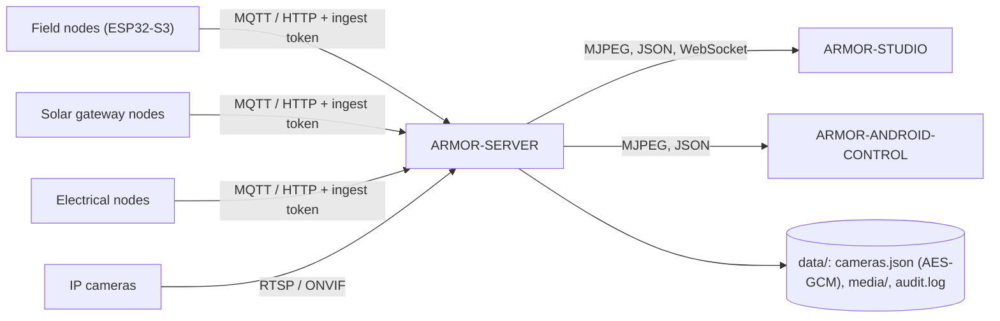

<p align="center">
  
</p>

# 🛡️ ARMOR-SERVER

<p align="center">
  <a href="README.md">🇺🇸 English</a> |
  <a href="README_spa.md">🇪🇸 Español</a> |
  <a href="README_fra.md">🇫🇷 Français</a> |
  <a href="README_ita.md">🇮🇹 Italiano</a> |
  <a href="README_deu.md">🇩🇪 Deutsch</a> |
  🇨🇳 <b>简体中文</b> |
  <a href="README_jpn.md">🇯🇵 日本語</a> |
  <a href="README_por.md">🇵🇹 Português</a>
</p>

### 中央安全协调器：节点、报警、设备、能源、摄像头、本地网络和系统维护

<p align="center">
  
  
  
  
  
  
</p>

---

**诚实性检查 - 今天真正能运行的部分:** 下面的每条路由、会话、加密和证据规则都是真实的，并有测试覆盖（`npm test`：417 个测试，包括针对隔离服务器的完整 HTTP 集成测试套件，以及检查每条路由都已写入 OpenAPI 文件）。它在 CM5 测试台上日常运行，配有真实的 MQTT 代理、ESP32-S3 板上真实雷达节点的固件、真实的 IP 摄像头（实时视频、快照、录像、Hi3510 设备上的 PTZ）、Studio 控制台、Android 应用以及语音和观察服务。**尚未**证明的是：用真实 ONVIF 摄像头测试 ONVIF、任何 Jetson 硬件、用真实节点测试太阳能、电气、报警主机和触摸屏的路由（它们用生成的消息测试：目前只有雷达板存在），以及用真实 Firebase 项目测试 Firebase 推送。

---

## 📋 速览

| | |
|---|---|
| 版本 | `0.6.9` |
| 成熟度 | 成熟 |
| 测试 | 417 (`npm test`) |
| 技术栈 | Node.js 22+ / TypeScript / Docker Compose |
| 真实硬件 | CM5 测试台的日常使用：真实的 MQTT 代理、真实的 IP 摄像头、ESP32-S3 板上的真实雷达节点，以及与之配合的 Studio、Android 应用和语音、观察服务 |

## 🎯 概述

**ARMOR-SERVER** 是 A.R.M.O.R. 的可信中心。现场节点发布雷达、光照和健康观测；本服务验证它们，保存每个节点最后已知的状态，并提供给 Studio 控制台和 Android 客户端。它还掌管一切接触摄像头的事务，因此**没有任何浏览器或手机持有摄像头密码或 RTSP 地址**。

* **经过验证的接入：**每种节点（雷达、太阳能、电气、报警主机、网络）的 HTTP 和 MQTT 消息在到达状态之前，都由共享契约在边界处检查；节点可以有自己的令牌（由共享令牌派生），严格模式则不接受其他令牌。
* **诚实的节点状态：**停止通信的节点在可配置的时间窗口后显示为*过期*和*离线*，绝不会用旧数据显示为在线；重新连接的节点从其返回时开始计时，而不是从旧消息算起。撤防会立即清除高级警报。
* **摄像头网关：**加密的摄像头保险库、ONVIF / Hi3510 / PSIA 云台、RTSP 路径发现、每个摄像头一个共享的 FFmpeg 中继、快照和 MP4 录像、把沉默的摄像头变成事件（布防时变成报警）的看门狗、**要忽略的画面区域**，以及摄像头在布防时看到东西时**自动拍照和录像**。
* **证据库：**按时间和大小保留、**永不清理的受保护证据**、用于保管链的 SHA-256，以及由服务器签名的**保管证明**文件。每个安全相关操作一条审计记录，凭据已被清除。
* **可延续的状态：**安全模式和每个节点的最后观测在重启后恢复（重启绝不会悄悄撤防）；文件以原子方式写入，损坏的文件会被恢复。每次警报、节点和模式变化都保存在事件历史中。
* **报警：**一个报警中心，生命周期为触发 / 确认 / 解除，无人查看的严重报警会升级，**布防前检查**（哪些是打开、沉默或故障的）、撤防 PIN（以及胁迫 PIN），以及来自节点、摄像头、设备、太阳能、电气、网络和报警主机的报警。它们会送达 Studio、手机（ntfy、Telegram、Home Assistant、签名的 webhook、配置后的 Firebase 推送）以及 MQTT 主题 `armor/server/alert`。
* **用户与角色：**用户名和密码（scrypt 哈希）、管理用户的 `admin` 角色、负责操作的 `operator` 角色，以及只看不改的 `viewer` 角色；更改密码或角色会终止该用户的其他会话。
* **设备与自动化：**烟雾、燃气、漏水、门、窗、移动、气候、插座、灯、警笛、门锁、卷帘、大门或车库门和热水器设备，通过 MQTT 或经认证的推送接入，状态规范化，带可用性和命令；在发生事件时（包括阈值触发）切换设备的规则。
* **能源：**逆变器和电池组（含每个电芯和容量）以及电气节点通过 HTTP 或 MQTT 到达，由共享契约验证，保存历史和每日能量，沉默时标记为过期，并触发报警（逆变器故障、电池电量低、电网丢失、电压、开关故障……）。电气设计和切换回路的规则保存在服务器上。
* **报警主机：**ARMOR-ALARM 节点的状态、带版本的**报警设计**、**绑定到防区的 Zigbee 设备**（服务器持有无线电时，由它告诉主机某防区的状态），以及发给主机的布防 / 撤防命令（除非设置 `ARMOR_ALARM_COMMANDS=1`，否则关闭）。
* **本地网络：**ARMOR-NETWORK 节点报告的内容（设备、互联网、公网地址及其来源）、给节点的指令（扫描、ping、端口、用你提供的登录信息检查设备）、名称、隐藏和监视的设备，以及**仅为该节点加密封装**后传输的登录信息。
* **语音、观察与维护：**文字和语音命令（封闭列表，八种语言，确认与人绑定）、观察服务的上下文（哪些雷达覆盖哪个摄像头）、从 Studio 逐个更新并显示进度的节点固件，以及通过维护助手完成的、来自 GitHub 的系统自身更新、操作系统更新和可选的 root 控制台。
* **从家外使用：**服务器区分家中和外部（VPN 视为家中），外部会话更短，要求第二重验证（验证器应用，附恢复码），并在关键操作前再次要求密码；可选择外部会话能做什么（全部、仅操作警报、仅查看）；有人从新地点登录时通知警报接收渠道；并通过服务器打开节点的网页面板（绑定节点证书，其 Cookie 保存在服务器上），因此永远不需要公开任何节点。

## 🧩 在 A.R.M.O.R. 中的角色

ARMOR-SERVER 是整个家族唯一可信的中心。现场节点（[ARMOR-RADAR](https://github.com/JuanenRac/ARMOR-RADAR)、[ARMOR-SOLAR](https://github.com/JuanenRac/ARMOR-SOLAR)、[ARMOR-ELECTRICAL](https://github.com/JuanenRac/ARMOR-ELECTRICAL)、[ARMOR-ALARM](https://github.com/JuanenRac/ARMOR-ALARM)、[ARMOR-HMI](https://github.com/JuanenRac/ARMOR-HMI)）和 [ARMOR-NETWORK](https://github.com/JuanenRac/ARMOR-NETWORK) 通过 MQTT 或 HTTP 与它通信；[ARMOR-STUDIO](https://github.com/JuanenRac/ARMOR-STUDIO) 和 [ARMOR-ANDROID-CONTROL](https://github.com/JuanenRac/ARMOR-ANDROID-CONTROL) 读取它并向它下达命令；[ARMOR-SERVER-AI](https://github.com/JuanenRac/ARMOR-SERVER-AI) 把摄像头看到的与雷达对照权衡，只给出建议；[ARMOR-VOICE-AI](https://github.com/JuanenRac/ARMOR-VOICE-AI) 把语音变成封闭的命令列表；[ARMOR-DEVOPS](https://github.com/JuanenRac/ARMOR-DEVOPS) 在 CM5 上安装并更新这一切。由服务器做决定：其他任何东西都不能布防、撤防或切换任何设备。

## 🔄 架构



## 🔒 安全模型

* 彼此独立的密钥：**ingest**（节点发送消息；每个节点也可以有自己的、由共享令牌派生的令牌，严格模式只接受这些）、**control**（布防 / 撤防、事件）、**operator**（自动化）和 **Studio 登录**；每一种都以恒定时间比较，且互不替代。给网络节点的登录信息仅为该节点加密封装后传输。
* 三种角色：**admin**、**operator** 和 **viewer**（只读，从不修改）。所有配置、移动、抓拍、录像、保护、删除或布防的路由都需要 operator；实时视频需要 operator 或绑定到某个摄像头的短期流票据。危险命令（撤防、切换回路、root 控制台）需要管理员，撤防还需要 PIN。
* 摄像头密码只保存在 `data/cameras.json` 中，使用 AES-256-GCM 加密，任何 API 都不会返回它们；ONVIF 地址必须停留在摄像头自身的主机上，重定向会被拒绝。
* Studio 会话为 HttpOnly 和 SameSite=Strict，登录有速率限制，错误从不携带堆栈跟踪。
* 服务器默认只监听 127.0.0.1，除非有意设置 `ARMOR_HOST`；此时短于 12 个字符的 Studio 密码会被拒绝。
* 从家外使用：第二重验证（TOTP，RFC 6238）、对用户、固件和节点面板的重新身份验证、仅限家中或 VPN 管理的策略、只接受已签名的固件版本，以及节点面板代理——它从不从请求中获取地址、只转发必要内容，并拒绝证书与受信任证书不一致的节点。

## 🌐 API

* 公开：`GET /healthz`。对已登录用户：状态、信息、摄像头、媒体、历史、规则、设备、报警、自动化、各类设计（场地、报警、电气、网络）、太阳能和电气读数、本地网络、通知和偏好设置；对管理员还有用户、服务、固件、更新和控制台。
* 面向节点：使用 ingest 令牌的 `POST /api/v1/telemetry`、`/health`、`/solar`、`/electrical/readings`、`/alarm/state`、`/network/state` 和 `/devices/state`，以及 MQTT 主题 `armor/node/#`、`armor/solar/#`、`armor/electrical/#`、`armor/alarm/#` 和 `armor/network/#`。事件通过 WebSocket `/api/v1/events` 送达控制台。
* 每条路由（目前 135 个路径）、其访问规则和模式都写在 [ARMOR-COMMON](https://github.com/JuanenRac/ARMOR-COMMON) 的 OpenAPI 文件中，并有测试检查没有遗漏。

## ⚙️ 配置

* 把 `.env.example` 复制为 `.env`（被 Git 忽略），或让 `run.bat` / `run.sh` 在首次运行时生成随机密钥。
* 必填：`ARMOR_INGEST_TOKEN` 和 `ARMOR_CONTROL_TOKEN`（24 个字符以上，彼此不同），以及 `ARMOR_STUDIO_USERNAME` / `ARMOR_STUDIO_PASSWORD`（第一位管理员）。
* 常用：`ARMOR_HOST` / `ARMOR_PORT`、`ARMOR_DATA_DIR`、`ARMOR_FFMPEG_PATH`（实时视频和抓拍）、`ARMOR_MQTT_URL`、`ARMOR_STUDIO_ORIGIN`、`ARMOR_NODE_STALE_AFTER_S`、`ARMOR_CAMERA_CHECK_S`、`ARMOR_ALERT_DWELL_MS`、`ARMOR_ALERT_WEBHOOK_URL` 和 `ARMOR_COOKIE_SECURE`（在 TLS 之后设为 `1`）。
* 可选，默认全部关闭：`ARMOR_NTFY_URL`、`ARMOR_TELEGRAM_BOT_TOKEN`、`ARMOR_HOMEASSISTANT_URL`、`ARMOR_FCM_SERVICE_ACCOUNT`（通过本系统自己的 Firebase 项目推送）、`ARMOR_ALARM_COMMANDS=1`（让服务器对报警主机布防和撤防）、`ARMOR_ELECTRICAL_SWITCHING` 和 `ARMOR_INGEST_STRICT=1`。

## 📂 仓库结构

```text
ARMOR-SERVER/
├── src/            server, app, config, context, store, persistence, events, contracts, rules, mqtt, audit, notify, channels,
│   │               alarms, alarm, alarm_design, alarm_commands, alarm_zone_feed, escalation, preflight, automations, users,
│   │               site, solar, solar_registry, electrical, electrical_energy, electrical_switching, network, network_commands,
│   │               firmware, installation, admin, voice, voice_actions, ai, capture_on_detect, ignore_zones, push_fcm, ...
│   ├── http/       auth, per-node tokens, sealed credentials
│   ├── routes/     sessions, users, cameras, media, ingest, history, devices, alarms, alarm, alarm_design, solar, electrical,
│   │               network, firmware, maintenance, admin, notifications, voice, ai, push, preferences, system
│   ├── devices/    catalog, registry, commands, mapping (the device model and its MQTT bridge)
│   ├── cameras/    model, vault, digest, ptz, rtsp, discovery, health, errors
│   └── media/      relay, evidence
├── tests/          417 tests: unit + full HTTP integration
├── docs/           state machine, camera gateway, integration, node firmware
├── tools/          project tooling and the CI checks
├── data/           runtime state (ignored by Git)
└── images/         brand assets
```

## 🛠️ 开发环境

**环境要求:** Node.js 22+, FFmpeg (live video and capture), an MQTT broker (Mosquitto)

```powershell
npm install
npm run typecheck   # tsc --noEmit
npm test            # 417 tests: unit + full HTTP integration (every route must be in the OpenAPI file)
npm run build       # dist/server.mjs
.\run.bat           # development server with hot reload
```

要安装到 CM5 测试台（与其他项目隔离，使用独立用户和端口），参见 [ARMOR-DEVOPS](https://github.com/JuanenRac/ARMOR-DEVOPS)。

## 🔗 相关项目

**A.R.M.O.R.**（Autonomous Radar & Multimodal Observation Range）是由若干独立仓库组成的周界安防系统。每个仓库都有自己的版本、测试和 README；家族成员如下：

* **[ARMOR-COMMON](https://github.com/JuanenRac/ARMOR-COMMON)** - 消息契约、验证器、一致性向量和生成的类型
* **[ARMOR-RADAR](https://github.com/JuanenRac/ARMOR-RADAR)** - 适用于 ESP32-S3 的现场节点固件，带三个雷达和自带网页面板
* **[ARMOR-SOLAR](https://github.com/JuanenRac/ARMOR-SOLAR)** - 太阳能逆变器与电池的协议，以及网关节点的消息
* **[ARMOR-ELECTRICAL](https://github.com/JuanenRac/ARMOR-ELECTRICAL)** - 电气节点：电表、电网读数消息和开关规则
* **[ARMOR-ALARM](https://github.com/JuanenRac/ARMOR-ALARM)** - 报警节点与报警主机：防区、布防、延时、警笛和 PIN，有无服务器均可
* **[ARMOR-HMI](https://github.com/JuanenRac/ARMOR-HMI)** - 触摸面板：墙面屏幕上的系统状态、布防与确认，以及语音助手的所在
* **[ARMOR-NETWORK](https://github.com/JuanenRac/ARMOR-NETWORK)** - 本地网络：其设备、互联网以及变化
* **ARMOR-SERVER** (本仓库) - 中央协调器：遥测、报警、设备、太阳能读数和摄像头
* **[ARMOR-STUDIO](https://github.com/JuanenRac/ARMOR-STUDIO)** - 网页控制台：摄像头、雷达、报警、太阳能和 2D/3D 场地设计器
* **[ARMOR-ANDROID-CONTROL](https://github.com/JuanenRac/ARMOR-ANDROID-CONTROL)** - 带实时 2D/3D 雷达的 Android 操作员客户端
* **[ARMOR-SERVER-AI](https://github.com/JuanenRac/ARMOR-SERVER-AI)** - 会解释决策且从不执行动作的视觉推理策略
* **[ARMOR-VISION](https://github.com/JuanenRac/ARMOR-VISION)** - Jetson Orin NX 上的摄像头区域、遮罩与检测规则
* **[ARMOR-VOICE-AI](https://github.com/JuanenRac/ARMOR-VOICE-AI)** - 带无法伪造确认的离线语音意图
* **[ARMOR-HARDWARE](https://github.com/JuanenRac/ARMOR-HARDWARE)** - 外壳、电子器件和台架验收矩阵
* **[ARMOR-DEVOPS](https://github.com/JuanenRac/ARMOR-DEVOPS)** - 部署、CM5 测试台、备份与 TLS
* **[ARMOR-SIMULATOR](https://github.com/JuanenRac/ARMOR-SIMULATOR)** - 带可重复故障的离线遥测模拟器
* **[ARMOR-UPDATER](https://github.com/JuanenRac/ARMOR-UPDATER)** - 发现、安装并更新生态系统自身的仓库
* **[ARMOR-DOCS](https://github.com/JuanenRac/ARMOR-DOCS)** - 架构、安全基线和能力矩阵

## 📚 文档与社区

更多阅读：

* [能力矩阵：哪些已被证实，哪些没有](https://github.com/JuanenRac/ARMOR-DOCS/blob/main/docs/CAPABILITY_MATRIX.md)
* [项目目录：版本以及各仓库之间的依赖](https://github.com/JuanenRac/ARMOR-DOCS/blob/main/docs/PROJECT_CATALOG.md)
* [本仓库的变更记录](CHANGELOG.md)
* [许可证（GPL-3.0-or-later）](LICENSE)
* 问题、想法与反馈：electrohobby3d@gmail.com

## 👤 作者

**JuanenRac (Electro Hobby 3D)** · electrohobby3d@gmail.com

## 📜 许可证

GPL-3.0-or-later - 见 [LICENSE](LICENSE)。
