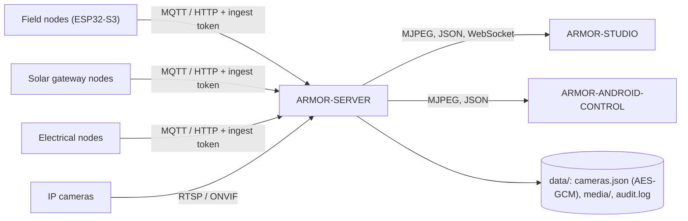

<p align="center">
  
</p>

# 🛡️ ARMOR-SERVER

<p align="center">
  <a href="README.md">🇺🇸 English</a> |
  <a href="README_spa.md">🇪🇸 Español</a> |
  <a href="README_fra.md">🇫🇷 Français</a> |
  <a href="README_ita.md">🇮🇹 Italiano</a> |
  <a href="README_deu.md">🇩🇪 Deutsch</a> |
  🇨🇳 <b>简体中文</b> |
  <a href="README_jpn.md">🇯🇵 日本語</a> |
  <a href="README_por.md">🇵🇹 Português</a>
</p>

### 中央安全协调器：节点、报警、设备、能源、摄像头、本地网络和系统维护

<p align="center">
  
  
  
  
  
  
</p>

---

**诚实性检查 - 今天真正能运行的部分：** 下面的每条路由、会话、加密和证据规则都是真实的，并有测试覆盖（`npm test`：724 个测试，包括针对隔离服务器的完整 HTTP 集成测试套件，以及检查每条路由都已写入 OpenAPI 文件）。它在 CM5 测试台上日常运行，配有真实的 MQTT 代理、ESP32-S3 板上真实雷达节点的固件、真实的 IP 摄像头（实时视频、快照、录像、Hi3510 设备上的 PTZ）、Studio 控制台、Android 应用以及语音和观察服务。**尚未**证明的是：用真实 ONVIF 摄像头测试 ONVIF、任何 Jetson 硬件、用真实节点测试太阳能、电气、报警主机和触摸屏的路由（它们用生成的消息测试：目前只有雷达板存在），以及用真实 Firebase 项目测试 Firebase 推送。

---

## 📋 速览

| | |
|---|---|
| 版本 | `0.8.0.7` |
| 成熟度 | 成熟 |
| 角色 | 家族的中央安全协调器：节点、报警、设备、能源、摄像头、网络 |
| 技术栈 | Node.js 22+, TypeScript, Express 5, MQTT, WebSocket, FFmpeg |
| 测试 | 724 项（`npm test`：单元与完整 HTTP 集成） |
| 契约 | 191 条 HTTP 路径、247 个操作（OpenAPI 在 ARMOR-COMMON 中），路由表见 `docs/ROUTES.md` |
| 监听地址 | `127.0.0.1:8080`（`ARMOR_HOST`、`ARMOR_PORT`） |
| 运行位置 | CM5 测试台（作为服务，见 ARMOR-DEVOPS）或任何装有 Node.js 的计算机 |
| 真实硬件 | CM5 测试台的日常使用：真实的 MQTT 代理、真实的 IP 摄像头、ESP32-S3 板上的真实雷达节点，以及与之配合的 Studio、Android 应用和语音、观察服务 |
| 许可证 | GPL-3.0-or-later |

**跳转到：** [概述](#-概述) · [架构](#-架构) · [安全](#-安全与防护) · [接口](#-接口) · [配置](#-配置) · [快速开始](#-快速开始) · [测试](#-测试) · [故障排除](#-故障排除) · [结构](#-仓库结构) · [相关项目](#-相关项目)

## 🚦 项目状态

每一行是本仓库的一个部分，灯号表示它今天做到了哪一步。内容依据仓库能够展示的证据（测试、构建、运行），而不是计划。

🟢 已完成并验证 · 🟡 可用，有已知限制 · 🟠 部分完成或尚未验证 · 🔴 未完成或不可用

| 领域 | 状态 | 在这里的含义 |
|---|---|---|
| 软件 | 🟢 | 路由、会话、加密和证据规则每天都在 CM5 测试台上运行。 |
| 测试 | 🟢 | 724 项测试通过（`npm test`），包括针对隔离服务器的完整 HTTP 集成测试，以及检查每条路由都已写入 OpenAPI 文件。 |
| 协议与数据 | 🟡 | 雷达消息来自真实的板子；光伏、电气、报警面板和触摸面板的路由是用生成的消息测试的，ONVIF 也没有遇到过真正的 ONVIF 摄像头。 |
| 硬件 | 🟡 | 它在 CM5 测试台上运行，配有真实的 MQTT 代理、真实的 IP 摄像头（实时视频、截图、录像、Hi3510 机型的云台）和真实的雷达节点；还没有在 Jetson 上运行过。 |
| 安全 | 🟡 | 会话、加密、证据和登录规则均有测试覆盖；没有经过独立审查。 |
| 集成 | 🟡 | Studio、Android 应用以及语音和观察服务每天在测试台上使用它；通过 Firebase 的推送从未对真实的 Firebase 项目运行过。 |
| 文档 | 🟢 | 八种语言、路由参考（OpenAPI 和 ROUTES）、环境与远程访问指南以及更新日志均为最新。 |

## 🎯 概述

**ARMOR-SERVER** 是 A.R.M.O.R. 的可信中心。现场节点发布雷达、光照和健康观测；本服务验证它们，保存每个节点最后已知的状态，并提供给 Studio 控制台和 Android 客户端。它还掌管一切接触摄像头的事务，因此**没有任何浏览器或手机持有摄像头密码或 RTSP 地址**。

* **经过验证的接入：**每种节点（雷达、太阳能、电气、报警主机、网络）的 HTTP 和 MQTT 消息在到达状态之前，都由共享契约在边界处检查；节点可以有自己的令牌（由共享令牌派生），严格模式则不接受其他令牌。
* **诚实的节点状态：**停止通信的节点在可配置的时间窗口后显示为*过期*和*离线*，绝不会用旧数据显示为在线；重新连接的节点从其返回时开始计时，而不是从旧消息算起。撤防会立即清除高级警报。
* **摄像头网关：**加密的摄像头保险库、ONVIF / Hi3510 / PSIA 云台、RTSP 路径发现、每个摄像头一个共享的 FFmpeg 中继、快照和 MP4 录像、把沉默的摄像头变成事件（布防时变成报警）的看门狗、**要忽略的画面区域**，以及摄像头在布防时看到东西时**自动拍照和录像**。
* **证据库：**按时间和大小保留、**永不清理的受保护证据**、用于保管链的 SHA-256，以及由服务器签名的**保管证明**文件。每个安全相关操作一条审计记录，凭据已被清除。
* **可延续的状态：**安全模式和每个节点的最后观测在重启后恢复（重启绝不会悄悄撤防）；文件以原子方式写入，损坏的文件会被恢复。每次警报、节点和模式变化都保存在事件历史中。
* **报警：**一个报警中心，生命周期为触发 / 确认 / 解除，无人查看的严重报警会升级，**布防前检查**（哪些是打开、沉默或故障的）、撤防 PIN（以及胁迫 PIN），以及来自节点、摄像头、设备、太阳能、电气、网络和报警主机的报警。它们会送达 Studio、手机（ntfy、Telegram、Home Assistant、签名的 webhook、配置后的 Firebase 推送）以及 MQTT 主题 `armor/server/alert`。
* **用户与角色：**用户名和密码（scrypt 哈希）、管理用户的 `admin` 角色、负责操作的 `operator` 角色，以及只看不改的 `viewer` 角色；更改密码或角色会终止该用户的其他会话。
* **设备与自动化：**烟雾、燃气、漏水、门、窗、移动、气候、插座、灯、警笛、门锁、卷帘、大门或车库门和热水器设备，通过 MQTT 或经认证的推送接入，状态规范化，带可用性和命令；在发生事件时（包括阈值触发）切换设备的规则。
* **能源：**逆变器和电池组（含每个电芯和容量）以及电气节点通过 HTTP 或 MQTT 到达，由共享契约验证，保存历史和每日能量，沉默时标记为过期，并触发报警（逆变器故障、电池电量低、电网丢失、电压、开关故障……）。电气设计和切换回路的规则保存在服务器上。
* **报警主机：**ARMOR-NODE-ALARM 节点的状态、带版本的**报警设计**、**绑定到防区的 Zigbee 设备**（服务器持有无线电时，由它告诉主机某防区的状态），以及发给主机的布防 / 撤防命令（除非设置 `ARMOR_ALARM_COMMANDS=1`，否则关闭）。
* **本地网络：**ARMOR-NETWORK 节点报告的内容（设备、互联网、公网地址及其来源）、给节点的指令（扫描、ping、端口、用你提供的登录信息检查设备）、名称、隐藏和监视的设备，以及**仅为该节点加密封装**后传输的登录信息。
* **语音、观察与维护：**文字和语音命令（封闭列表，八种语言，确认与人绑定）、观察服务的上下文（哪些雷达覆盖哪个摄像头）、从 Studio 逐个更新并显示进度的节点固件，以及通过维护助手完成的、来自 GitHub 的系统自身更新、操作系统更新和可选的 root 控制台。
* **从家外使用：**服务器区分家中和外部（VPN 视为家中），外部会话更短，要求第二重验证（验证器应用，附恢复码），并在关键操作前再次要求密码；可选择外部会话能做什么（全部、仅操作警报、仅查看）；有人从新地点登录时通知警报接收渠道；并通过服务器打开节点的网页面板（绑定节点证书，其 Cookie 保存在服务器上），因此永远不需要公开任何节点。
* **可选的与代理加密连接(mqtts):** `ARMOR_MQTT_CA_FILE` 指向本安装自有证书颁发机构的证书;使用 `mqtts://` 地址时,服务器只信任该机构并检查代理名称;如果文件不是有效证书或地址不是 `mqtts://`,服务器拒绝启动。Studio 显示连接是否加密以及机构的指纹。已针对 TLS 代理替身和真实的 Mosquitto 2.0 测试。
* **节点健康与布防模式：** 保存每个节点的最新报告和重启记录，并发出四种警告（内存不足、重启过于频繁、代理反复断开、Wi-Fi 信号弱）；保存布防配置（离家、在家、夜间和您自己的），并把所选配置放进布防命令，只发给声明支持它的节点。警报的强弱遵循配置；不带配置的布防仍是原来的命令。
* **连接与系统历史：** 除警报、节点、摄像头、设备和报警外，历史还记录哪些设备和应用连接了服务器（Studio 会话、Android 应用、节点面板、语音服务：登录、被拒、退出、会话过期、第二重验证的使用、首次与最近出现），以及系统事件（带固件版本出现或消失的节点、代理连接、被更改的设置及操作人、服务、更新、含方案的布防）。可按类型、类别、客户端和用户筛选；地址和用户代理只显示给管理员，密码、令牌、Cookie 和 PIN 绝不会被记录。
* **写入 Pylontech 电池的指令（除非设置 `ARMOR_BATTERY_WRITE=1`，否则关闭）：** 仅限刚刚再次证明身份的管理员——准备、再次输入电池序列号后执行、取消、把输出恢复原状、保存固件镜像一小时——依据共享的操作与范围表检查，以 `solar_battery_command` 发给网关节点；每次操作都会保存（谁、哪块电池、操作前后读到的内容、差异和记录，绝不含服务密码），并在历史的“电池”类别中记录。
* **节点控制：** `POST /api/v1/nodes/{id}/control` 和 `POST /api/v1/nodes/control` 向一个节点或所有在上报的节点下达一条命令（重启、暂停、恢复、待机、识别、诊断、开启或关闭维护），仅限刚刚再次验证过身份的管理员；在会让家中防护减弱的地方，还要再次输入节点名称（对所有节点则输入单词 RESTART、PAUSE 或 STANDBY）。服务器先准备命令，再用节点为该操作给出的一次性令牌执行，在 `GET /api/v1/nodes/control/operations` 中跟踪每个节点（已发送、已确认、已应用、已恢复），滚动重启时把报警主机放在最后，在历史和审计记录中记下谁下达了什么命令，并在节点健康中显示暂停、待机（停止工作，保持连接）和维护。没有恢复出厂设置、擦除或深度睡眠。已用模拟代理测试；尚未在真实节点上试过。
* **实时状态与路由表：** 每当有变化，服务器就通过 `/api/v1/events` 的 WebSocket 把完整状态推送给 Studio（一连串变化合并为一条消息，落后的客户端会被断开），并且它注册的每条路由及可调用者都列在由代码生成的表中。壁挂面板有自己更小的通道 `/api/v1/panel/events`（与 `GET /api/v1/panel/summary` 相同的几百字节摘要，在变化时以及每五秒发送，面向面板、操作员和管理员账户；管理员可用 `panel.live_events` 将其关闭）。

## 🧩 在 A.R.M.O.R. 中的角色

ARMOR-SERVER 是整个家族唯一可信的中心。现场节点（[ARMOR-NODE-RADAR](https://github.com/JuanenRac/ARMOR-NODE-RADAR)、[ARMOR-NODE-SOLAR](https://github.com/JuanenRac/ARMOR-NODE-SOLAR)、[ARMOR-NODE-ELECTRICAL](https://github.com/JuanenRac/ARMOR-NODE-ELECTRICAL)、[ARMOR-NODE-ALARM](https://github.com/JuanenRac/ARMOR-NODE-ALARM)、[ARMOR-NODE-HMI](https://github.com/JuanenRac/ARMOR-NODE-HMI)）和 [ARMOR-NETWORK](https://github.com/JuanenRac/ARMOR-NETWORK) 通过 MQTT 或 HTTP 与它通信；[ARMOR-STUDIO](https://github.com/JuanenRac/ARMOR-STUDIO) 和 [ARMOR-ANDROID-CONTROL](https://github.com/JuanenRac/ARMOR-ANDROID-CONTROL) 读取它并向它下达命令；[ARMOR-SERVER-AI](https://github.com/JuanenRac/ARMOR-SERVER-AI) 把摄像头看到的与雷达对照权衡，只给出建议；[ARMOR-VOICE-AI](https://github.com/JuanenRac/ARMOR-VOICE-AI) 把语音变成封闭的命令列表；[ARMOR-DEVOPS](https://github.com/JuanenRac/ARMOR-DEVOPS) 在 CM5 上安装并更新这一切。由服务器做决定：其他任何东西都不能布防、撤防或切换任何设备。

| 对话对象 | 方式 | 用途 |
|---|---|---|
| ARMOR-NODE-RADAR, SOLAR, ELECTRICAL, ALARM, HMI | MQTT `armor/*/#` 或带采集令牌的 HTTP `POST` | 接收其消息并下发指令 |
| ARMOR-NETWORK | 接收状态，下发指令和密封凭据 | 本地网络 |
| ARMOR-STUDIO, ARMOR-ANDROID-CONTROL | HTTP、MJPEG 和 WebSocket `/api/v1/events` | 控制台 |
| ARMOR-VOICE-AI | 用其自己的令牌访问 `/v1/command`、`/v1/turn` | 判定一句话，由服务器执行 |
| ARMOR-SERVER-AI | `ARMOR_AI_TOKEN`、`/api/v1/ai/...` | 摄像头观察 |
| IP 摄像头 | RTSP、ONVIF、Hi3510、PSIA（由服务器调用） | 实时视频、快照、录制、PTZ |

## 🏛️ 架构

<p align="center">
  
</p>

<details>
<summary>图表的文本版本（Mermaid）</summary>



</details>

## 🔒 安全与防护

* 彼此独立的密钥：**ingest**（节点发送消息；每个节点也可以有自己的、由共享令牌派生的令牌，严格模式只接受这些）、**control**（布防 / 撤防、事件）、**operator**（自动化）和 **Studio 登录**；每一种都以恒定时间比较，且互不替代。给网络节点的登录信息仅为该节点加密封装后传输。
* 三种角色：**admin**、**operator** 和 **viewer**（只读，从不修改）。所有配置、移动、抓拍、录像、保护、删除或布防的路由都需要 operator；实时视频需要 operator 或绑定到某个摄像头的短期流票据。危险命令（撤防、切换回路、root 控制台）需要管理员，撤防还需要 PIN。
* 摄像头密码只保存在 `data/cameras.json` 中，使用 AES-256-GCM 加密，任何 API 都不会返回它们；ONVIF 地址必须停留在摄像头自身的主机上，重定向会被拒绝。
* Studio 会话为 HttpOnly 和 SameSite=Strict，登录有速率限制，错误从不携带堆栈跟踪。
* 服务器默认只监听 127.0.0.1，除非有意设置 `ARMOR_HOST`；此时短于 12 个字符的 Studio 密码会被拒绝。
* 从家外使用：第二重验证（TOTP，RFC 6238）、对用户、固件和节点面板的重新身份验证、仅限家中或 VPN 管理的策略、只接受已签名的固件版本，以及节点面板代理——它从不从请求中获取地址、只转发必要内容，并拒绝证书与受信任证书不一致的节点。

| 威胁 | 防御 |
|---|---|
| 猜测 Studio 密码 | scrypt（N=16384、r=8、p=1），无论用户是否存在都做同样的计算；每人每地址 15 分钟 12 次、每地址 60 次、全局每分钟 40 次；少于 8 个字符被拒绝（服务器可从网络访问时为 12 个） |
| 被盗的 Cookie、来自其他站点的请求 | HttpOnly、SameSite=Strict，HTTPS 后使用 Secure；会话时长：Studio 7 天、操作员 8 小时、从外部访问 12 小时（空闲 30 分钟） |
| 计时攻击与弱密钥 | 密钥以恒定时间比较，至少 24 个字符且互不相同（采集、控制、操作员、摄像头密钥、AI、证据密钥） |
| 未经验证的撤防 | 由 `alarm.disarm_pin`（never、if_set、always）决定的 4 到 10 位 PIN；错误 3 次后锁定 60 秒、5 分钟、15 分钟，之后 1 小时，重启后仍保存在磁盘；胁迫 PIN 会被悄悄区分；控制令牌仅在 `ARMOR_CONTROL_DISARM=1` 时可撤防 |
| 摄像头密码泄露 | 以 AES-256-GCM 存于 `data/cameras.json`，任何 API 都不返回；FFmpeg 通过本地 RTSP 隧道（`media.rtsp_proxy`），密码绝不出现在命令行；拒绝 ONVIF 重定向 |
| 未登录观看实时视频 | 仅绑定一台摄像头的流票据，只发给操作员 |
| 洪泛 API | 通常每分钟 240 个请求（节点 POST 有单独的每分钟 6000 额度）；JSON 请求体 64 kB（安装文件 9 MB） |
| 伪造或格式错误的节点消息 | 由 `src/contracts.ts` 的解析器在边界检查，并用 ARMOR-COMMON 的共享向量测试：最多 15 条轨迹，照度至多 200 000，节点 ID 由字母、数字、`_` 和 `-` 组成；每个节点有由共享令牌派生的令牌，另有严格模式（`ARMOR_INGEST_STRICT=1`） |
| 来自屋外的会话 | 第二因素（`ARMOR_TOTP_REQUIRED`：off、remote、always）、可做事项的策略（`ARMOR_REMOTE_POLICY`：full、operate、view）、关键操作前重新验证身份（默认 5 分钟）以及从新地点登录时的提醒 |
| 被当作开放代理的节点面板 | 地址从不取自请求；HTTPS 固定到节点证书的 SHA-256 指纹 |
| 语音：未确认就静音、超长文本、超大音频 | 策略 `voice.silence_confirmation`（off、pin、double_turn）随每个轮次发送；确认与本人绑定；200 个字符、8 种语言、每分钟 30 个请求；音频最多 480 000 字节，回复最多 200 000 字节 |
| 误操作的危险写入 | 除非设置 `ARMOR_BATTERY_WRITE=1`、`ARMOR_ELECTRICAL_SWITCHING=1` 或 `ARMOR_ALARM_COMMANDS=1`，否则关闭；启动时给出警告 |

**Studio 中的开关。** 可调的保护措施是保存在 `security-settings.json`（权限 0600，原子写入）中的 15 项设置，每项都有保守的默认值，调低任何一项都会写入审计：`alarm.disarm_pin`、`voice.silence_confirmation`、`alarm.config_hash`、`server.zone_feed`、`server.zone_feed_signature`、`media.rtsp_proxy`、`network.login_secure_only`、`voice.multipart_turn`、`panel.live_events`、`client.device_lock`、`nodes.nvs_encryption`, `alarm_audio.spoken`, `alarm_audio.custom_sounds`、`voice.turn_max_bytes` 和 `voice.reply_audio_max_bytes`。

**它绝不会：** 返回摄像头密码、保存所说的话（只保留命令及其结果），或把 PIN、令牌或 Cookie 写进日志。没有独立的安全审查。

## 🔌 接口

路由表（`docs/ROUTES.md`，由代码生成）列出每条路由及可调用者；ARMOR-COMMON 的 OpenAPI 文件描述了 191 条路径和 247 个操作，缺少任何路由时测试会失败。最重要的几条：

| 路由 | 认证 | 作用 |
|---|---|---|
| `GET /healthz` | 无 | 存活就绪 |
| `POST /api/v1/telemetry`  `/health`  `/solar`  `/electrical/readings`  `/alarm/state`  `/network/state`  `/devices/state` | 采集令牌 | 节点上报的内容 |
| `WS /api/v1/events` | 会话 | 状态变化时推送完整状态（一阵变化合并为一条消息；落后的客户端会被断开；客户端最多发 1 KB） |
| `WS /api/v1/panel/events` | 面板 | 壁挂面板用的较小通道（客户端最多 128 字节） |
| `POST /api/v1/voice/command` | 操作员，每分钟 30 次 | 文字或语音命令 `{text, language, confirmation?, pin?}`；返回 `{accepted, executed, intent, outcome, speech, confirmation_token?, reason?, result?}` |
| `POST /api/v1/voice/turn`  `/api/v1/voice/v1/turn` | 请求头 `X-Armor-Voice-Token` | 一个轮次的音频（multipart）；错误 `unauthorized`、`multipart_turn_disabled`（415）、`audio_too_large`（413）、`bad_multipart`（400）、`voice_bad_reply`（502） |
| `GET /api/v1/alarm-audio` | 操作员 | 报警声音的状态：两个选项（默认关闭）、是否设置了语音网关、限制以及已保存的声音 |
| `GET /api/v1/alarm-audio/spoken` | 操作员或壁挂面板的账户 | 大声播报的报警（来源、严重程度、报警代码；带 SHA-256 的 16 kHz 16 位单声道 PCM），由语音网关生成并缓存；选项关闭时返回 404 `spoken_alarms_disabled` |
| `GET` `PUT` `DELETE /api/v1/alarm-audio/sounds/{source}` | GET：操作员或壁挂面板的账户；PUT 和 DELETE：管理员（从屋外访问时需再次验证身份） | 某个报警来源的声音：16 kHz 16 位单声道 PCM 的 WAVE 文件，逐字节检查（十分之一秒至 `ARMOR_ALARM_SOUND_MAX_BYTES`，不得为静音），只保存其采样，并附 SHA-256 提供；选项关闭时返回 409 `custom_sounds_disabled` |
| `POST /api/v1/nodes/{id}/control`  `POST /api/v1/nodes/control` | 刚刚重新验证身份的管理员 | 向一个或所有节点下发一条指令（重启、暂停、恢复、待机、识别、诊断、维护） |
| `POST /api/v1/cameras/{id}/stream-ticket` | 操作员 | 单台摄像头实时视频的短期票据 |

* 公开：`GET /healthz`。对已登录用户：状态、信息、摄像头、媒体、历史、规则、设备、报警、自动化、各类设计（场地、报警、电气、网络）、太阳能和电气读数、本地网络、通知和偏好设置；对管理员还有用户、服务、固件、更新和控制台。
* 面向节点：使用 ingest 令牌的 `POST /api/v1/telemetry`、`/health`、`/solar`、`/electrical/readings`、`/alarm/state`、`/network/state` 和 `/devices/state`，以及 MQTT 主题 `armor/node/#`、`armor/solar/#`、`armor/electrical/#`、`armor/alarm/#` 和 `armor/network/#`。事件通过 WebSocket `/api/v1/events` 送达控制台。

## ⚙️ 配置

把 `.env.example` 复制为 `.env`（Git 忽略），或让 `run.bat` / `run.sh` 在首次运行时生成随机密钥。变量的完整列表及范围见 [docs/ENVIRONMENT.md](docs/ENVIRONMENT.md)（由代码生成），远程访问相关变量见 [docs/REMOTE_ACCESS.md](docs/REMOTE_ACCESS.md)。保护安装的取值不在这里，而在 Studio 中修改（见安全部分）。

| 设置 | 默认值 | 作用 |
|---|---|---|
| `ARMOR_INGEST_TOKEN`  `ARMOR_CONTROL_TOKEN` | 是（24 个以上字符，互不相同） | 节点上报所用；布防、撤防和读取事件所用 |
| `ARMOR_STUDIO_USERNAME`  `ARMOR_STUDIO_PASSWORD` | 是 | 第一个管理员 |
| `ARMOR_HOST`  `ARMOR_PORT` | 127.0.0.1  8080 | 监听位置；非回环地址时拒绝少于 12 个字符的 Studio 密码 |
| `ARMOR_DATA_DIR`  `ARMOR_FFMPEG_PATH` | data/ | 状态文件夹；用于实时视频和抓取的 FFmpeg |
| `ARMOR_MQTT_URL`  `ARMOR_MQTT_CA_FILE` | 可选 | 代理地址；`mqtts://` 使用的安装自有机构（服务器只信任它，检查代理名称，文件有误则拒绝启动） |
| `ARMOR_NODE_STALE_AFTER_S` | 30 (5-3600) | 节点被视为过期前的静默秒数 |
| `ARMOR_ALERT_DWELL_MS`  `ARMOR_ALERT_MIN_TARGETS` | 2000 (0-60000)  1 (1-20) | 雷达警报前的持续时间和目标数 |
| `ARMOR_ESCALATE_AFTER_MIN` | 0 = off (0-1440) | 无人查看的严重报警升级前的分钟数 |
| `ARMOR_MEDIA_RETENTION_DAYS`  `ARMOR_MEDIA_MAX_BYTES` | 30 (0-3650)  20 GiB | 按时间和大小保留证据，先删最旧的；受保护的证据从不删除 |
| `ARMOR_STUDIO_SESSION_TTL_MS`  `ARMOR_OPERATOR_SESSION_TTL_MS`  `ARMOR_REMOTE_SESSION_TTL_MS`  `ARMOR_REMOTE_IDLE_MS`  `ARMOR_ELEVATION_MS` | 7 d  8 h  12 h  30 min  5 min | 会话时长及重新验证身份的有效时间 |
| `ARMOR_TOTP_REQUIRED`  `ARMOR_REMOTE_POLICY` | off  full | 第二因素与外部会话可做的事 |
| `ARMOR_ALERT_LANGUAGE` | es | 报警语言（八种之一） |
| `ARMOR_NTFY_URL`  `ARMOR_TELEGRAM_BOT_TOKEN`  `ARMOR_HOMEASSISTANT_URL`  `ARMOR_ALERT_WEBHOOK_URL`  `ARMOR_FCM_SERVICE_ACCOUNT` | 关闭 | 报警发往何处（默认全部关闭） |
| `ARMOR_ALARM_COMMANDS`  `ARMOR_BATTERY_WRITE`  `ARMOR_ELECTRICAL_SWITCHING`  `ARMOR_INGEST_STRICT`  `ARMOR_CONTROL_DISARM` | 0 | 危险写入与严格模式，全部关闭 |
| `ARMOR_COOKIE_SECURE`  `ARMOR_STUDIO_ORIGIN` | - | 在 TLS 之后设为 `1`；Studio 的来源 |

* 必填：`ARMOR_INGEST_TOKEN` 和 `ARMOR_CONTROL_TOKEN`（24 个字符以上，彼此不同），以及 `ARMOR_STUDIO_USERNAME` / `ARMOR_STUDIO_PASSWORD`（第一位管理员）。
* 常用：`ARMOR_HOST` / `ARMOR_PORT`、`ARMOR_DATA_DIR`、`ARMOR_FFMPEG_PATH`（实时视频和抓拍）、`ARMOR_MQTT_URL`、`ARMOR_MQTT_CA_FILE`、`ARMOR_STUDIO_ORIGIN`、`ARMOR_NODE_STALE_AFTER_S`、`ARMOR_CAMERA_CHECK_S`、`ARMOR_ALERT_DWELL_MS`、`ARMOR_ALERT_WEBHOOK_URL` 和 `ARMOR_COOKIE_SECURE`（在 TLS 之后设为 `1`）。

## 🚀 快速开始

**要求：** Node.js 22+、FFmpeg（实时视频和抓取）、MQTT 代理（Mosquitto）。

```powershell
npm install           # 依赖
npm run typecheck     # tsc --noEmit
npm test              # 724 项：单元与完整 HTTP 集成
npm run build         # dist/server.mjs
.\run.bat   (run.sh)  # 带热重载的开发服务器
```

在 CM5 测试台上安装（与其他项目隔离，独立用户和端口）请见 [ARMOR-DEVOPS](https://github.com/JuanenRac/ARMOR-DEVOPS)。

## 🧪 测试

```powershell
npm run typecheck  # tsc --noEmit
npm test           # tsx --test tests/*.test.ts
python -I tools/armor_ci_validate.py
```

`npm test` 运行 `tests/` 的每个文件（95 个）：各模块的单元测试，以及针对隔离服务器的完整 HTTP 集成套件（`tests/vertical-slice.test.ts`）。`tests/conformance.test.ts` 运行 ARMOR-COMMON 的共享向量，并检查**服务器注册的路由与 OpenAPI 文件描述的操作（按方法和路径）完全一致**，以及每个响应都说明其请求体类型；ARMOR-COMMON 不在本仓库旁边时会跳过。TLS 测试需要安装 `openssl`。GitHub Actions 在每次推送和拉取请求时运行 A.R.M.O.R. 基线：清单、版本、更新日志和 README 一致性的校验，然后是项目自身的构建和测试。

## 🏗️ 构建与发布

`npm run build` 把服务器打包为 `dist/server.mjs`（`Dockerfile` 据此构建容器镜像）。版本记录在 `package.json`、`armor.project.json` 和 README 徽章中（读取自清单）；每个版本在 [CHANGELOG.md](CHANGELOG.md) 中都有对应条目。发布版本发布在 GitHub 上。

## 🩺 故障排除

| 你看到 | 原因 | 处理 |
|---|---|---|
| `ARMOR_INGEST_TOKEN must be at least 24 characters` | 缺少密钥或密钥太短 | 设置它（24 个以上字符）；`run.sh` 可以生成 |
| `... and ... must be different values` | 两个密钥相同 | 给每个密钥单独的值 |
| `ARMOR_STUDIO_PASSWORD must be at least 12 characters when the server is reachable from the network` | `ARMOR_HOST` 不是回环地址 | 使用更长的密码，或保持 `127.0.0.1` |
| `ARMOR_MQTT_CA_FILE needs an mqtts:// address in ARMOR_MQTT_URL` | 设置了机构文件但代理地址不是 `mqtts://` | 使用 `mqtts://` 地址，或移除该文件 |
| `TLS_CERT_PATH and TLS_KEY_PATH must both be set` | 只设置了其中一个 | 要 HTTPS 就两个都设，要明文 HTTP 就都不设 |
| `voice_unavailable`  `voice_not_answering` (503) | 语音服务不可达 | 启动 ARMOR-VOICE-AI 并检查 `ARMOR_VOICE_URL` 及其令牌 |

## 📂 仓库结构

<p align="center">
  
</p>

<details>
<summary>目录树的文本版本</summary>

```text
ARMOR-SERVER/
├── src/
│   ├── server.ts app.ts              启动、Express 应用、限流
│   ├── config.ts                     启动时校验每项设置
│   ├── contracts.ts mqtt_router.ts   边界处的校验
│   ├── store.ts persistence.ts       节点状态与重启后保留的内容
│   ├── alarms.ts escalation.ts       报警中心与升级
│   ├── users.ts totp.ts              用户、角色、PIN 与第二因素
│   ├── security_settings.ts          Studio 修改的 15 个开关
│   ├── voice.ts voice_turn.ts        文字和语音命令
│   ├── firmware.ts installation.ts   节点固件与自身更新
│   ├── http/                         会话、节点令牌、密封凭据
│   ├── routes/                       每组路由一个文件
│   ├── cameras/                      保险库、PTZ、RTSP、发现、健康
│   ├── media/                        FFmpeg 中继与证据库
│   └── devices/                      设备模型及其 MQTT 桥
├── tests/                            700 项测试（单元与 HTTP 集成）
├── docs/                             7 份指南、路由表、环境变量
├── tools/                            docs/ROUTES.md 和 docs/ENVIRONMENT.md 的生成器、CI 检查、启动器
├── images/                           横幅图、图标和 README 的图片
├── .github/                          CI 工作流、仪表板通知、议题和 pull request 模板
├── Dockerfile                        服务器容器镜像
├── armor.project.json                清单：版本、角色、成熟度
├── CHANGELOG.md                      每个版本的变化
├── package.json package-lock.json    依赖与脚本
├── tsconfig.json                     TypeScript 设置
├── run.sh run.bat                    启动（共用流程）
├── build.sh build.bat                构建并测试（共用流程）
├── build-test.sh build-test.bat      构建、测试并打包
├── test.sh test.bat                  只运行测试，不改版本
└── SECURITY.md SUPPORT.md CONTRIBUTING.md CODE_OF_CONDUCT.md LICENSE
```

</details>

## 🗺️ 路线图与已知限制

**当前已知限制**

* ONVIF 从未接触过真实的 ONVIF 摄像头，也没有任何东西在 Jetson 上运行过。
* 太阳能、电气、报警面板和触摸面板的路由用生成的消息测试：只有雷达的开发板存在。
* 通过 Firebase 的推送从未对真实的 Firebase 项目运行过。
* 节点控制指令以及使用公共证书的原生 TLS 没有在真实节点上运行过。
* 没有独立的安全审查。

**下一步**

* 用真实摄像头试 ONVIF，并用其他节点的开发板试它们的路由。
* 用真实的 Firebase 项目试推送。

## 🌍 语言

README 和文本提供英语、西班牙语、法语、意大利语、德语、汉语、日语和欧洲葡萄牙语版本。

## 🔗 相关项目

**A.R.M.O.R.**（Autonomous Radar & Multimodal Observation Range）是一个由相互独立的仓库组成的周界安全系统。每个仓库都有自己的版本、自己的测试和自己的 README；这是整个系列：

* **[ARMOR-COMMON](https://github.com/JuanenRac/ARMOR-COMMON)** - 消息契约、验证器、一致性向量和生成的类型
* **[ARMOR-NODE-RADAR](https://github.com/JuanenRac/ARMOR-NODE-RADAR)** - 面向 ESP32-S3 的现场节点固件，配三个雷达和自带的网页面板
* **[ARMOR-NODE-SOLAR](https://github.com/JuanenRac/ARMOR-NODE-SOLAR)** - 太阳能逆变器和电池的协议，以及网关节点的消息
* **[ARMOR-NODE-ELECTRICAL](https://github.com/JuanenRac/ARMOR-NODE-ELECTRICAL)** - 电气节点：电表、电网读数的消息和切换规则
* **[ARMOR-NODE-ALARM](https://github.com/JuanenRac/ARMOR-NODE-ALARM)** - 报警节点与面板：防区、布防、延时、警笛和 PIN，可配合服务器也可独立使用
* **[ARMOR-NODE-HMI](https://github.com/JuanenRac/ARMOR-NODE-HMI)** - 触摸面板：壁挂屏幕上的系统状态、布防与确认，以及语音助手的所在
* **[ARMOR-NETWORK](https://github.com/JuanenRac/ARMOR-NETWORK)** - 本地网络：其设备、互联网以及变化
* **ARMOR-SERVER**（本仓库） - 中央协调器：遥测、报警、设备、太阳能读数和摄像头
* **[ARMOR-STUDIO](https://github.com/JuanenRac/ARMOR-STUDIO)** - 网页控制台：摄像头、雷达、报警、太阳能以及 2D/3D 场地设计器
* **[ARMOR-ANDROID-CONTROL](https://github.com/JuanenRac/ARMOR-ANDROID-CONTROL)** - 带实时 2D/3D 雷达的 Android 操作员客户端
* **[ARMOR-IOS-CONTROL](https://github.com/JuanenRac/ARMOR-IOS-CONTROL)** - iPhone 操作员客户端
* **[ARMOR-SERVER-AI](https://github.com/JuanenRac/ARMOR-SERVER-AI)** - 视觉推理策略，会解释其决策且从不驱动设备
* **[ARMOR-VISION](https://github.com/JuanenRac/ARMOR-VISION)** - 面向 Jetson Orin NX 的摄像头区域、遮罩和检测规则
* **[ARMOR-VOICE-AI](https://github.com/JuanenRac/ARMOR-VOICE-AI)** - 离线语音意图，附带无法伪造的确认
* **[ARMOR-HARDWARE](https://github.com/JuanenRac/ARMOR-HARDWARE)** - 外壳、电子器件和台架验收矩阵
* **[ARMOR-DEVOPS](https://github.com/JuanenRac/ARMOR-DEVOPS)** - 部署、CM5 测试台、备份和 TLS
* **[ARMOR-SIMULATOR](https://github.com/JuanenRac/ARMOR-SIMULATOR)** - 带可重复故障的离线遥测模拟器
* **[ARMOR-UPDATER](https://github.com/JuanenRac/ARMOR-UPDATER)** - 检测、安装和更新生态系统自身的仓库
* **[ARMOR-DOCS](https://github.com/JuanenRac/ARMOR-DOCS)** - 架构、安全基线和能力矩阵

## 📚 文档

* [路由表](docs/ROUTES.md)：每条路由及可调用者（自动生成）
* [环境变量](docs/ENVIRONMENT.md)：每个变量及其范围（自动生成）
* [集成](docs/INTEGRATION.md)：节点、应用和服务如何与服务器通信
* [远程访问](docs/REMOTE_ACCESS.md)：第二因素、策略与从屋外访问
* [摄像头与媒体网关](docs/CAMERA_MEDIA_GATEWAY.md)：保险库、PTZ、中继与证据
* [节点固件](docs/NODE_FIRMWARE.md)：从 Studio 更新节点
* [状态机](docs/STATE_MACHINE.md)：节点与报警的生命周期
* [能力矩阵：哪些已被证明，哪些没有](https://github.com/JuanenRac/ARMOR-DOCS/blob/main/docs/CAPABILITY_MATRIX.md)
* [项目目录：版本以及各仓库之间如何相互依赖](https://github.com/JuanenRac/ARMOR-DOCS/blob/main/docs/PROJECT_CATALOG.md)
* [本仓库的更新日志](CHANGELOG.md)

## 🤝 参与贡献与社区

* 提交 pull request 之前，请运行 `python -I tools/armor_ci_validate.py` 和测试：两者都必须通过。请参阅 [CONTRIBUTING.md](CONTRIBUTING.md) 和[行为准则](CODE_OF_CONDUCT.md)。
* README 提供八种语言，由 ARMOR-DOCS 中的源文件生成：文本的修改在那里进行。
* 组件之间消息的变更从 ARMOR-COMMON 开始。
* 不要把仅仅构建过的东西描述为已在板子上运行。
* 请私下报告漏洞：[SECURITY.md](SECURITY.md)。问题、想法和报告：electrohobby3d@gmail.com（[SUPPORT.md](SUPPORT.md)）。

## 👤 作者

**JuanenRac (Electro Hobby 3D)** · electrohobby3d@gmail.com

## 📜 许可证

GPL-3.0-or-later - 见 [LICENSE](LICENSE)。
